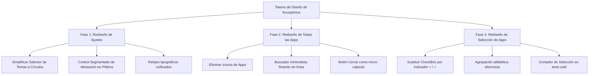

# Plan de Implementación: Rediseño Premium de GUI (Ajustes, Todas las Apps y Editar Lista)

Este plan detalla el **Roadmap y los Tokens de Diseño** necesarios para rediseñar por completo las tres pantallas secundarias de **focusphone**: **Ajustes** (`SettingsActivity`), **Todas las Apps** (`AllAppsActivity`) y **Selección de Apps** (`AppSelectActivity`). El objetivo es elevar la interfaz de usuario (GUI) actual de un estado básico (frecuentemente recargado y genérico) a una experiencia minimalista, limpia, espacial y de altísima calidad visual, inspirada en la estética premium de *Dumb Phone (iOS)* pero optimizada para las capacidades nativas de Android.

---

## 🎨 Principios y Tokens del Sistema de Diseño

Para erradicar la sobreestimulación visual y lograr coherencia monástica con la pantalla de inicio, aplicaremos las siguientes reglas estéticas:

1. **Tipografía Consistente**: Toda la interfaz debe adoptar la fuente activa del sistema ([FontPreferences](file:///d:/repositorios/android-projects/focusphone-app/focusphone-project/app/src/main/java/app/focusphone/data/preferences/FontPreferences.kt)). Fuera las fuentes predeterminadas del sistema de Google.
2. **Minúsculas Sistemáticas**: Continuar el uso radical de textos 100% en minúsculas (ej. `"appearance"`, `"launcher"`, `"choose your apps"`, `"done"`, `"back"`). Las mayúsculas son visualmente ruidosas.
3. **Respiración Espacial**: Aumentar los márgenes e introducir más aire (paddings generosos de `24dp` a `32dp`). El vacío es diseño.
4. **Eliminación de Iconos**: Quitar los iconos tradicionales multicolores de las aplicaciones. En su lugar, usar texto puro o, de ser necesarios, micro-iconos monocromáticos y desaturados de máximo `20dp` de tamaño para evitar descargas de dopamina.
5. **Fricción Elegante**: Transiciones suaves sin parpadeos visuales (`crossfade` sutil) y respuestas hápticas de teclado ante pulsaciones.

---

## 🗺️ Roadmap de Rediseño de Pantallas

---

### 🛠️ Fase 1: Rediseño de la Pantalla de Ajustes (`SettingsActivity`)
*Archivo actual:* [activity_settings.xml](file:///d:/repositorios/android-projects/focusphone-app/focusphone-project/app/src/main/res/layout/activity_settings.xml)

#### [MODIFY] [activity_settings.xml](file:///d:/repositorios/android-projects/focusphone-app/focusphone-project/app/src/main/res/layout/activity_settings.xml)
*   **Encabezado / Toolbar**:
    *   Reemplazar el botón "Atrás" textual gigante por una palabra sutil en minúsculas `"back"` con tipografía extra fina y un espaciado generoso.
    *   Centrar el título `"settings"` con un interlineado y espaciado entre letras elegante (`letterSpacing="0.08"`).
*   **Selector de Temas (Grid de Tarjetas Actual)**:
    *   *Antes:* Cuatro tarjetas gigantes y ruidosas (`FrameLayout` de `130dp` de alto) que intentan renderizar mockups de teléfonos.
    *   *Después:* Una fila horizontal limpia con 4 círculos de color sólido que representan la paleta cromática del tema, rodeados por un sutil borde activo de color de alto contraste al seleccionarse. El nombre del tema se renderiza debajo en minúsculas y letra pequeña.
*   **Selector Segmentado de Alineación**:
    *   Convertir el contenedor actual en una cápsula ("pill") ultra fina con esquinas completamente redondeadas.
    *   El elemento seleccionado se deslizará de forma sutil aplicando una opacidad limpia en lugar de un bloque rígido de color.
*   **Selector de Estilos de Reloj**:
    *   *Antes:* Bloques toscos que dicen `"thin"`, `"bold"`, etc.
    *   *Después:* Pequeños recuadros flotantes minimalistas sin bordes, con la previsualización del formato del reloj en minúsculas e hilo fino tipográfico.

---

### 🛠️ Fase 2: Rediseño de la Pantalla de "Todas las Apps" (`AllAppsActivity`)
*Archivos actuales:* [activity_all_apps.xml](file:///d:/repositorios/android-projects/focusphone-app/focusphone-project/app/src/main/res/layout/activity_all_apps.xml) e [item_all_app.xml](file:///d:/repositorios/android-projects/focusphone-app/focusphone-project/app/src/main/res/layout/item_all_app.xml)

#### [MODIFY] [activity_all_apps.xml](file:///d:/repositorios/android-projects/focusphone-app/focusphone-project/app/src/main/res/layout/activity_all_apps.xml)
*   **Caja de Búsqueda**:
    *   Eliminar la línea inferior de entrada (`divider_search`) que fragmenta el diseño.
    *   Crear un campo de texto `EditText` limpio con un sutil cursor de color y un placeholder `"search..."` en letra ultra-fina. El input flotará en el centro rodeado de amplio aire blanco.
*   **Lista de Aplicaciones (`RecyclerView`)**:
    *   Aumentar la separación vertical de cada item. El listado no debe sentirse apretado.

#### [MODIFY] [item_all_app.xml](file:///d:/repositorios/android-projects/focusphone-app/focusphone-project/app/src/main/res/layout/item_all_app.xml)
*   **Eliminación Radical de Iconos de Terceros**:
    *   *Antes:* Los iconos de Android multicolores saturan la pantalla y llaman la atención visual.
    *   *Después:* Ocultar o eliminar por completo el `ImageView` del icono de la app por defecto. La lista pasa a ser puramente tipográfica (texto en minúsculas, ej. `"messages"`, `"whatsapp"`, `"camera"`). Esto genera una sensación instantánea de tranquilidad y orden monástico.
    *   *(Opcional - Configurable):* Si se mantiene el icono, este se forzará a ser monocromático (escala de grises) y con una opacidad reducida del `30%`, activándose al `100%` solo bajo presión táctil.
*   **Botón de Cerrar**:
    *   Convertir el botón rígido inferior `@style/FocusPhone.ActionButton` en una cápsula flotante translúcida, o en una palabra `"close"` solitaria y elegante ubicada con amplio espacio en la zona inferior central de la pantalla.

---

### 🛠️ Fase 3: Rediseño de la Pantalla de "Editar Lista" (`AppSelectActivity`)
*Archivos actuales:* [activity_app_select.xml](file:///d:/repositorios/android-projects/focusphone-app/focusphone-project/app/src/main/res/layout/activity_app_select.xml) e [item_installed_app.xml](file:///d:/repositorios/android-projects/focusphone-app/focusphone-project/app/src/main/res/layout/item_installed_app.xml)

#### [MODIFY] [activity_app_select.xml](file:///d:/repositorios/android-projects/focusphone-app/focusphone-project/app/src/main/res/layout/activity_app_select.xml)
*   **Encabezado e Indicador de Límite**:
    *   Colocar el contador `"2 of 10 selected"` en una tipografía pequeña y sutil en minúsculas que actúe como un badge flotante silencioso, dándole un peso equilibrado al título.
*   **Organización Alfabética Silenciosa**:
    *   Insertar pequeños separadores de letra (ej. `"a"`, `"b"`, `"c"`) en minúsculas y tono gris muy tenue que dividan la lista al hacer scroll.

#### [MODIFY] [item_installed_app.xml](file:///d:/repositorios/android-projects/focusphone-app/focusphone-project/app/src/main/res/layout/item_installed_app.xml)
*   **Rediseño del Checkbox de Selección**:
    *   *Antes:* El `CheckBox` nativo de Android se ve anticuado y tosco.
    *   *Después:* Reemplazarlo por un indicador de texto simple y sutil alineado a la derecha:
        *   Si no está seleccionada, se muestra un signo más tipográfico tenue `+`.
        *   Si está seleccionada, se muestra la palabra `"selected"` en minúsculas y color de alto contraste del tema, o un micro-aspa `✓` fino.
    *   Esto elimina elementos visuales toscos de la interfaz y la unifica conceptualmente con una página de edición tipográfica.
*   **Eliminación de Iconos**:
    *   Mismo criterio que en Todas las Apps: texto alineado de forma impecable sin las distracciones cromáticas de los logos de las apps.

---

## 🧪 Plan de Verificación Estética y de UX

Una vez realizados los cambios en el código XML y Kotlin, validaremos la calidad visual de la siguiente manera:
1.  **Validación de Temas**: Comprobar que los nuevos círculos selectores y elementos dinámicos cambien correctamente de color al alternar entre *Slate*, *Off-White*, *Warm Beige* y *Navy*.
2.  **Validación de Altura Dinámica y Scroll**: Asegurar que las listas en Todas las Apps y Selección mantengan su rendimiento óptimo de desplazamiento (60/120 fps) y no sufran de parpadeos tipográficos.
3.  **Inspección Visual Comparativa**: Cotejar las capturas de pantalla de la aplicación rediseñada contra la UI minimalista de Dumb Phone para asegurar que la elegancia tipográfica y los espacios alcancen el nivel premium solicitado.
