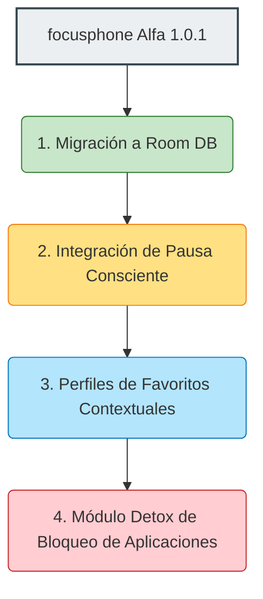

# Informe de Análisis Intensivo y Comparativo: focusphone vs. Dumb Phone

Este informe proporciona un análisis exhaustivo y en profundidad de la aplicación **focusphone** (Versión Alfa 1.0.1) para Android y la aplicación **Dumb Phone (dp)** para iOS (desarrollada por Michael Tigas en `dumbphone.so`). El documento detalla las filosofías de diseño, arquitecturas técnicas, diferencias estructurales, características comunes, oportunidades de mejora y viabilidad de desarrollo de nuevas funcionalidades para **focusphone**.

---

## 1. Filosofía del Proyecto y Enfoque de Minimalismo

Ambas aplicaciones surgen como respuesta a la crisis contemporánea de adicción al teléfono móvil y sobreestimulación cognitiva. Su propósito fundamental es **introducir fricción consciente** entre el usuario y las aplicaciones distractoras, convirtiendo el smartphone de un juguete de dopamina constante en una herramienta utilitaria pasiva.

```
+-----------------------------------------------------------------+
|                    FILOSOFÍA DE DISEÑO MINIMALISTA              |
|                                                                 |
|   1. Reducción del estímulo visual (sin iconos brillantes).     |
|   2. Limitación intencional de accesos directos (máx. 10 apps). |
|   3. Foco en la tipografía clara y el espaciado amplio.         |
|   4. Ausencia de contadores de notificaciones intrusivos.       |
+-----------------------------------------------------------------+
```

---

## 2. Análisis Técnico y Funcional de focusphone (Android v1.0.1 Alfa)

### 2.1 Arquitectura de Software y Código Fuente
**focusphone** está estructurado bajo principios de **Clean Architecture** y patrón **MVVM (Model-View-ViewModel)** escrito en **Kotlin**.
* **Capa de Presentación (`ui`)**: Dividida de forma modular en pantallas: `home`, `allapps`, `appselect`, `onboarding` y `settings`. Se utiliza **ViewBinding** para un enlace seguro y eficiente con las vistas XML convencionales.
* **Capa de Dominio (`domain`)**: Contiene lógica pura de negocio encapsulada en **Use Cases** (`GetFavouriteAppsUseCase`, `GetInstalledAppsUseCase`, `ToggleFavouriteAppUseCase`, `UpdateAppsOrderUseCase`) que aseguran la separación de responsabilidades.
* **Capa de Datos (`data`)**:
  * **Persistencia plana en SharedPreferences**: Utiliza una serialización personalizada mediante delimitadores de línea y barra vertical (`packageName|label|sortOrder`) dentro de [FavouriteAppsPreferences](file:///d:/repositorios/android-projects/focusphone-app/focusphone-project/app/src/main/java/app/focusphone/data/preferences/FavouriteAppsPreferences.kt) para evitar dependencias pesadas en la fase alfa. Una nota del desarrollador indica que se migrará a Room + KSP en la Fase 2.
  * **Configuración del Sistema**: Preferencias síncronas rápidas de tema ([ThemePreferences](file:///d:/repositorios/android-projects/focusphone-app/focusphone-project/app/src/main/java/app/focusphone/data/preferences/ThemePreferences.kt)) y tipografía ([FontPreferences](file:///d:/repositorios/android-projects/focusphone-app/focusphone-project/app/src/main/java/app/focusphone/data/preferences/FontPreferences.kt)).

### 2.2 Funcionalidades Clave Implementadas
1. **Lanzador de Sistema (Default Launcher)**: Reemplazo nativo de la pantalla de inicio del sistema Android mediante el filtrado de Intents `CATEGORY_HOME`.
2. **Lista Curada de Favoritos**: Límite estricto de **10 aplicaciones** en la pantalla de inicio (definido en [ToggleFavouriteAppUseCase](file:///d:/repositorios/android-projects/focusphone-app/focusphone-project/app/src/main/java/app/focusphone/domain/usecase/ToggleFavouriteAppUseCase.kt#L33)).
3. **Reordenación por Arrastre (Drag & Drop)**: Integración fluida en el `RecyclerView` utilizando `ItemTouchHelper` para reordenar la lista deslizando los elementos de manera vertical.
4. **Menú de Gestos (Drawer Lateral)**: Un panel oculto de ancho completo que se despliega deslizando el dedo hacia la izquierda o mediante interacción táctil, aplicando un efecto físico de empuje (`translationX` dinámico del Home) y sincronización de puntos indicadores. El menú aloja las opciones esenciales: *All Apps*, *Select Apps* y *Settings*.
5. **Estilos de Reloj Avanzados**: Ofrece cuatro estilos visuales sofisticados (Digital, Vertical/Stacked, Words ("nine o'clock"), Analógico dibujado a mano) o la opción de Ocultar, reajustando automáticamente las restricciones del layout para centrar verticalmente la lista de apps.
6. **Selector de Idioma In-App**: Soporte multilingüe integrado (Español, Inglés US/UK, Francés, Alemán) utilizando compatibilidad nativa de `AppCompatDelegate`.
7. **Control de Desinstalaciones**: Un detector automático integrado en `onResume` que comprueba si alguna app favorita fue eliminada del sistema operativo para purgarla de forma segura de las SharedPreferences.

---

## 3. Análisis Técnico y Funcional de Dumb Phone (iOS)

Dado que iOS prohíbe el reemplazo completo del launcher del sistema (SpringBoard), **Dumb Phone** (`dumbphone.so`) por Michael Tigas adopta un enfoque híbrido creativo basado en la infraestructura permitida por Apple.

### 3.1 Arquitectura e Integración en el OS
* **Widgets Interactivos**: Funciona principalmente mediante widgets en la pantalla de inicio (introducidos de forma interactiva en iOS 17) que actúan como listas de texto plano.
* **Integración con Atajos (Shortcuts)**: Al pulsar sobre un nombre de la lista, el widget activa una automatización o enlace de esquema URL personalizado para lanzar la aplicación final.
* **Sincronización con Modos de Concentración (Focus Modes)**: Permite que diferentes widgets o pantallas minimalistas se activen automáticamente dependiendo del contexto asignado (Trabajo, Ocio, Noche).
* **Control Center Widgets**: Proporciona acceso rápido desde el centro de control para rotar perfiles o lanzar el configurador.

### 3.2 Funcionalidades Clave de Dumb Phone
1. **Perfiles Contextuales**: Posibilidad de configurar múltiples "lanzadores" (Work Launcher, Home Launcher) que se alternan automáticamente según la hora del día o ubicación del usuario.
2. **Integración con Screen Time (Detox Mode)**: Bloqueo de aplicaciones distractoras basándose en la API nativa de Apple para límites familiares y escolares.
3. **Integración Estética Total**: Suministra fondos de pantalla con colores exactos que coinciden con los fondos de los widgets, camuflando los bordes del widget para crear la ilusión de una interfaz integrada (pantalla de tinta electrónica).
4. **Pausa Consciente (Mindful Pause)**: Exige un breve tiempo de espera (por ejemplo, respirar durante 5 segundos) antes de permitir el acceso a ciertas aplicaciones configuradas como "adictivas".

---

## 4. Diferencias Cruciales entre focusphone y Dumb Phone

| Criterio | focusphone (Android) | Dumb Phone (iOS) |
| :--- | :--- | :--- |
| **Nivel de Integración** | **Nativo y Completo**. Reemplaza el launcher del sistema por completo bloqueando el acceso al Home tradicional. | **Capa de Widgets (Overlay)**. Es una interfaz superpuesta mediante widgets, el Home de Apple sigue existiendo debajo. |
| **Fricción del Sistema** | **Total**. El usuario está obligado a pasar por el minimalismo de focusphone al presionar el botón de inicio. | **Parcial**. El usuario puede evadir el minimalismo deslizando a la biblioteca de apps tradicionales de iOS de forma sencilla. |
| **Lanzamiento de Aplicaciones** | **Instantáneo**. Mediante `Intent` directo a nivel de sistema operativo Android sin retardos. | **Intermediado**. Puede sufrir un parpadeo visual menor de redireccionamiento (vía URL Schemes / Shortcuts). |
| **Perfiles / Modos** | Único perfil de favoritos en la pantalla de inicio (máx. 10). | Perfiles contextuales dinámicos de aplicaciones que cambian automáticamente según el horario. |
| **Bloqueo / Filtro Parental** | No implementado en la v1.0.1. | Integrado nativamente con la API de Screen Time de iOS. |
| **Compatibilidad Estética** | Maneja dinámicamente alineación, fuentes descargables y temas del sistema dentro de su propia UI. | Requiere fondos de pantalla específicos proporcionados por la app para ocultar los bordes de los widgets. |

---

## 5. Características Comunes (Puntos de Encuentro)

1. **Alineación con el "Minimalismo Radical"**: Ambas aplicaciones erradican por completo los iconos visualmente llamativos e híper-diseñados de las corporaciones para neutralizar los impulsos reactivos.
2. **Listas Basadas en Texto**: El núcleo funcional es un listado vertical limpio en tipografía plana de peso variable.
3. **Curación de Favoritos**: Forzar al usuario a decidir activamente qué aplicaciones merecen estar en la pantalla de inicio, reduciendo el "piloto automático".
4. **Identidad de Paleta Apagada**: Temas suaves de bajo contraste (colores carbón, grises, beiges cálidos, azul marino apagado) idóneos para pantallas OLED que además reducen la fatiga visual.
5. **Retroalimentación Háptica Integrada**: Vibración precisa del teclado al interactuar con menús y elementos para mantener una sensación de fisicidad "premium".
6. **Tutorial / Onboarding Guiado**: Procesos iniciales diseñados para concienciar al usuario y ayudarle a configurar los ajustes necesarios del sistema.

---

## 6. Funcionalidades a Mejorar y Pulir en focusphone (v1.0.1 Alfa)

Tras la revisión exhaustiva del repositorio de **focusphone**, se identifican los siguientes puntos de fricción técnica y funcional que requieren refinamiento inmediato:

1. **Migración de Datos a Room Database (Fase 2)**:
   * *Problema*: La serialización manual con delimitador `|` en SharedPreferences es propensa a fallar si un usuario introduce un carácter de tubería (`|`) en el nombre de la etiqueta de la app, rompiendo la persistencia.
   * *Solución*: Migrar a SQLite mediante Room, permitiendo además una gestión de caché más rápida, robusta y escalable.
2. **Carga y Caché de Fuentes Descargables**:
   * *Problema*: El resolvedor dinámico de tipografías ([FontPreferences.kt](file:///d:/repositorios/android-projects/focusphone-app/focusphone-project/app/src/main/java/app/focusphone/data/preferences/FontPreferences.kt#L46)) descarga las fuentes de Google Fonts en caliente mediante `ResourcesCompat`. Si no hay conexión de datos en el primer arranque, la aplicación vuelve a la fuente del sistema de manera brusca.
   * *Solución*: Implementar precarga en el onboarding, almacenar en caché interna o empaquetar de forma estática los archivos `.ttf` esenciales en el directorio `res/font`.
3. **Mejorar el Comportamiento de "Ocultar Aplicación"**:
   * *Problema*: Desde el cajón "All Apps", cualquier aplicación sigue estando al alcance de un tap rápido, reduciendo el efecto de desintoxicación.
   * *Solución*: Implementar la capacidad de ocultar/bloquear por completo ciertas apps del cajón general bajo contraseña o PIN mental.
4. **Optimización del Desplazamiento en AllApps y Búsqueda**:
   * *Problema*: Al filtrar aplicaciones en el buscador de `AllAppsActivity`, la recreación instantánea de la lista no posee transiciones fluidas ni memoria de scroll.
   * *Solución*: Aplicar micro-animaciones usando `TransitionManager` o heredar mejores comportamientos dinámicos en el `DiffUtil` del adaptador.

---

## 7. Funcionalidades de Dumb Phone Compatibles con focusphone
*(Evaluación de portabilidad técnica hacia focusphone en Android)*

### 7.1 Perfiles Contextuales (Modos Trabajo / Ocio / Noche)
* **Descripción**: Cambiar automáticamente la lista de hasta 10 apps favoritas del Home según criterios temporales o ubicación del usuario.
* **Viabilidad**: **Muy Alta**. Android facilita enormemente el registro de alarmas persistentes (`AlarmManager`) o monitorización de geofencing.
* **Dificultad**: Media. Requiere diseñar una base de datos ampliada (Room) para almacenar listas de favoritos mapeadas con un ID de perfil.
* **Tiempo Estimado**: **4 a 5 días de desarrollo**.

### 7.2 Pausa Consciente (Mindful Pause)
* **Descripción**: Al hacer clic en aplicaciones configuradas como "altamente adictivas" (por ejemplo, Instagram o TikTok), se muestra un overlay a pantalla completa animando al usuario a respirar hondo durante 5 o 10 segundos antes de abrirla.
* **Viabilidad**: **Alta**. A diferencia de iOS, en Android se puede lanzar una actividad intermedia transparente u overlay sobre otras apps de manera nativa.
* **Dificultad**: Baja-Media.
* **Tiempo Estimado**: **2 a 3 días de desarrollo**.

### 7.3 Bloqueo de Aplicaciones con Detox Mode (App Blocker)
* **Descripción**: Impedir el lanzamiento de aplicaciones fuera de los límites de tiempo programados o forzar bloqueos estrictos temporales.
* **Viabilidad**: **Alta**. Utiliza la API nativa de Android de estadísticas de uso (`UsageStatsManager`) o servicios de accesibilidad para interceptar y bloquear.
* **Dificultad**: Alta. Requiere permisos delicados del sistema operativo Android (`PACKAGE_USAGE_STATS` y dibujo sobre otras aplicaciones).
* **Tiempo Estimado**: **7 a 10 días de desarrollo**.

### 7.4 Widgets de Utilidad Minimalista Integrados (Notas rápidas, Tareas del día)
* **Descripción**: Mostrar directamente en el Home de focusphone (arriba o abajo del listado de favoritos) pequeñas utilidades de texto interactivo como "Tareas pendientes de hoy" o un "Recordatorio rápido".
* **Viabilidad**: **Muy Alta**. Al ser un launcher nativo, se pueden incrustar layouts directamente sobre `ActivityHomeBinding`.
* **Dificultad**: Media.
* **Tiempo Estimado**: **5 a 7 días de desarrollo**.

---

## 8. Detalles Secundarios Importantes y Funcionalidades Necesarias

* **Copia de Seguridad y Restauración (Backup & Restore)**: El usuario minimalista cambia a menudo de dispositivo o restaura de fábrica. Contar con un exportador rápido en JSON o integración con la copia nativa en la nube de Google (`BackupAgent`) de SharedPreferences/Room es crucial.
* **Optimización de Consumo Energético (OLED Black)**: Asegurar que los fondos oscuros utilicen negro absoluto (`#000000`) en pantallas OLED, lo que apaga físicamente los píxeles y extiende drásticamente la batería del dispositivo.
* **Soporte de Accesibilidad (TalkBack / Contraste)**: Las interfaces que omiten iconos deben ser sumamente rigurosas con las descripciones de accesibilidad (`contentDescription`) y asegurar que los tamaños de fuente respondan correctamente a los ajustes globales del sistema del usuario sin romper los cálculos de altura dinámica de la lista (el fragmento de código que restringe el alto dinámico de favoritos a un máximo de `80dp`).

---

## 9. Parte Visual, Identidad y Diseño de Interfaz (UX/UI)

### 9.1 Identidad de Marca y Filosofía Visual
La identidad visual de **focusphone** destaca por su elegancia monástica. A diferencia de las interfaces llenas de sombras pesadas e iconografía ruidosa, esta aplicación reduce la interfaz a su mínima expresión semántica: la palabra escrita.

* **Tipografía**: La omisión intencional de iconos resalta la tipografía como único elemento de interacción y branding. El uso de fuentes como `Poppins` (moderna y geométrica) y `Space Mono` (técnica e industrial) establece un tono sofisticado de "máquina de escribir digital".
* **Minúsculas Sistemáticas**: Una de las decisiones creativas más potentes observadas en los recursos de focusphone (en [strings.xml](file:///d:/repositorios/android-projects/focusphone-app/focusphone-project/app/src/main/res/values/strings.xml)) es el uso deliberado de minúsculas sistemáticas en las cadenas de texto (ej. `"all apps"`, `"settings"`, `"hold an app to remove it from your list"`). Esto reduce la agresividad visual que denotan las mayúsculas tradicionales y transmite un aura de calma extrema.

```
  ┌────────────────────────────────────────┐
  │                 FOCUS                  │
  │               10:41 am                 │
  │             wednesday, 6               │
  │                                        │
  │         • phone                        │
  │         • messages                     │
  │         • maps                         │
  │         • camera                       │
  │         • spotify                      │
  │                                        │
  └────────────────────────────────────────┘
```

### 9.2 Diseño de GUI y UX (User Experience)
* **Efecto de Desplazamiento Físico (Push Effect)**: El comportamiento dinámico implementado en `HomeActivity` donde la pantalla de inicio se desliza horizontalmente hacia la izquierda al desplegar el drawer lateral, disminuyendo la opacidad y revelando el menú de control de ancho completo, es un pulido de animación que confiere una categoría "premium".
* **Espacio de Respiración Espacial**: El diseño emplea paddings generosos que simulan márgenes de editor de texto literario. El cálculo dinámico del tamaño de las celdas en el `RecyclerView` (calculando la altura disponible de la pantalla para dividirla proporcionalmente entre el número de favoritos activos) evita el solapamiento de textos y garantiza que el Home jamás se perciba congestionado.
* **Gama Cromática Armónica**: Los esquemas de temas pre-configurados tienen coeficientes de brillo idóneos:
  * **Slate** (`#20242C` a `#14161B` aprox.): Un gris pizarra ultramoderno y relajante.
  * **Off-White** (`#F7F7F7`): Inspirado en el papel de oficina o las pantallas de e-Ink tradicionales.
  * **Warm Beige** (`#EFEBE4`): Tonos cálidos y naturales que remiten a libros antiguos o lino.
  * **Navy** (`#0B132B`): Un azul profundo nocturno que promueve la desconexión del sueño.

---

## 10. Conclusiones y Hoja de Ruta Sugerida

Mientras que **Dumb Phone** en iOS ha pulido al máximo el uso creativo de las limitaciones del SpringBoard para ofrecer widgets dinámicos y perfiles contextuales, **focusphone** aprovecha la naturaleza abierta de Android para consolidar una experiencia de desintoxicación digital **totalmente inmersiva e ineludible**.

Para llevar la versión Alfa 1.0.1 de **focusphone** a un estándar de mercado de excelencia, se sugiere la siguiente priorización técnica:



*   **Paso 1 (Corto plazo - 3 días)**: Sustituir la persistencia plana de SharedPreferences por Room Database para prevenir la corrupción de favoritos.
*   **Paso 2 (Medio plazo - 4 días)**: Desarrollar la funcionalidad de *Pausa Consciente* para dotar al lanzador de un elemento diferenciador contra la gratificación instantánea.
*   **Paso 3 (Largo plazo - 10 días)**: Implementar *Perfiles Contextuales* y el *Módulo Detox* (Bloqueador de aplicaciones), permitiendo competir directamente con el arsenal funcional de Dumb Phone (iOS).
