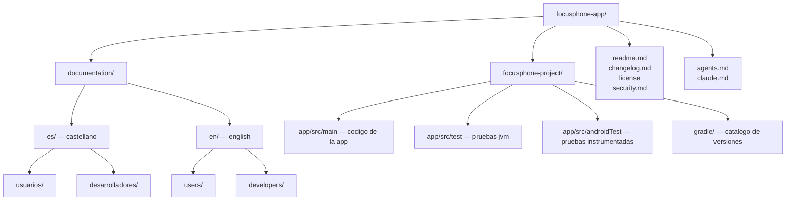

# DOCUMENTACION DE FOCUSPHONE

 

<strong>documentacion completa del lanzador minimalista focusphone</strong> 
<strong>complete documentation for the focusphone minimalist launcher</strong>

  

---

## IDIOMAS / LANGUAGES

<table>
<tr>
<td width="50%" valign="top" align="center">

### CASTELLANO

documentacion completa en español, para usuarios y para desarrolladores.

**[abrir la documentacion en castellano →](./es/README.md)**

</td>
<td width="50%" valign="top" align="center">

### ENGLISH

complete documentation in english, for users and for developers.

**[open the documentation in english →](./en/README.md)**

</td>
</tr>
</table>

---

## QUE VAS A ENCONTRAR AQUI

esta carpeta contiene dos documentaciones paralelas, una por idioma, y cada una
se divide en dos recorridos independientes:

<table>
<tr>
<th align="left" width="50%">para usuarios</th>
<th align="left" width="50%">para desarrolladores</th>
</tr>
<tr>
<td valign="top">

no hace falta ningun conocimiento tecnico. se explica que hace la app, como se
instala, como se usa cada gesto, como funcionan los bloqueos y que significa
cada ajuste.

- que es focusphone y para quien es
- instalacion y primeros pasos
- pantalla de inicio y gestos
- aplicaciones, favoritos y carpetas
- perfiles, detox y horarios
- pausa consciente
- personalizacion y apariencia
- notificaciones y widgets
- referencia completa de ajustes
- privacidad y permisos
- preguntas frecuentes

</td>
<td valign="top">

pensado para leer el codigo con contexto. se explica la arquitectura, cada capa,
el sistema de temas, el modelo de seguridad y el proceso de build.

- arquitectura general
- estructura del proyecto
- entorno y compilacion
- capa de datos
- capa de dominio
- capa de presentacion
- sistema de temas y color
- seguridad y cifrado
- servicios del sistema
- pruebas y calidad
- integracion continua y publicacion
- guia de contribucion

</td>
</tr>
</table>

---

## MAPA RAPIDO DEL PROYECTO

---

## CONVENCIONES DE ESTA DOCUMENTACION

<strong>reglas de formato aplicadas a todos los ficheros</strong>

 

| regla | detalle |
|---|---|
| idiomas | cada documento existe en castellano (`es/`) y en ingles (`en/`), con la misma numeracion y el mismo contenido |
| minusculas | todo el contenido esta escrito en minusculas |
| titulos | todos los titulos y encabezados van en mayusculas y sin acentos |
| identificadores | los nombres de clases, ficheros, rutas y comandos se escriben entre comillas invertidas y conservan su capitalizacion real, porque son codigo |
| tablas y diagramas | se usan tablas html y diagramas mermaid, que github renderiza de forma nativa |
| bloques plegables | los detalles largos van dentro de bloques `details` para no romper la lectura |

<strong>relacion con la documentacion existente del repositorio</strong>

 

| fichero | proposito | audiencia |
|---|---|---|
| `readme.md` (raiz) | presentacion publica del proyecto | visitantes del repositorio |
| `changelog.md` | historial de cambios por version, bilingue | usuarios y desarrolladores |
| `agents.md` / `claude.md` | guia operativa para agentes de ia y para el flujo de commits, pr y releases | agentes y mantenedores |
| `documentation/` | documentacion funcional y tecnica completa | usuarios finales y desarrolladores |

`documentation/` no sustituye a `agents.md`: aquel describe **como se trabaja** en el
repositorio, y este describe **que es y como funciona** el producto.

---

focusphone — desarrollado por <a href="https://rezzt.dev"><b>rezzt.dev</b></a>

