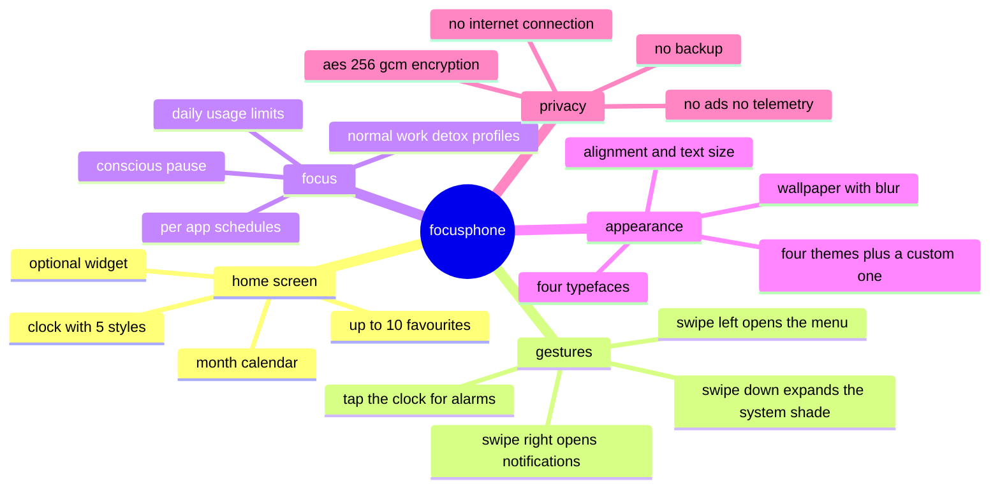

# FOCUSPHONE DOCUMENTATION — ENGLISH

 

<strong>focusphone is a minimalist android launcher that replaces your home screen 
with a list of text: a clock, a calendar and only the apps you actually use.</strong>

 

---

## WHERE TO START

<table>
<tr>
<td width="50%" valign="top">

### I AM A USER

i just installed focusphone, or i want to know what it does before installing it.
i do not need to know how to code.

**start here →** [what is focusphone](./users/01-what-is-focusphone.md)

the shortest path to a working setup:

1. [what is focusphone](./users/01-what-is-focusphone.md)
2. [installation and first steps](./users/02-installation-and-first-steps.md)
3. [home screen and gestures](./users/03-home-screen-and-gestures.md)
4. [apps and folders](./users/04-apps-and-folders.md)

</td>
<td width="50%" valign="top">

### I AM A DEVELOPER

i want to read the code, understand the design decisions, or contribute to the
project.

**start here →** [architecture](./developers/01-architecture.md)

the shortest path to getting oriented:

1. [architecture](./developers/01-architecture.md)
2. [project structure](./developers/02-project-structure.md)
3. [environment and build](./developers/03-environment-and-build.md)
4. [contributing](./developers/12-contributing.md)

</td>
</tr>
</table>

---

## INDEX FOR USERS

| # | document | what it covers |
|---|---|---|
| 01 | [what is focusphone](./users/01-what-is-focusphone.md) | the idea behind the project, who it is for, what it does and what it does not do |
| 02 | [installation and first steps](./users/02-installation-and-first-steps.md) | requirements, installing the apk, setting it as the default launcher and finishing onboarding |
| 03 | [home screen and gestures](./users/03-home-screen-and-gestures.md) | what is on the home screen and what every gesture does |
| 04 | [apps and folders](./users/04-apps-and-folders.md) | picking favourites, the app drawer, searching, renaming, folders and uninstalling |
| 05 | [profiles and detox](./users/05-profiles-and-detox.md) | the normal, work and detox profiles, password locking and real system-level blocking |
| 06 | [app schedules](./users/06-app-schedules.md) | per-app time windows, weekday selection and daily usage limits |
| 07 | [conscious pause](./users/07-conscious-pause.md) | the breathing countdown before an app opens, and how to configure it |
| 08 | [customization](./users/08-customization.md) | themes, custom colours, fonts, text size, clocks, wallpaper and layout |
| 09 | [notifications and widgets](./users/09-notifications-and-widgets.md) | the side notification panel, the swipe-down gesture and the home screen widget |
| 10 | [settings reference](./users/10-settings-reference.md) | every settings screen, option by option |
| 11 | [privacy and permissions](./users/11-privacy-and-permissions.md) | which permissions it asks for, why, and what data it stores and where |
| 12 | [faq](./users/12-faq.md) | common questions and problems, with their answers |

---

## INDEX FOR DEVELOPERS

| # | document | what it covers |
|---|---|---|
| 01 | [architecture](./developers/01-architecture.md) | layers, data flow, manual dependency injection and key decisions |
| 02 | [project structure](./developers/02-project-structure.md) | folder map and the responsibility of every package |
| 03 | [environment and build](./developers/03-environment-and-build.md) | requirements, gradle, version catalog, build variants and signing |
| 04 | [data layer](./developers/04-data-layer.md) | room, synchronous preferences, repositories and migrations |
| 05 | [domain layer](./developers/05-domain-layer.md) | models, use cases and pure utilities |
| 06 | [presentation layer](./developers/06-presentation-layer.md) | activities, viewmodels, adapters and ui patterns |
| 07 | [theming system](./developers/07-theming-system.md) | `FocusPalette`, `FocusColors`, `SurfaceScrim`, wcag contrast and wallpapers |
| 08 | [security](./developers/08-security.md) | encryption at rest, password hashing, attempt policy and attack surface |
| 09 | [system services](./developers/09-system-services.md) | accessibility service, notification listener and usage accounting |
| 10 | [testing and quality](./developers/10-testing-and-quality.md) | unit tests, instrumented tests, test doubles and lint |
| 11 | [ci and release](./developers/11-ci-and-release.md) | the github actions workflow, versioning and the release process |
| 12 | [contributing](./developers/12-contributing.md) | branches, commit format, pull requests and code style |

---

## THE WHOLE PROJECT ON ONE PAGE

---

<a href="../README.md">← back to the general index</a> · <a href="../es/README.md">version en castellano</a>

