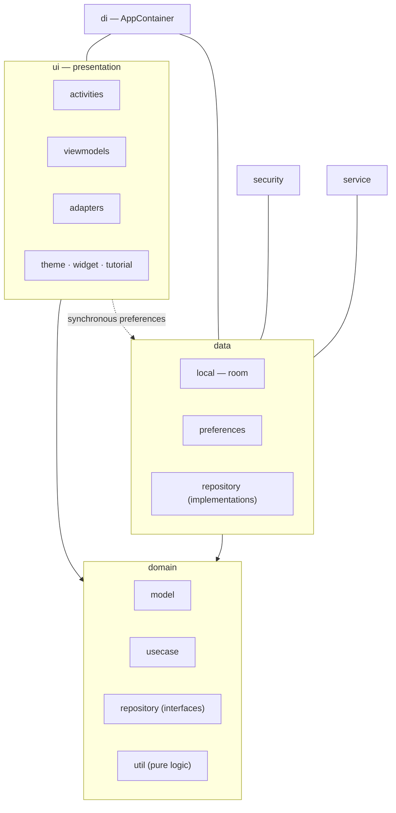
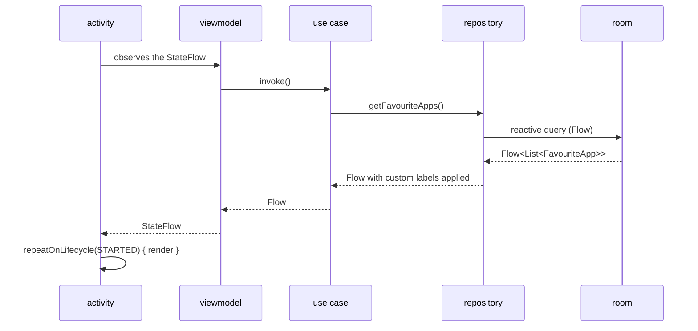

<div align="center">

# ARCHITECTURE

<sub><a href="../README.md">index</a> · <a href="../../es/desarrolladores/01-arquitectura.md">castellano</a> · next: <a href="./02-project-structure.md">project structure</a></sub>

</div>

---

## OVERVIEW

focusphone is a **single-module** android application (`:app`), written entirely in kotlin,
following a **lightweight clean architecture** with three layers and the **mvvm** pattern in
the presentation layer.

| property | value |
|---|---|
| modules | one: `:app` |
| package | `app.focusphone` |
| language | kotlin |
| min sdk | 24 |
| target and compile sdk | 36 |
| java compatibility | 11 |
| agp | 9.3.0 |
| daemon toolchain | jdk 21 |
| ui | xml views with view binding; **no** compose |
| asynchrony | kotlin coroutines, `StateFlow` and `SharedFlow` |

---

## THE THREE LAYERS



<table>
<tr>
<th align="left" width="20%">layer</th>
<th align="left" width="40%">responsibility</th>
<th align="left" width="40%">depends on</th>
</tr>
<tr>
<td><code>domain</code></td>
<td>business models, use cases, repository interfaces and pure testable logic</td>
<td>nothing from the android framework in its pure part (<code>util</code>, <code>model</code>, <code>usecase</code>)</td>
</tr>
<tr>
<td><code>data</code></td>
<td>persistence: room for favourites, synchronous preferences for everything else, and repository implementations</td>
<td><code>domain</code> and the android framework</td>
</tr>
<tr>
<td><code>ui</code></td>
<td>activities, viewmodels, adapters, the theming system and custom views</td>
<td><code>domain</code>, and <code>data</code> only for synchronous preferences</td>
</tr>
</table>

> the `ui → data` dependency for preferences is deliberate and bounded: the `*Preferences`
> objects are synchronous and are read where a coroutine does not fit, such as
> `attachBaseContext` or a touch event handler. every other data access goes through use
> cases.

---

## MANUAL DEPENDENCY INJECTION

neither hilt nor dagger is used. the dependency graph is a class, `AppContainer`, exposed
lazily by the `Application`.

```kotlin
// FocusPhoneApp.kt
open class FocusPhoneApp : Application() {
    open val container: AppContainer by lazy { AppContainer(this, applicationScope) }
    val applicationScope = CoroutineScope(SupervisorJob() + Dispatchers.IO)
}
```

<details open>
<summary><strong>what is inside <code>AppContainer</code></strong></summary>

<br>

| group | members |
|---|---|
| data | `customAppLabelsPreferences`, `appFolderPreferences`, the room database |
| repositories | `appRepository`, `favouriteAppRepository` |
| use cases | `getInstalledAppsUseCase`, `getFavouriteAppsUseCase`, `toggleFavouriteAppUseCase`, `removeFavouriteAppUseCase`, `updateAppsOrderUseCase`, `getAppShortcutsUseCase` |

every member is `by lazy` except the repositories, which are built in the constructor because
they support substitution.

</details>

<details open>
<summary><strong>why not hilt</strong></summary>

<br>

the decision is documented in the code: hilt is avoided in this phase because of annotation
processing compatibility issues with agp 9.x. the intention is to migrate once a compatible
version exists.

**until then, do not introduce hilt or dagger** without first resolving that
incompatibility.

</details>

<details open>
<summary><strong>how test doubles are injected</strong></summary>

<br>

`AppContainer` takes two optional constructor parameters:

```kotlin
class AppContainer(
    context: Context,
    private val applicationScope: CoroutineScope,
    appRepositoryOverride: AppRepository? = null,
    favouriteAppRepositoryOverride: FavouriteAppRepository? = null
)
```

instrumented tests use `TestFocusPhoneApp` and `TestRunner` to swap repositories **before**
any activity starts. the container is only rebuilt when a double is swapped, mirroring
production.

</details>

---

## DATA FLOW



the general rule in the ui:

```kotlin
lifecycleScope.launch {
    repeatOnLifecycle(Lifecycle.State.STARTED) {
        viewModel.favourites.collect { render(it) }
    }
}
```

---

## KEY ARCHITECTURAL DECISIONS

<details open>
<summary><strong>1 · synchronous preferences instead of datastore</strong></summary>

<br>

theme and typeface must be read **before** `setContentView`, inside
`BaseActivity.attachBaseContext()` and `onCreate()`. datastore is async by design, and with
it the screen flashes unstyled for a frame. that is why every `*Preferences` object is
synchronous over `SharedPreferences`.

room is used only for favourites, where reactivity is actually wanted.

</details>

<details open>
<summary><strong>2 · no icons on the home screen</strong></summary>

<br>

the home screen shows text labels only. omitting icons is a product decision, not a technical
limitation: icons are the main visual pull the app is trying to remove.

</details>

<details open>
<summary><strong>3 · profile-based blocking</strong></summary>

<br>

| profile | behaviour |
|---|---|
| normal | blocks nothing |
| work | blocks the marked apps plus the ones matching the editable keywords |
| detox | blocks everything except focusphone; needs a password to leave early and reverts on its own when the timer expires |

the blocking decision lives in `ProfilePreferences.isAppBlockedPure`, a pure function tested
without android.

</details>

<details open>
<summary><strong>4 · schedule-based blocking, independent of profiles</strong></summary>

<br>

any app can carry an `AppScheduleRule` with a time window, weekdays and a daily limit. it is
evaluated **in addition to** the active profile, so a device in the normal profile still
enforces it.

the decision lives in `AppScheduleEvaluator`, free of android dependencies, which is why it
is exhaustively unit tested. every in-app launch path calls
`BaseActivity.enforceAppSchedule()`; `FocusAccessibilityService` covers launches that bypass
focusphone.

</details>

<details open>
<summary><strong>5 · colour is resolved at runtime, never by attribute</strong></summary>

<br>

colour always comes from `FocusPalette.of(context)` (or `BaseActivity.palette` /
`effectivePalette`). **never** from `Theme.resolveAttribute(attr, tv, true).data`, which
yields a resource id instead of a colour whenever the attribute points at a `ColorStateList`,
and which knows nothing about the custom theme.

full detail in [theming system](./07-theming-system.md).

</details>

<details open>
<summary><strong>6 · automatic theme without <code>values-night</code></strong></summary>

<br>

there is no `values-night/` folder. light/dark is resolved manually: `THEME_AUTO` maps to
`THEME_SLATE` when the system is in night mode and to `THEME_OFF_WHITE` otherwise.
`BaseActivity` tracks the **effective** resolved theme, so `onResume()` detects the system
change and recreates.

</details>

<details open>
<summary><strong>7 · migration from sharedpreferences to room</strong></summary>

<br>

`FavouriteAppRepositoryImpl.migrateFromSharedPreferences()` runs once on init: it converts the
old pipe-delimited string format into room entities and then deletes the old key.

</details>

<details open>
<summary><strong>8 · typed results for encrypted storage failures</strong></summary>

<br>

`EncryptedPrefs.read()` distinguishes four states: `Absent`, `Present`, `Unavailable` (the
keystore key is temporarily unusable) and `Lost` (the payload can never be decrypted).
writers of user-authored lists **refuse to run** while a value is `Unavailable`, because
writing would replace the real data with whatever was built from the empty fallback.

</details>

---

## ENTRY POINTS

| entry point | class | when it acts |
|---|---|---|
| application | `FocusPhoneApp` | on process creation: migrates legacy keys, starts `PackageChangeMonitor` and expires detox if needed |
| home screen | `HomeActivity` | `HOME` / `DEFAULT` / `LAUNCHER` intent filter with `android:priority="1"` |
| accessibility service | `FocusAccessibilityService` | optional; intercepts system window state changes |
| notification listener | `FocusNotificationService` | optional; feeds the side notification panel |

---

## CROSS-CUTTING COMPONENTS

| component | location | purpose |
|---|---|---|
| `BaseActivity` | `ui/base` | theme, wallpaper, scrim, typeface, insets, transitions, dialogs and locks |
| `AppContainer` | `di` | dependency graph |
| `EncryptedPrefs` / `SecureStorageHelper` | `security` | aes-256/gcm encryption at rest |
| `PasswordHasher` / `PasswordAttemptPolicy` | `security` | pbkdf2 hashing and the shared attempt policy |
| `FocusPalette` / `FocusColors` / `SurfaceScrim` | `ui/theme` | runtime colour, wcag contrast and the adaptive scrim |
| `PackageChangeMonitor` | `data/repository` | process-wide signal for installed-app changes |

---

<div align="center">

<sub><a href="../README.md">← index</a> · <a href="./02-project-structure.md">project structure →</a></sub>

</div>
