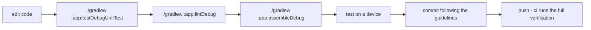

<div align="center">

# ENVIRONMENT AND BUILD

<sub><a href="../README.md">index</a> · <a href="../../es/desarrolladores/03-entorno-y-compilacion.md">castellano</a> · previous: <a href="./02-project-structure.md">project structure</a> · next: <a href="./04-data-layer.md">data layer</a></sub>

</div>

---

## REQUIREMENTS

| requirement | value | note |
|---|---|---|
| jdk | **21** | selected by the daemon toolchain criterion, never a machine-specific path |
| android studio | a version compatible with agp 9.3.0 | |
| android sdk | api 36 installed | `compileSdk` and `targetSdk` |
| gradle | the versioned wrapper | always use `./gradlew`, never a system gradle |

> the gradle wrapper jar **is versioned** in the repository, and the ci action validates it
> against the official checksums.

<details>
<summary><strong>how the jdk is chosen</strong></summary>

<br>

the gradle daemon runs on a jdk 21 selected through `gradle/gradle-daemon-jvm.properties`. to
regenerate that file:

```bash
./gradlew updateDaemonJvm --jvm-version=21
```

**do not reintroduce `org.gradle.java.home`**: it pins a concrete path on a concrete machine
and breaks the build everywhere else, ci included.

</details>

---

## FIRST BUILD

```bash
git clone https://github.com/rezzt-dev/focusphone-app.git
cd focusphone-app/focusphone-project
./gradlew :app:assembleDebug
```

the apk lands in `app/build/outputs/apk/debug/`.

---

## GRADLE COMMANDS

all of them run from `focusphone-project/`.

| command | what it does |
|---|---|
| `./gradlew :app:assembleDebug` | debug apk |
| `./gradlew :app:assembleRelease` | release apk, minified with shrunk resources |
| `./gradlew :app:testDebugUnitTest` | jvm unit tests |
| `./gradlew :app:connectedDebugAndroidTest` | instrumented tests on a device or emulator |
| `./gradlew :app:lintDebug` | static analysis; must finish with **0 errors** |
| `./gradlew clean` | clears build outputs |

<details>
<summary><strong>the full verification, exactly as ci runs it</strong></summary>

<br>

```bash
./gradlew :app:testDebugUnitTest :app:lintDebug :app:assembleRelease --stacktrace
```

this is precisely what the github actions workflow runs on every push and every pull request.

</details>

---

## MODULE CONFIGURATION

```kotlin
android {
    namespace  = "app.focusphone"
    compileSdk { version = release(36) { minorApiLevel = 1 } }

    defaultConfig {
        applicationId = "app.focusphone"
        minSdk        = 24
        targetSdk     = 36
        versionCode   = 3
        versionName   = "1.0.6"
        testInstrumentationRunner = "app.focusphone.TestRunner"
    }

    buildFeatures {
        viewBinding = true
        buildConfig = true
    }

    compileOptions {
        sourceCompatibility = JavaVersion.VERSION_11
        targetCompatibility = JavaVersion.VERSION_11
    }
}
```

| key | value | why |
|---|---|---|
| `viewBinding` | enabled | every screen uses `ActivityXxxBinding.inflate(layoutInflater)` |
| `buildConfig` | enabled | `BuildConfig` is read at runtime |
| `testInstrumentationRunner` | `app.focusphone.TestRunner` | a custom runner that allows repository substitution |
| `unitTests.isIncludeAndroidResources` | enabled | robolectric tests inflate real layouts, so they need the merged resources |

> `versionCode` and `versionName` stay in sync with the release branch (`alfa-X.Y.Z`), and
> `versionCode` **must be bumped on every published build**: the *about* screen shows
> `versionName` to the user.

---

## BUILD VARIANTS

<table>
<tr>
<th align="left" width="20%">variant</th>
<th align="left" width="80%">characteristics</th>
</tr>
<tr>
<td><strong>debug</strong></td>
<td>not minified, debuggable, signed with the debug key</td>
</tr>
<tr>
<td><strong>release</strong></td>
<td><code>isMinifyEnabled = true</code>, <code>isShrinkResources = true</code>, rules from <code>proguard-rules.pro</code> on top of <code>proguard-android-optimize.txt</code>, lint-vital enabled</td>
</tr>
</table>

---

## RELEASE SIGNING

the signing configuration is **conditional**: it only activates if the matching properties
exist.

```kotlin
signingConfigs {
    create("release") {
        val releaseStoreFile = findProperty("RELEASE_STORE_FILE") as String?
        if (releaseStoreFile != null) {
            storeFile     = file(releaseStoreFile)
            storePassword = findProperty("RELEASE_STORE_PASSWORD") as String
            keyAlias      = findProperty("RELEASE_KEY_ALIAS") as String
            keyPassword   = findProperty("RELEASE_KEY_PASSWORD") as String
        }
    }
}
```

| property | contents |
|---|---|
| `RELEASE_STORE_FILE` | path to the keystore |
| `RELEASE_STORE_PASSWORD` | keystore password |
| `RELEASE_KEY_ALIAS` | key alias |
| `RELEASE_KEY_PASSWORD` | key password |

they are defined in `gradle.properties` (outside version control) or as project properties.
**without them, the release build still assembles, unsigned**, which is exactly what ci does.

---

## VERSION CATALOG

every dependency is declared in `gradle/libs.versions.toml`. **do not add literal coordinates
in `build.gradle.kts`.**

<details open>
<summary><strong>main dependencies</strong></summary>

<br>

| group | library | version |
|---|---|---|
| build | android gradle plugin | 9.3.0 |
| androidx | core-ktx | 1.18.0 |
| androidx | appcompat | 1.8.0 |
| androidx | activity-ktx | 1.13.0 |
| androidx | fragment-ktx | 1.9.0 |
| androidx | constraintlayout | 2.2.2 |
| androidx | recyclerview | 1.4.0 |
| androidx | viewpager2 | 1.1.0 |
| androidx | lifecycle (viewmodel, livedata, runtime) | 2.11.0 |
| kotlinx | coroutines (core, android, test) | 1.11.0 |
| google | material | 1.14.0 |
| androidx | room (runtime, ktx, compiler) | 2.8.5 |

</details>

<details open>
<summary><strong>test dependencies</strong></summary>

<br>

| scope | library | version |
|---|---|---|
| jvm | junit | 4.13.2 |
| jvm | mockk | 1.14.11 |
| jvm | robolectric | 4.17 |
| jvm | turbine | 1.2.1 |
| jvm | kotlinx-coroutines-test | 1.11.0 |
| instrumented | androidx.test.ext junit | 1.3.0 |
| instrumented | espresso core and contrib | 3.7.0 |
| instrumented | androidx.test core, runner, rules | 1.7.0 |

</details>

> **room uses `kapt`**, not ksp, because the project is on agp 9.x. the plugin is declared as
> `com.android.legacy-kapt`.

---

## LINT

```kotlin
lint {
    checkReleaseBuilds = true
    abortOnError       = true
}
```

- lint also runs on release builds, and **any error fails the build**
- **there is no lint baseline**, on purpose: every error has been fixed at the source, and the
  remaining warnings are tracked findings in the project's technical audit
- when a new error appears, it gets fixed; it does not get added to a baseline

<details>
<summary><strong>lint failing on windows because of file locks</strong></summary>

<br>

if android studio holds a lock on the lint cache jars, the build fails with a
`FileSystemException`. the fix is to run the build from a terminal with the ide closed,
**not** to disable `checkReleaseBuilds`.

</details>

---

## OUTPUTS AND IGNORED FILES

| path | version control |
|---|---|
| `focusphone-project/gradle/wrapper/gradle-wrapper.jar` | **versioned** (explicit exception in `.gitignore`) |
| `app/release/` | ignored |
| `app/build/`, `.gradle/`, `.kotlin/` | ignored |
| `local.properties` | ignored: it contains local sdk paths |
| `.docs/` | ignored: working documentation and agent skills |

---

## WORKING CYCLE SUMMARY



---

<div align="center">

<sub><a href="./02-project-structure.md">← project structure</a> · <a href="../README.md">index</a> · <a href="./04-data-layer.md">data layer →</a></sub>

</div>
