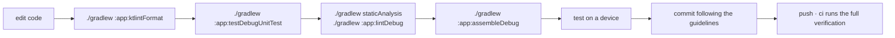

<div align="center">

# ENVIRONMENT AND BUILD

<sub><a href="../README.md">index</a> · <a href="../../es/desarrolladores/03-entorno-y-compilacion.md">castellano</a> · previous: <a href="./02-project-structure.md">project structure</a> · next: <a href="./04-data-layer.md">data layer</a></sub>

</div>

---

## REQUIREMENTS

| requirement | value | note |
|---|---|---|
| jdk | **21** | selected by the daemon toolchain criterion, never a machine-specific path |
| android studio | a version compatible with agp 9.3.0 | |
| android sdk | api 36 installed | `compileSdk` and `targetSdk` |
| gradle | the versioned wrapper | always use `./gradlew`, never a system gradle |

> the gradle wrapper jar **is versioned** in the repository, and the ci action validates it
> against the official checksums.

<details>
<summary><strong>how the jdk is chosen</strong></summary>

<br>

the gradle daemon runs on a jdk 21 selected through `gradle/gradle-daemon-jvm.properties`. to
regenerate that file:

```bash
./gradlew updateDaemonJvm --jvm-version=21
```

**do not reintroduce `org.gradle.java.home`**: it pins a concrete path on a concrete machine
and breaks the build everywhere else, ci included.

</details>

---

## FIRST BUILD

```bash
git clone https://github.com/rezzt-dev/focusphone-app.git
cd focusphone-app/focusphone-project
./gradlew :app:assembleDebug
```

the apk lands in `app/build/outputs/apk/debug/`.

---

## GRADLE COMMANDS

all of them run from `focusphone-project/`.

| command | what it does |
|---|---|
| `./gradlew :app:assembleDebug` | debug apk |
| `./gradlew :app:assembleRelease` | release apk, minified with shrunk resources |
| `./gradlew :app:testDebugUnitTest` | jvm unit tests |
| `./gradlew :app:connectedDebugAndroidTest` | instrumented tests on a device or emulator |
| `./gradlew :app:lintDebug` | android lint; must finish with **0 errors** |
| `./gradlew staticAnalysis` | ktlint + detekt; must finish with **0 findings** |
| `./gradlew :app:ktlintFormat` | autofixes every formatting violation ktlint can fix on its own |
| `./gradlew clean` | clears build outputs |

<details>
<summary><strong>the full verification, exactly as ci runs it</strong></summary>

<br>

```bash
./gradlew staticAnalysis --continue --stacktrace
./gradlew :app:testDebugUnitTest :app:lintDebug :app:assembleRelease --stacktrace
```

this is precisely what the github actions workflow runs on every push and every pull request.
style comes first because it needs no compilation and fails in seconds, so a misplaced brace
never waits for r8 to finish.

</details>

---

## MODULE CONFIGURATION

```kotlin
android {
    namespace  = "app.focusphone"
    compileSdk { version = release(36) { minorApiLevel = 1 } }

    defaultConfig {
        applicationId = "app.focusphone"
        minSdk        = 24
        targetSdk     = 36
        versionCode   = 3
        versionName   = "1.0.6"
        testInstrumentationRunner = "app.focusphone.TestRunner"
    }

    buildFeatures {
        viewBinding = true
        buildConfig = true
    }

    compileOptions {
        sourceCompatibility = JavaVersion.VERSION_11
        targetCompatibility = JavaVersion.VERSION_11
    }
}
```

| key | value | why |
|---|---|---|
| `viewBinding` | enabled | every screen uses `ActivityXxxBinding.inflate(layoutInflater)` |
| `buildConfig` | enabled | `BuildConfig` is read at runtime |
| `testInstrumentationRunner` | `app.focusphone.TestRunner` | a custom runner that allows repository substitution |
| `unitTests.isIncludeAndroidResources` | enabled | robolectric tests inflate real layouts, so they need the merged resources |

> `versionCode` and `versionName` stay in sync with the release branch (`alfa-X.Y.Z`), and
> `versionCode` **must be bumped on every published build**: the *about* screen shows
> `versionName` to the user.

---

## BUILD VARIANTS

<table>
<tr>
<th align="left" width="20%">variant</th>
<th align="left" width="80%">characteristics</th>
</tr>
<tr>
<td><strong>debug</strong></td>
<td>not minified, debuggable, signed with the debug key</td>
</tr>
<tr>
<td><strong>release</strong></td>
<td><code>isMinifyEnabled = true</code>, <code>isShrinkResources = true</code>, rules from <code>proguard-rules.pro</code> on top of <code>proguard-android-optimize.txt</code>, lint-vital enabled</td>
</tr>
</table>

---

## RELEASE SIGNING

the signing configuration is **conditional**: it only activates if the matching properties
exist.

```kotlin
signingConfigs {
    create("release") {
        val releaseStoreFile = findProperty("RELEASE_STORE_FILE") as String?
        if (releaseStoreFile != null) {
            storeFile     = file(releaseStoreFile)
            storePassword = findProperty("RELEASE_STORE_PASSWORD") as String
            keyAlias      = findProperty("RELEASE_KEY_ALIAS") as String
            keyPassword   = findProperty("RELEASE_KEY_PASSWORD") as String
        }
    }
}
```

| property | contents |
|---|---|
| `RELEASE_STORE_FILE` | path to the keystore |
| `RELEASE_STORE_PASSWORD` | keystore password |
| `RELEASE_KEY_ALIAS` | key alias |
| `RELEASE_KEY_PASSWORD` | key password |

they are defined in `gradle.properties` (outside version control) or as project properties.
**without them, the release build still assembles, unsigned**, which is exactly what ci does.

---

## VERSION CATALOG

every dependency is declared in `gradle/libs.versions.toml`. **do not add literal coordinates
in `build.gradle.kts`.**

<details open>
<summary><strong>main dependencies</strong></summary>

<br>

| group | library | version |
|---|---|---|
| build | android gradle plugin | 9.3.0 |
| androidx | core-ktx | 1.18.0 |
| androidx | appcompat | 1.8.0 |
| androidx | activity-ktx | 1.13.0 |
| androidx | fragment-ktx | 1.9.0 |
| androidx | constraintlayout | 2.2.2 |
| androidx | recyclerview | 1.4.0 |
| androidx | viewpager2 | 1.1.0 |
| androidx | lifecycle (viewmodel, livedata, runtime) | 2.11.0 |
| kotlinx | coroutines (core, android, test) | 1.11.0 |
| google | material | 1.14.0 |
| androidx | room (runtime, ktx, compiler) | 2.8.5 |

</details>

<details open>
<summary><strong>test dependencies</strong></summary>

<br>

| scope | library | version |
|---|---|---|
| jvm | junit | 4.13.2 |
| jvm | mockk | 1.14.11 |
| jvm | robolectric | 4.17 |
| jvm | turbine | 1.2.1 |
| jvm | kotlinx-coroutines-test | 1.11.0 |
| instrumented | androidx.test.ext junit | 1.3.0 |
| instrumented | espresso core and contrib | 3.7.0 |
| instrumented | androidx.test core, runner, rules | 1.7.0 |

</details>

> **room uses `kapt`**, not ksp, because the project is on agp 9.x. the plugin is declared as
> `com.android.legacy-kapt`.

---

## MANUAL DEPENDENCY UPDATES

no bot ever bumps `gradle/libs.versions.toml`. dependabot and renovate are disabled for the
whole repository and **every version change is made by hand**, in a commit that carries the
verification for that bump.

| file | role |
|---|---|
| `.github/dependabot.yml` | declares the `gradle` and `github-actions` ecosystems with `open-pull-requests-limit: 0`, which disables version-update pull requests |
| `renovate.json` | `"enabled": false` plus `"ignorePaths": ["**/*"]`, so installing the renovate app on the repository or the organisation opens nothing |
| `.github/workflows/dependency-policy.yml` | fails any pull request authored by `dependabot[bot]` / `renovate[bot]`, or coming from a `dependabot/*` / `renovate/*` branch |

<details open>
<summary><strong>why updates are manual here</strong></summary>

<br>

- the catalog is pinned to a working combination, not to the newest of everything: `agp` sits
  at 9.3.0 to stay compatible with the current android studio, and room runs on `kapt`
  (`com.android.legacy-kapt`) precisely because of that agp line
- a bump can be green in ci and still break the launcher at runtime, where the accessibility
  service, the widget host and the encrypted preferences live
- a bot pull request splits one decision across many pull requests and leaves the changelog
  entry to be written afterwards, against the flow described in `11-ci-and-release.md`

</details>

<details open>
<summary><strong>how to update a dependency</strong></summary>

<br>

1. edit the version in the `[versions]` block of `gradle/libs.versions.toml` — never the
   literal coordinates in `build.gradle.kts`
2. run the full verification: `./gradlew :app:testDebugUnitTest :app:lintDebug :app:assembleRelease`
3. run the instrumented tests on a real device when the bump touches ui, room or the system
   services
4. add one line to `## SIN PUBLICAR / UNRELEASED` in `changelog.md`, in both languages, naming
   the library and the new version
5. commit with the `changes` prefix, since a bump is tooling, not a feature

</details>

> if a dependency bot pull request ever shows up, **close it**: do not merge it and do not
> bypass the guard. the fix is to turn the integration off in the repository settings, not to
> override the check.

---

## STATIC ANALYSIS

three tools cover three different things, and **none of them has a baseline file**: a finding
is fixed at the source, or the rule is switched off in config with the reason written next
to it.

| tool | covers | config | task |
|---|---|---|---|
| android lint | android/api correctness, resources, manifest | `app/build.gradle.kts`, `lint { }` | `:app:lintDebug` |
| **ktlint** `1.8.0` | kotlin formatting | `.editorconfig` (repository root) | `:app:ktlintCheck` / `:app:ktlintFormat` |
| **detekt** `1.23.8` | kotlin code smells and complexity | `config/detekt/detekt.yml` | `:app:detekt` |

`./gradlew staticAnalysis` is a root task that runs ktlint and detekt over every module; it is
what ci runs.

### KTLINT

formatting is **enforced, not conventional**. everything ktlint checks comes from
`.editorconfig` at the repository root, which the ide reads too — so *reformat code* in android
studio and `ktlintFormat` cannot drift apart:

- 4-space indent, lf endings, utf-8, final newline, no trailing whitespace
- **140-column limit**
- no wildcard imports, imports in lexicographic order
- **no trailing commas** (`ij_kotlin_allow_trailing_comma*` are `false`)
- style `intellij_idea`, the same formatter `kotlin.code.style=official` already selects for
  the ide

five rules are switched off on purpose, each with its reason in `.editorconfig`:
`function-signature`, `class-signature`, `argument-list-wrapping` and `multiline-if-else`
(where a signature or an argument list breaks is an authored readability decision, not
something to re-flow because it would fit on one line), plus `no-multi-spaces` (the codebase
aligns assignments into columns, `versionCode   = 3`).

the ktlint *engine* is pinned in the version catalog (`ktlint`) separately from its gradle
plugin (`ktlintGradle`), so the formatter never moves on its own and rewrites files that ci
previously accepted.

### DETEKT

`buildUponDefaultConfig = true`, so `config/detekt/detekt.yml` records only the **deviations**
from detekt's defaults. never paste the full default config into it: new rules from an upgrade
would be silently dropped. `config.validation = true` makes a rule name that no longer exists
fail the build instead of being quietly ignored.

the deviations that matter:

| setting | why |
|---|---|
| `LongMethod` 130, `CyclomaticComplexMethod` 40, `LargeClass` 1800, `NestedBlockDepth` 5 | set just above the worst case in `main` today, so they work as a **ratchet**: today's screens are tolerated, nothing may grow past them. lower them when a screen is split; never raise them to silence a new finding |
| `TooGenericExceptionCaught` off | a launcher is the process the user falls back to when everything else dies; it must survive whatever `PackageManager`, `LauncherApps` or an oem system service throws |
| `SwallowedException` on | the counterweight to the above: every `catch` must log, rethrow, or name its binding `_` / `ignored` / `expected` to say the exception is dropped on purpose |
| `MagicNumber` off | layout maths, colour channels and timing constants are unavoidably numeric in an android ui codebase |
| `TooManyFunctions` 30 | the `*Preferences` objects are flat façades over `SharedPreferences`: one getter and one setter per key is what makes them readable |
| `formatting` ruleset **not** added | detekt bundles a copy of the ktlint rules; running both engines reports every formatting issue twice and they can disagree after an upgrade. formatting belongs to ktlint alone |

### ANDROID LINT

```kotlin
lint {
    checkReleaseBuilds = true
    abortOnError       = true
}
```

- lint also runs on release builds, and **any error fails the build**
- **there is no lint baseline**, on purpose: every error has been fixed at the source, and the
  remaining warnings are tracked findings in the project's technical audit
- when a new error appears, it gets fixed; it does not get added to a baseline

<details>
<summary><strong>lint failing on windows because of file locks</strong></summary>

<br>

if android studio holds a lock on the lint cache jars, the build fails with a
`FileSystemException`. the fix is to run the build from a terminal with the ide closed,
**not** to disable `checkReleaseBuilds`.

</details>

---

## OUTPUTS AND IGNORED FILES

| path | version control |
|---|---|
| `focusphone-project/gradle/wrapper/gradle-wrapper.jar` | **versioned** (explicit exception in `.gitignore`) |
| `app/release/` | ignored |
| `app/build/`, `.gradle/`, `.kotlin/` | ignored |
| `local.properties` | ignored: it contains local sdk paths |
| `.docs/` | ignored: working documentation and agent skills |
| `.editorconfig`, `config/detekt/detekt.yml` | **versioned**: they are the static analysis contract |

---

## WORKING CYCLE SUMMARY



---

<div align="center">

<sub><a href="./02-project-structure.md">← project structure</a> · <a href="../README.md">index</a> · <a href="./04-data-layer.md">data layer →</a></sub>

</div>
