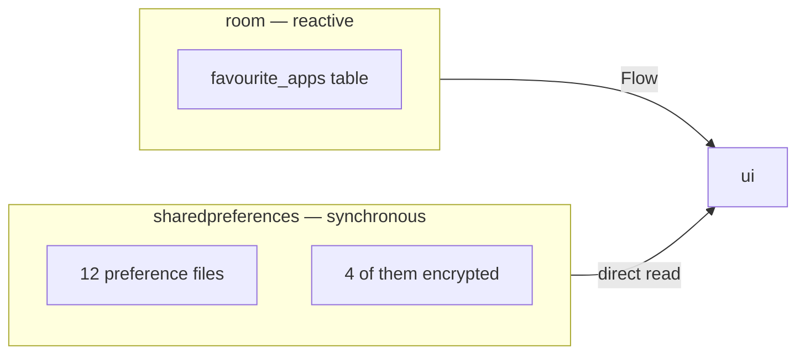

<div align="center">

# DATA LAYER

<sub><a href="../README.md">index</a> · <a href="../../es/desarrolladores/04-capa-de-datos.md">castellano</a> · previous: <a href="./03-environment-and-build.md">environment and build</a> · next: <a href="./05-domain-layer.md">domain layer</a></sub>

</div>

---

## TWO PERSISTENCE MECHANISMS



| mechanism | used for | why |
|---|---|---|
| **room** | favourite apps | it needs reactive queries: the home screen redraws itself when the list changes |
| **sharedpreferences** | absolutely everything else | it must be read **synchronously**, before `setContentView` or inside a touch handler |

> **datastore is ruled out** deliberately: its api is async, and the theme has to be applied
> before the first view exists, or the screen flashes unstyled.

---

## ROOM

### THE ENTITY

```kotlin
@Entity(tableName = "favourite_apps")
data class FavouriteApp(
    @PrimaryKey val packageName: String,
    val label: String,
    val sortOrder: Int = 0
)
```

### THE DATABASE

```kotlin
@Database(entities = [FavouriteApp::class], version = 1, exportSchema = false)
abstract class AppDatabase : RoomDatabase()
```

- singleton with double-checked locking under `synchronized`
- file: `focusphone_database`
- `fallbackToDestructiveMigration(true)`: acceptable because the user can re-select
  favourites, and only while the project is in early development

> when changing the schema: **bump the version and add a migration**, or consciously accept
> the current destructive migration.

### THE DAO

<table>
<tr><th align="left" width="34%">method</th><th align="left" width="66%">detail</th></tr>
<tr><td><code>observeAll()</code></td><td><code>Flow</code> ordered by <code>sortOrder</code>: the reactive source for the home screen</td></tr>
<tr><td><code>getAll()</code>, <code>count()</code>, <code>exists()</code></td><td>one-off <code>suspend</code> queries</td></tr>
<tr><td><code>insert()</code>, <code>insertAll()</code></td><td>insert with <code>OnConflictStrategy.REPLACE</code></td></tr>
<tr><td><code>delete()</code></td><td>delete by package</td></tr>
<tr><td><code>deleteAndReorder()</code></td><td><strong>transaction</strong>: deletes and recompacts <code>sortOrder</code> with no gaps</td></tr>
<tr><td><code>applyOrder()</code></td><td><strong>transaction</strong>: rewrites only <code>sortOrder</code>, using <code>FavouriteOrdering.merge</code>; it <strong>never deletes a row</strong></td></tr>
<tr><td><code>insertIfNotExists()</code></td><td><strong>transaction</strong>: inserts assigning the next free <code>sortOrder</code></td></tr>
</table>

<details>
<summary><strong>why <code>applyOrder</code> cannot lose favourites</strong></summary>

<br>

reordering is expressed as a **merge**, not a replacement: the requested order comes first,
and every stored favourite the request did not mention keeps its relative position after it.
that way, a list built from a partial view (for example only the visible rows) cannot delete
anything.

the rule lives in `domain/util/FavouriteOrdering.kt` and is covered by unit tests.

</details>

---

## REPOSITORIES

<details open>
<summary><strong><code>FavouriteAppRepositoryImpl</code></strong></summary>

<br>

it combines room with the custom labels:

```kotlin
override fun observeFavourites(): Flow<List<FavouriteApp>> =
    combine(dao.observeAll(), customLabels.labelsFlow) { list, labels ->
        list.map { app ->
            val custom = labels[app.packageName]
            if (custom != null) app.copy(label = custom.normalizeAppName())
            else app.copy(label = app.label.normalizeAppName())
        }
    }
```

it also runs the legacy migration **once**, in `init`:

| migration step | detail |
|---|---|
| source | file `focusphone_favourites`, key `apps`, rows `package\|label\|order` separated by newlines |
| validation | the package name must contain a dot and be 255 characters or shorter |
| filtering | focusphone's own package is excluded |
| deduplication | `distinctBy { packageName }` |
| cap | `MAX_FAVOURITES` is applied **on write**, not on read |
| cleanup | the old key is removed after inserting |

> the cap is applied on write on purpose: truncating on read hid stored favourites from every
> screen, and the next reorder — built from the truncated list — deleted them.

</details>

<details open>
<summary><strong><code>AppRepositoryImpl</code></strong></summary>

<br>

it queries launchable apps through `PackageManager`, which is expensive because every label
has to be loaded.

| aspect | behaviour |
|---|---|
| cache | brief, holding **system** labels only |
| custom labels | applied **on every read**, never cached: a rename is visible immediately |
| invalidation | the cache is dropped as soon as `PackageChangeMonitor` reports an install, uninstall or update |

</details>

<details open>
<summary><strong><code>NotificationRepository</code></strong></summary>

<br>

a list of active notifications held **in ram only**. when the process dies the list is
cleared and repopulated on the next `FocusNotificationService` connection. content is never
written to disk.

</details>

<details open>
<summary><strong><code>PackageChangeMonitor</code></strong></summary>

<br>

a process-wide signal: its `version` increases on every install, uninstall, update or
enable/disable. caches compare their stored version against the current one to tell whether
they are stale, and open screens reload.

</details>

---

## THE PREFERENCES

twelve objects, each with its own `SharedPreferences` file. four of them encrypted.

<table>
<tr>
<th align="left" width="28%">object</th>
<th align="left" width="26%">file</th>
<th align="left" width="12%">encrypted</th>
<th align="left" width="34%">contents</th>
</tr>
<tr><td><code>ThemePreferences</code></td><td><code>focusphone_theme</code></td><td>no</td><td>theme, custom colours, alignment, status bar, onboarding completed</td></tr>
<tr><td><code>FontPreferences</code></td><td><code>focusphone_prefs</code></td><td>no</td><td>typeface, clock type and size, app text size and home text size (`home_font_size_pt`, which follows the app size until set), both 8-24 pt, default 14</td></tr>
<tr><td><code>HomeGridPreferences</code></td><td><code>focusphone_home_grid</code></td><td>no</td><td>the grid size and one line per block (clock, favourites, widgets with their id, provider and cells); on first run it reads and then clears the pre-grid <code>focusphone_home_layout</code> order and <code>focusphone_widget</code> widget</td></tr>
<tr><td><code>HomeLayoutPreferences</code></td><td><code>focusphone_home_layout</code></td><td>no</td><td>app spacing and the clock type to restore after hiding it</td></tr>
<tr><td><code>LibraryWidgetPreferences</code></td><td><code>focusphone_widget_library</code> · <code>focusphone_widget_library_secure</code></td><td>the intention, yes</td><td>world clock cities per widget id and the style signature (plain); the intention text (encrypted)</td></tr>
<tr><td><code>WallpaperPreferences</code></td><td><code>focusphone_wallpaper</code></td><td>no</td><td>per-surface uris, shared mode, blur and intensity, legibility (default 60)</td></tr>
<tr><td><code>GesturePreferences</code></td><td><code>focusphone_gestures</code></td><td>no</td><td>swipe-down gesture</td></tr>
<tr><td><code>NotificationPanelPreferences</code></td><td><code>focusphone_notification_panel</code></td><td>no</td><td>side panel enablement</td></tr>
<tr><td><code>ConsciousPausePreferences</code></td><td><code>focusphone_conscious_pause</code></td><td>no</td><td>enablement and duration (3-10 s)</td></tr>
<tr><td><code>TutorialPreferences</code></td><td><code>focusphone_tutorial</code></td><td>no</td><td>tutorial completed and current step</td></tr>
<tr><td><code>ProfilePreferences</code></td><td><code>focusphone_profile</code></td><td><strong>yes</strong></td><td>profile, detox end, password hash, blocked apps, keywords, attempt counter</td></tr>
<tr><td><code>CustomAppLabelsPreferences</code></td><td><code>focusphone_custom_labels</code></td><td><strong>yes</strong></td><td>custom labels per package</td></tr>
<tr><td><code>AppFolderPreferences</code></td><td>its own file</td><td><strong>yes</strong></td><td>drawer folders and their expanded state</td></tr>
<tr><td><code>AppSchedulePreferences</code></td><td><code>focusphone_schedule</code></td><td><strong>yes</strong></td><td>rules, password, current day's usage counters</td></tr>
</table>

### THE COMMON PATTERN

```kotlin
object XxxPreferences {
    private const val PREF_FILE = "focusphone_xxx"
    private const val KEY_THING  = "thing"

    private fun prefs(context: Context) =
        context.getSharedPreferences(PREF_FILE, Context.MODE_PRIVATE)

    fun getThing(context: Context): T = ...
    fun setThing(context: Context, value: T) = ...
}
```

they are `object`s, not classes, except the ones that need observable state
(`CustomAppLabelsPreferences`, `AppFolderPreferences`), which are instantiated from
`AppContainer` and expose `StateFlow`s.

---

## ENCRYPTED PREFERENCES

the four sensitive preference stores go through `EncryptedPrefs`, which in turn uses
`SecureStorageHelper` (aes-256/gcm with an android keystore key).

`EncryptedPrefs.read()` returns a **typed result**:

<table>
<tr><th align="left" width="20%">state</th><th align="left" width="45%">meaning</th><th align="left" width="35%">how a writer must react</th></tr>
<tr><td><code>Absent</code></td><td>nothing is stored</td><td>write normally</td></tr>
<tr><td><code>Present</code></td><td>value read correctly</td><td>write normally</td></tr>
<tr><td><code>Unavailable</code></td><td>the keystore key cannot be used <strong>right now</strong></td><td><strong>must refuse to write</strong>: writing would replace the real data with the empty fallback</td></tr>
<tr><td><code>Lost</code></td><td>the payload can <strong>never</strong> be decrypted</td><td>treated as absent, so the user can rebuild their data</td></tr>
</table>

this is the pattern `AppFolderPreferences`, `AppSchedulePreferences` and `ProfilePreferences`
apply: while the state is `Unavailable`, the ui shows an empty list **and every write is
refused**.

### LEGACY PLAIN-TEXT DETECTION

`CustomAppLabelsPreferences` recognises old plain-text values **by their shape**, with
`SecureStorageHelper.looksEncrypted`, never by a failed decryption.

> when the keystore key is lost, a real encrypted value also fails to decrypt. treating it as
> plain text would re-encrypt the ciphertext and corrupt the label forever. unreadable values
> are left untouched on disk and the system label is shown instead.

---

## WALLPAPER STORAGE

`ui/wallpaper/WallpaperStorage.kt` manages the images:

| rule | reason |
|---|---|
| the image is **copied** into `filesDir/wallpapers`, downscaled and exif-rotated | the photo picker grant dies with the process, so a `content://` uri must never be stored |
| preferences store the copy's `file://` uri | it survives restarts |
| assigning or removing an image goes **only** through `WallpaperPreferences.assignWallpaper`, inside `WallpaperStorage.replace` / `update` | those methods delete the copies no preference refers to any more |
| shared mode is switched **only** with `WallpaperPreferences.setSharedMode` | it seeds the shared slot from the image on screen and hands each surface its own back when turned off |

---

## RULES WHEN TOUCHING THIS LAYER

| rule | reason |
|---|---|
| do not make a preference asynchronous | they are read before `setContentView` and inside touch handlers |
| do not read encrypted preferences in a hot loop without caching | decrypting aes on every event causes anrs; the service caches its state |
| do not treat `Unavailable` as an empty list | it overwrites the user's real data |
| enforce caps **on write**, not on read | truncating on read hides data and the next save deletes it |
| add a new key to its own `*Preferences`, not to someone else's | every file owns a clear domain |

---

<div align="center">

<sub><a href="./03-environment-and-build.md">← environment and build</a> · <a href="../README.md">index</a> · <a href="./05-domain-layer.md">domain layer →</a></sub>

</div>
