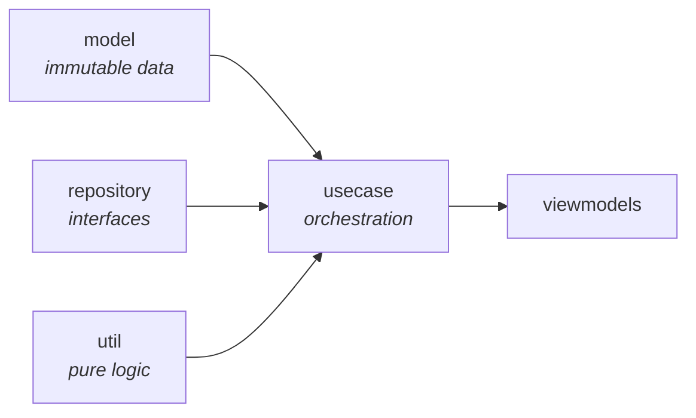

<div align="center">

# DOMAIN LAYER

<sub><a href="../README.md">index</a> · <a href="../../es/desarrolladores/05-capa-de-dominio.md">castellano</a> · previous: <a href="./04-data-layer.md">data layer</a> · next: <a href="./06-presentation-layer.md">presentation layer</a></sub>

</div>

---

## PRINCIPLE

the `domain` package holds the **business rules**, and its critical part is written as
**pure functions with no android dependencies**. the reason is direct: focusphone's most
delicate decisions are *is this app blocked?* and *what order are the favourites in?*, and
both must be exhaustively testable on the jvm, without an emulator.



---

## MODELS

<table>
<tr><th align="left" width="26%">model</th><th align="left" width="74%">contents</th></tr>
<tr><td><code>AppInfo</code></td><td>an installed app. <code>icon</code> is nullable on purpose, so it is not loaded when it is not needed (the home screen shows no icons)</td></tr>
<tr><td><code>AppShortcut</code></td><td>a shortcut obtained through <code>LauncherApps</code>: dynamic, manifest-declared or pinned</td></tr>
<tr><td><code>AppFolder</code></td><td>a drawer folder. <code>packageNames</code> keeps insertion order only as a persistence detail: the ui always re-sorts by label</td></tr>
<tr><td><code>AppFont</code></td><td>typeface enum: <code>SYSTEM</code>, <code>POPPINS</code>, <code>COMFORTAA</code>, <code>JETBRAINS</code></td></tr>
<tr><td><code>ClockType</code></td><td>clock enum: <code>DIGITAL</code>, <code>STACKED</code>, <code>WORDS</code>, <code>ANALOG</code>, <code>HIDDEN</code>, each with its preview label</td></tr>
<tr><td><code>ToggleResult</code></td><td>result of toggling a favourite: <code>Added</code>, <code>Removed</code> or <code>LimitReached</code></td></tr>
<tr><td><code>AppScheduleRule</code></td><td>an app's schedule rule</td></tr>
<tr><td><code>ScheduleBlockReason</code></td><td>a sealed class carrying the block reason and the data needed to explain it</td></tr>
</table>

### `AppScheduleRule` IN DETAIL

```kotlin
data class AppScheduleRule(
    val packageName: String,
    val windowEnabled: Boolean = false,
    val startMinute: Int = DEFAULT_START_MINUTE,   // 9 * 60
    val endMinute: Int = DEFAULT_END_MINUTE,       // 18 * 60
    val days: Set<Int> = ALL_DAYS,
    val dailyLimitMinutes: Int = 0
)
```

| convention | detail |
|---|---|
| time unit | minutes since local midnight, `0..1439`; 9:30 is `570` |
| window wrapping past midnight | `startMinute > endMinute`, for example `22:00 → 06:00` |
| all-day window | `startMinute == endMinute` |
| days | `Calendar.DAY_OF_WEEK` values, sunday = 1 … saturday = 7 |
| empty day set | interpreted as *every day* |
| `isActive` | `windowEnabled || dailyLimitMinutes > 0`; an inactive rule is dropped when persisted |

---

## REPOSITORY INTERFACES

| interface | contract |
|---|---|
| `AppRepository` | the installed-apps list; the implementation uses `PackageManager` and persists nothing |
| `FavouriteAppRepository` | favourites crud; changes are emitted reactively through `Flow` |

the `domain` layer defines these interfaces and the `data` layer implements them: the
dependency direction always points at the domain.

---

## USE CASES

<table>
<tr><th align="left" width="32%">use case</th><th align="left" width="68%">responsibility</th></tr>
<tr>
<td><code>GetInstalledAppsUseCase</code></td>
<td>lists installed apps marking which ones are favourites</td>
</tr>
<tr>
<td><code>GetFavouriteAppsUseCase</code></td>
<td>observes the favourites. it does <strong>not</strong> apply the cap of 10: the cap is enforced where favourites are written, because truncating on read hid stored favourites and the next reorder deleted them</td>
</tr>
<tr>
<td><code>ToggleFavouriteAppUseCase</code></td>
<td>toggles a favourite. returns <code>ToggleResult.LimitReached</code> when trying to go beyond <code>MAX_FAVOURITES = 10</code></td>
</tr>
<tr>
<td><code>RemoveFavouriteAppUseCase</code></td>
<td>removes a favourite. <strong>use this, not the toggle</strong>, when the intent is removal: a toggle adds the app back when it is no longer a favourite, which let overlapping clean-ups of uninstalled apps re-insert them</td>
</tr>
<tr>
<td><code>UpdateAppsOrderUseCase</code></td>
<td>persists a new order. <strong>only the order changes</strong>: a list that omits favourites leaves them in place, after the reordered ones</td>
</tr>
<tr>
<td><code>GetAppShortcutsUseCase</code></td>
<td>shortcuts via <code>LauncherApps</code>. returns an empty list if the api is below 25, if focusphone is not the default launcher, if the app declares none, or if the call throws <code>SecurityException</code></td>
</tr>
</table>

---

## PURE UTILITIES

this is the most important part of the package: **no android, no `Context`, fully
testable**.

<details open>
<summary><strong><code>AppScheduleEvaluator</code> — the schedule blocking decision</strong></summary>

<br>

```kotlin
fun evaluate(
    rule: AppScheduleRule,
    minuteOfDay: Int,
    dayOfWeek: Int,
    usedMinutesToday: Int
): ScheduleBlockReason?
```

returns `null` when the app may be used, and the reason when it may not.

the check order is: inactive rule → no block; outside the window → `OutsideWindow`; limit
reached → `DailyLimitReached`.

**window rules** (`isWithinWindow`):

| case | behaviour |
|---|---|
| `start == end` | the window covers the whole selected day |
| `start < end` | **half-open** interval `[start, end)`: a 09:00-18:00 window blocks at exactly 18:00 |
| `start > end` | the window wraps past midnight and **belongs to the day it starts on**: with 22:00 → 06:00 enabled only on friday, 02:00 on saturday is still allowed because it is the tail of friday |
| empty `days` | equivalent to `ALL_DAYS` |

the same object owns the **serialization**, one line per rule:

```
packageName|windowEnabled|startMinute|endMinute|day,day,…|dailyLimitMinutes
```

`parse()` returns `null` for malformed input, so a single corrupted line can be skipped
without discarding the whole rule set. values are clamped to their valid range on parse.

</details>

<details open>
<summary><strong><code>FavouriteOrdering</code> — reordering without losing anything</strong></summary>

<br>

```kotlin
fun merge(current: List<String>, requested: List<String>): List<String> {
    val known = current.toSet()
    val head = requested.filter { it in known }.distinct()
    val headSet = head.toSet()
    return head + current.filterNot { it in headSet }
}
```

- unknown or repeated packages in `requested` are ignored
- every package in `current` appears **exactly once** in the result
- therefore, reordering **cannot delete** a favourite

</details>

<details open>
<summary><strong><code>FuzzyMatcher</code> — the drawer search</strong></summary>

<br>

subsequence search with scoring:

| rule | value |
|---|---|
| matched character | +1 |
| consecutive-character bonus | +3 |
| match requirement | every query character must appear, in order |
| empty query | always matches |

examples: `fb` finds *facebook*, `yt` finds *youtube*, `zzz` does not find *facebook*. the
cost is `O(|query| × |target|)` in the worst case, but in practice closer to `O(|target|)`
because the inner loop advances monotonically.

</details>

<details open>
<summary><strong><code>TextExtensions</code> — normalization</strong></summary>

<br>

two functions with different purposes:

| function | what it does | why |
|---|---|---|
| `normalizeAppName()` | lowercases the name and **keeps diacritics** | in the supported locales (es, fr, de) diacritics are spelling, not decoration: stripping them turned `teléfono` into `telefono` and `Übersetzer` into `ubersetzer` |
| `normalizeForSearch()` | lowercases **and** removes diacritics | so the query `telefono` still finds *teléfono* |

</details>

<details open>
<summary><strong><code>AppFolderSerializer</code> — folder persistence</strong></summary>

<br>

one folder per line:

```
id|name|package1,package2,…
```

`sanitizeName()` strips the separators from the name **on the way in**, so a name can never
break the format. alphabetical order is applied on read, because folders store no manual
order.

</details>

---

## RULES WHEN TOUCHING THIS LAYER

| rule | reason |
|---|---|
| decision logic goes in `util`, not in the activity or the service | it is the only way to cover it with jvm tests |
| no `import android.*` in `model`, `usecase` or `util` | keeps the layer testable without an emulator |
| every new blocking rule needs edge-case tests | midnight, day rollover, empty sets, corrupted input |
| models are immutable (`data class` with `val`) | avoids inconsistent intermediate states in flows |
| a use case orchestrates, it does not compute | computation lives in `util`, data access in `data` |

---

<div align="center">

<sub><a href="./04-data-layer.md">← data layer</a> · <a href="../README.md">index</a> · <a href="./06-presentation-layer.md">presentation layer →</a></sub>

</div>
