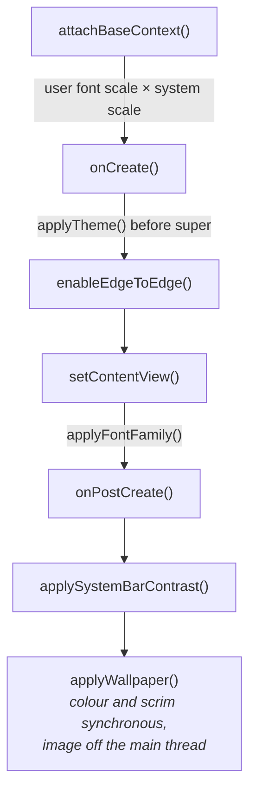

<div align="center">

# PRESENTATION LAYER

<sub><a href="../README.md">index</a> · <a href="../../es/desarrolladores/06-capa-de-presentacion.md">castellano</a> · previous: <a href="./05-domain-layer.md">domain layer</a> · next: <a href="./07-theming-system.md">theming system</a></sub>

</div>

---

## TECHNOLOGY

| aspect | choice |
|---|---|
| view system | **xml with view binding**; jetpack compose is not used |
| pattern | mvvm with `ViewModel` and `StateFlow` / `SharedFlow` |
| lists | `RecyclerView` with custom adapters |
| dialogs | `MaterialAlertDialogBuilder` with the app's own dialog theme |
| transitions | a consistent fade defined in `res/anim/fp_fade_in.xml` and `fp_fade_out.xml` |

---

## `BaseActivity`, THE CORE OF THE UI

**every** activity extends `BaseActivity`. it concentrates the cross-cutting work so no
screen has to repeat it.



<table>
<tr><th align="left" width="30%">responsibility</th><th align="left" width="70%">detail</th></tr>
<tr>
<td>theme</td>
<td><code>applyTheme()</code> runs <strong>before</strong> <code>super.onCreate</code>: it resolves the effective theme, remembers the custom colours and clears the palette cache</td>
</tr>
<tr>
<td>font scale</td>
<td><code>attachBaseContext()</code> multiplies the system scale by the user's and clamps it to <code>0.5f..2.0f</code></td>
</tr>
<tr>
<td>typeface</td>
<td><code>applyFontFamily()</code> runs on every <code>setContentView</code>; it preserves hierarchy: a weight above 450 counts as emphasised, so <code>sans-serif-medium</code> is not flattened to regular</td>
</tr>
<tr>
<td>edge to edge</td>
<td>transparent bars and manual inset application on every screen</td>
</tr>
<tr>
<td>wallpaper and scrim</td>
<td><code>applyWallpaper()</code> can be called on a live screen: it settles background, scrim and colours in place</td>
</tr>
<tr>
<td>recolouring</td>
<td><code>colorizeViewTree()</code> only repaints backgrounds drawn in a theme colour and <strong>remembers each view's colour role</strong>, so it is safe to run repeatedly</td>
</tr>
<tr>
<td>transitions</td>
<td><code>startActivity()</code> and <code>finish()</code> apply the same fade</td>
</tr>
<tr>
<td>dialogs</td>
<td><code>trackDialog</code>, <code>showExclusiveDialog</code>, <code>showStyledDialog</code>, <code>styleMaterialDialog</code> and <code>applyDialogSurface</code></td>
</tr>
<tr>
<td>locks</td>
<td><code>showDetoxUnlockDialog</code>, cooldown and remaining-attempt messages, and <code>enforceAppSchedule()</code></td>
</tr>
<tr>
<td>system changes</td>
<td><code>onResume()</code> detects changes in effective theme, scale or family and calls <code>recreate()</code></td>
</tr>
</table>

<details>
<summary><strong>two traps documented in the code</strong></summary>

<br>

| trap | rule |
|---|---|
| window insets | use `updatePadding(top = …)`, **never** `setPadding(0, …, 0, 0)`: the second form silently erases the padding declared in xml |
| colours | use `FocusPalette.of(context)`, **never** `Theme.resolveAttribute(attr, tv, true).data`: it yields a resource id when the attribute points at a `ColorStateList`, and it knows nothing about the custom theme |

</details>

---

## VIEWMODEL PATTERN

```kotlin
class HomeViewModel(
    getFavouriteApps: GetFavouriteAppsUseCase,
    private val removeFavouriteApp: RemoveFavouriteAppUseCase,
    private val updateAppsOrder: UpdateAppsOrderUseCase
) : ViewModel() {

    val favouriteApps: StateFlow<List<FavouriteApp>> = getFavouriteApps()
        .stateIn(
            scope        = viewModelScope,
            started      = SharingStarted.WhileSubscribed(5_000),
            initialValue = emptyList()
        )

    companion object {
        fun factory(app: FocusPhoneApp): ViewModelProvider.Factory = /* … */
    }
}
```

fixed conventions:

| convention | detail |
|---|---|
| factory | every viewmodel exposes `companion object { fun factory(app: FocusPhoneApp): ViewModelProvider.Factory }` that pulls its dependencies from `AppContainer` |
| exposure | `StateFlow` for state, `SharedFlow` for one-shot events |
| sharing | `SharingStarted.WhileSubscribed(5_000)` so rotations survive without leaving collectors alive |
| errors | write operations are wrapped in `try/catch` and logged, never propagated to the ui |

in the activity:

```kotlin
private val viewModel: HomeViewModel by viewModels { HomeViewModel.factory(focusPhoneApp) }

lifecycleScope.launch {
    repeatOnLifecycle(Lifecycle.State.STARTED) {
        viewModel.favouriteApps.collect { render(it) }
    }
}
```

---

## SCREENS

<table>
<tr><th align="left" width="26%">screen</th><th align="left" width="74%">responsibility</th></tr>
<tr><td><code>HomeActivity</code></td><td>the home screen: clock, calendar, favourites, drawers, gestures, profiles, reordering and tutorial. it is the largest class in the project</td></tr>
<tr><td><code>AppSelectActivity</code></td><td>favourites selection with search and a counter, enforcing the cap of 10</td></tr>
<tr><td><code>AllAppsActivity</code></td><td>the full drawer: search, folders, dragging and the options menu</td></tr>
<tr><td><code>SettingsActivity</code></td><td>a menu of six categories; it holds no controls</td></tr>
<tr><td><code>SettingsSubActivity</code></td><td>abstract base for sub-screens: toolbar, back button, insets and a vertical container</td></tr>
<tr><td><code>AppearanceSettingsActivity</code></td><td>theme, custom colours, typeface, text size, alignment, status bar and wallpaper</td></tr>
<tr><td><code>HomeSettingsActivity</code></td><td>clock type and size, clock fixed at top, spacing, widget and layout</td></tr>
<tr><td><code>FocusSettingsActivity</code></td><td>conscious pause, schedules and work mode keywords</td></tr>
<tr><td><code>NotificationSettingsActivity</code></td><td>notification access, side panel and swipe-down gesture</td></tr>
<tr><td><code>SystemSettingsActivity</code></td><td>permissions, accessibility, default launcher and language</td></tr>
<tr><td><code>AboutSettingsActivity</code></td><td>version, tutorial, onboarding restart and licences</td></tr>
<tr><td><code>HomeLayoutActivity</code></td><td>component reordering and visibility, with a <strong>real, working</strong> preview</td></tr>
<tr><td><code>PermissionsActivity</code></td><td>the status of every permission</td></tr>
<tr><td><code>OnboardingActivity</code></td><td>five-step onboarding with <code>ViewPager2</code> and live default-launcher verification</td></tr>
<tr><td><code>ConsciousPauseActivity</code></td><td>the breathing countdown before the target app opens</td></tr>
<tr><td><code>DetoxBlockedActivity</code></td><td>full-screen block with a live countdown and password unlock</td></tr>
<tr><td><code>AppScheduleActivity</code></td><td>the rule list, password protected; it renders nothing until unlocked</td></tr>
<tr><td><code>AppScheduleEditActivity</code></td><td>editor for one rule; re-checks <code>ScheduleAccessGate</code> on every <code>onResume</code></td></tr>
<tr><td><code>ScheduleBlockedActivity</code></td><td>schedule block; <strong>no unlock button</strong>, on purpose</td></tr>
<tr><td><code>WidgetPickerActivity</code></td><td>picking the single widget, through the activity result api</td></tr>
</table>

---

## ADAPTERS AND LISTS

<details open>
<summary><strong><code>FavouriteAppsAdapter</code> — why it is not a <code>ListAdapter</code></strong></summary>

<br>

it deliberately does **not** extend `ListAdapter`. drag and drop moves rows in place with
`notifyItemMoved`, whereas a `ListAdapter`'s list only ever changes through `submitList`. the
two drifted apart during a drag: rows could rebind to the wrong app, and the diff against the
next database emission replayed moves that had already happened on screen.

here, `items` is always exactly what is displayed, and diffs — at most a handful of rows —
are computed synchronously against it.

</details>

<details open>
<summary><strong><code>AllAppsAdapter</code> and <code>AllAppsRow</code></strong></summary>

<br>

`AllAppsRow` is a sealed class with two variants: folder header and app. the list mixes both:
folders first, alphabetically, each followed by its apps while expanded, and the apps
belonging to no folder close the list.

the adapter does **not** handle an app's long press: the `ItemTouchHelper` installed by the
activity claims it. folders do use a plain listener, because they are not draggable.

</details>

<details open>
<summary><strong><code>FolderDragCallback</code> — one channel for dragging and long press</strong></summary>

<br>

`ItemTouchHelper` always claims the long press of a draggable row, so the callback resolves
both:

| gesture outcome | interpretation |
|---|---|
| released without passing the touch slop | long press → opens the options dialog |
| released after travelling | drag → the target is computed from the **centre of the dragged row** |

computing the target from the centre, rather than from `onMove`, is what lets **the whole
region** of an expanded folder accept a drop, and lets releasing over the plain app list take
an app back out of its folder.

the list is always sorted, so a drag never reorders anything: it only picks a target.

</details>

---

## SETTINGS HELPERS

`SettingsUiHelper.kt` concentrates the reusable rows:

| helper | produces |
|---|---|
| `settingsSection { }` | a section with an optional header, the rows and the separators |
| `addSectionHeader(res)` | just the header, for example *appearance* |
| `addCategoryRow(...)` | navigable row: icon, title, subtitle and chevron |
| `addSwitchRow(...)` | switch row; the listener fires **after** the internal state is updated |
| `addValueRow(...)` | row with a value on the right; the value may be null, in which case it is hidden |
| `persistOnStop { }` | persists a slider value **once per drag**, not once per pixel |

> separators are only drawn **between two standard rows**. a slider, a selector or an inline
> panel sits flush against its neighbour, because a rule above a slider reads as a divider for
> a control with no top edge of its own. that is why no screen inflates `settings_divider` by
> hand.

---

## ADDING A NEW SCREEN

```kotlin
class MyActivity : BaseActivity() {
    private lateinit var binding: ActivityMyBinding

    override fun onCreate(savedInstanceState: Bundle?) {
        super.onCreate(savedInstanceState)
        binding = ActivityMyBinding.inflate(layoutInflater)
        setContentView(binding.root)
        setupInsets()
    }

    private fun setupInsets() {
        ViewCompat.setOnApplyWindowInsetsListener(binding.root) { _, insets ->
            val bars = insets.getInsets(WindowInsetsCompat.Type.systemBars())
            binding.toolbar.updatePadding(top = bars.top)
            insets
        }
    }
}
```

1. extend `BaseActivity`
2. declare it in `AndroidManifest.xml`
3. use `ActivityXxxBinding.inflate(layoutInflater)`
4. apply insets manually with `updatePadding`
5. observe flows with `repeatOnLifecycle(Lifecycle.State.STARTED)`

---

## ADDING A NEW SETTING

1. add the keys to the matching `*Preferences`
2. expose any repository or use-case changes needed
3. pick the correct `ui/settings` sub-screen and build the row with the helpers
4. if the setting affects the theme or the font scale, make sure `BaseActivity.onResume()`
   detects the change and calls `recreate()`
5. **only add a new top-level category in `SettingsActivity` if the setting opens a completely
   new domain**; otherwise it belongs inside an existing sub-screen

---

## STYLE CONVENTIONS

| convention | detail |
|---|---|
| comments and kdoc | **in english**, always |
| ui text | lowercase, minimalist and calm in tone |
| section dividers | `// ── Section Name ──────────────────────────` |
| package names | `app.focusphone.{layer}.{feature}` |
| pixel conversion | a `dp(value: Int)` helper in every activity that needs one |

---

<div align="center">

<sub><a href="./05-domain-layer.md">← domain layer</a> · <a href="../README.md">index</a> · <a href="./07-theming-system.md">theming system →</a></sub>

</div>
