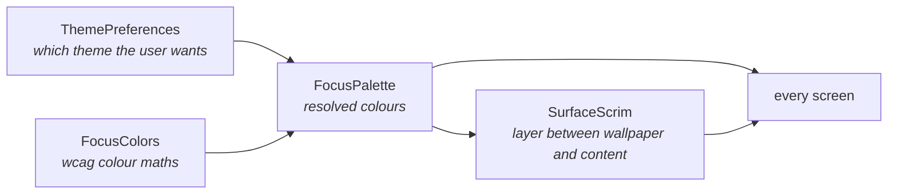

<div align="center">

# THEMING SYSTEM

<sub><a href="../README.md">index</a> · <a href="../../es/desarrolladores/07-sistema-de-temas.md">castellano</a> · previous: <a href="./06-presentation-layer.md">presentation layer</a> · next: <a href="./08-security.md">security</a></sub>

</div>

---

## THE PROBLEM IT SOLVES

focusphone lets the user combine **an arbitrary theme** — including a completely free
background/foreground pair — with **an arbitrary wallpaper**. nothing guarantees that such a
combination stays readable.

on top of that, the custom theme **is not applied through a style** but at runtime, so
resolving colours from theme attributes misses it entirely.

hence the three pieces of the `ui/theme` package:



---

## THE GOLDEN RULE

> **colour always comes from `FocusPalette.of(context)`**, or from `BaseActivity.palette` /
> `effectivePalette`.
>
> **never** from `Theme.resolveAttribute(attr, tv, true).data`.

reasons:

1. `resolveAttribute(...).data` returns a **resource id**, not a colour, when the attribute
   points at a `ColorStateList`
2. it knows nothing about the custom theme
3. it applies no contrast checking

---

## `FocusPalette`

an immutable `data class` holding the already-resolved colour set:

| field | use |
|---|---|
| `background` | the opaque colour painted behind the whole screen |
| `surface` | a slightly raised background for cards, tiles and inputs |
| `textPrimary` | primary text and icons |
| `textSecondary` | supporting text, subtitles and inactive icons |
| `divider` | hairline separators |
| `accent` | fill for selected states: today's date, active chips, switches |
| `onAccent` | readable colour on top of `accent` |
| `isDark` | true when the background is dark, i.e. light content belongs on top |

### CONSTRUCTION

```kotlin
fun of(context: Context): FocusPalette   // single source of truth
```

| path | when |
|---|---|
| `fromCustom(context)` | the active theme is `THEME_CUSTOM`: colours come from `ThemePreferences` |
| `fromTheme(context)` | any built-in theme: colours come from style attributes, with fallbacks if missing |

both paths end in `build(...)`, which **forces contrast**:

```kotlin
val safePrimary   = FocusColors.ensureContrast(primary,   background, CONTRAST_BODY)
val safeSecondary = FocusColors.ensureContrast(secondary, background, CONTRAST_SUPPORT)
```

that is why an unreadable custom theme is impossible: the user chooses, and the palette
corrects just enough to reach the minimum.

### USEFUL METHODS

| method | purpose |
|---|---|
| `primaryAt(fraction)` | dims `textPrimary` towards the background while staying opaque and measurable |
| `ripple()` | a translucent press colour derived from `textPrimary` |
| `forScrim(scrimAlpha)` | a palette variant for text on a **partially transparent** scrim |

<details>
<summary><strong>why <code>forScrim</code> exists</strong></summary>

<br>

a scrim below 100 % opacity lets the wallpaper shift the actual surface away from
`background`, and **every** focusphone colour was chosen against `background`.

that shift always **reduces** the distance between surface and text: a light theme over a dark
photo darkens the surface, a dark theme over a bright photo lightens it. pulling the
supporting colours towards `textPrimary` restores the separation in either direction.

the pull is proportional to how much wallpaper still shows through, so a nearly opaque scrim
leaves the palette untouched (`OPAQUE_ENOUGH = 0.95f`).

</details>

---

## `FocusColors`

the shared colour maths, following the **wcag 2.1** contrast definition — the same model
material 3 uses for its tonal palettes.

<table>
<tr><th align="left" width="32%">function</th><th align="left" width="68%">what it does</th></tr>
<tr><td><code>withAlpha(color, alpha)</code></td><td>replaces the alpha channel</td></tr>
<tr><td><code>blend(fg, bg, ratio)</code></td><td>composites <code>fg</code> over <code>bg</code> and returns an <strong>opaque</strong> colour; preferred over <code>withAlpha</code> whenever contrast has to be measured, because a translucent colour has no measurable luminance of its own</td></tr>
<tr><td><code>flatten(color, background)</code></td><td>flattens a possibly translucent colour onto an opaque background</td></tr>
<tr><td><code>luminance(color)</code></td><td>wcag relative luminance, 0 to 1</td></tr>
<tr><td><code>isDark(color)</code></td><td>true when luminance is below 0.5</td></tr>
<tr><td><code>contrastRatio(a, b)</code></td><td>wcag contrast ratio, 1.0 to 21.0</td></tr>
<tr><td><code>bestOn(background)</code></td><td>returns black or white, whichever reads better on top</td></tr>
<tr><td><code>ensureContrast(fg, bg, minRatio)</code></td><td>the key method: see below</td></tr>
<tr><td><code>compositeOver(top, bottom)</code></td><td>alpha-composites the way the framework draws overlapping views</td></tr>
</table>

### THRESHOLDS

| constant | value | purpose |
|---|---|---|
| `CONTRAST_BODY` | 4.5 | wcag minimum for body text (14 sp regular) |
| `CONTRAST_LARGE` | 3.0 | wcag minimum for large text (18 sp, or 14 sp bold) and meaningful shapes |
| `CONTRAST_SUPPORT` | 4.0 | a comfortable target for focusphone's supporting text |

### `ensureContrast`

```kotlin
fun ensureContrast(foreground: Int, background: Int, minRatio: Double = CONTRAST_BODY): Int
```

1. if the colour already meets the minimum, it is **returned untouched**: a carefully designed
   theme is never altered
2. otherwise it is blended progressively towards the more readable extreme (black or white) in
   steps of 0.05, **preserving the hue as long as possible**
3. only when the target is otherwise unreachable is the pure extreme returned

---

## `SurfaceScrim`

the scrim is the layer painted **between the wallpaper and the content**. it is always
painted in the active palette's `background` colour, so what sits behind the text is a dimmed
version of the chosen theme rather than a grey wash.

### SURFACE KINDS

each surface maps the user's single *legibility* preference to its own alpha range, because
the amount of help a screen needs depends entirely on what it renders.

| surface | floor | range | reason |
|---|---|---|---|
| `HOME` | 0.00 | 0.55 | the wallpaper is the point of this screen; at legibility 0 the photo shows untouched |
| `PANEL` | 0.28 | 0.62 | the side drawers are dense: 12 sp weekday letters over a busy photo are unreadable |
| `CONTENT` | 0.40 | 0.55 | settings, drawer, pickers and block screens: small body text, subtitles, switches and sliders |

### THE FORMULA

```kotlin
var alpha = surface.floor + surface.range * (legibility / 100f)
if (blurEnabled) {
    alpha *= (1f - BLUR_RELIEF * (blurIntensity / 100f))   // BLUR_RELIEF = 0.35f
}
```

<details>
<summary><strong>why blur discounts the scrim</strong></summary>

<br>

blurring already removes the high-frequency detail that makes text hard to read. without this
discount, the two effects would stack into an opaque panel and the chosen wallpaper would stop
showing at all.

</details>

<details>
<summary><strong>the no-wallpaper case costs nothing</strong></summary>

<br>

`SurfaceScrim.apply` sets the view to `GONE` when the alpha is negligible, so on the common
path — no wallpaper — the scrim does not cost a single draw pass.

</details>

<details>
<summary><strong>live preview</strong></summary>

<br>

there is an overload, `alphaFor(surface, legibility, blurEnabled, blurIntensity)`, taking
explicit values, so the settings preview can follow a slider **while it is being dragged**,
before anything is stored.

</details>

---

## THEMES IN RESOURCES

`res/values/themes.xml` defines:

| style | role |
|---|---|
| `Theme.FocusPhone` | the root, on top of `Theme.Material3.Dark.NoActionBar` |
| `Base.Theme.FocusPhone` / `Base.Theme.FocusPhone.Dark` | shared bases for light and dark themes |
| `Theme.FocusPhone.OffWhite` · `.Slate` · `.WarmBeige` · `.Navy` | the four built-in themes |
| dialog and widget styles | the look of dialogs, switches and sliders |

<details>
<summary><strong>the material 3 role redirection</strong></summary>

<br>

each theme **redirects to its own colours** every material 3 role it does not define
(`colorPrimaryInverse`, `colorOnTertiary`, `colorSurfaceContainerLow`, …). without that
redirection, the m3 purple baseline leaked into the monochrome ui through components the app
does not style explicitly.

</details>

<details>
<summary><strong>why there is no <code>values-night/</code></strong></summary>

<br>

light/dark is **not** delegated to the resource system. `THEME_AUTO` is resolved manually:

```kotlin
fun getEffectiveTheme(context: Context): String   // AUTO → SLATE (night) | OFF_WHITE (day)
```

`BaseActivity` tracks the **effective** resolved theme, so `onResume()` notices the system
switching modes and calls `recreate()`. that way the custom theme and the automatic mode live
under a single mechanism.

</details>

### BUILT-IN PALETTES

| theme | background | secondary background | accent | primary text | secondary text | divider |
|---|---|---|---|---|---|---|
| off-white | `#FAFAFA` | `#F5F5F5` | `#E0E0E0` | `#333333` | `#757575` | `#E0E0E0` |
| slate | `#181818` | `#1E1E1E` | `#333333` | `#E0E0E0` | `#9E9E9E` | `#2C2C2C` |
| warm beige | `#FEFEFE` | `#F0EDE8` | `#D4C9B0` | `#4A4A4A` | `#8A8078` | `#D4C9B0` |
| navy | `#0A0E17` | `#1A1F2E` | `#2D3748` | `#E2E8F0` | `#94A3B8` | `#1E2A3A` |

the custom theme validates its hex values with a strict regex (`^#[0-9A-Fa-f]{6}$`) and falls
back to safe values (`#181818` / `#FAFAFA`) when a value is invalid.

---

## VIEW TREE RECOLOURING

the custom theme does not go through a style, so `BaseActivity.colorizeViewTree()` repaints
the already-inflated tree. two rules make it safe:

| rule | reason |
|---|---|
| **it only repaints backgrounds drawn in a theme colour** | it used to fill every container with an opaque colour that was never undone, which hid the wallpaper |
| **it remembers each view's colour role** | without that, repainting twice turned secondary text into primary |

there is also a list of excluded ids (`BACKGROUND_RECOLOR_EXCLUDED_IDS`) for the surfaces
whose background the layout defines with its own semantic intent.

---

## COLOUR CHANGE CHECKLIST

<details open>
<summary><strong>before calling a colour change done</strong></summary>

<br>

- [ ] the colour comes from `FocusPalette`, not from `resolveAttribute`
- [ ] it has been tested in **all four** built-in themes
- [ ] it has been tested with the **custom theme**, including a deliberately unreadable pair
- [ ] it has been tested with a **wallpaper** on, with and without blur, at legibility 0 and 100
- [ ] secondary text is still distinguishable from primary after several repaints
- [ ] `./gradlew :app:testDebugUnitTest` passes, including `FocusColorsTest`, `SurfaceScrimTest` and `MaterialAlertDialogThemeTest`

</details>

---

<div align="center">

<sub><a href="./06-presentation-layer.md">← presentation layer</a> · <a href="../README.md">index</a> · <a href="./08-security.md">security →</a></sub>

</div>
