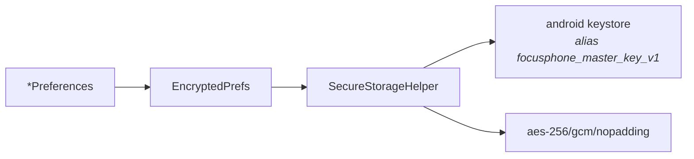

<div align="center">

# SECURITY

<sub><a href="../README.md">index</a> · <a href="../../es/desarrolladores/08-seguridad.md">castellano</a> · previous: <a href="./07-theming-system.md">theming system</a> · next: <a href="./09-system-services.md">system services</a></sub>

</div>

---

## THREAT MODEL

focusphone does not defend against a remote attacker: **it has no network**. what it does
protect is:

<table>
<tr>
<th align="left" width="34%">threat</th>
<th align="left" width="66%">mitigation</th>
</tr>
<tr>
<td>the user themselves trying to bypass their own limits on impulse</td>
<td>hashed passwords, an attempt policy with a cooldown, block screens with no escape shortcut, and rules invisible until unlocked</td>
</tr>
<tr>
<td>another app reading focusphone's data</td>
<td>app-private storage plus aes-256/gcm encryption of the sensitive data</td>
</tr>
<tr>
<td>extracting files from the device</td>
<td>sensitive values are unreadable without the keystore key, which never leaves the device</td>
</tr>
<tr>
<td>leakage through backup or device transfer</td>
<td><code>allowBackup=false</code> and <code>data_extraction_rules.xml</code> excluding every domain</td>
</tr>
<tr>
<td>visual observation of a password</td>
<td><code>FLAG_SECURE</code> on the detox block screen and on the password dialogs</td>
</tr>
</table>

**out of scope**: focusphone is not a device administrator, does not prevent its own
uninstall and does not prevent switching launchers. it is a reinforced commitment, not a
cage.

---

## ENCRYPTION AT REST



### `SecureStorageHelper`

| aspect | value |
|---|---|
| algorithm | `AES/GCM/NoPadding` |
| key length | 256 bits |
| key alias | `focusphone_master_key_v1` |
| store | `AndroidKeyStore`, hardware- or tee-backed where the device allows |
| iv | 12 random bytes per operation |
| authentication tag | 128 bits |
| payload format | `Base64( IV(12) ‖ ciphertext ‖ authTag(16) )` |
| api | **synchronous**, so it can be used inside `SharedPreferences` wrappers read on the main thread |

the key **never leaves the keystore**: the app can only ask it to encrypt and decrypt.

> **the key is never regenerated over an existing alias.** doing so left everything encrypted
> with the previous key unreadable.

### `EncryptedPrefs` AND THE TYPED RESULT

no failure is swallowed silently. `read()` returns one of four states:

<table>
<tr><th align="left" width="18%">state</th><th align="left" width="42%">meaning</th><th align="left" width="40%">required reaction</th></tr>
<tr><td><code>Absent</code></td><td>nothing is stored</td><td>write normally</td></tr>
<tr><td><code>Present</code></td><td>value decrypted correctly</td><td>write normally</td></tr>
<tr><td><code>Unavailable</code></td><td>the keystore key cannot be used <strong>right now</strong></td><td><strong>refuse to write</strong>: writing would replace the real data with the empty fallback</td></tr>
<tr><td><code>Lost</code></td><td>the payload can <strong>never</strong> be decrypted</td><td>treat it as absent, so the user can rebuild it</td></tr>
</table>

this is the pattern `AppFolderPreferences`, `AppSchedulePreferences` and `ProfilePreferences`
apply: while the state is `Unavailable`, the ui shows an empty list **and every write is
refused**.

### LEGACY FORMAT DETECTION

`CustomAppLabelsPreferences` tells old plain-text values apart **by their shape**, with
`SecureStorageHelper.looksEncrypted`, and never by a failed decryption.

> when the key is lost, a real encrypted value also fails to decrypt. treating it as plain
> text would re-encrypt the ciphertext over itself and corrupt the label forever. unreadable
> values are left untouched and the system label is shown instead.

### WHAT IS ENCRYPTED

| file | encrypted contents |
|---|---|
| `focusphone_profile` | active profile, detox end, password hash, blocked apps, keywords, attempt counter and cooldown deadline |
| `focusphone_custom_labels` | custom app labels |
| drawer folders | folder definitions and membership |
| `focusphone_schedule` | schedule rules, password hash and daily usage counters |

---

## PASSWORD HASHING

`PasswordHasher` is the single place where passwords are processed, for both detox and
schedules.

| parameter | value |
|---|---|
| algorithm | `PBKDF2WithHmacSHA256` |
| iterations | 100,000 |
| derived key length | 256 bits |
| salt | 16 bytes (128 bits) from `SecureRandom`, different per password |
| stored format | `saltBase64:hashBase64` |

```kotlin
fun verify(stored: String, input: String): VerifyResult
```

| result | meaning |
|---|---|
| `Match` | matches and is stored in the current format |
| `MatchNeedsUpgrade` | matches a **legacy** unsalted sha-256 hash: the caller must re-store it in the modern format |
| `Mismatch` | does not match, or the stored payload is unreadable |

<details>
<summary><strong>implementation details that matter</strong></summary>

<br>

| detail | reason |
|---|---|
| **constant-time** comparison (`constantTimeEquals`) | it does not short-circuit on the first differing character, so no timing information leaks |
| legacy format recognised by shape | exactly 64 hexadecimal characters |
| empty or unreadable salt → `Mismatch` | a payload with no usable salt can never match |
| **pbkdf2 always runs off the main thread** | 100,000 iterations would block the ui |

</details>

---

## ATTEMPT POLICY

`PasswordAttemptPolicy` is the **single** wrong-password policy in the app: detox sessions
and schedules share it.

| parameter | default |
|---|---|
| maximum failed attempts | 5 |
| cooldown duration | 15 minutes |

```kotlin
fun recordFailure(): Boolean      // true when this failure started the cooldown
fun isLockedOut(): Boolean
fun lockoutRemainingMs(): Long
fun remainingAttempts(): Int
fun reset()                       // after a success or a password change
```

### INVARIANTS

<table>
<tr><td width="4%">1</td><td>during the cooldown <strong>every</strong> attempt is refused, <strong>including the correct password</strong>. without that, trying passwords would cost nothing.</td></tr>
<tr><td>2</td><td><strong>nothing is ever erased on failure</strong>: not the password, not the rules, not the session. clearing the protected configuration on failure would turn the lock into a one-minute bypass.</td></tr>
<tr><td>3</td><td>a wrong password <strong>does not end</strong> a detox session.</td></tr>
<tr><td>4</td><td>the user is never trapped: a detox session <strong>always</strong> ends when its timer expires.</td></tr>
<tr><td>5</td><td>the counter and the cooldown deadline are persisted <strong>encrypted</strong>, so they survive process death and cannot be reset by editing a plain-text preference file.</td></tr>
</table>

<details>
<summary><strong>the counter restarts when the cooldown begins</strong></summary>

<br>

when the fifth failure starts the cooldown, the counter goes back to 0 and the deadline is
stored. that way, once the cooldown is over, the next attempt budget starts clean instead of
leaving the lock permanently jammed.

</details>

<details>
<summary><strong>the <code>AttemptStore</code> abstraction</strong></summary>

<br>

the policy knows nothing about the keystore: it takes an `AttemptStore` interface with four
methods. in production, `PasswordAttemptPolicy.encrypted(...)` backs it with `EncryptedPrefs`;
in tests it is replaced with an in-memory implementation, alongside an injectable clock.

</details>

---

## THE SCHEDULE ACCESS GATE

`ScheduleAccessGate` is a **5-minute** unlock session that lives **in memory only**:

| property | detail |
|---|---|
| duration | 5 minutes from a successful verification |
| storage | process memory; it disappears with the process |
| reason | it lets the user adjust several apps without re-entering the password for each edit |
| revalidation | `AppScheduleEditActivity` checks it on **every `onResume`**, so a stale task in recents cannot be used to edit rules |

---

## PERMISSIONS AND ATTACK SURFACE

| declared permission | reason |
|---|---|
| `QUERY_ALL_PACKAGES` | essential for a launcher: listing the installed apps. requires a play store declaration form |
| `REQUEST_DELETE_PACKAGES` | required since android 9 to launch uninstall intents; the system always confirms |
| `EXPAND_STATUS_BAR` | the gesture that expands the notification shade |

| exported service | protection |
|---|---|
| `FocusAccessibilityService` | `android.permission.BIND_ACCESSIBILITY_SERVICE`: only the system can bind it |
| `FocusNotificationService` | `android.permission.BIND_NOTIFICATION_LISTENER_SERVICE`: same |

**every other activity is declared with `android:exported="false"`**, except `HomeActivity`,
which must be exported because of its `HOME` intent filter.

---

## BACKUPS

```xml
android:allowBackup="false"
android:dataExtractionRules="@xml/data_extraction_rules"
```

| mechanism | status | reason |
|---|---|---|
| cloud backup and `adb backup` | disabled by `allowBackup="false"` | prevents leaking user metadata: favourites, themes, custom labels and profile state |
| device-to-device transfer | excluded in `data_extraction_rules.xml` | since android 12, `allowBackup` no longer covers transfer |

even if a copy escaped, the encrypted values are bound to a keystore key that never leaves
the device, so a restored copy would not be readable.

---

## UI PROTECTIONS

| protection | where |
|---|---|
| `FLAG_SECURE` | `DetoxBlockedActivity` and the password dialogs: blocks screenshots and screen recording |
| deferred rendering | `AppScheduleActivity` does not draw the rule list until the password check succeeds |
| no unlock button | `ScheduleBlockedActivity` offers no escape: rules can only be changed from settings |
| input validation | custom theme colours are validated with `^#[0-9A-Fa-f]{6}$` before parsing |
| package validation | custom label keys are validated against package-name shape before being persisted |

---

## RULES WHEN TOUCHING SECURITY

<details open>
<summary><strong>never do this</strong></summary>

<br>

- **do not** delete protected configuration in response to failed attempts
- **do not** treat `Unavailable` as an empty list
- **do not** run pbkdf2 on the main thread
- **do not** regenerate the keystore key over an existing alias
- **do not** detect legacy plain text through a failed decryption
- **do not** add an unlock shortcut to a schedule block screen
- **do not** store a password in the clear, not even temporarily

</details>

<details open>
<summary><strong>always do this</strong></summary>

<br>

- run every new password through `PasswordHasher`
- reuse `PasswordAttemptPolicy` instead of writing another attempt policy
- store any new data that reveals user habits through `EncryptedPrefs`
- set `FLAG_SECURE` on any new screen that shows or asks for a password
- add unit tests for the edge cases: malformed payload, empty salt, active cooldown, legacy format

</details>

---

## REPORTING A VULNERABILITY

do not open a public issue: use [github private vulnerability reporting](https://github.com/rezzt-dev/focusphone-app/security/advisories/new)
or email `privacy@rezzt.dev`. the supported version, the response targets, the disclosure
policy and what is in and out of scope live in [`SECURITY.md`](../../../SECURITY.md) at the
repository root, which is where github reads it from to enable the "security" tab.

---

<div align="center">

<sub><a href="./07-theming-system.md">← theming system</a> · <a href="../README.md">index</a> · <a href="./09-system-services.md">system services →</a></sub>

</div>
