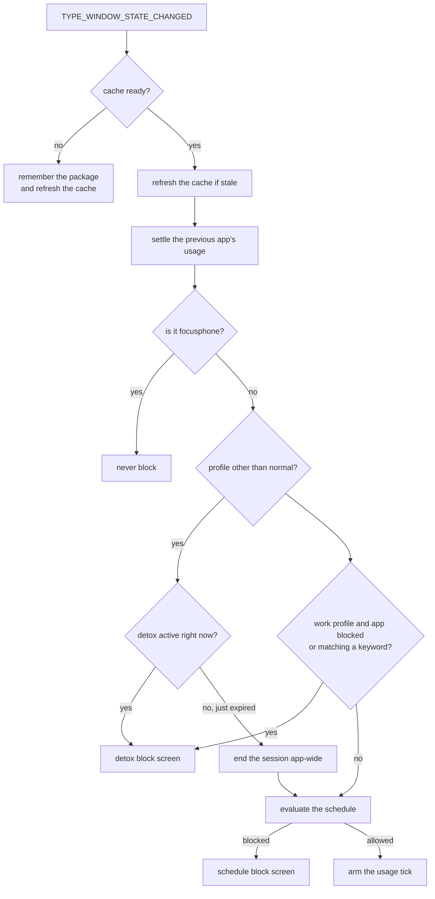
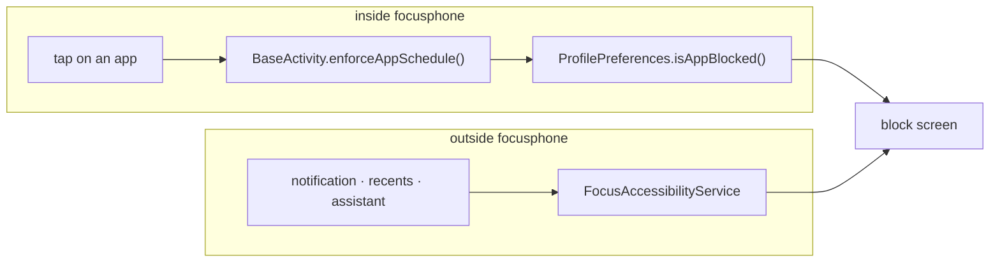

<div align="center">

# SYSTEM SERVICES

<sub><a href="../README.md">index</a> · <a href="../../es/desarrolladores/09-servicios-del-sistema.md">castellano</a> · previous: <a href="./08-security.md">security</a> · next: <a href="./10-testing-and-quality.md">testing and quality</a></sub>

</div>

---

## TWO SERVICES, BOTH OPTIONAL

| service | bind permission | enables |
|---|---|---|
| `FocusAccessibilityService` | `BIND_ACCESSIBILITY_SERVICE` | system-level blocking, daily usage limits and expanding the shade |
| `FocusNotificationService` | `BIND_NOTIFICATION_LISTENER_SERVICE` | the side notification panel and badges |

neither is active by default: the user enables them from the system settings.

---

## `FocusAccessibilityService`

### WHY IT EXISTS

focusphone blocks apps launched **from focusphone** without any special permission. but an
app can also be launched from a notification, from recents or from the voice assistant, and
that bypasses the launcher. this service closes that route.

it is also **the only component that can measure how long an app stays in the foreground**,
so it also owns the accounting behind the daily limits.

### CONFIGURATION

```xml
<accessibility-service
    android:accessibilityEventTypes="typeWindowStateChanged"
    android:accessibilityFeedbackType="feedbackGeneric"
    android:notificationTimeout="0"
    android:canRetrieveWindowContent="true"
    android:settingsActivity="app.focusphone.ui.settings.SettingsActivity" />
```

it listens only for `TYPE_WINDOW_STATE_CHANGED`: knowing **which package** comes to the
foreground is enough.

### EVENT FLOW



### THE CACHE AND WHY IT EXISTS

reading aes-256/gcm encrypted preferences **on every accessibility event** causes anrs. so
the service keeps in memory:

| cached value | contents |
|---|---|
| `cachedBlockedApps` | manually blocked packages |
| `cachedWorkKeywords` | work profile keywords |
| `cachedScheduleRules` | schedule rules by package |
| `cachedDetoxEndTime` | the detox session's end timestamp |
| `cachedProfile` | the active profile |

| constant | value | purpose |
|---|---|---|
| `CACHE_TTL_MS` | 3,000 ms | lifetime of the encrypted-state cache |
| `TICK_INTERVAL_MS` | 30,000 ms | maximum usage re-check interval |
| `DISK_FLUSH_INTERVAL_MS` | 60,000 ms | periodic flush of counters to disk |

<details>
<summary><strong>detox is not cached as a boolean</strong></summary>

<br>

whether a detox session is active depends on the **clock**, so it is evaluated on every event
from the cached inputs, with `ProfilePreferences.isDetoxActivePure(...)`.

caching the boolean kept the block in force for up to `CACHE_TTL_MS` after the session had
already ended.

when the session has just expired, the service does not merely stop blocking: it calls
`expireDetoxIfNeeded` to end it **for the whole app**, not only inside the service.

</details>

### USAGE ACCOUNTING

<table>
<tr><th align="left" width="34%">mechanism</th><th align="left" width="66%">detail</th></tr>
<tr>
<td>foreground stopwatch</td>
<td><code>foregroundPackage</code> and <code>foregroundSince</code>; when the app changes, the previous app's time is settled first</td>
</tr>
<tr>
<td>only apps with a limit</td>
<td><code>flushForegroundUsage()</code> discards any package without <code>hasDailyLimit</code>: <strong>no usage data is written for apps with no limit</strong></td>
</tr>
<tr>
<td>paused while the screen is off</td>
<td>an <code>ACTION_SCREEN_OFF</code> / <code>ACTION_SCREEN_ON</code> receiver stops and resumes counting: an app left in the foreground on a locked device is not being used</td>
</tr>
<tr>
<td>periodic re-check</td>
<td><code>scheduleUsageTickFor()</code> wakes up <strong>exactly</strong> when the allowance would run out, or at most after 30 s, so the session is interrupted mid-use</td>
</tr>
<tr>
<td>writing to disk</td>
<td>the in-memory delta is flushed in one io transaction serialized by a <code>Mutex</code>; if encrypted storage is temporarily unavailable, the batch is merged back in memory instead of being lost</td>
</tr>
<tr>
<td>day rollover</td>
<td><code>ensureCurrentUsageDay()</code> resets the counters at local midnight</td>
</tr>
</table>

<details>
<summary><strong>why usage is also settled inside <code>enforceSchedule</code></strong></summary>

<br>

some apps emit window events constantly. without that extra settle, every event reset the
periodic timer and the time used never got written.

</details>

### STATIC API

| method | purpose |
|---|---|
| `isEnabled(context)` | checks whether the user enabled the service |
| `openAccessibilitySettings(context)` | opens android's accessibility screen directly |
| `expandNotifications()` | expands the shade using `GLOBAL_ACTION_NOTIFICATIONS`; returns `false` if the service is not active |

`HomeActivity` uses that official route first, and only falls back to reflection over
`StatusBarManager` when the service is inactive. that reflection is blocked by the non-sdk
interface list from api 31 onwards, so on modern devices **the gesture needs the service**.

### LIFECYCLE

| callback | what it does |
|---|---|
| `onServiceConnected()` | forces a cache refresh, arms the periodic flush and registers the screen receiver **only once** (it can fire again after a reconnect) |
| `onInterrupt()` | required by the platform |
| `onUnbind()` / `onDestroy()` | `release()`: flushes pending usage, cancels the timers and unregisters the receiver |

---

## `FocusNotificationService`

it extends `NotificationListenerService` and feeds `NotificationRepository`.

| callback | behaviour |
|---|---|
| `onNotificationPosted` / `onNotificationRemoved` | refresh the list |
| `onListenerConnected` | refreshes the list on connect |
| `onListenerDisconnected` | **forgets everything**: without a live listener the list cannot be kept current, so other apps' notification content must not stay on screen, or in memory |
| `onDestroy` | same |
| `onStartCommand` | handles the action that dismisses a specific notification |

### PRIVACY GUARANTEE

content (title and text) **lives in ram only**. it is not written to disk, not indexed and
never leaves the device. when the process dies the list is cleared and repopulated on the
next connection.

each notification's `PendingIntent` is held in a concurrent map and released when it is
dismissed or when the listener disconnects.

---

## BLOCK ENFORCEMENT POINTS

there are **two** paths through which a block is enforced, and both must stay consistent:



| path | covers | needs the service |
|---|---|---|
| `BaseActivity.enforceAppSchedule()` | any launch started inside focusphone | no |
| `FocusAccessibilityService` | any system launch | yes |

> when adding a new launch path in the app, **call `enforceAppSchedule()`**, or that path
> becomes a hole through which blocks are not enforced.

---

## RULES WHEN TOUCHING THE SERVICES

| rule | reason |
|---|---|
| do not read encrypted preferences directly in `onAccessibilityEvent` | decrypting on every event causes anrs; use the cache |
| do not cache decisions that depend on the clock | a cached boolean keeps a block alive for up to 3 s after it expires |
| do not accumulate usage for apps with no daily limit | it would record activity nobody asked to measure |
| register receivers only once | `onServiceConnected` can fire again after a reconnect |
| always flush pending usage in `onUnbind` and `onDestroy` | otherwise the time accumulated since the last flush is lost |
| never write notification content to disk | it breaks the panel's privacy guarantee |

---

<div align="center">

<sub><a href="./08-security.md">← security</a> · <a href="../README.md">index</a> · <a href="./10-testing-and-quality.md">testing and quality →</a></sub>

</div>
