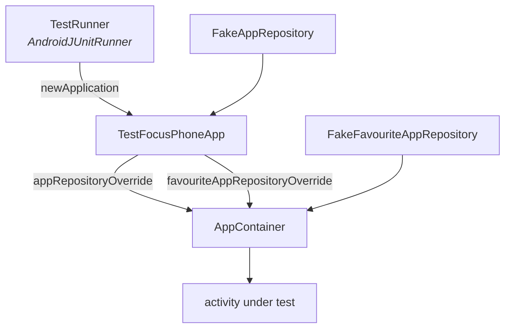

<div align="center">

# TESTING AND QUALITY

<sub><a href="../README.md">index</a> · <a href="../../es/desarrolladores/10-pruebas-y-calidad.md">castellano</a> · previous: <a href="./09-system-services.md">system services</a> · next: <a href="./11-ci-and-release.md">ci and release</a></sub>

</div>

---

## THE TWO LEVELS

<table>
<tr>
<th align="left" width="50%">unit tests (jvm)</th>
<th align="left" width="50%">instrumented tests</th>
</tr>
<tr>
<td valign="top">

`app/src/test/java/app/focusphone/`

- runner: junit 4 on the jvm
- libraries: mockk, robolectric, turbine, kotlinx-coroutines-test
- command: `./gradlew :app:testDebugUnitTest`
- they cover: **pure logic and critical decisions**

</td>
<td valign="top">

`app/src/androidTest/java/app/focusphone/`

- runner: `AndroidJUnit4` through `TestRunner`
- libraries: espresso, `ActivityScenario`
- command: `./gradlew :app:connectedDebugAndroidTest`
- they cover: **complete user flows**

</td>
</tr>
</table>

> `unitTests.isIncludeAndroidResources = true`: robolectric tests inflate real layouts and
> need the app's merged resources. without them, a broken style only showed up as a crash on
> a device.

---

## TEST INFRASTRUCTURE



| piece | responsibility |
|---|---|
| `TestRunner` | a custom runner that swaps the `Application` class for `TestFocusPhoneApp` |
| `TestFocusPhoneApp` | extends `FocusPhoneApp`; exposes a **single** `AppContainer`, like production, and only rebuilds it when a double is swapped |
| `FakeAppRepository` | returns a fixed app list for instrumented tests |
| `FakeFavouriteAppRepository` | in-memory double for unit tests |
| `AppContainer` | accepts both doubles through its constructor |

<details>
<summary><strong>why a single container in tests</strong></summary>

<br>

the label and folder `StateFlow`s must be **the same** for every screen under test, just as in
production. moreover, the `Application` outlives individual tests, and a test's `@Before` may
install its doubles after an earlier test already built the graph: hence the container is
invalidated when a double is swapped, rather than created fresh on every read.

</details>

---

## CURRENT COVERAGE

### UNIT TESTS

<table>
<tr><th align="left" width="36%">suite</th><th align="left" width="64%">what it covers</th></tr>
<tr><td><code>AppScheduleEvaluatorTest</code></td><td>windows, exclusive end, midnight wrap, which day a wrapped window belongs to, unselected days, empty sets, daily limits, window precedence over the limit, serialization round trip, malformed lines and out-of-range values</td></tr>
<tr><td><code>ProfilePreferencesTest</code></td><td>pure blocking logic, detox expiration, sha-256 → pbkdf2 migration</td></tr>
<tr><td><code>ThemePreferencesTest</code></td><td>theme resolution, automatic day/night, fallback on invalid hex</td></tr>
<tr><td><code>PasswordHasherTest</code></td><td>pbkdf2 payloads, legacy format upgrade, malformed input</td></tr>
<tr><td><code>PasswordAttemptPolicyTest</code></td><td>failure counting, cooldown start and end, counter reset</td></tr>
<tr><td><code>AppFolderSerializerTest</code></td><td>round trip, name sanitizing, corrupted lines, alphabetical order</td></tr>
<tr><td><code>FavouriteOrderingTest</code></td><td>the merge never loses or duplicates a favourite</td></tr>
<tr><td><code>FuzzyMatcherTest</code></td><td>scoring, consecutive bonus, non-matches</td></tr>
<tr><td><code>ToggleFavouriteAppUseCaseTest</code></td><td>toggling and the cap of 10</td></tr>
<tr><td><code>RemoveFavouriteAppUseCaseTest</code></td><td>idempotent removal</td></tr>
<tr><td><code>UpdateAppsOrderUseCaseTest</code></td><td>lossless reordering</td></tr>
<tr><td><code>FocusColorsTest</code></td><td>luminance, contrast ratio, <code>ensureContrast</code></td></tr>
<tr><td><code>SurfaceScrimTest</code></td><td>per-surface alpha, blur relief, the no-wallpaper case</td></tr>
<tr><td><code>MaterialAlertDialogThemeTest</code></td><td>that material dialogs inflate in <strong>every</strong> theme</td></tr>
<tr><td><code>AllAppsViewModelTest</code></td><td>drawer row construction</td></tr>
<tr><td><code>FocusAccessibilityServiceTest</code></td><td>service logic isolated from the platform</td></tr>
<tr><td>assorted preferences</td><td><code>AppFolder</code>, <code>Font</code>, <code>Gesture</code>, <code>HomeLayout</code>, <code>Wallpaper</code>, <code>Widget</code></td></tr>
</table>

### INSTRUMENTED TESTS

| suite | flow |
|---|---|
| `OnboardingFlowTest` | the onboarding steps |
| `AppSelectFlowTest` | favourites selection and the cap of 10 |
| `ProfileSwitchTest` | switching between the normal and work profiles |
| `DetoxPasswordTest` | password verification and lockout after failed attempts |
| `AppScheduleTest` | rule persistence, usage accounting and the schedule password cooldown |
| `ProfilePreferencesStorageTest` | encrypted profile storage |
| `FavouriteAppDaoTest` | dao transactions |
| `ClockRendererTest` | rendering of the clock types |
| `WallpaperStorageTest` | image copying, replacement and cleanup |
| `WidgetSlotTest` | the single widget slot |

---

## TEST STYLE

names are **english sentences** in backticks that describe the behaviour, not the method:

```kotlin
@Test fun `the window end is exclusive`() { … }
@Test fun `a wrapped window belongs to the day it starts on`() { … }
@Test fun `usage that reaches the limit blocks the app`() { … }
@Test fun `parse rejects malformed lines`() { … }
```

| convention | detail |
|---|---|
| one test, one behaviour | no tests verifying five things at once |
| explicit edge cases | midnight, empty sets, corrupted input, out-of-range values |
| injectable clocks | `PasswordAttemptPolicy` takes `clock: () -> Long`, so the cooldown is tested without waiting |
| doubles through interfaces | `AttemptStore`, `AppRepository` and `FavouriteAppRepository` are swapped without mocking the framework |

---

## WHAT MUST ALWAYS BE TESTED

<details open>
<summary><strong>mandatory</strong></summary>

<br>

| change | minimum required test |
|---|---|
| a new or modified blocking rule | unit tests for all of its edge cases |
| a clock-dependent decision | tests with an injected clock, midnight rollover included |
| a serialized format | round trip, plus corrupted input |
| a password operation | success, failure, legacy format and active cooldown |
| a colour or contrast change | `FocusColorsTest` and `SurfaceScrimTest` |
| a dialog style | `MaterialAlertDialogThemeTest` covers every theme |
| a new user flow | an instrumented test of the whole path |

</details>

<details>
<summary><strong>a real example of why</strong></summary>

<br>

`MaterialAlertDialogThemeTest` exists because `FocusPhone.DialogTitleTextStyle` inherited from
a `TextAppearance` with no `layout_width`, so the `m3_alert_dialog` title could not be
inflated: the app crashed when opening **any** material dialog. the title and body styles now
inherit from `MaterialAlertDialog.Material3.*.Text`, and the test checks it theme by theme.

</details>

---

## LINT

```kotlin
lint {
    checkReleaseBuilds = true
    abortOnError       = true
}
```

| project rule | detail |
|---|---|
| lint also runs on release | any error breaks the release build |
| **there is no baseline** | on purpose: every error has been fixed at the source |
| warnings | the remaining ones are tracked findings in the technical audit |
| new errors | they get fixed in the code, not silenced |

---

## COMMANDS

| command | when |
|---|---|
| `./gradlew :app:testDebugUnitTest` | on every logic change |
| `./gradlew :app:lintDebug` | before every commit |
| `./gradlew :app:connectedDebugAndroidTest` | when touching a user flow, with a device connected |
| `./gradlew :app:testDebugUnitTest :app:lintDebug :app:assembleRelease` | the full verification, identical to ci |

reports land in `app/build/reports/` and `app/build/test-results/`, and ci publishes them as
artifacts on every run.

---

<div align="center">

<sub><a href="./09-system-services.md">← system services</a> · <a href="../README.md">index</a> · <a href="./11-ci-and-release.md">ci and release →</a></sub>

</div>
