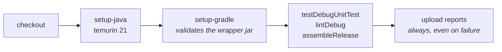
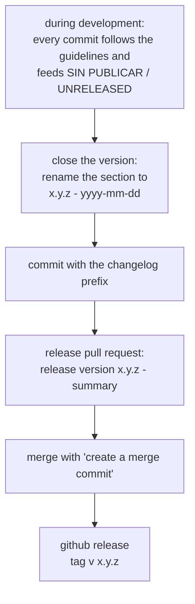

<div align="center">

# CI AND RELEASE

<sub><a href="../README.md">index</a> · <a href="../../es/desarrolladores/11-ci-y-publicacion.md">castellano</a> · previous: <a href="./10-testing-and-quality.md">testing and quality</a> · next: <a href="./12-contributing.md">contributing</a></sub>

</div>

---

## CONTINUOUS INTEGRATION

the workflow lives in `.github/workflows/android-ci.yml`.

| property | value |
|---|---|
| name | `android-ci` |
| triggers | `push` to `main` and to `alfa-*`, and **every** pull request |
| runner | `ubuntu-latest` |
| timeout | 45 minutes |
| concurrency | one group per workflow and ref, cancelling earlier runs |
| permissions | `contents: read` |
| working directory | `focusphone-project` |

### STEPS



```yaml
- name: Verify
  run: ./gradlew :app:testDebugUnitTest :app:lintDebug :app:assembleRelease --stacktrace
```

<details>
<summary><strong>why those three targets, in that order</strong></summary>

<br>

| target | what it adds |
|---|---|
| `testDebugUnitTest` | fails fast on a logic regression |
| `lintDebug` | static analysis with `abortOnError` |
| `assembleRelease` | runs **lint-vital** and **r8**: the only way to catch a broken proguard rule or an error that only appears when minifying |

the release apk is assembled **unsigned** in ci, because the `RELEASE_*` signing properties
only exist on the release machine.

</details>

<details>
<summary><strong>jdk and wrapper</strong></summary>

<br>

- `actions/setup-java@v4` with temurin 21 satisfies the daemon toolchain criterion defined in
  `gradle/gradle-daemon-jvm.properties`
- `gradle/actions/setup-gradle@v4` also validates
  `gradle/wrapper/gradle-wrapper.jar` against the official checksums, which is why the jar is
  versioned

</details>

### ARTIFACTS

with `if: always()`, even when verification fails, these are uploaded:

```
focusphone-project/app/build/reports/
focusphone-project/app/build/test-results/
```

---

## DEPENDENCY POLICY

a second workflow, `.github/workflows/dependency-policy.yml`, runs on every pull request and
does one thing: it **fails pull requests opened by a dependency bot**.

| property | value |
|---|---|
| name | `dependency-policy` |
| triggers | every pull request |
| timeout | 5 minutes |
| permissions | `contents: read` |
| fails when | the author is `dependabot[bot]` / `renovate[bot]`, or the head branch is `dependabot/*` / `renovate/*` |

there are no automated updates of `gradle/libs.versions.toml` in this repository:
`.github/dependabot.yml` declares its ecosystems with `open-pull-requests-limit: 0` and
`renovate.json` carries `"enabled": false`, while this workflow keeps the policy in force even
if one of those integrations is re-enabled from the repository settings.

> the manual procedure for bumping a library — verification, changelog entry and commit prefix —
> is in <a href="./03-environment-and-build.md">environment and build</a>, section *manual
> dependency updates*.

---

## VERSIONING

| item | where | rule |
|---|---|---|
| `versionName` | `app/build.gradle.kts` | shown to the user in *about* |
| `versionCode` | `app/build.gradle.kts` | **must be bumped on every published build** |
| release branch | git | `alfa-X.Y.Z`, in sync with `versionName` |
| tag | git | `v<x.y.z>`, with no suffixes |
| changelog heading | `changelog.md` | `## [x.y.z] - yyyy-mm-dd` |

---

## THE CHANGELOG AS THE SOURCE OF TRUTH

`changelog.md` is **bilingual** and uses five closed categories, always in this order,
omitting the ones with no entries:

| spanish | english |
|---|---|
| añadido | added |
| cambiado | changed |
| corregido | fixed |
| eliminado | removed |
| seguridad | security |

style rules:

- all content **lowercase and unaccented**; headings uppercase and unaccented
- **one line per entry**, in the imperative
- file names, paths, commands and identifiers in backticks
- dates in `yyyy-mm-dd` format
- the `[online]` / `[offline]` markers are carried over verbatim into pull requests, merges and releases

> the content of pull requests, merge commits and releases is **extracted** from
> `changelog.md`. it is not written in parallel, and no channel invents a format of its own.

---

## RELEASE FLOW



### 1 · CLOSE THE VERSION

rename `## SIN PUBLICAR / UNRELEASED` to `## [x.y.z] - yyyy-mm-dd` in `changelog.md` and make
a commit with the `changelog` prefix.

### 2 · THE RELEASE PULL REQUEST

| item | format |
|---|---|
| title | `release version <x.y.z> - <short imperative summary>` |
| summary | covers the 2-3 most relevant entries of the version |
| description | the `### CASTELLANO` and `### ENGLISH` blocks of that version, pasted verbatim with their `####` headings |

for a regular working pull request, the title uses the **same format as a commit**:
`<prefix> | <short imperative summary>`, and the description includes only the items that
pull request contributes.

### 3 · THE MERGE

always use **create a merge commit**. never squash, never rebase: the history of individual
commits, written according to the guidelines, must be preserved in full alongside the pull
request summary.

github generates the merge commit from the pull request's title and description, so if the pr
follows the format, the merge commit follows it with no extra work.

if the merge is done by hand (`git merge --no-ff`), the message is written following the same
title and body the equivalent pull request would carry.

### 4 · THE GITHUB RELEASE

releases are **english only**, unlike `changelog.md` and pull requests: they are the project's
public face for users who do not necessarily read spanish.

| item | format |
|---|---|
| title | `v<x.y.z> — <short english summary, lowercase, unaccented>` |
| body | the `### ENGLISH` block of the closed version, with its `#### ADDED`, `#### CHANGED`, … categories |
| tag | `v<x.y.z>` |

example title: `v1.7 — 100% offline, reminders redesign & settings categories`

> the release must be producible by **copying and pasting** the `### ENGLISH` block. it is not
> rewritten into narrative paragraphs with bold text, and the categories are not reordered.
>
> releases predating this guideline use a different narrative format: they are historical and
> are not rewritten.

---

## BUILDING A SIGNED APK

```bash
cd focusphone-project
./gradlew :app:assembleRelease
```

with the four `RELEASE_*` properties defined in `gradle.properties` (outside version control)
or passed as project properties:

| property | contents |
|---|---|
| `RELEASE_STORE_FILE` | path to the keystore |
| `RELEASE_STORE_PASSWORD` | keystore password |
| `RELEASE_KEY_ALIAS` | key alias |
| `RELEASE_KEY_PASSWORD` | key password |

without them, the build assembles **unsigned**, which is still useful for local testing and is
what ci does.

the output lands in `app/release/`, which is **not** under version control.

---

## RELEASE CHECKLIST

<details open>
<summary><strong>before publishing a version</strong></summary>

<br>

- [ ] `changelog.md` has the closed version section, dated and in both languages
- [ ] `versionName` matches the changelog version
- [ ] `versionCode` has been bumped
- [ ] `./gradlew :app:testDebugUnitTest` passes
- [ ] `./gradlew :app:lintDebug` reports 0 errors
- [ ] `./gradlew :app:assembleRelease` builds, with lint-vital and r8
- [ ] instrumented tests pass on a real device
- [ ] the release pull request follows the title and description format
- [ ] the merge is done with *create a merge commit*
- [ ] the release carries the `v<x.y.z>` tag and the `### ENGLISH` block as its body

</details>

---

<div align="center">

<sub><a href="./10-testing-and-quality.md">← testing and quality</a> · <a href="../README.md">index</a> · <a href="./12-contributing.md">contributing →</a></sub>

</div>
