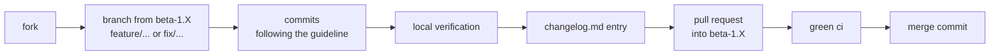

<div align="center">

# CONTRIBUTING

<sub><a href="../README.md">index</a> · <a href="../../es/desarrolladores/12-contribuir.md">castellano</a> · previous: <a href="./11-ci-and-release.md">ci and release</a></sub>

</div>

---

## BEFORE YOU START

| step | detail |
|---|---|
| 1 | read [architecture](./01-architecture.md) and [project structure](./02-project-structure.md) |
| 2 | set up the environment following [environment and build](./03-environment-and-build.md) |
| 3 | check that `./gradlew :app:testDebugUnitTest`, `./gradlew :app:lintDebug` and `./gradlew staticAnalysis` all pass **before** touching anything |
| 4 | review the licence: the project is distributed under a **non-commercial use** licence |

---

## WORKFLOW



```bash
git checkout -b feature/descriptive-name
# … WORK …
./gradlew :app:ktlintFormat                      # autofix formatting first
./gradlew staticAnalysis                         # ktlint + detekt, must be clean
./gradlew :app:testDebugUnitTest :app:lintDebug
git commit
git push origin feature/descriptive-name
```

pull requests target the active `beta-1.X` branch (today `beta-1.5`). the maintainer then
merges `beta-1.X` into `version-beta`, which holds the stable versions, and `version-beta`
into `main`, which is updated last — always with a merge commit.

---

## COMMIT FORMAT

### TITLE

```
<prefix> | <short imperative summary>
```

the separator is always **space, pipe, space**. the prefix is one of these five words, in
lowercase, and they are **never combined and never invented**:

<table>
<tr><th align="left" width="16%">prefix</th><th align="left" width="84%">when to use it</th></tr>
<tr><td><strong>update</strong></td><td>normal forward work: a feature, content or existing document is added or improved. it is the default prefix</td></tr>
<tr><td><strong>fix</strong></td><td>a bug or incorrect behaviour found during development is corrected, with no urgency to publish</td></tr>
<tr><td><strong>hotfix</strong></td><td>something urgent affecting a published version or a critical blocker is corrected. only when the fix really is urgent</td></tr>
<tr><td><strong>changes</strong></td><td>structural or non-functional changes: reorganizing folders, renaming files, touching configuration, tooling or dependencies. it adds no feature and fixes no bug</td></tr>
<tr><td><strong>changelog</strong></td><td>the commit's only purpose is editing <code>changelog.md</code>, for example when closing a version</td></tr>
</table>

correct examples:

```
update | añadir vista previa de mapeo de columnas al asistente de importación csv
fix | detección de duplicados fallando en filas con importes negativos
hotfix | fallo al iniciar cuando falta el archivo de perfil de importación
changes | reorganizar la documentación en la subcarpeta project-context
changelog | cerrar la sección de changelog para la versión mvp fase 0
```

### BODY

| rule | detail |
|---|---|
| format | always an **unnumbered markdown list**; every item starts with `-` |
| never | numbered lists or loose paragraphs |
| each item | a logical block in the imperative, on **one single continuous line**, with no internal breaks |
| spacing | no blank lines between items |
| markdown | files, paths, commands and identifiers in backticks |
| content | explain **the what and the why**, not the line-by-line detail |
| closing | a blank line and whichever attribution line the environment requires |

### HOW THE RESULT IS PRESENTED

when writing a title and a description, **separate code blocks** are used: one for the title
and another for the body, plus another for the changelog fragment. title and body are
**never** put in the same block.

---

## PULL REQUESTS

<table>
<tr><th align="left" width="30%">type</th><th align="left" width="70%">title</th></tr>
<tr>
<td>regular work</td>
<td><code>&lt;prefix&gt; | &lt;short imperative summary&gt;</code> — the same format as a commit; if it groups several commits, the summary describes the set</td>
</tr>
<tr>
<td>version release</td>
<td><code>release version &lt;x.y.z&gt; - &lt;short imperative summary&gt;</code></td>
</tr>
</table>

the **description** is the same for both types: the `### CASTELLANO` and `### ENGLISH` blocks
of the matching `changelog.md` section, pasted verbatim with their `####` category headings.

```
### CASTELLANO

#### <CATEGORIA>
- <cambio en una linea>

### ENGLISH

#### <CATEGORY>
- <same change, one line>
```

| rule | detail |
|---|---|
| scope | if the pr only contributes part of `SIN PUBLICAR / UNRELEASED`, include **only its items**, not the whole section |
| extra context | screenshots and explanations go **after** the list, never in its place |
| merge | always **create a merge commit**; never squash, never rebase |

---

## CODE STYLE

formatting is **enforced, not conventional**: ktlint reads `.editorconfig` at the repository
root and ci fails on any violation. run `./gradlew :app:ktlintFormat` before committing —
4-space indent, lf, utf-8, a 140-column limit, ordered imports and no trailing commas are all
applied for you. what follows is what a formatter cannot decide:

<table>
<tr><th align="left" width="34%">aspect</th><th align="left" width="66%">convention</th></tr>
<tr><td>code language</td><td><strong>comments and kdoc in english</strong>, always</td></tr>
<tr><td>ui text</td><td>lowercase, minimalist and calm: <code>"no apps selected.\ntap the menu to add apps."</code></td></tr>
<tr><td>section dividers</td><td><code>// ── Section Name ──────────────────────────</code></td></tr>
<tr><td>packages</td><td><code>app.focusphone.{layer}.{feature}</code></td></tr>
<tr><td>activities</td><td>they all extend <code>BaseActivity</code></td></tr>
<tr><td>pixel conversion</td><td>a <code>dp(value: Int)</code> helper</td></tr>
<tr><td>view binding</td><td><code>ActivityXxxBinding.inflate(layoutInflater)</code></td></tr>
<tr><td>insets</td><td><code>ViewCompat.setOnApplyWindowInsetsListener</code> and <code>updatePadding</code>, never a full <code>setPadding</code></td></tr>
<tr><td>dialogs</td><td><code>MaterialAlertDialogBuilder</code> with the app's own dialog theme</td></tr>
<tr><td>flows</td><td><code>lifecycleScope.launch { repeatOnLifecycle(STARTED) { … } }</code></td></tr>
</table>

---

## NON-NEGOTIABLE RULES

<details open>
<summary><strong>do not do this</strong></summary>

<br>

| prohibition | reason |
|---|---|
| introducing hilt or dagger | there is a known annotation-processing incompatibility with agp 9.x; resolve it first |
| using `Theme.resolveAttribute(attr, tv, true).data` to get a colour | it returns a resource id with a `ColorStateList` and knows nothing about the custom theme |
| using `setPadding(0, top, 0, 0)` for insets | it silently erases the padding declared in xml |
| making a preference asynchronous | they are read before `setContentView` and inside touch handlers |
| treating `Unavailable` as an empty list | it overwrites the user's real data |
| deleting protected configuration after failed attempts | it turns the lock into a trivial bypass |
| running pbkdf2 on the main thread | it blocks the ui for 100,000 iterations |
| adding a lint baseline | every error is fixed at the source |
| adding a dependency with literal coordinates | they all go in `gradle/libs.versions.toml` |
| adding `values-night/` | the automatic mode is resolved manually in `ThemePreferences` |
| reintroducing `org.gradle.java.home` | it pins a specific machine's path and breaks ci |

</details>

<details open>
<summary><strong>if you do this, do it this way</strong></summary>

<br>

| task | procedure |
|---|---|
| **adding a setting** | 1) keys in the matching `*Preferences` · 2) repository or use-case changes · 3) the row in the correct sub-screen with `SettingsUiHelper` · 4) if it affects theme or scale, check that `BaseActivity.onResume()` calls `recreate()` · 5) a new category in `SettingsActivity` **only** if it opens a completely new domain |
| **adding a screen** | 1) extend `BaseActivity` · 2) declare it in `AndroidManifest.xml` · 3) view binding · 4) manual insets · 5) flows with `repeatOnLifecycle` |
| **adding a use case** | 1) define it in `domain.usecase` · 2) inject the repositories it needs · 3) expose it in `AppContainer` · 4) pass it to the viewmodel through its `factory()` |
| **adding a singleton** | register it in `AppContainer`, not in a global `object` |
| **modifying the database** | bump `AppDatabase`'s version and add a migration, or consciously accept the current destructive migration |
| **adding an app launch path** | call `BaseActivity.enforceAppSchedule()`, or that path becomes a hole in the blocks |
| **adding a string** | add it to `values/strings.xml` in lowercase and translate it into `values-es`, `values-fr`, `values-de` and `values-en-rGB` |

</details>

---

## PULL REQUEST CHECKLIST

<details open>
<summary><strong>before opening it</strong></summary>

<br>

- [ ] `./gradlew :app:testDebugUnitTest` passes
- [ ] `./gradlew staticAnalysis` reports **0 findings** (ktlint and detekt)
- [ ] `./gradlew :app:lintDebug` reports **0 errors**
- [ ] `./gradlew :app:assembleRelease` builds
- [ ] there are new tests for the new logic, with their edge cases
- [ ] visual changes have been tested in **all four** themes, in the custom theme and with a wallpaper
- [ ] new strings are translated into all five languages
- [ ] there is an entry in `changelog.md` under `SIN PUBLICAR / UNRELEASED`, **in both languages** and in the right category
- [ ] title and description follow the format in these guidelines
- [ ] comments and kdoc are in english

</details>

---

## REPORTING BUGS

in the repository's **issues** tab. a good report includes:

| item | why |
|---|---|
| focusphone version | *settings → about → version* |
| phone model and android version | many behaviours are vendor-dependent |
| exact steps to reproduce | without them, most bugs cannot be investigated |
| accessibility service status | it completely changes how blocking behaves |
| active theme and whether a wallpaper is set | essential for any visual bug |

---

## LICENCE

the project is distributed under a **non-commercial use licence**. personal, educational and
evaluation use is allowed; commercial use requires prior written permission from the author.
the full text is in `license`.

by contributing, you accept that your contribution is distributed under those same terms.

---

<div align="center">

<sub><a href="./11-ci-and-release.md">← ci and release</a> · <a href="../README.md">index</a></sub>

</div>
