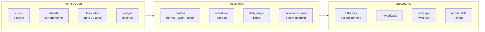

# WHAT IS FOCUSPHONE

<a href="../README.md">index</a> · <a href="../../es/usuarios/01-que-es-focusphone.md">castellano</a> · next: <a href="./02-installation-and-first-steps.md">installation and first steps</a>

---

## THE IDEA IN ONE SENTENCE

focusphone replaces your phone's home screen with a screen made of text: a clock, a
calendar and the list of the apps you actually use. nothing else.

there are no colourful icons, no grids, no carousel of screens, no suggestions and no
recommendations. if an app is not on your list, you will not stumble into it.

---

## WHY IT EXISTS

most android launchers are designed so that you open apps. colourful icons, red badges
and screens full of grids act as constant reminders: every time you unlock the phone to
check the time, you see twenty reasons to stay.

focusphone starts from the opposite idea: **the home screen should be a place you pass
through, not a place you stay in**. that is why the interface is text only, why favourites
are capped at ten, and why the conscious pause exists.

<table>
<tr>
<th align="left" width="50%">a normal launcher</th>
<th align="left" width="50%">focusphone</th>
</tr>
<tr>
<td valign="top">

- dozens of icons in view
- colourful badges demanding attention
- several screens in a carousel
- icon folders with animations
- automatic app suggestions
- opening an app is a reflex tap

</td>
<td valign="top">

- a text list capped at ten apps
- no icons on the home screen
- a single screen, no carousel
- text folders, only in the app drawer
- nothing is suggested: you decide what appears
- optionally, a breath before opening

</td>
</tr>
</table>

---

## WHO IT IS FOR

<strong>it fits well if…</strong>

 

- you want to cut screen time without uninstalling anything
- you catch yourself opening apps without having decided to
- you like a minimalist look and prefer text over icons
- you need to separate work phone from personal phone without carrying two phones
- you want to block apps for a while and have that block actually hold
- you care that an app does not send your data anywhere

<strong>it probably does not fit if…</strong>

 

- you rely on large, multiple home screen widgets: focusphone supports **one** widget
- you need configurable advanced gestures or several desktop screens
- you want parental controls for someone else's phone: focusphone is built for setting your own limits, not imposing them on others
- you use a launcher with deep vendor integration that you do not want to lose

---

## WHAT IT DOES, IN BLOCKS

### HOME SCREEN

a clock you can show in five different styles (digital, stacked, in words, analog or
hidden), a month calendar in the side menu, and the list of your favourite apps, capped at
ten. you can reorder them by dragging and rename them to whatever you want.

### FOCUS TOOLS

- **profiles**: *normal* blocks nothing, *work* blocks the apps you mark plus the ones that
  match your keywords, and *detox* blocks absolutely everything for a period of time,
  protected by a password.
- **schedules**: any app can have an allowed time window, with weekday selection, and a
  daily allowance in minutes. they always apply, even in the normal profile.
- **conscious pause**: a countdown of a few seconds before any app opens, asking whether you
  really want to open it.

### APPEARANCE

four built-in themes (off-white, slate, warm beige and navy), an automatic mode that
follows the system light/dark setting, and a custom theme where you pick your own
background and text colours. four typefaces, adjustable text size, left, centre or right
alignment, and your own wallpaper with blur and legibility control.

---

## WHAT IT DOES **NOT** DO

| it does not | why |
|---|---|
| it does not connect to the internet | the app is fully offline: no accounts, no sync, no servers |
| it does not show ads | there is no advertising component anywhere in the code |
| it does not collect telemetry | no analytics, no usage reports, no identifiers |
| it does not back up to the cloud | `allowBackup` is off and device transfer is excluded |
| it does not read your notification content outside of ram | the notification panel lives in memory and is cleared when the process ends |
| it cannot stop you from uninstalling focusphone | the locks are a commitment to yourself, not a cage |

---

## BASIC TECHNICAL FACTS

| property | value |
|---|---|
| package name | `app.focusphone` |
| documented version | 1.0.6 |
| minimum android | 7.0 (api 24) |
| target android | 16 (api 36) |
| language | kotlin |
| interface languages | english, british english, spanish, french, german |
| licence | non-commercial use, see `license` |

---

## NEXT STEP

if you want to install it and get it running, continue with
**[installation and first steps](./02-installation-and-first-steps.md)**.

if what you want is to understand how it is built, jump to the
**[developer documentation](../developers/01-architecture.md)**.

---

<a href="../README.md">← index</a> · <a href="./02-installation-and-first-steps.md">installation and first steps →</a>

