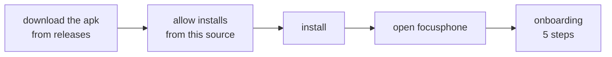

<div align="center">

# INSTALLATION AND FIRST STEPS

<sub><a href="../README.md">index</a> · <a href="../../es/usuarios/02-instalacion-y-primeros-pasos.md">castellano</a> · previous: <a href="./01-what-is-focusphone.md">what is focusphone</a> · next: <a href="./03-home-screen-and-gestures.md">home screen and gestures</a></sub>

</div>

---

## REQUIREMENTS

| requirement | value |
|---|---|
| android version | 7.0 (api 24) or newer |
| storage | a few megabytes; the app is very light |
| internet connection | **not needed** at any point, neither to install the apk nor to use the app |
| user account | none: focusphone has no sign-up and no login |

---

## INSTALLING THE APP

focusphone is distributed as an apk from the releases tab of the repository.



<details open>
<summary><strong>step by step</strong></summary>

<br>

1. go to the **releases** tab of the repository and download the `.apk` file of the latest
   version.
2. open the downloaded file. android will warn you that the install comes from an unknown
   source.
3. grant **install unknown apps** to whichever app you are opening the apk from (usually
   the browser or the file manager). android takes you to that screen automatically.
4. go back and confirm the installation.
5. open focusphone from your current launcher's app drawer.

</details>

<details>
<summary><strong>building the apk yourself</strong></summary>

<br>

if you would rather build from source than download an apk:

```bash
git clone https://github.com/rezzt-dev/focusphone-app.git
cd focusphone-app/focusphone-project
./gradlew :app:assembleDebug
```

the apk lands in `app/build/outputs/apk/debug/`. the full build environment is documented in
[environment and build](../developers/03-environment-and-build.md).

</details>

---

## ONBOARDING: 5 STEPS

the first time you open focusphone, a five-screen onboarding appears; swipe horizontally to
move through it.

| step | what it does |
|---|---|
| 1 · welcome | introduces the app and its purpose |
| 2 · philosophy | explains why the interface is text only and what you gain from it |
| 3 · default launcher | takes you to the android settings screen to make focusphone your home screen, and **verifies in real time** whether you succeeded |
| 4 · choose apps | opens the selector so you can mark your first favourite apps |
| 5 · done | closes onboarding and leaves you on the home screen |

> onboarding can be relaunched at any time from
> **settings → about → restart onboarding**.

---

## SETTING FOCUSPHONE AS THE DEFAULT LAUNCHER

this is the one step that really matters: until it is your default launcher, focusphone is
just another app and the home button will keep taking you to your usual screen.

<details open>
<summary><strong>if you are in onboarding</strong></summary>

<br>

tap the button on step 3. focusphone opens the android screen where the home app is chosen.
select **focusphone** and come back: the step marks itself as verified.

</details>

<details>
<summary><strong>if you already closed onboarding</strong></summary>

<br>

two routes:

- **from focusphone**: side menu → settings → system → *set as default*.
- **from android**: system settings → apps → default apps → home app → focusphone.

the exact path varies by manufacturer; on some phones the option is called *home screen app*
or *launcher*.

</details>

<details>
<summary><strong>how to go back to your previous launcher</strong></summary>

<br>

focusphone does not hold you: repeat the same procedure and pick your previous launcher from
the list. your apps, folders and data are untouched, because focusphone never modifies the
installed apps, it only decides which ones it shows.

</details>

---

## CHOOSING YOUR FIRST APPS

the cap is **10 favourite apps**. it is not an arbitrary number: it is the core of the
proposition. if everything fits on the home screen, the home screen becomes a grid again.

<details open>
<summary><strong>how to pick them</strong></summary>

<br>

1. open the menu by swiping **left** on the home screen.
2. tap **edit dashboard**.
3. use the search field to find each app and select it.
4. the counter at the top tells you how many of the ten you have used.
5. tap **done**.

</details>

<details>
<summary><strong>a rule that helps</strong></summary>

<br>

include only the apps you would open **with a concrete intention** (phone, messages, camera,
maps, music, notes) and leave out the ones you open out of habit. the ones you leave out are
still installed and reachable from the all apps drawer: they simply stop being one tap away.

</details>

---

## PERMISSIONS IT WILL ASK FOR

focusphone runs on very few permissions, and **none of the optional ones is mandatory**.

| permission | when it is asked | what for |
|---|---|---|
| see installed apps | automatically on install | listing your apps in the drawer and the selector |
| uninstall apps | only when you tap *uninstall* | launching android's uninstall dialog |
| accessibility service | when starting a detox session, or from settings | really blocking apps and measuring usage time |
| notification access | when enabling the notification panel | showing your notifications in the side drawer |

full detail in **[privacy and permissions](./11-privacy-and-permissions.md)**.

---

## FINAL CHECK

<details open>
<summary><strong>checklist</strong></summary>

<br>

- [ ] focusphone is installed and has been opened at least once
- [ ] it is selected as the home app: pressing the home button shows focusphone
- [ ] there is at least one app in the favourites list
- [ ] swiping left opens the side menu
- [ ] tapping the clock opens the alarm app

if all of that works, the installation is complete.

</details>

---

<div align="center">

<sub><a href="./01-what-is-focusphone.md">← what is focusphone</a> · <a href="../README.md">index</a> · <a href="./03-home-screen-and-gestures.md">home screen and gestures →</a></sub>

</div>
