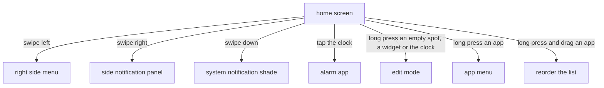

<div align="center">

# HOME SCREEN AND GESTURES

<sub><a href="../README.md">index</a> · <a href="../../es/usuarios/03-pantalla-de-inicio-y-gestos.md">castellano</a> · previous: <a href="./02-installation-and-first-steps.md">installation</a> · next: <a href="./04-apps-and-folders.md">apps and folders</a></sub>

</div>

---

## ANATOMY OF THE HOME SCREEN

the home screen is a **grid**, like the workspace of a stock launcher, with two side drawers.
it holds three kinds of block, and each one occupies a rectangle of cells:

```
┌──────────────────────────────────┐
│ ┌──────────────────────────────┐ │
│ │            09:41             │ │  ← clock (5 styles, tap it for alarms)
│ │        monday, 12 may        │ │
│ └──────────────────────────────┘ │
│ ┌─────────────┐ ┌──────────────┐ │
│ │   battery   │ │    music     │ │  ← widgets (any number, optional)
│ └─────────────┘ └──────────────┘ │
│ ┌──────────────────────────────┐ │
│ │            phone             │ │
│ │           messages           │ │  ← favourites (up to 10, text only)
│ │            camera            │ │
│ └──────────────────────────────┘ │
└──────────────────────────────────┘
   ↑ swipe right         ↑ swipe left
   notifications         menu
```

<table>
<tr>
<th align="left">block</th>
<th align="left">what it is</th>
<th align="left">can be removed</th>
</tr>
<tr>
<td>clock</td>
<td>the time and date, in one of five styles; it shrinks to fit a small block instead of being cut</td>
<td>yes, and added back from edit mode</td>
</tr>
<tr>
<td>widgets</td>
<td>any number of widgets: focusphone's own 20 or those of your other apps (see <a href="./09-notifications-and-widgets.md">notifications and widgets</a>)</td>
<td>yes</td>
</tr>
<tr>
<td>favourites</td>
<td>the text list with your chosen apps</td>
<td>no, it is the core of the screen</td>
</tr>
</table>

| grid | value |
|---|---|
| columns | 3 to 6 (4 by default) |
| rows | 4 to 12 (by default, the number that makes the cells about square on your screen) |
| pages | one: the side swipes already belong to the drawers |

> if you used an earlier version, your previous layout (order, hidden clock, the widget and
> its height) is moved onto the grid automatically the first time.

---

## EDIT MODE

the layout is edited on the home screen itself.

**to enter edit mode**: long press an empty spot, a widget or the clock, or use
**settings → home screen → edit home screen**. the drawers are locked while you edit.

| you want to | do this |
|---|---|
| move a block | drag it; the other blocks make room once the target cell holds still for a moment |
| resize a block | tap it to select it, then pull the handles on the sides it can grow along; sizes snap to whole cells |
| use a block's actions | tap it: a floating bar shows its actions — **widget settings** and **remove** for a widget, **style** and **remove** for the clock, **choose apps** for the favourites |
| add a widget | **widgets** in the bottom bar opens the widget picker |
| bring the clock back | **add clock** in the bottom bar |
| change the grid size | **grid** in the bottom bar, with a live preview of the columns and rows |
| finish | **done** in the bottom bar |

<details>
<summary><strong>when there is no room</strong></summary>

<br>

a new widget is placed in reading order. if the grid is full, focusphone first shrinks the
favourites list from its top edge, then other blocks. if there is still no room, it tells
you: *no room for that on the home screen. remove or shrink a block first.*

</details>

<details>
<summary><strong>editing without dragging</strong></summary>

<br>

every block in edit mode also offers accessibility actions — move up, down, left or right,
make wider or narrower, make taller or shorter — so the layout can be changed with talkback
or switch access.

</details>

---

## THE FIVE CLOCK STYLES

| style | looks like | comment |
|---|---|---|
| digital | `09:41` | the classic, one line with the date below |
| stacked | `09` over `41` | hours and minutes on two lines, very large type |
| in words | `nine` / `forty-one` | the time spelled out, the calmest option |
| analog | a drawn face | a minimalist hands clock |
| hidden | — | no clock; the screen keeps only the favourites |

the clock follows the 12 or 24 hour format configured in your system, and its size is set
with a slider in **settings → home screen → clock size**.

> **tapping the clock opens the system alarm app.** it is the most used shortcut in
> focusphone: unlock, check the time, set an alarm, put the phone away.

---

## THE GESTURES

every gesture is performed on the home screen, on any free area.



<table>
<tr>
<th align="left" width="34%">gesture</th>
<th align="left" width="33%">result</th>
<th align="left" width="33%">conditions</th>
</tr>
<tr>
<td><strong>swipe left</strong></td>
<td>opens the side menu: calendar, all apps, edit dashboard, settings and profile</td>
<td>always available</td>
</tr>
<tr>
<td><strong>swipe right</strong></td>
<td>opens focusphone's side notification panel</td>
<td>requires enabling the panel in settings and granting notification access</td>
</tr>
<tr>
<td><strong>swipe down</strong></td>
<td>expands android's notification shade</td>
<td>requires enabling the gesture in settings; works best with the accessibility service on</td>
</tr>
<tr>
<td><strong>tap the clock</strong></td>
<td>opens the system alarm app</td>
<td>always available, if the clock is visible</td>
</tr>
<tr>
<td><strong>long press an empty spot, a widget or the clock</strong></td>
<td>enters <a href="#edit-mode">edit mode</a></td>
<td>always available</td>
</tr>
<tr>
<td><strong>long press an app</strong></td>
<td>opens its options: the app's shortcuts, remove from home, app info, uninstall</td>
<td>always available</td>
</tr>
<tr>
<td><strong>long press and drag an app</strong></td>
<td>changes the order of the favourites list</td>
<td>always available</td>
</tr>
</table>

<details>
<summary><strong>why you cannot open one drawer while the other is open</strong></summary>

<br>

if a drawer is already open, the swipe gesture will not open the opposite one: you have to
close the current one first (tap outside, or press back). this is deliberate, so a quick
gesture never lands you in the wrong drawer.

</details>

---

## THE SIDE MENU

it opens by swiping left. from top to bottom it contains:

| item | what it does |
|---|---|
| month calendar | shows the current month with today highlighted; it refreshes itself when the day changes |
| all applications | opens the full app drawer, with search and folders |
| edit dashboard | opens the favourites selector |
| focus settings | opens the settings screen |
| selected profile | shows the active profile and, when tapped, lets you change it |

<details>
<summary><strong>the calendar</strong></summary>

<br>

it is a read-only calendar: it shows the current month with weekday names in your system's
order and language, and today highlighted. you cannot navigate to other months or create
events, on purpose: it is a quick reference, not an agenda.

because a launcher can stay open for days, the calendar rebuilds itself when the day
changes, without you having to leave the screen and come back.

</details>

---

## THE FAVOURITES LIST

- shows **text only**, no icons, with whatever name you choose for each app
- holds a maximum of **10 apps**
- aligns left, centre or right (**settings → appearance → alignment**), which helps for
  one-handed use
- the spacing between apps is adjustable (**settings → home screen → spacing**)
- when empty, it shows *no apps yet. tap here to choose the few you really need.*, and
  tapping it opens the app selector directly

<details>
<summary><strong>reordering the list</strong></summary>

<br>

long press an app and, without lifting your finger, drag it to its new position. the new
order is saved automatically. reordering can **never** remove an app from the list: if the
reorder does not include one of your favourites, that app is kept after the others.

</details>

<details>
<summary><strong>the per-app menu</strong></summary>

<br>

long pressing an app without dragging opens a dialog titled with the app's name (a tap
already opens the app, so there is no "open" entry):

| option | what it does |
|---|---|
| the app's shortcuts | the shortcuts the app publishes (for example "new message"), opened through the same profile, schedule and conscious pause checks as the app |
| remove from home | takes it out of favourites, without uninstalling it |
| app info | opens the app's page in android settings |
| uninstall | launches the system uninstall dialog |

</details>

---

## THE PAGE INDICATOR

two very discreet dots appear at the bottom while you drag sideways: they indicate whether
you are on the home screen or in the menu. they disappear as soon as you let go.

---

<div align="center">

<sub><a href="./02-installation-and-first-steps.md">← installation</a> · <a href="../README.md">index</a> · <a href="./04-apps-and-folders.md">apps and folders →</a></sub>

</div>
