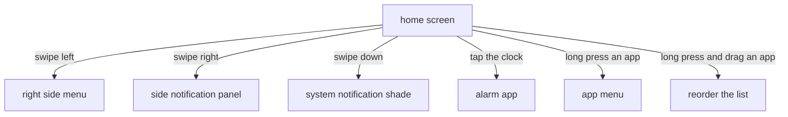

<div align="center">

# HOME SCREEN AND GESTURES

<sub><a href="../README.md">index</a> · <a href="../../es/usuarios/03-pantalla-de-inicio-y-gestos.md">castellano</a> · previous: <a href="./02-installation-and-first-steps.md">installation</a> · next: <a href="./04-apps-and-folders.md">apps and folders</a></sub>

</div>

---

## ANATOMY OF THE HOME SCREEN

the home screen has three components and two side drawers. all three components can be
hidden and reordered relative to each other.

```
┌──────────────────────────────────┐
│                                  │
│              09:41               │  ← clock (5 styles, tap it for alarms)
│          monday, 12 may          │
│                                  │
│  ┌────────────────────────────┐  │
│  │      optional widget       │  │  ← widget (exactly one, optional)
│  └────────────────────────────┘  │
│                                  │
│              phone               │
│             messages             │  ← favourites (up to 10, text only)
│              camera              │
│               notes              │
│                                  │
└──────────────────────────────────┘
   ↑ swipe right         ↑ swipe left
   notifications         menu
```

<table>
<tr>
<th align="left">component</th>
<th align="left">what it is</th>
<th align="left">can be hidden</th>
</tr>
<tr>
<td>clock</td>
<td>the time and date, in one of five styles</td>
<td>yes</td>
</tr>
<tr>
<td>widget</td>
<td>a single widget from another app, if you add one</td>
<td>yes</td>
</tr>
<tr>
<td>favourites</td>
<td>the text list with your chosen apps</td>
<td>no, it is the core of the screen</td>
</tr>
</table>

> the order of the three components is changed in
> **settings → home screen → layout**, with a real, working preview.

---

## THE FIVE CLOCK STYLES

| style | looks like | comment |
|---|---|---|
| digital | `09:41` | the classic, one line with the date below |
| stacked | `09` over `41` | hours and minutes on two lines, very large type |
| in words | `nine` / `forty-one` | the time spelled out, the calmest option |
| analog | a drawn face | a minimalist hands clock |
| hidden | — | no clock; the screen keeps only the favourites |

the clock follows the 12 or 24 hour format configured in your system, and its size is set
with a slider in **settings → home screen → clock size**.

> **tapping the clock opens the system alarm app.** it is the most used shortcut in
> focusphone: unlock, check the time, set an alarm, put the phone away.

---

## THE GESTURES

every gesture is performed on the home screen, on any free area.



<table>
<tr>
<th align="left" width="34%">gesture</th>
<th align="left" width="33%">result</th>
<th align="left" width="33%">conditions</th>
</tr>
<tr>
<td><strong>swipe left</strong></td>
<td>opens the side menu: calendar, all apps, edit dashboard, settings and profile</td>
<td>always available</td>
</tr>
<tr>
<td><strong>swipe right</strong></td>
<td>opens focusphone's side notification panel</td>
<td>requires enabling the panel in settings and granting notification access</td>
</tr>
<tr>
<td><strong>swipe down</strong></td>
<td>expands android's notification shade</td>
<td>requires enabling the gesture in settings; works best with the accessibility service on</td>
</tr>
<tr>
<td><strong>tap the clock</strong></td>
<td>opens the system alarm app</td>
<td>always available, if the clock is visible</td>
</tr>
<tr>
<td><strong>long press an app</strong></td>
<td>opens its menu: open, remove from list, app info, uninstall</td>
<td>always available</td>
</tr>
<tr>
<td><strong>long press and drag an app</strong></td>
<td>changes the order of the favourites list</td>
<td>always available</td>
</tr>
</table>

<details>
<summary><strong>why you cannot open one drawer while the other is open</strong></summary>

<br>

if a drawer is already open, the swipe gesture will not open the opposite one: you have to
close the current one first (tap outside, or press back). this is deliberate, so a quick
gesture never lands you in the wrong drawer.

</details>

---

## THE SIDE MENU

it opens by swiping left. from top to bottom it contains:

| item | what it does |
|---|---|
| month calendar | shows the current month with today highlighted; it refreshes itself when the day changes |
| all applications | opens the full app drawer, with search and folders |
| edit dashboard | opens the favourites selector |
| focus settings | opens the settings screen |
| selected profile | shows the active profile and, when tapped, lets you change it |

<details>
<summary><strong>the calendar</strong></summary>

<br>

it is a read-only calendar: it shows the current month with weekday names in your system's
order and language, and today highlighted. you cannot navigate to other months or create
events, on purpose: it is a quick reference, not an agenda.

because a launcher can stay open for days, the calendar rebuilds itself when the day
changes, without you having to leave the screen and come back.

</details>

---

## THE FAVOURITES LIST

- shows **text only**, no icons, with whatever name you choose for each app
- holds a maximum of **10 apps**
- aligns left, centre or right (**settings → appearance → alignment**), which helps for
  one-handed use
- the spacing between apps is adjustable (**settings → home screen → spacing**)
- when empty, it shows *no apps selected. tap the menu to add apps.*

<details>
<summary><strong>reordering the list</strong></summary>

<br>

long press an app and, without lifting your finger, drag it to its new position. the new
order is saved automatically. reordering can **never** remove an app from the list: if the
reorder does not include one of your favourites, that app is kept after the others.

</details>

<details>
<summary><strong>the per-app menu</strong></summary>

<br>

long pressing an app without dragging opens its menu:

| option | what it does |
|---|---|
| open | opens it (going through the conscious pause if you have it enabled) |
| remove from list | takes it out of favourites, without uninstalling it |
| app info | opens the app's page in android settings |
| uninstall | launches the system uninstall dialog |

</details>

---

## THE PAGE INDICATOR

two very discreet dots appear at the bottom while you drag sideways: they indicate whether
you are on the home screen or in the menu. they disappear as soon as you let go.

---

<div align="center">

<sub><a href="./02-installation-and-first-steps.md">← installation</a> · <a href="../README.md">index</a> · <a href="./04-apps-and-folders.md">apps and folders →</a></sub>

</div>
