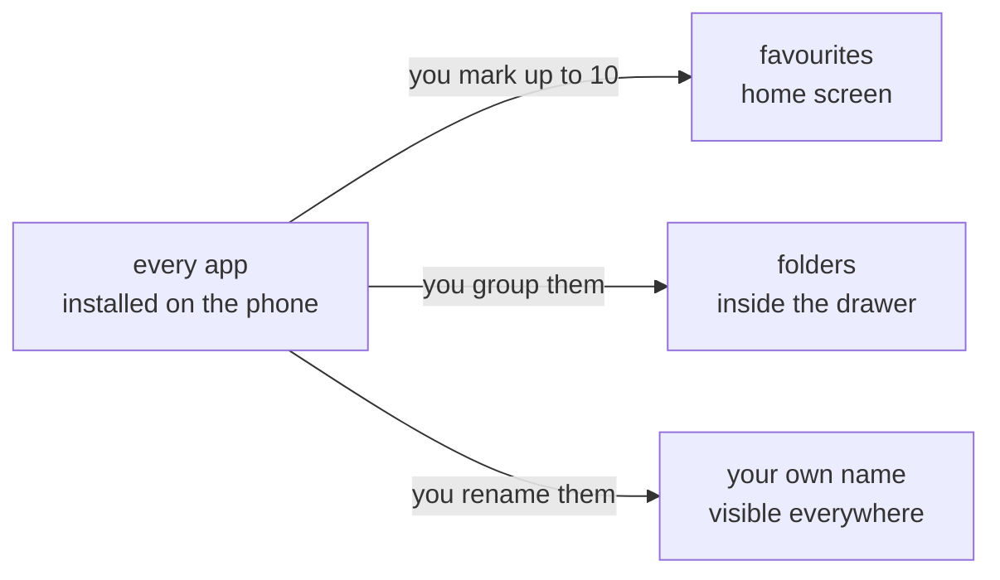

<div align="center">

# APPS AND FOLDERS

<sub><a href="../README.md">index</a> · <a href="../../es/usuarios/04-aplicaciones-y-carpetas.md">castellano</a> · previous: <a href="./03-home-screen-and-gestures.md">home screen and gestures</a> · next: <a href="./05-profiles-and-detox.md">profiles and detox</a></sub>

</div>

---

## TWO DIFFERENT LISTS

focusphone works with two lists that are worth keeping apart:

<table>
<tr>
<th align="left" width="50%">favourites (dashboard)</th>
<th align="left" width="50%">all applications (drawer)</th>
</tr>
<tr>
<td valign="top">

the apps that appear on the **home screen**.

- maximum of **10**
- you pick them one by one
- reordered by dragging
- edited from *edit dashboard*

</td>
<td valign="top">

**every** app installed on the phone.

- no limit
- opened from *all applications*
- has search and folders
- this is where you rename, block and uninstall

</td>
</tr>
</table>



---

## PICKING AND EDITING FAVOURITES

**side menu → edit dashboard**

| action | how |
|---|---|
| add an app | find it and tick it in the list |
| remove an app | untick it, or long press its row on the home screen and choose *remove from list* |
| see how many you have | the top counter shows `x of 10 apps selected` |
| finish | tap *done* |

<details>
<summary><strong>what happens when you reach 10</strong></summary>

<br>

the selector tells you *you've reached the limit of 10 apps* and will not let you add more
until you remove one. the cap is intentional: it is what keeps the home screen a list rather
than a grid.

</details>

<details>
<summary><strong>what happens if you uninstall a favourite app</strong></summary>

<br>

focusphone detects system installs, uninstalls and updates and cleans the list
automatically. you will not be left with a dead entry that opens nothing.

</details>

---

## THE ALL APPS DRAWER

**side menu → all applications**

this is the full list, sorted alphabetically, with a search field at the top.

### THE SEARCH

search is **fuzzy and accent-insensitive**: you do not need the full name, nor the correct
diacritics.

| you type | it finds |
|---|---|
| `fb` | facebook |
| `yt` | youtube |
| `telefono` | teléfono |
| `ubers` | übersetzer |

while searching, folder headers are hidden and results are listed flat.

### THE PER-APP MENU

long press any row in the drawer:

| option | what it does |
|---|---|
| open | opens the app |
| shortcuts | if the app offers any, they appear here (requires being the default launcher) |
| rename | give it whatever name you want |
| move to folder | puts it in an existing folder, or creates a new one |
| take out of folder | returns it to the general list |
| block / unblock | marks it as blocked for the work profile |
| app info | opens its page in android settings |
| uninstall | launches the system uninstall dialog |

---

## RENAMING APPS

one of the features that most changes how the launcher feels. the name you set is used
**everywhere**: home screen, drawer, selector and block screens.

<details open>
<summary><strong>how to rename</strong></summary>

<br>

1. open **all applications**
2. long press the app
3. choose **rename**
4. type the new name and confirm

to go back to the original name, clear the field and confirm with it empty.

</details>

<details>
<summary><strong>what it is good for in practice</strong></summary>

<br>

stripping brand names out reduces the visual pull. common examples:

| original name | useful name |
|---|---|
| whatsapp messenger | messages |
| youtube | videos |
| google chrome | browser |
| gmail | mail |
| spotify | music |

</details>

> custom names are stored **encrypted** on the device, because they reveal how you organise
> your phone. more detail in [privacy and permissions](./11-privacy-and-permissions.md).

---

## FOLDERS

folders live **only inside the all apps drawer**, never on the home screen. they are made of
text, always shown **before** the loose apps, and sorted alphabetically.

```
┌─────────────────────────────┐
│  search…                    │
├─────────────────────────────┤
│  › work               (4)   │  ← collapsed folder
│  ⌄ leisure            (3)   │  ← expanded folder
│      music                  │
│      podcasts               │
│      videos                 │
│  ─────────────────────────  │
│  settings                   │  ← apps with no folder
│  camera                     │
│  calculator                 │
└─────────────────────────────┘
```

### CREATING, FILLING AND EMPTYING

<table>
<tr>
<th align="left" width="30%">action</th>
<th align="left" width="70%">how it is done</th>
</tr>
<tr>
<td>create a folder</td>
<td>tap <strong>+ new folder</strong> at the top of the drawer and type the name</td>
</tr>
<tr>
<td>put an app in</td>
<td>drag it onto the folder, or long press it and choose <strong>move to folder</strong></td>
</tr>
<tr>
<td>take an app out</td>
<td>drag it out, onto the general list, or choose <strong>take out of folder</strong></td>
</tr>
<tr>
<td>expand or collapse</td>
<td>tap the folder header</td>
</tr>
<tr>
<td>rename</td>
<td>long press the header and choose <strong>rename folder</strong></td>
</tr>
<tr>
<td>delete</td>
<td>long press the header and choose <strong>delete</strong>; the apps inside go back to the general list, nothing is uninstalled</td>
</tr>
</table>

<details>
<summary><strong>folder rules</strong></summary>

<br>

- an app belongs to **at most one folder**: moving it to another removes it from the previous one automatically
- folder names are **unique**: repeating one shows an inline error and the dialog stays open
- there is **no manual folder order**: they are always sorted alphabetically, ignoring case
- when dragging onto an expanded folder, **its whole region** accepts the drop, not just the header
- folders are stored encrypted on the device

</details>

<details>
<summary><strong>an app in a folder has disappeared</strong></summary>

<br>

if an app inside a folder does not show up, it is almost always temporarily unavailable: it
is updating, the phone has just booted, or it belongs to an android work profile that is not
ready yet. focusphone **does not delete** the folder membership in that case: it hides the
app and shows it again once it is available.

</details>

---

## APP SHORTCUTS

if focusphone is your default launcher and the device runs android 7.1 or newer, the per-app
menu in the drawer also shows that app's shortcuts (for example *new message* or *scan
code*). if the app declares none, or focusphone is not the default launcher, the section
simply does not appear.

---

<div align="center">

<sub><a href="./03-home-screen-and-gestures.md">← home screen and gestures</a> · <a href="../README.md">index</a> · <a href="./05-profiles-and-detox.md">profiles and detox →</a></sub>

</div>
