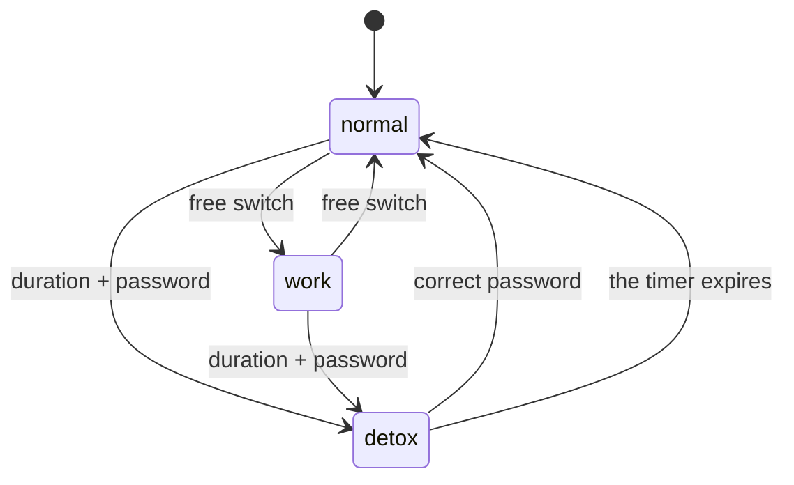
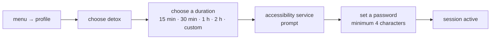

# PROFILES AND DETOX

<a href="../README.md">index</a> · <a href="../../es/usuarios/05-perfiles-y-detox.md">castellano</a> · previous: <a href="./04-apps-and-folders.md">apps and folders</a> · next: <a href="./06-app-schedules.md">app schedules</a>

---

## THE THREE PROFILES

a profile is a mode of using the phone. exactly one is active at any moment, and it is
changed from the side menu by tapping the **selected profile** row.

<table>
<tr>
<th align="left" width="20%">profile</th>
<th align="left" width="45%">what it blocks</th>
<th align="left" width="35%">how you leave it</th>
</tr>
<tr>
<td><strong>normal</strong></td>
<td>nothing</td>
<td>it is the default state</td>
</tr>
<tr>
<td><strong>work</strong></td>
<td>the apps you marked as blocked, plus the ones matching your keywords</td>
<td>freely, at any time</td>
</tr>
<tr>
<td><strong>detox</strong></td>
<td><strong>everything</strong>, except focusphone</td>
<td>with the password, or by waiting for the timer to expire</td>
</tr>
</table>

---

## WORK PROFILE

built for the working day: you want the phone, mail and calendar, but not social media or
video.

### WHAT IT BLOCKS

1. **the apps you mark by hand**: in the all apps drawer, long press an app and choose
   *block*.
2. **the ones matching your keywords**: if the app's name contains any word from your list,
   it is blocked without having to mark it.

### THE KEYWORDS

**settings → focus → work mode keywords**

the list comes pre-filled with a reasonable starting set and is **fully editable**: add,
change or delete whatever you want, or leave it empty so only the hand-marked apps count.

<strong>how to use keywords well</strong>

 

they are text matches against the app name, so it pays to be specific:

| keyword | blocks | risk |
|---|---|---|
| `tok` | tiktok | low |
| `gram` | instagram, telegram | may block more than intended |
| `game` | any app with "game" in its name | high if you have many |

if a keyword blocks something you did not intend, remove it from the list and block that app
by hand instead.

> the work profile **has no password**: you can leave it whenever you want. it is a help
> against autopilot, not a barrier.

---

## DETOX PROFILE

this is the strict mode. while it is active, **no app opens** except focusphone. trying to
open anything shows a full-screen page with the remaining time.

### STARTING A DETOX SESSION

1. open the side menu and tap the profile row.
2. choose **detox**.
3. choose the duration: 15 minutes, 30 minutes, 1 hour, 2 hours, or a custom duration in
   hours and minutes.
4. if the accessibility service is not active, focusphone offers to enable it. you can
   continue without it, but the block will be weaker (see below).
5. set a password of at least 4 characters. **that password is the only thing that ends the
   session early.**

### DURING THE SESSION

- the block screen shows a live countdown
- screenshots and screen recording are blocked on the block screen and on the password dialogs
- focusphone keeps working: you can check the time, the calendar and settings

### ENDING THE SESSION

| way | detail |
|---|---|
| wait | when the timer reaches zero, the profile returns to *normal* on its own, even if the phone was restarted |
| password | enter the correct password on the block screen |

---

## THE PASSWORD AND FAILED ATTEMPTS

<table>
<tr>
<th align="left" width="40%">rule</th>
<th align="left" width="60%">detail</th>
</tr>
<tr>
<td>minimum length</td>
<td>4 characters</td>
</tr>
<tr>
<td>storage</td>
<td>the password is never stored: only a cryptographic digest with a random salt</td>
</tr>
<tr>
<td>allowed attempts</td>
<td>5 consecutive failed attempts</td>
</tr>
<tr>
<td>cooldown</td>
<td>after the fifth failure, <strong>15 minutes</strong> during which every attempt is refused, including the correct one</td>
</tr>
<tr>
<td>what does <strong>not</strong> happen on failure</td>
<td>the password is not erased, the session is not cancelled and no configuration is lost</td>
</tr>
<tr>
<td>persistence</td>
<td>the counter survives restarts: closing the app does not reset attempts</td>
</tr>
</table>

<strong>what if i forget the password?</strong>

 

there is no recovery, and that is intentional: if there were a way around the password, the
lock would be pointless. **but you are never trapped**: every detox session has a timer and
ends on its own when it expires. if you forget the password, you just have to wait.

<strong>why even the correct password is refused during the cooldown</strong>

 

because otherwise, trying passwords would cost nothing. the waiting period makes brute force
impractical, and it does not hurt legitimate use: someone who knows their password gets it
right on the first try.

---

## REAL BLOCKING: THE ACCESSIBILITY SERVICE

focusphone blocks apps launched **from focusphone** without any special permission. but an
app can also be launched from a notification, from recents or from the voice assistant, and
that bypasses the launcher.

focusphone's **accessibility service** closes that route: it watches which app comes to the
foreground and, if it is blocked, shows the block screen on top immediately.

<table>
<tr>
<th align="left" width="50%">without the service</th>
<th align="left" width="50%">with the service</th>
</tr>
<tr>
<td valign="top">

- apps opened from focusphone are blocked
- apps opened from notifications, recents or the assistant are **not** blocked
- time-window schedules work
- **daily usage limits do not work**

</td>
<td valign="top">

- the app is blocked no matter where it is opened from
- schedules work fully
- daily usage limits work: it is the only component that can measure foreground time
- the extra battery cost is minimal

</td>
</tr>
</table>

### HOW TO ENABLE IT

**settings → system → system blocking**, or accept the prompt when starting a detox session.
focusphone opens android's accessibility screen directly; find *focusphone* in the list and
turn it on.

> android shows a generic warning when enabling any accessibility service, because they are
> powerful. focusphone only uses it to know **which app is in the foreground** and to expand
> the notification shade: it does not read screen content, does not type anything and does
> not send anything anywhere.

---

## WHAT CAN AND CANNOT BE BLOCKED

| situation | result |
|---|---|
| opening a blocked app from focusphone | always blocked |
| opening a blocked app from a notification | blocked only with the accessibility service |
| opening a blocked app from recents | blocked only with the accessibility service |
| uninstalling focusphone during a detox | android allows it: focusphone is not a device administrator |
| restarting the phone during a detox | the session continues; the state is checked on every boot |
| changing the system time | the session stays tied to its end timestamp |

---

<a href="./04-apps-and-folders.md">← apps and folders</a> · <a href="../README.md">index</a> · <a href="./06-app-schedules.md">app schedules →</a>

