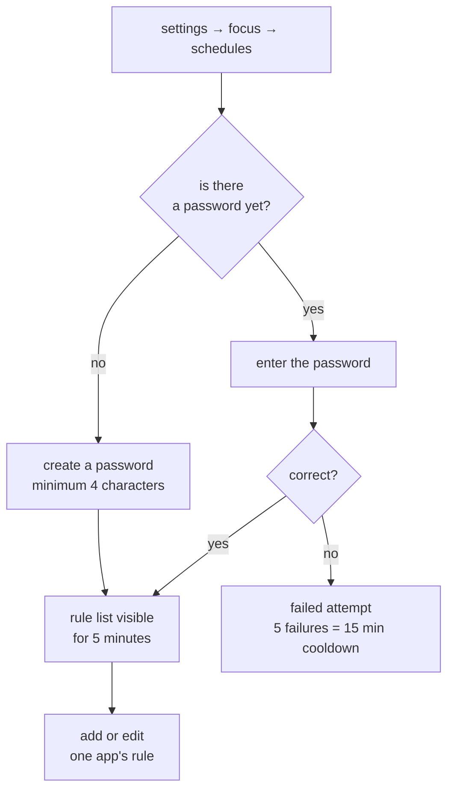

# APP SCHEDULES

<a href="../README.md">index</a> · <a href="../../es/usuarios/06-horarios-de-aplicaciones.md">castellano</a> · previous: <a href="./05-profiles-and-detox.md">profiles and detox</a> · next: <a href="./07-conscious-pause.md">conscious pause</a>

---

## WHAT THEY ARE

a schedule is a permanent rule attached to **one specific app**. it combines two independent
restrictions that can be used together or separately:

<table>
<tr>
<th align="left" width="50%">allowed time window</th>
<th align="left" width="50%">daily usage limit</th>
</tr>
<tr>
<td valign="top">

the app only opens **between two times** and **on the weekdays** you choose.

example: mail only from 09:00 to 18:00, monday to friday.

</td>
<td valign="top">

the app can only be used for **a number of minutes per day**. the counter resets at
midnight.

example: video, 30 minutes a day.

</td>
</tr>
</table>

> schedules are **independent of profiles**: they apply in the normal profile too. they are
> the tool for long-term limits, while detox is for one-off sessions.

---

## REACHING THE SCHEDULES

**settings → focus → app schedules**

the screen is password protected, and shows **absolutely nothing** until you enter it
correctly: you cannot even see which apps have rules.

### THE SCHEDULE PASSWORD

- it is **different** from the detox password
- it is created the first time you enter the screen
- minimum 4 characters
- after entering it you have **5 minutes** to adjust several apps without being asked again;
  that grant lives in memory only and disappears when the app closes
- after **5 failed attempts**, the screen is locked for **15 minutes**
- failing **never** deletes the rules or the password

---

## CREATING A RULE

1. open the schedules screen and enter the password
2. tap to add an app and pick it from the list
3. configure the window, the days and the daily limit
4. save

<strong>configuring the time window</strong>

 

| field | detail |
|---|---|
| enable window | switch that turns this restriction on |
| start time | the time from which the app may be used |
| end time | the time from which it is blocked again |
| days | weekday chips, shown in your system's language and order |

important rules:

- the window is **closed at the start and open at the end**: a 09:00-18:00 window blocks at
  exactly 18:00
- a window that **wraps past midnight** is valid: 22:00 → 06:00 works, and that window
  belongs to the day it **starts** on. with 22:00 → 06:00 enabled only on friday, 02:00 on
  saturday is still allowed because it is the tail of friday
- if start and end are **equal**, the window covers the whole selected day
- if you select no days, it means **every day**

<strong>configuring the daily limit</strong>

 

| field | detail |
|---|---|
| minutes per day | how many minutes are allowed per day |
| reset | automatic at local midnight |

to enforce any rule when an app opens from recents, suggested shortcuts, notifications,
or anywhere outside focusphone, **enable the accessibility service**. without it, a time
window is only checked for launches from focusphone. daily limits also need the service
to measure how long an app stays in the foreground.

time accumulates while the app is in the foreground and **pauses while the screen is off**.
the rule is re-checked every 30 seconds, or exactly when the allowance would run out, so a
session is interrupted the moment the limit is passed, not the next time you open the app.

---

## WHAT YOU SEE WHEN IT IS BLOCKED

a full-screen page explains the reason:

| reason | message |
|---|---|
| outside the window | names the allowed window, for example *available from 09:00 to 18:00* |
| allowance used up | names minutes used and the limit, for example *30 of 30 minutes used today* |

**this screen has no unlock button**, unlike the detox one. that is deliberate: a schedule is
a standing configuration, and the only way to change it is the password-protected settings
screen. putting an unlock shortcut there would offer the way out at the exact moment someone
wants to bypass it.

---

## PRACTICAL EXAMPLES

<strong>social media only in the evening, on weekdays</strong>

 

| field | value |
|---|---|
| window | enabled, 18:00 → 21:00 |
| days | monday, tuesday, wednesday, thursday, friday |
| daily limit | disabled |

result: on weekdays it only opens between 18:00 and 21:00; at the weekend it does not open at
all, because saturday and sunday are not selected.

<strong>video, half an hour a day, any time</strong>

 

| field | value |
|---|---|
| window | disabled |
| daily limit | 30 minutes |

result: you can open it at any time, but when the 30 minutes are used up it is blocked until
midnight. requires the accessibility service.

<strong>no phone in the small hours</strong>

 

| field | value |
|---|---|
| window | enabled, 07:00 → 23:30 |
| days | all |
| daily limit | disabled |

result: between 23:30 and 07:00 that app does not open on any day.

<strong>work mail only during office hours, with a cap</strong>

 

| field | value |
|---|---|
| window | enabled, 09:00 → 18:00 |
| days | monday to friday |
| daily limit | 60 minutes |

result: both restrictions apply at once. outside the window it is blocked by time; inside it,
it is blocked once the accumulated hour is reached.

---

## SCHEDULES VERSUS DETOX

| | schedules | detox |
|---|---|---|
| scope | one app at a time | every app |
| duration | permanent, until you change it | a timed session |
| activation | automatic, always | manual, when you start it |
| password | the schedule one | the detox session one |
| early exit | none: only from settings | the session password |
| required profile | any, including normal | the detox profile |

---

<a href="./05-profiles-and-detox.md">← profiles and detox</a> · <a href="../README.md">index</a> · <a href="./07-conscious-pause.md">conscious pause →</a>

