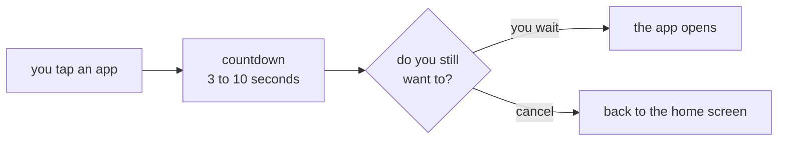

# CONSCIOUS PAUSE

<a href="../README.md">index</a> · <a href="../../es/usuarios/07-pausa-consciente.md">castellano</a> · previous: <a href="./06-app-schedules.md">app schedules</a> · next: <a href="./08-customization.md">customization</a>

---

## WHAT IT IS

the conscious pause is **one guided breath** of a few seconds that appears **between** the
moment you tap an app and the moment it opens:

- during the first half a disc **swells** (*inhale…*) and during the second half it
  **settles** (*exhale…*), inside a ring that fills as the time passes.
- a light haptic tick marks the moment the breath turns.
- the question stays on screen the whole time:

> are you sure you want to open *x*?

- if the app has a daily limit (see [app schedules](./06-app-schedules.md)), the pause also
  tells you how many **minutes are left today**.

when the breath ends, the app opens on its own. if at any point you decide not to, you tap
**cancel** and go back to the home screen. with android's animations turned off, the disc
stays still and only the ring and the text move.

---

## WHY IT WORKS

opening an app is usually a reflex: the hand gets there before the decision. the pause does
not prevent anything, it just **inserts a decision where there used to be an automatism**.
in practice, a share of those openings get cancelled effortlessly, simply because there is
now a moment in which to notice.

---

## ENABLING AND CONFIGURING IT

**settings → focus → conscious pause**

| option | detail |
|---|---|
| enable conscious pause | master switch; it ships disabled |
| duration | from **3 to 10 seconds**, with a slider |

<strong>which duration to pick</strong>

 

| duration | how it feels | recommended for |
|---|---|---|
| 3 seconds | barely noticeable | a first try, or if you find it annoying |
| 5 seconds | enough to notice | most cases |
| 7 to 10 seconds | clearly uncomfortable on reflex openings | when you really want to cut down the number of openings |

---

## HOW IT BEHAVES

<table>
<tr>
<th align="left" width="45%">situation</th>
<th align="left" width="55%">result</th>
</tr>
<tr>
<td>you open an app from the home screen</td>
<td>the pause appears</td>
</tr>
<tr>
<td>you open an app from the all apps drawer</td>
<td>the pause appears</td>
</tr>
<tr>
<td>you open an app from a focusphone widget, in focusphone or in another launcher</td>
<td>the pause appears</td>
</tr>
<tr>
<td>you open an app shortcut from the long-press menu of a favourite</td>
<td>the pause appears</td>
</tr>
<tr>
<td>you leave the pause screen (by pressing home, for example)</td>
<td>the countdown <strong>stops</strong>, it does not keep running in the background</td>
</tr>
<tr>
<td>you come back to the pause screen</td>
<td>the countdown resumes</td>
</tr>
<tr>
<td>the app is blocked by profile or schedule</td>
<td>no pause: the block screen is shown directly</td>
</tr>
<tr>
<td>you open an app from a notification</td>
<td>no pause: that launch does not go through focusphone</td>
</tr>
</table>

<strong>why the countdown stops when you leave</strong>

 

because of a real android limitation: since android 10, an app that is not in the foreground
**cannot launch another app**. if the countdown kept running in the background, nothing
would happen when it ended and the tap would be lost. stopping it keeps the behaviour
predictable.

---

## COMBINING IT WITH THE REST

the conscious pause is the gentlest of the three focus tools, and it combines with all of
them:

| tool | intensity | when it acts |
|---|---|---|
| conscious pause | low: it only adds a delay | every time you open an app from focusphone |
| work profile | medium: it blocks, but you can leave freely | while the profile is active |
| schedules | high: blocks by clock and usage, password protected | always, per each app's rule |
| detox | maximum: blocks everything, with a password and a timer | for the length of the session |

a progression that tends to work: start with just the conscious pause for a few days, then
add the work profile, and keep schedules and detox for the specific apps that resist.

---

<a href="./06-app-schedules.md">← app schedules</a> · <a href="../README.md">index</a> · <a href="./08-customization.md">customization →</a>

