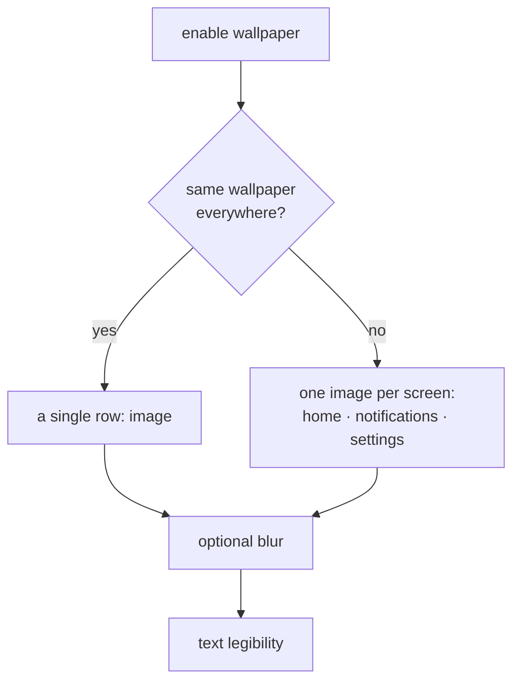

# CUSTOMIZATION

<a href="../README.md">index</a> · <a href="../../es/usuarios/08-personalizacion.md">castellano</a> · previous: <a href="./07-conscious-pause.md">conscious pause</a> · next: <a href="./09-notifications-and-widgets.md">notifications and widgets</a>

---

## THEMES

**settings → appearance → theme**

focusphone ships four monochrome palettes, an automatic mode and a fully customizable theme.

<table>
<tr>
<th align="left">theme</th>
<th align="left">type</th>
<th align="left">background</th>
<th align="left">text</th>
<th align="left">character</th>
</tr>
<tr><td><strong>off-white</strong></td><td>light</td><td><code>#FAFAFA</code></td><td><code>#333333</code></td><td>paper-like, neutral, very readable in daylight</td></tr>
<tr><td><strong>slate</strong></td><td>dark</td><td><code>#181818</code></td><td><code>#E0E0E0</code></td><td>dark grey, the default theme</td></tr>
<tr><td><strong>warm beige</strong></td><td>light</td><td><code>#FEFEFE</code></td><td><code>#4A4A4A</code></td><td>warm, with sand-coloured accents</td></tr>
<tr><td><strong>navy</strong></td><td>dark</td><td><code>#0A0E17</code></td><td><code>#E2E8F0</code></td><td>very deep blue, almost black</td></tr>
<tr><td><strong>auto</strong></td><td>both</td><td>—</td><td>—</td><td>uses slate when the system is in dark mode and off-white when it is light</td></tr>
<tr><td><strong>custom</strong></td><td>whatever you pick</td><td>your colour</td><td>your colour</td><td>you choose the background and the text colour</td></tr>
</table>

<strong>the automatic theme</strong>

 

with **auto**, focusphone follows android's light/dark setting. the change is detected on its
own, without reopening the app: if your phone switches to dark mode at sunset, focusphone
switches to slate at that moment.

<strong>the custom theme</strong>

 

choosing **custom** opens a panel with two hexadecimal colours:

| field | example | what it is |
|---|---|---|
| background colour | `#181818` | the background of every screen |
| text colour | `#E0E0E0` | the colour of the primary text |

the accepted format is `#RRGGBB` with six hexadecimal digits. an invalid value is reported
and the safe defaults are kept.

**and if you pick a barely readable combination**, for example grey on grey, focusphone does
not leave you with an unreadable screen: it adjusts the text automatically until it reaches a
minimum contrast, following the same criterion the web accessibility guidelines use.

---

## TYPOGRAPHY AND TEXT

**settings → appearance**

### TYPEFACE

| option | character |
|---|---|
| system | your android's default typeface |
| poppins | geometric, round and very clean |
| comfortaa | rounded and soft, the most informal |
| jetbrains mono | monospaced, technical look |

the selector shows a live sample of each typeface before applying it.

### TEXT SIZE

**settings → appearance** has two sliders, both between **8 and 24 points**:

| slider | affects | default |
|---|---|---|
| app text size | settings, all apps, dialogs and every other screen | 14 |
| home text size | the home screen, including its side menu and notification panel | follows the app text size until you move it |

both keep the hierarchy: titles stay larger than body text, and bold stays bold. if you used
an earlier version, the home screen keeps its current look until you choose a home size.

### ALIGNMENT

| option | good for |
|---|---|
| left | comfortable for right-handed one-handed use |
| centre | the most balanced look, and the default |
| right | comfortable for left-handers, or for very large phones |

it affects the favourites list on the home screen.

### STATUS BAR

the system **status bar can be hidden** for a fully clean home screen, with no system clock
and no battery or signal icons.

---

## THE CLOCK

**settings → home screen**

| setting | detail |
|---|---|
| clock type | digital, stacked, in words, analog or hidden |
| clock size | percentage slider |

the 12 or 24 hour format is **not configured in focusphone**: it is taken from the system
setting, so there are not two places to change the same thing.

---

## WALLPAPER

**settings → appearance → wallpaper**

focusphone can use its own image as a background, independent of the android wallpaper.

<table>
<tr>
<th align="left" width="35%">setting</th>
<th align="left" width="65%">detail</th>
</tr>
<tr>
<td>enable wallpaper</td>
<td>master switch; with it off, everything else disappears from the screen</td>
</tr>
<tr>
<td>same wallpaper everywhere</td>
<td>with it on, one image serves home, notifications and settings</td>
</tr>
<tr>
<td>image</td>
<td>opens the android image picker; the preview is tapped to change it</td>
</tr>
<tr>
<td>blur</td>
<td>blurs the image so text stands out</td>
</tr>
<tr>
<td>blur intensity</td>
<td>slider; only appears while blur is on</td>
</tr>
<tr>
<td>text legibility</td>
<td>slider from 0 to 100 that darkens or lightens a layer between the image and the text</td>
</tr>
</table>

<strong>the preview</strong>

 

the section includes a preview with a sample clock that follows blur and legibility **live**
while you drag the sliders, so you never have to leave settings to see the result. tapping
the preview opens the image picker directly.

<strong>what happens to the image you pick</strong>

 

focusphone **copies** the image into its private storage, downscaled and with the rotation
corrected. it does not keep a reference to the gallery, because that kind of reference
expires when the process ends and the wallpaper would disappear after a restart.

the copy is deleted automatically once no screen uses it any more.

<strong>why the legibility setting exists</strong>

 

a bright photo with bright text on top is unreadable. instead of fixing an arbitrary opacity,
focusphone paints a layer in **your theme's** background colour between the image and the
content, and lets you control its strength. each surface (home screen, notification drawer,
menu, settings) gets the amount it needs for what it renders.

---

## HOME SCREEN LAYOUT

the layout is edited directly on the home screen, in **edit mode**: long press an empty spot,
a widget or the clock, or use **settings → home screen → edit home screen**. there you move
and resize the clock, the favourites and any number of widgets, and change the size of the
grid. the whole procedure is in
[home screen and gestures → edit mode](./03-home-screen-and-gestures.md#edit-mode).

the favourites list cannot be removed: it is the core of the screen.

### APP SPACING

**settings → home screen → spacing** adjusts the vertical gap between favourite rows, in
density-independent pixels. more space looks airier; less space lets all ten apps fit without
scrolling.

---

## LANGUAGE

**settings → system → language**

| option |
|---|
| follow the system language |
| english |
| british english |
| spanish |
| french |
| german |

the language can be changed for focusphone alone, without touching the rest of the phone.
weekday names and the week order in the calendar and the schedules follow the active
language.

---

<a href="./07-conscious-pause.md">← conscious pause</a> · <a href="../README.md">index</a> · <a href="./09-notifications-and-widgets.md">notifications and widgets →</a>

