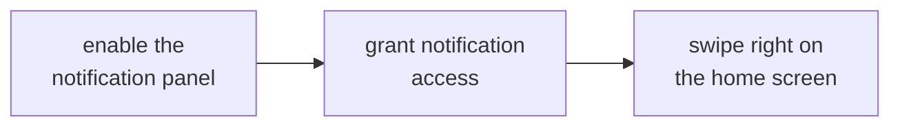

# NOTIFICATIONS AND WIDGETS

<a href="../README.md">index</a> · <a href="../../es/usuarios/09-notificaciones-y-widgets.md">castellano</a> · previous: <a href="./08-customization.md">customization</a> · next: <a href="./10-settings-reference.md">settings reference</a>

---

## THE SIDE NOTIFICATION PANEL

focusphone can show your notifications in its own drawer, opened by **swiping right** on the
home screen. it is a calmer alternative to the system shade: text only, styled with whatever
theme you are using.

### ENABLING IT

**settings → notifications**

1. turn on **notification panel**
2. grant **notification access**: focusphone opens the android screen where it is granted
3. swipe right on the home screen

### HOW IT IS USED

| action | result |
|---|---|
| tap a notification | opens the corresponding app |
| swipe a notification to the right | dismisses it |
| clear button | dismisses all of them at once |

### PRIVACY

<table>
<tr>
<td>

notification content (title and text) **lives only in ram**. it is never written to disk,
never stored in any database and never leaves the device. when the focusphone process ends,
the list is cleared and repopulated the next time the service connects.

</td>
</tr>
</table>

---

## THE SWIPE-DOWN GESTURE

**settings → notifications → swipe-down gesture**

with this setting on, swiping down on the home screen expands **android's notification
shade**, the usual one, without having to reach the top edge of the screen.

<strong>it works better with the accessibility service</strong>

 

focusphone uses the official accessibility action to expand the shade. if focusphone's
accessibility service is active, the gesture always works reliably.

without the service, focusphone tries an older alternative route that android blocks from
version 12 onwards, so on modern phones the gesture may not respond. if that happens, enable
the accessibility service in **settings → system → system blocking**.

---

## NOTIFICATION BADGES

the notifications section also controls whether the apps on the home screen show an indicator
when they have pending notifications. it is a discreet, text-based indicator, consistent with
the rest of the interface: there are no red circles.

---

## WIDGETS

the home screen holds **any number of widgets**, each in its own block of the grid (see
[edit mode](./03-home-screen-and-gestures.md#edit-mode)). they can be focusphone's own or
those of your other apps.

### FOCUSPHONE'S 20 WIDGETS

they follow your active theme (the custom one included) and redraw when you change theme,
colours, day/night mode or language. their icons are [lucide](https://lucide.dev) icons. they
are real android widgets, so **they also work in any other launcher**, and opening an app
from them always goes through focusphone's profile block, schedule and conscious pause.

| group | widget | what it shows |
|---|---|---|
| time | clock | large time, the date and the next alarm |
| time | analog clock | an analog face |
| time | world clock | up to three cities side by side, each with its offset from local time (chosen when you add it) |
| time | today | weekday, day of the month and month on a square tile |
| time | month | the month grid |
| time | week | the current week as a strip |
| music | music bar · music player · music tile | what is playing, with play/pause, previous and next; the tile uses the artwork |
| navigation | search | a search field that opens all apps with the keyboard already up |
| navigation | spotlight | search plus your favourites |
| navigation | favourites | as many favourites as its height holds, in the home screen's order |
| system | battery | battery level as a ring, with a charging icon |
| system | storage | free and used storage |
| system | system | battery, storage and memory together |
| system | quick settings | a real torch toggle, plus shortcuts to android's internet, bluetooth and volume panels and to settings |
| system | next alarm | the time of your next alarm |
| focus | focus profile | the active profile and, during a detox, its end |
| focus | intention | a sentence you write for the day, stored encrypted |
| focus | progress | how much of the day, week, month and year has passed |

> the three music widgets need **notification access**, because android only exposes what
> is playing to notification listeners. without it they show a "no access" state.

### ADDING A WIDGET

from edit mode (**widgets** in the bottom bar) or from **settings → home screen → add
widget**, which also shows how many widgets the home screen has. the picker:

- groups widgets by app, with the app's icon, and lists **focusphone's own first**;
- has a fuzzy search;
- shows faithful previews (on android 12+, the widget's own preview layout rendered live);
- shows each widget's size in cells of **your** grid, and marks with *in use* the ones
  already on the home screen.

if a widget needs its own configuration, its configuration screen opens before it is placed.
if the grid has no room, the picker tells you instead of replacing another widget.

### CHANGING OR REMOVING IT

in edit mode, tap the widget: its floating bar offers **widget settings** (when the widget
can be reconfigured) and **remove**. to move or resize it, drag it or pull its handles.

<strong>"widget unavailable"</strong>

 

while the app that provides a widget is being updated, android briefly removes the widget's
provider. focusphone shows *widget unavailable while its app updates* in its place instead of
deleting it, and the widget comes back on its own when the update finishes.

<strong>widgets from other apps</strong>

 

the widgets that disturb the look least are the text ones or the single-value ones (weather
in its compact form, the next calendar event, a quick note). large widgets with images,
carousels or news feeds work, but bring the visual noise back to the screen. each
manufacturer pads widgets differently: focusphone removes that default padding and, when a
widget does not fit its block, shrinks it instead of cropping it.

---

## PERMISSION SUMMARY FOR THIS SECTION

| feature | permission needed | mandatory |
|---|---|---|
| side notification panel | notification access | only for this feature |
| swipe-down gesture | accessibility service (recommended) | no, but without it it may not work on android 12+ |
| notification badges | notification access | only for this feature |
| focusphone's music widgets | notification access | only for those three widgets |
| any other widget | none | — |

---

<a href="./08-customization.md">← customization</a> · <a href="../README.md">index</a> · <a href="./10-settings-reference.md">settings reference →</a>

