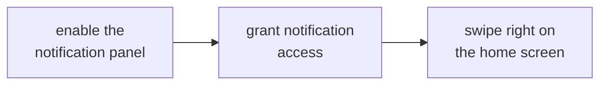

# NOTIFICATIONS AND WIDGETS

<a href="../README.md">index</a> · <a href="../../es/usuarios/09-notificaciones-y-widgets.md">castellano</a> · previous: <a href="./08-customization.md">customization</a> · next: <a href="./10-settings-reference.md">settings reference</a>

---

## THE SIDE NOTIFICATION PANEL

focusphone can show your notifications in its own drawer, opened by **swiping right** on the
home screen. it is a calmer alternative to the system shade: text only, styled with whatever
theme you are using.

### ENABLING IT

**settings → notifications**

1. turn on **notification panel**
2. grant **notification access**: focusphone opens the android screen where it is granted
3. swipe right on the home screen

### HOW IT IS USED

| action | result |
|---|---|
| tap a notification | opens the corresponding app |
| swipe a notification to the right | dismisses it |
| clear button | dismisses all of them at once |

### PRIVACY

<table>
<tr>
<td>

notification content (title and text) **lives only in ram**. it is never written to disk,
never stored in any database and never leaves the device. when the focusphone process ends,
the list is cleared and repopulated the next time the service connects.

</td>
</tr>
</table>

---

## THE SWIPE-DOWN GESTURE

**settings → notifications → swipe-down gesture**

with this setting on, swiping down on the home screen expands **android's notification
shade**, the usual one, without having to reach the top edge of the screen.

<strong>it works better with the accessibility service</strong>

 

focusphone uses the official accessibility action to expand the shade. if focusphone's
accessibility service is active, the gesture always works reliably.

without the service, focusphone tries an older alternative route that android blocks from
version 12 onwards, so on modern phones the gesture may not respond. if that happens, enable
the accessibility service in **settings → system → system blocking**.

---

## NOTIFICATION BADGES

the notifications section also controls whether the apps on the home screen show an indicator
when they have pending notifications. it is a discreet, text-based indicator, consistent with
the rest of the interface: there are no red circles.

---

## THE HOME SCREEN WIDGET

focusphone supports **exactly one widget** on the home screen. this is deliberate: a grid of
widgets would turn the screen back into the shop window it is trying to escape.

### ADDING A WIDGET

**settings → home screen → widget**

1. tap the widget row
2. pick a widget from the list your apps offer
3. if the widget needs its own configuration, its configuration screen opens
4. the widget appears on the home screen, in the position it has in the layout

### REMOVING OR CHANGING IT

| action | how |
|---|---|
| change widget | go back to the widget row and pick another |
| remove the widget | tap *remove widget* and confirm |
| hide it without removing it | turn off the widget block in *layout* |

<strong>widgets that fit well</strong>

 

the widgets that disturb the look least are the text ones or the single-value ones:

- weather, in its compact form
- next calendar event
- quick note
- minimalist music control
- step counter

the ones that fit worst are large widgets with images, carousels or news feeds: they work,
but they push the favourites list down and bring the visual noise back to the screen.

---

## PERMISSION SUMMARY FOR THIS SECTION

| feature | permission needed | mandatory |
|---|---|---|
| side notification panel | notification access | only for this feature |
| swipe-down gesture | accessibility service (recommended) | no, but without it it may not work on android 12+ |
| notification badges | notification access | only for this feature |
| widget | none | — |

---

<a href="./08-customization.md">← customization</a> · <a href="../README.md">index</a> · <a href="./10-settings-reference.md">settings reference →</a>

