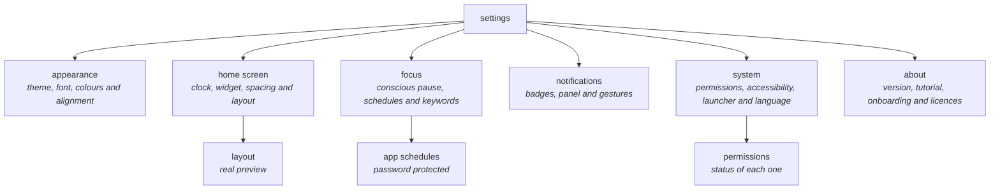

# SETTINGS REFERENCE

<a href="../README.md">index</a> · <a href="../../es/usuarios/10-referencia-de-ajustes.md">castellano</a> · previous: <a href="./09-notifications-and-widgets.md">notifications and widgets</a> · next: <a href="./11-privacy-and-permissions.md">privacy and permissions</a>

---

## HOW THEY ARE ORGANIZED

settings open from the side menu, under **focus settings**. the main screen holds no
controls: it is a menu of six categories, and each one opens its own screen.

---

## APPEARANCE

<strong>section: appearance</strong>

 

| setting | type | values | effect |
|---|---|---|---|
| theme | selector | off-white · slate · warm beige · navy · auto · custom | changes the whole colour palette of the app |

choosing **custom** reveals a panel with two hexadecimal colour fields (`#RRGGBB`):
background and text. an invalid value is rejected with a warning and the safe defaults are
kept.

<strong>section: font</strong>

 

| setting | type | values |
|---|---|---|
| typeface | selector with live sample | system · poppins · comfortaa · jetbrains mono |

<strong>section: text and layout</strong>

 

| setting | type | range | default |
|---|---|---|---|
| text size | slider | 8 to 24 points, step 1 | 14 |
| alignment | three-icon selector | left · centre · right | centre |
| hide the status bar | switch | yes / no | no |

<strong>section: wallpaper</strong>

 

| setting | type | detail |
|---|---|---|
| enable wallpaper | switch | master switch; with it off, the rest of the section is hidden |
| same wallpaper everywhere | switch | a single image for home, notifications and settings |
| image | row with preview | tapped to open the android image picker |
| home / notifications / settings | three rows | only shown with shared mode off; each screen gets its own image |
| blur | switch | blurs the image |
| blur intensity | slider | only visible while blur is on |
| text legibility | slider | 0 to 100, default 60 |

the options in this section apply **immediately on the settings screen itself**, without
reloading it.

---

## HOME SCREEN

<strong>section: clock</strong>

 

| setting | type | values | default |
|---|---|---|---|
| clock type | selector with thumbnails | digital · stacked · in words · analog · hidden | digital |
| clock size | slider | 0 to 100 | — |

<strong>section: launcher</strong>

 

| setting | type | range | effect |
|---|---|---|---|
| app spacing | slider | 0 to 40 dp | vertical gap between favourite rows |
| widget | row with value | none, or the active widget's name | adds, changes or removes the single home screen widget |
| layout | opens another screen | — | reorders and hides clock, widget and app list, with a real preview |

---

## FOCUS

<strong>section: conscious pause</strong>

 

| setting | type | range | default |
|---|---|---|---|
| enable conscious pause | switch | yes / no | no |
| duration | slider | 3 to 10 seconds | — |

with the pause off, the whole duration row dims, not just the slider.

<strong>section: scheduled apps</strong>

 

| setting | type | detail |
|---|---|---|
| app schedules | opens another screen | password-protected screen; see [app schedules](./06-app-schedules.md) |

<strong>section: work profile</strong>

 

| setting | type | detail |
|---|---|---|
| work mode keywords | multiline text field | one word per line; stored lowercased, empty lines ignored |

tap **save** to apply. an empty list is valid: in that case only the hand-marked apps are
blocked.

---

## NOTIFICATIONS

<strong>section: notifications</strong>

 

| setting | type | detail |
|---|---|---|
| notification access | row with status | shows *active* or *inactive*; tapping it opens the android screen where it is granted |
| notification panel | switch | enables focusphone's side notification drawer |
| swipe-down gesture | switch | lets you expand the system shade by swiping down on the home screen |

---

## SYSTEM

<strong>section: system</strong>

 

| setting | type | detail |
|---|---|---|
| permissions | opens another screen | lists the status of each permission: granted / denied, active / inactive |
| system blocking | row with status | accessibility service status; tapping it opens android's accessibility screen |
| set as default | row with status | says whether focusphone is the default launcher and opens the screen to change it |

<strong>section: language</strong>

 

| setting | type | values |
|---|---|---|
| language | row with value | system · english · british english · spanish · french · german |

the change affects focusphone only, not the rest of the phone.

<strong>the permissions screen</strong>

 

| permission | status it shows | needed for |
|---|---|---|
| see installed apps | granted / denied | listing apps in the drawer and the selector |
| accessibility service | active / inactive | real blocking and daily usage limits |
| default launcher | active / inactive | making the home button open focusphone, and app shortcuts |

---

## ABOUT

<strong>section: about</strong>

 

| row | what it does |
|---|---|
| version | shows the installed version; tapping it opens the privacy policy |
| tutorial | opens the interactive tutorial, which highlights the real home screen elements |
| restart the tutorial | starts the tutorial again from step one, after confirmation |
| restart onboarding | relaunches the 5-step onboarding, after confirmation |
| open source | shows the licences of the third-party libraries used |

---

## QUICK TABLE: WHERE EVERYTHING IS

| i want to… | path |
|---|---|
| change the app's colours | appearance → theme |
| use my own colours | appearance → theme → custom |
| change the typeface | appearance → font |
| make the text bigger | appearance → text size |
| move the list to one side | appearance → alignment |
| remove the status bar | appearance → hide the status bar |
| set a photo as background | appearance → wallpaper |
| change the clock style | home screen → clock type |
| remove the clock | home screen → clock type → hidden |
| add a widget | home screen → widget |
| reorder clock, widget and apps | home screen → layout |
| space the apps further apart | home screen → app spacing |
| breathe before opening an app | focus → conscious pause |
| limit an app by time | focus → app schedules |
| tune what work mode blocks | focus → work mode keywords |
| see notifications inside focusphone | notifications → notification panel |
| expand the shade with a gesture | notifications → swipe-down gesture |
| enable real blocking | system → system blocking |
| make focusphone my home screen | system → set as default |
| change the app's language | system → language |
| replay the tutorial | about → tutorial |
| check the installed version | about → version |

---

<a href="./09-notifications-and-widgets.md">← notifications and widgets</a> · <a href="../README.md">index</a> · <a href="./11-privacy-and-permissions.md">privacy and permissions →</a>

