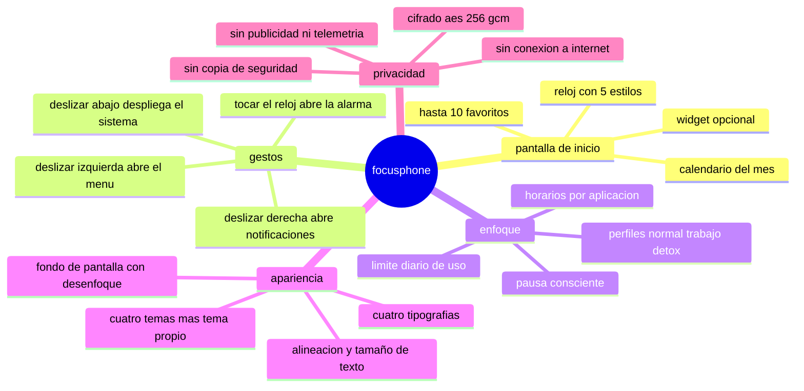

# DOCUMENTACION DE FOCUSPHONE — CASTELLANO

 

<strong>focusphone es un lanzador minimalista de android que sustituye tu pantalla de inicio 
por una lista de texto: un reloj, un calendario y solo las aplicaciones que de verdad usas.</strong>

 

---

## POR DONDE EMPEZAR

<table>
<tr>
<td width="50%" valign="top">

### SOY USUARIO

acabo de instalar focusphone, o quiero saber que hace antes de instalarlo. no
necesito saber programar.

**empieza aqui →** [que es focusphone](./usuarios/01-que-es-focusphone.md)

la ruta mas corta para tenerlo funcionando:

1. [que es focusphone](./usuarios/01-que-es-focusphone.md)
2. [instalacion y primeros pasos](./usuarios/02-instalacion-y-primeros-pasos.md)
3. [pantalla de inicio y gestos](./usuarios/03-pantalla-de-inicio-y-gestos.md)
4. [aplicaciones y carpetas](./usuarios/04-aplicaciones-y-carpetas.md)

</td>
<td width="50%" valign="top">

### SOY DESARROLLADOR

quiero leer el codigo, entender las decisiones de diseño o contribuir al
proyecto.

**empieza aqui →** [arquitectura](./desarrolladores/01-arquitectura.md)

la ruta mas corta para orientarte:

1. [arquitectura](./desarrolladores/01-arquitectura.md)
2. [estructura del proyecto](./desarrolladores/02-estructura-del-proyecto.md)
3. [entorno y compilacion](./desarrolladores/03-entorno-y-compilacion.md)
4. [guia de contribucion](./desarrolladores/12-contribuir.md)

</td>
</tr>
</table>

---

## INDICE PARA USUARIOS

| # | documento | de que trata |
|---|---|---|
| 01 | [que es focusphone](./usuarios/01-que-es-focusphone.md) | la idea del proyecto, para quien es, que hace y que no hace |
| 02 | [instalacion y primeros pasos](./usuarios/02-instalacion-y-primeros-pasos.md) | requisitos, instalar el apk, ponerlo como lanzador por defecto y completar la bienvenida |
| 03 | [pantalla de inicio y gestos](./usuarios/03-pantalla-de-inicio-y-gestos.md) | que hay en la pantalla de inicio y que hace cada gesto |
| 04 | [aplicaciones y carpetas](./usuarios/04-aplicaciones-y-carpetas.md) | elegir favoritos, el cajon de todas las apps, buscar, renombrar, carpetas y desinstalar |
| 05 | [perfiles y detox](./usuarios/05-perfiles-y-detox.md) | los perfiles normal, trabajo y detox, el bloqueo con contraseña y el bloqueo real del sistema |
| 06 | [horarios de aplicaciones](./usuarios/06-horarios-de-aplicaciones.md) | franjas horarias por app, dias de la semana y limite diario de uso |
| 07 | [pausa consciente](./usuarios/07-pausa-consciente.md) | la respiracion previa a abrir una app y como configurarla |
| 08 | [personalizacion](./usuarios/08-personalizacion.md) | temas, colores propios, tipografias, tamaño de texto, relojes, fondo de pantalla y distribucion |
| 09 | [notificaciones y widgets](./usuarios/09-notificaciones-y-widgets.md) | el panel lateral de notificaciones, el gesto hacia abajo y el widget de la pantalla de inicio |
| 10 | [referencia de ajustes](./usuarios/10-referencia-de-ajustes.md) | todas las pantallas de ajustes, opcion por opcion |
| 11 | [privacidad y permisos](./usuarios/11-privacidad-y-permisos.md) | que permisos pide, por que, que datos guarda y donde |
| 12 | [preguntas frecuentes](./usuarios/12-preguntas-frecuentes.md) | dudas y problemas habituales, con su solucion |

---

## INDICE PARA DESARROLLADORES

| # | documento | de que trata |
|---|---|---|
| 01 | [arquitectura](./desarrolladores/01-arquitectura.md) | capas, flujo de datos, inyeccion manual de dependencias y decisiones clave |
| 02 | [estructura del proyecto](./desarrolladores/02-estructura-del-proyecto.md) | mapa de carpetas y responsabilidad de cada paquete |
| 03 | [entorno y compilacion](./desarrolladores/03-entorno-y-compilacion.md) | requisitos, gradle, catalogo de versiones, variantes de build y firma |
| 04 | [capa de datos](./desarrolladores/04-capa-de-datos.md) | room, preferencias sincronas, repositorios y migraciones |
| 05 | [capa de dominio](./desarrolladores/05-capa-de-dominio.md) | modelos, casos de uso y utilidades puras |
| 06 | [capa de presentacion](./desarrolladores/06-capa-de-presentacion.md) | activities, viewmodels, adaptadores y patrones de ui |
| 07 | [sistema de temas](./desarrolladores/07-sistema-de-temas.md) | `FocusPalette`, `FocusColors`, `SurfaceScrim`, contraste wcag y fondo de pantalla |
| 08 | [seguridad](./desarrolladores/08-seguridad.md) | cifrado en reposo, hashing de contraseñas, politica de intentos y superficie de ataque |
| 09 | [servicios del sistema](./desarrolladores/09-servicios-del-sistema.md) | servicio de accesibilidad, escucha de notificaciones y contabilidad de uso |
| 10 | [pruebas y calidad](./desarrolladores/10-pruebas-y-calidad.md) | pruebas unitarias, instrumentadas, dobles de prueba y lint |
| 11 | [ci y publicacion](./desarrolladores/11-ci-y-publicacion.md) | workflow de github actions, versionado y proceso de release |
| 12 | [contribuir](./desarrolladores/12-contribuir.md) | ramas, formato de commits, pull requests y estilo de codigo |

---

## RESUMEN EN UNA PAGINA

---

<a href="../README.md">← volver al indice general</a> · <a href="../en/README.md">english version</a>

