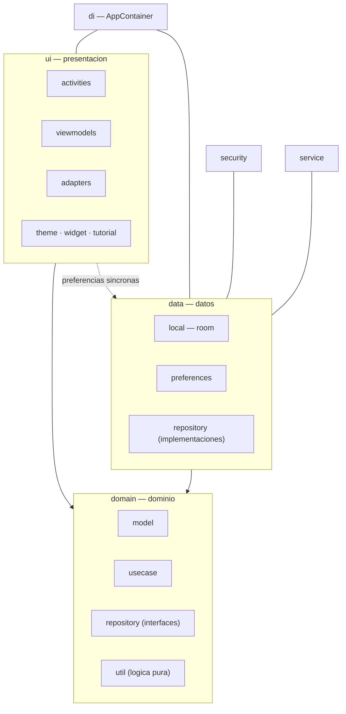
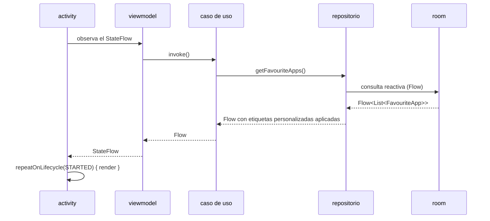

<div align="center">

# ARQUITECTURA

<sub><a href="../README.md">indice</a> · <a href="../../en/developers/01-architecture.md">english</a> · siguiente: <a href="./02-estructura-del-proyecto.md">estructura del proyecto</a></sub>

</div>

---

## VISION GENERAL

focusphone es una aplicacion android de **un solo modulo** (`:app`), escrita integramente
en kotlin, que sigue una **clean architecture ligera** con tres capas y el patron **mvvm**
en la presentacion.

| propiedad | valor |
|---|---|
| modulos | uno: `:app` |
| paquete | `app.focusphone` |
| lenguaje | kotlin |
| sdk minimo | 24 |
| sdk objetivo y de compilacion | 36 |
| compatibilidad java | 11 |
| agp | 9.3.0 |
| toolchain del daemon | jdk 21 |
| ui | vistas xml con view binding; **no** compose |
| asincronia | corrutinas de kotlin, `StateFlow` y `SharedFlow` |

---

## LAS TRES CAPAS



<table>
<tr>
<th align="left" width="20%">capa</th>
<th align="left" width="40%">responsabilidad</th>
<th align="left" width="40%">depende de</th>
</tr>
<tr>
<td><code>domain</code></td>
<td>modelos de negocio, casos de uso, interfaces de repositorio y logica pura testeable</td>
<td>nada del framework de android en la parte pura (<code>util</code>, <code>model</code>, <code>usecase</code>)</td>
</tr>
<tr>
<td><code>data</code></td>
<td>persistencia: room para los favoritos, preferencias sincronas para todo lo demas, e implementaciones de los repositorios</td>
<td><code>domain</code> y el framework de android</td>
</tr>
<tr>
<td><code>ui</code></td>
<td>activities, viewmodels, adaptadores, sistema de temas y vistas personalizadas</td>
<td><code>domain</code>, y <code>data</code> solo para preferencias sincronas</td>
</tr>
</table>

> la dependencia `ui → data` para las preferencias es deliberada y esta acotada: los objetos
> `*Preferences` son sincronos y se leen en puntos donde no cabe una corrutina, como
> `attachBaseContext` o un manejador de eventos tactiles. el resto del acceso a datos pasa
> siempre por casos de uso.

---

## INYECCION DE DEPENDENCIAS MANUAL

no se usa hilt ni dagger. el grafo de dependencias es una clase, `AppContainer`, que la
clase `Application` expone de forma perezosa.

```kotlin
// FocusPhoneApp.kt
open class FocusPhoneApp : Application() {
    open val container: AppContainer by lazy { AppContainer(this, applicationScope) }
    val applicationScope = CoroutineScope(SupervisorJob() + Dispatchers.IO)
}
```

<details open>
<summary><strong>que hay dentro de <code>AppContainer</code></strong></summary>

<br>

| grupo | miembros |
|---|---|
| datos | `customAppLabelsPreferences`, `appFolderPreferences`, la base de datos room |
| repositorios | `appRepository`, `favouriteAppRepository` |
| casos de uso | `getInstalledAppsUseCase`, `getFavouriteAppsUseCase`, `toggleFavouriteAppUseCase`, `removeFavouriteAppUseCase`, `updateAppsOrderUseCase`, `getAppShortcutsUseCase` |

todos los miembros son `by lazy`, salvo los repositorios, que se crean en el constructor
porque admiten sustitucion.

</details>

<details open>
<summary><strong>por que no hilt</strong></summary>

<br>

la decision esta documentada en el codigo: hilt se evita en esta fase por problemas de
compatibilidad del procesamiento de anotaciones con agp 9.x. la intencion es migrar cuando
exista una version compatible.

**mientras tanto, no introduzcas hilt ni dagger** sin resolver antes esa incompatibilidad.

</details>

<details open>
<summary><strong>como se inyectan dobles de prueba</strong></summary>

<br>

`AppContainer` acepta dos parametros opcionales en el constructor:

```kotlin
class AppContainer(
    context: Context,
    private val applicationScope: CoroutineScope,
    appRepositoryOverride: AppRepository? = null,
    favouriteAppRepositoryOverride: FavouriteAppRepository? = null
)
```

las pruebas instrumentadas usan `TestFocusPhoneApp` y `TestRunner` para sustituir los
repositorios **antes** de que arranque ninguna activity. el contenedor solo se reconstruye
cuando se intercambia un doble, igual que en produccion.

</details>

---

## FLUJO DE DATOS



la regla general en la ui:

```kotlin
lifecycleScope.launch {
    repeatOnLifecycle(Lifecycle.State.STARTED) {
        viewModel.favourites.collect { render(it) }
    }
}
```

---

## DECISIONES ARQUITECTONICAS CLAVE

<details open>
<summary><strong>1 · preferencias sincronas en lugar de datastore</strong></summary>

<br>

el tema y la tipografia deben leerse **antes** de `setContentView`, dentro de
`BaseActivity.attachBaseContext()` y `onCreate()`. datastore es asincrono por diseño, y
con el la pantalla aparece un instante sin estilo. por eso todos los objetos `*Preferences`
son sincronos sobre `SharedPreferences`.

room se usa unicamente para los favoritos, donde si interesa la reactividad.

</details>

<details open>
<summary><strong>2 · sin iconos en la pantalla de inicio</strong></summary>

<br>

la pantalla de inicio muestra solo etiquetas de texto. la omision de los iconos es una
decision de producto, no una limitacion tecnica: los iconos son el principal reclamo visual
que la aplicacion trata de eliminar.

</details>

<details open>
<summary><strong>3 · bloqueo por perfiles</strong></summary>

<br>

| perfil | comportamiento |
|---|---|
| normal | no bloquea nada |
| trabajo | bloquea las aplicaciones marcadas mas las que coincidan con las palabras clave editables |
| detox | bloquea todo salvo focusphone; requiere contraseña para salir antes de tiempo y revierte solo al expirar |

la decision de bloqueo vive en `ProfilePreferences.isAppBlockedPure`, una funcion pura que
se prueba sin android.

</details>

<details open>
<summary><strong>4 · bloqueo por horarios, independiente de los perfiles</strong></summary>

<br>

cualquier aplicacion puede llevar un `AppScheduleRule` con franja horaria, dias y limite
diario. **se evalua ademas del perfil activo**, asi que un dispositivo en perfil normal
sigue aplicandolos.

la decision vive en `AppScheduleEvaluator`, sin dependencias de android, y por eso esta
exhaustivamente cubierta por pruebas unitarias. todos los caminos de lanzamiento internos
llaman a `BaseActivity.enforceAppSchedule()`; `FocusAccessibilityService` cubre los
lanzamientos que no pasan por focusphone.

</details>

<details open>
<summary><strong>5 · el color se resuelve en tiempo de ejecucion, nunca por atributo</strong></summary>

<br>

el color siempre se obtiene de `FocusPalette.of(context)` (o de `BaseActivity.palette` /
`effectivePalette`). **nunca** con `Theme.resolveAttribute(attr, tv, true).data`, que
devuelve un id de recurso en vez de un color cuando el atributo apunta a un
`ColorStateList`, y que ademas desconoce el tema personalizado.

detalle completo en [sistema de temas](./07-sistema-de-temas.md).

</details>

<details open>
<summary><strong>6 · tema automatico sin <code>values-night</code></strong></summary>

<br>

no existe la carpeta `values-night/`. el modo claro/oscuro se resuelve manualmente:
`THEME_AUTO` se traduce a `THEME_SLATE` cuando el sistema esta en modo nocturno y a
`THEME_OFF_WHITE` en caso contrario. `BaseActivity` guarda el tema **efectivo** resuelto,
de modo que `onResume()` detecta el cambio del sistema y se recrea.

</details>

<details open>
<summary><strong>7 · migracion de sharedpreferences a room</strong></summary>

<br>

`FavouriteAppRepositoryImpl.migrateFromSharedPreferences()` se ejecuta una vez en la
inicializacion: convierte el antiguo formato de cadena separada por barras verticales en
entidades de room y borra la clave antigua.

</details>

<details open>
<summary><strong>8 · fallos de almacenamiento cifrado con resultado tipado</strong></summary>

<br>

`EncryptedPrefs.read()` distingue cuatro estados: `Absent`, `Present`, `Unavailable`
(la clave del keystore no se puede usar ahora mismo) y `Lost` (el contenido nunca podra
descifrarse). los escritores de listas del usuario **se niegan a escribir** mientras el
valor es `Unavailable`, porque hacerlo sustituiria los datos reales por los del valor
vacio de respaldo.

</details>

---

## PUNTOS DE ENTRADA

| punto de entrada | clase | cuando actua |
|---|---|---|
| aplicacion | `FocusPhoneApp` | al crearse el proceso: migra claves antiguas, arranca `PackageChangeMonitor` y caduca el detox si procede |
| pantalla de inicio | `HomeActivity` | filtro de intent `HOME` / `DEFAULT` / `LAUNCHER` con `android:priority="1"` |
| servicio de accesibilidad | `FocusAccessibilityService` | opcional; intercepta los cambios de ventana del sistema |
| escucha de notificaciones | `FocusNotificationService` | opcional; alimenta el panel lateral de notificaciones |

---

## MAPA DE COMPONENTES TRANSVERSALES

| componente | ubicacion | para que |
|---|---|---|
| `BaseActivity` | `ui/base` | tema, fondo de pantalla, scrim, tipografia, insets, transiciones, dialogos y bloqueos |
| `AppContainer` | `di` | grafo de dependencias |
| `EncryptedPrefs` / `SecureStorageHelper` | `security` | cifrado aes-256/gcm en reposo |
| `PasswordHasher` / `PasswordAttemptPolicy` | `security` | hashing pbkdf2 y politica compartida de intentos |
| `FocusPalette` / `FocusColors` / `SurfaceScrim` | `ui/theme` | color en tiempo de ejecucion, contraste wcag y scrim adaptativo |
| `PackageChangeMonitor` | `data/repository` | señal global de cambios en las aplicaciones instaladas |

---

<div align="center">

<sub><a href="../README.md">← indice</a> · <a href="./02-estructura-del-proyecto.md">estructura del proyecto →</a></sub>

</div>
