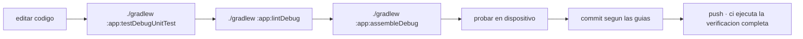

<div align="center">

# ENTORNO Y COMPILACION

<sub><a href="../README.md">indice</a> · <a href="../../en/developers/03-environment-and-build.md">english</a> · anterior: <a href="./02-estructura-del-proyecto.md">estructura del proyecto</a> · siguiente: <a href="./04-capa-de-datos.md">capa de datos</a></sub>

</div>

---

## REQUISITOS

| requisito | valor | nota |
|---|---|---|
| jdk | **21** | lo selecciona el criterio de toolchain del daemon, no una ruta de la maquina |
| android studio | version compatible con agp 9.3.0 | |
| sdk de android | api 36 instalada | `compileSdk` y `targetSdk` |
| gradle | el del wrapper versionado | usa siempre `./gradlew`, nunca un gradle del sistema |

> el jar del wrapper de gradle **esta versionado** en el repositorio, y la accion de ci lo
> valida contra las sumas de comprobacion oficiales.

<details>
<summary><strong>como se elige el jdk</strong></summary>

<br>

el daemon de gradle se ejecuta sobre un jdk 21 seleccionado mediante
`gradle/gradle-daemon-jvm.properties`. para regenerar ese fichero:

```bash
./gradlew updateDaemonJvm --jvm-version=21
```

**no reintroduzcas `org.gradle.java.home`**: fija una ruta concreta de una maquina concreta
y rompe la compilacion en cualquier otro equipo y en ci.

</details>

---

## PRIMERA COMPILACION

```bash
git clone https://github.com/rezzt-dev/focusphone-app.git
cd focusphone-app/focusphone-project
./gradlew :app:assembleDebug
```

el apk queda en `app/build/outputs/apk/debug/`.

---

## COMANDOS DE GRADLE

todos se ejecutan desde `focusphone-project/`.

| comando | que hace |
|---|---|
| `./gradlew :app:assembleDebug` | apk de depuracion |
| `./gradlew :app:assembleRelease` | apk de publicacion, minificado y con recursos reducidos |
| `./gradlew :app:testDebugUnitTest` | pruebas unitarias en la jvm |
| `./gradlew :app:connectedDebugAndroidTest` | pruebas instrumentadas en un dispositivo o emulador |
| `./gradlew :app:lintDebug` | analisis estatico; debe terminar con **0 errores** |
| `./gradlew clean` | limpia las salidas de compilacion |

<details>
<summary><strong>la verificacion completa, igual que en ci</strong></summary>

<br>

```bash
./gradlew :app:testDebugUnitTest :app:lintDebug :app:assembleRelease --stacktrace
```

es exactamente lo que ejecuta el workflow de github actions en cada push y en cada pull
request.

</details>

---

## CONFIGURACION DEL MODULO

```kotlin
android {
    namespace  = "app.focusphone"
    compileSdk { version = release(36) { minorApiLevel = 1 } }

    defaultConfig {
        applicationId = "app.focusphone"
        minSdk        = 24
        targetSdk     = 36
        versionCode   = 3
        versionName   = "1.0.6"
        testInstrumentationRunner = "app.focusphone.TestRunner"
    }

    buildFeatures {
        viewBinding = true
        buildConfig = true
    }

    compileOptions {
        sourceCompatibility = JavaVersion.VERSION_11
        targetCompatibility = JavaVersion.VERSION_11
    }
}
```

| clave | valor | por que |
|---|---|---|
| `viewBinding` | activado | todas las pantallas usan `ActivityXxxBinding.inflate(layoutInflater)` |
| `buildConfig` | activado | se consulta `BuildConfig` en tiempo de ejecucion |
| `testInstrumentationRunner` | `app.focusphone.TestRunner` | runner propio que permite sustituir repositorios |
| `unitTests.isIncludeAndroidResources` | activado | las pruebas de robolectric inflan layouts reales, asi que necesitan los recursos fusionados |

> `versionCode` y `versionName` se mantienen sincronizados con la rama de publicacion
> (`alfa-X.Y.Z`), y `versionCode` **debe subir en cada build publicado**: la pantalla
> *acerca de* muestra `versionName` al usuario.

---

## VARIANTES DE COMPILACION

<table>
<tr>
<th align="left" width="20%">variante</th>
<th align="left" width="80%">caracteristicas</th>
</tr>
<tr>
<td><strong>debug</strong></td>
<td>sin minificar, depurable, firmada con la clave de depuracion</td>
</tr>
<tr>
<td><strong>release</strong></td>
<td><code>isMinifyEnabled = true</code>, <code>isShrinkResources = true</code>, reglas de <code>proguard-rules.pro</code> sobre <code>proguard-android-optimize.txt</code>, lint-vital activo</td>
</tr>
</table>

---

## FIRMA DE LA VERSION DE PUBLICACION

la configuracion de firma es **condicional**: solo se activa si existen las propiedades
correspondientes.

```kotlin
signingConfigs {
    create("release") {
        val releaseStoreFile = findProperty("RELEASE_STORE_FILE") as String?
        if (releaseStoreFile != null) {
            storeFile     = file(releaseStoreFile)
            storePassword = findProperty("RELEASE_STORE_PASSWORD") as String
            keyAlias      = findProperty("RELEASE_KEY_ALIAS") as String
            keyPassword   = findProperty("RELEASE_KEY_PASSWORD") as String
        }
    }
}
```

| propiedad | contenido |
|---|---|
| `RELEASE_STORE_FILE` | ruta al almacen de claves |
| `RELEASE_STORE_PASSWORD` | contraseña del almacen |
| `RELEASE_KEY_ALIAS` | alias de la clave |
| `RELEASE_KEY_PASSWORD` | contraseña de la clave |

se definen en `gradle.properties` (fuera del control de versiones) o como propiedades de
proyecto. **sin ellas, el build de release se ensambla igualmente pero sin firmar**, que es
justo lo que hace ci.

---

## CATALOGO DE VERSIONES

toda dependencia se declara en `gradle/libs.versions.toml`. **no añadas coordenadas
literales en `build.gradle.kts`.**

<details open>
<summary><strong>dependencias principales</strong></summary>

<br>

| grupo | biblioteca | version |
|---|---|---|
| build | android gradle plugin | 9.3.0 |
| androidx | core-ktx | 1.18.0 |
| androidx | appcompat | 1.8.0 |
| androidx | activity-ktx | 1.13.0 |
| androidx | fragment-ktx | 1.9.0 |
| androidx | constraintlayout | 2.2.2 |
| androidx | recyclerview | 1.4.0 |
| androidx | viewpager2 | 1.1.0 |
| androidx | lifecycle (viewmodel, livedata, runtime) | 2.11.0 |
| kotlinx | coroutines (core, android, test) | 1.11.0 |
| google | material | 1.14.0 |
| androidx | room (runtime, ktx, compiler) | 2.8.5 |

</details>

<details open>
<summary><strong>dependencias de prueba</strong></summary>

<br>

| ambito | biblioteca | version |
|---|---|---|
| jvm | junit | 4.13.2 |
| jvm | mockk | 1.14.11 |
| jvm | robolectric | 4.17 |
| jvm | turbine | 1.2.1 |
| jvm | kotlinx-coroutines-test | 1.11.0 |
| instrumentada | androidx.test.ext junit | 1.3.0 |
| instrumentada | espresso core y contrib | 3.7.0 |
| instrumentada | androidx.test core, runner, rules | 1.7.0 |

</details>

> **room usa `kapt`**, no ksp, porque el proyecto esta en agp 9.x. el plugin se declara como
> `com.android.legacy-kapt`.

---

## LINT

```kotlin
lint {
    checkReleaseBuilds = true
    abortOnError       = true
}
```

- lint se ejecuta tambien en las compilaciones de publicacion, y **cualquier error rompe el
  build**
- **no hay linea base de lint**, a proposito: cada error se ha corregido en origen, y las
  advertencias restantes estan registradas como hallazgos en la auditoria tecnica del
  proyecto
- si aparece un error nuevo, se corrige; no se añade a una linea base

<details>
<summary><strong>fallo de lint en windows por bloqueo de ficheros</strong></summary>

<br>

si android studio mantiene bloqueados los jar de la cache de lint, el build falla con una
`FileSystemException`. la solucion es ejecutar el build desde una terminal con el ide
cerrado, **no** desactivar `checkReleaseBuilds`.

</details>

---

## SALIDAS Y FICHEROS IGNORADOS

| ruta | control de versiones |
|---|---|
| `focusphone-project/gradle/wrapper/gradle-wrapper.jar` | **versionado** (excepcion explicita en `.gitignore`) |
| `app/release/` | ignorado |
| `app/build/`, `.gradle/`, `.kotlin/` | ignorados |
| `local.properties` | ignorado: contiene rutas locales del sdk |
| `.docs/` | ignorado: documentacion de trabajo y habilidades de agentes |

---

## RESUMEN DEL CICLO DE TRABAJO



---

<div align="center">

<sub><a href="./02-estructura-del-proyecto.md">← estructura del proyecto</a> · <a href="../README.md">indice</a> · <a href="./04-capa-de-datos.md">capa de datos →</a></sub>

</div>
