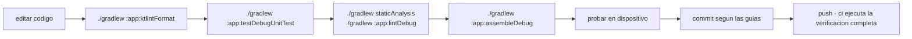

<div align="center">

# ENTORNO Y COMPILACION

<sub><a href="../README.md">indice</a> · <a href="../../en/developers/03-environment-and-build.md">english</a> · anterior: <a href="./02-estructura-del-proyecto.md">estructura del proyecto</a> · siguiente: <a href="./04-capa-de-datos.md">capa de datos</a></sub>

</div>

---

## REQUISITOS

| requisito | valor | nota |
|---|---|---|
| jdk | **21** | lo selecciona el criterio de toolchain del daemon, no una ruta de la maquina |
| android studio | version compatible con agp 9.3.0 | |
| sdk de android | api 36 instalada | `compileSdk` y `targetSdk` |
| gradle | el del wrapper versionado | usa siempre `./gradlew`, nunca un gradle del sistema |

> el jar del wrapper de gradle **esta versionado** en el repositorio, y la accion de ci lo
> valida contra las sumas de comprobacion oficiales.

<details>
<summary><strong>como se elige el jdk</strong></summary>

<br>

el daemon de gradle se ejecuta sobre un jdk 21 seleccionado mediante
`gradle/gradle-daemon-jvm.properties`. para regenerar ese fichero:

```bash
./gradlew updateDaemonJvm --jvm-version=21
```

**no reintroduzcas `org.gradle.java.home`**: fija una ruta concreta de una maquina concreta
y rompe la compilacion en cualquier otro equipo y en ci.

</details>

---

## PRIMERA COMPILACION

```bash
git clone https://github.com/rezzt-dev/focusphone-app.git
cd focusphone-app/focusphone-project
./gradlew :app:assembleDebug
```

el apk queda en `app/build/outputs/apk/debug/`.

---

## COMANDOS DE GRADLE

todos se ejecutan desde `focusphone-project/`.

| comando | que hace |
|---|---|
| `./gradlew :app:assembleDebug` | apk de depuracion |
| `./gradlew :app:assembleRelease` | apk de publicacion, minificado y con recursos reducidos |
| `./gradlew :app:testDebugUnitTest` | pruebas unitarias en la jvm |
| `./gradlew :app:connectedDebugAndroidTest` | pruebas instrumentadas en un dispositivo o emulador |
| `./gradlew :app:lintDebug` | android lint; debe terminar con **0 errores** |
| `./gradlew staticAnalysis` | ktlint + detekt; debe terminar con **0 hallazgos** |
| `./gradlew :app:ktlintFormat` | corrige automaticamente todo lo que ktlint puede arreglar solo |
| `./gradlew clean` | limpia las salidas de compilacion |

<details>
<summary><strong>la verificacion completa, igual que en ci</strong></summary>

<br>

```bash
./gradlew staticAnalysis --continue --stacktrace
./gradlew :app:testDebugUnitTest :app:lintDebug :app:assembleRelease --stacktrace
```

es exactamente lo que ejecuta el workflow de github actions en cada push y en cada pull
request. el estilo va primero porque no necesita compilar y falla en segundos: una llave mal
puesta no espera a que termine r8.

</details>

---

## CONFIGURACION DEL MODULO

```kotlin
android {
    namespace  = "app.focusphone"
    compileSdk { version = release(36) { minorApiLevel = 1 } }

    defaultConfig {
        applicationId = "app.focusphone"
        minSdk        = 24
        targetSdk     = 36
        versionCode   = 4
        versionName   = "1.4.0-beta"
        testInstrumentationRunner = "app.focusphone.TestRunner"
    }

    buildFeatures {
        viewBinding = true
        buildConfig = true
    }

    compileOptions {
        sourceCompatibility = JavaVersion.VERSION_11
        targetCompatibility = JavaVersion.VERSION_11
    }
}
```

| clave | valor | por que |
|---|---|---|
| `viewBinding` | activado | todas las pantallas usan `ActivityXxxBinding.inflate(layoutInflater)` |
| `buildConfig` | activado | se consulta `BuildConfig` en tiempo de ejecucion |
| `testInstrumentationRunner` | `app.focusphone.TestRunner` | runner propio que permite sustituir repositorios |
| `unitTests.isIncludeAndroidResources` | activado | las pruebas de robolectric inflan layouts reales, asi que necesitan los recursos fusionados |

> `versionName` es `<x.y.z>-beta` mientras la app esta en beta, y coincide con la seccion
> `[x.y.z]` de `changelog.md` y con la etiqueta `v<x.y.z>`; `versionCode` **debe subir en cada
> build publicado**: la pantalla *acerca de* muestra `versionName` al usuario, y `1.0.0-beta` y
> `1.4-beta` se publicaron las dos como `1.0.6` (`versionCode` 3) por no hacerlo.

---

## VARIANTES DE COMPILACION

<table>
<tr>
<th align="left" width="20%">variante</th>
<th align="left" width="80%">caracteristicas</th>
</tr>
<tr>
<td><strong>debug</strong></td>
<td>sin minificar, depurable, firmada con la clave de depuracion</td>
</tr>
<tr>
<td><strong>release</strong></td>
<td><code>isMinifyEnabled = true</code>, <code>isShrinkResources = true</code>, reglas de <code>proguard-rules.pro</code> sobre <code>proguard-android-optimize.txt</code>, lint-vital activo</td>
</tr>
</table>

---

## FIRMA DE LA VERSION DE PUBLICACION

la configuracion de firma es **condicional**: solo se activa si existen las propiedades
correspondientes.

```kotlin
signingConfigs {
    create("release") {
        val releaseStoreFile = findProperty("RELEASE_STORE_FILE") as String?
        if (releaseStoreFile != null) {
            storeFile     = file(releaseStoreFile)
            storePassword = findProperty("RELEASE_STORE_PASSWORD") as String
            keyAlias      = findProperty("RELEASE_KEY_ALIAS") as String
            keyPassword   = findProperty("RELEASE_KEY_PASSWORD") as String
        }
    }
}
```

| propiedad | contenido |
|---|---|
| `RELEASE_STORE_FILE` | ruta al almacen de claves |
| `RELEASE_STORE_PASSWORD` | contraseña del almacen |
| `RELEASE_KEY_ALIAS` | alias de la clave |
| `RELEASE_KEY_PASSWORD` | contraseña de la clave |

se definen en `gradle.properties` (fuera del control de versiones) o como propiedades de
proyecto. **sin ellas, el build de release se ensambla igualmente pero sin firmar**, que es
justo lo que hace ci.

---

## CATALOGO DE VERSIONES

toda dependencia se declara en `gradle/libs.versions.toml`. **no añadas coordenadas
literales en `build.gradle.kts`.**

<details open>
<summary><strong>dependencias principales</strong></summary>

<br>

| grupo | biblioteca | version |
|---|---|---|
| build | android gradle plugin | 9.3.0 |
| androidx | core-ktx | 1.18.0 |
| androidx | appcompat | 1.8.0 |
| androidx | activity-ktx | 1.13.0 |
| androidx | fragment-ktx | 1.9.0 |
| androidx | constraintlayout | 2.2.2 |
| androidx | recyclerview | 1.4.0 |
| androidx | viewpager2 | 1.1.0 |
| androidx | lifecycle (viewmodel, livedata, runtime) | 2.11.0 |
| kotlinx | coroutines (core, android, test) | 1.11.0 |
| google | material | 1.14.0 |
| androidx | room (runtime, ktx, compiler) | 2.8.5 |

</details>

<details open>
<summary><strong>dependencias de prueba</strong></summary>

<br>

| ambito | biblioteca | version |
|---|---|---|
| jvm | junit | 4.13.2 |
| jvm | mockk | 1.14.11 |
| jvm | robolectric | 4.17 |
| jvm | turbine | 1.2.1 |
| jvm | kotlinx-coroutines-test | 1.11.0 |
| instrumentada | androidx.test.ext junit | 1.3.0 |
| instrumentada | espresso core y contrib | 3.7.0 |
| instrumentada | androidx.test core, runner, rules | 1.7.0 |

</details>

> **room usa `kapt`**, no ksp, porque el proyecto esta en agp 9.x. el plugin se declara como
> `com.android.legacy-kapt`.

---

## ACTUALIZACION MANUAL DE DEPENDENCIAS

ningun bot toca `gradle/libs.versions.toml`. dependabot y renovate estan desactivados en todo
el repositorio y **cada cambio de version se hace a mano**, en un commit que lleva consigo la
verificacion de ese salto.

| fichero | papel |
|---|---|
| `.github/dependabot.yml` | declara los ecosistemas `gradle` y `github-actions` con `open-pull-requests-limit: 0`, lo que desactiva las pull requests de actualizacion |
| `renovate.json` | `"enabled": false` mas `"ignorePaths": ["**/*"]`, para que instalar la app de renovate en el repositorio o en la organizacion no abra nada |
| `.github/workflows/dependency-policy.yml` | falla cualquier pull request abierta por `dependabot[bot]` / `renovate[bot]`, o que venga de una rama `dependabot/*` / `renovate/*` |

<details open>
<summary><strong>por que aqui se actualiza a mano</strong></summary>

<br>

- el catalogo esta fijado a una combinacion que funciona, no a lo ultimo de cada biblioteca:
  `agp` se queda en 9.3.0 para seguir siendo compatible con la version actual de android
  studio, y room usa `kapt` (`com.android.legacy-kapt`) justamente por esa linea de agp
- un salto de version puede pasar ci en verde y aun asi romper el launcher en ejecucion, donde
  viven el servicio de accesibilidad, el host de widgets y las preferencias cifradas
- una pull request de bot reparte una sola decision entre muchas pull requests y deja la
  entrada del changelog para despues, en contra del flujo descrito en `11-ci-y-publicacion.md`

</details>

<details open>
<summary><strong>como actualizar una dependencia</strong></summary>

<br>

1. edita la version en el bloque `[versions]` de `gradle/libs.versions.toml` — nunca las
   coordenadas literales en `build.gradle.kts`
2. lanza la verificacion completa: `./gradlew :app:testDebugUnitTest :app:lintDebug :app:assembleRelease`
3. ejecuta las pruebas instrumentadas en un dispositivo real cuando el salto toque la ui, room
   o los servicios del sistema
4. añade una linea a `## SIN PUBLICAR / UNRELEASED` en `changelog.md`, en los dos idiomas,
   nombrando la biblioteca y la nueva version
5. haz el commit con el prefijo `changes`, porque un salto de version es tooling, no una
   funcionalidad

</details>

> si aparece una pull request de un bot de dependencias, **cierrala**: no se fusiona ni se
> esquiva el guard. la solucion es desactivar la integracion en los ajustes del repositorio, no
> saltarse la comprobacion.

---

## ANALISIS ESTATICO

tres herramientas cubren tres cosas distintas y **ninguna tiene fichero de linea base**: un
hallazgo se corrige en origen, o la regla se desactiva en la configuracion con el motivo
escrito al lado.

| herramienta | cubre | configuracion | tarea |
|---|---|---|---|
| android lint | correccion de api/android, recursos, manifest | `app/build.gradle.kts`, `lint { }` | `:app:lintDebug` |
| **ktlint** `1.8.0` | formato de kotlin | `.editorconfig` (raiz del repositorio) | `:app:ktlintCheck` / `:app:ktlintFormat` |
| **detekt** `1.23.8` | malos olores y complejidad de kotlin | `config/detekt/detekt.yml` | `:app:detekt` |

`./gradlew staticAnalysis` es una tarea raiz que ejecuta ktlint y detekt sobre todos los
modulos; es lo que ejecuta ci.

### KTLINT

el formato es **obligatorio, no una convencion**. todo lo que comprueba ktlint sale de
`.editorconfig` en la raiz del repositorio, que el ide tambien lee — asi *reformat code* en
android studio y `ktlintFormat` no pueden separarse:

- indentacion de 4 espacios, finales de linea lf, utf-8, salto de linea final, sin espacios
  al final
- **limite de 140 columnas**
- sin imports con comodin, imports en orden lexicografico
- **sin comas finales** (`ij_kotlin_allow_trailing_comma*` en `false`)
- estilo `intellij_idea`, el mismo formateador que `kotlin.code.style=official` ya selecciona
  para el ide

hay cinco reglas desactivadas a proposito, cada una con su motivo en `.editorconfig`:
`function-signature`, `class-signature`, `argument-list-wrapping` y `multiline-if-else` (donde
se parte una firma o una lista de argumentos es una decision de legibilidad del autor, no algo
que reescribir solo porque cabria en una linea), mas `no-multi-spaces` (el codigo alinea las
asignaciones en columnas, `versionCode   = 4`).

la version del *motor* de ktlint esta fijada en el catalogo de versiones (`ktlint`) aparte de
la de su plugin de gradle (`ktlintGradle`), de modo que el formateador nunca se mueve solo y
reescribe ficheros que ci ya habia aceptado.

### DETEKT

`buildUponDefaultConfig = true`, asi que `config/detekt/detekt.yml` solo registra las
**desviaciones** respecto a los valores por defecto de detekt. nunca se pega ahi la
configuracion por defecto completa: las reglas nuevas de una actualizacion se perderian en
silencio. `config.validation = true` hace que un nombre de regla que ya no existe rompa el
build en vez de ignorarse sin avisar.

las desviaciones que importan:

| ajuste | por que |
|---|---|
| `LongMethod` 130, `CyclomaticComplexMethod` 40, `LargeClass` 1800, `NestedBlockDepth` 5 | fijados justo por encima del peor caso actual de `main`, de forma que funcionan como **trinquete**: las pantallas de hoy se toleran, ninguna puede crecer mas alla. se bajan cuando una pantalla se parte; nunca se suben para callar un hallazgo nuevo |
| `TooGenericExceptionCaught` desactivada | un launcher es el proceso al que vuelve el usuario cuando todo lo demas se cae; tiene que sobrevivir a lo que lancen `PackageManager`, `LauncherApps` o un servicio del sistema de un fabricante |
| `SwallowedException` activada | el contrapeso de lo anterior: todo `catch` debe registrar, relanzar o nombrar su variable `_` / `ignored` / `expected` para decir que la excepcion se descarta a proposito |
| `MagicNumber` desactivada | las cuentas de layout, los canales de color y las constantes de tiempo son numericas por naturaleza en una interfaz android |
| `TooManyFunctions` 30 | los objetos `*Preferences` son fachadas planas sobre `SharedPreferences`: un getter y un setter por clave es justo lo que los hace legibles |
| conjunto `formatting` **no** añadido | detekt incluye una copia de las reglas de ktlint; ejecutar los dos motores reporta cada problema de formato dos veces y pueden discrepar tras una actualizacion. el formato es solo de ktlint |

### ANDROID LINT

```kotlin
lint {
    checkReleaseBuilds = true
    abortOnError       = true
}
```

- lint se ejecuta tambien en las compilaciones de publicacion, y **cualquier error rompe el
  build**
- **no hay linea base de lint**, a proposito: cada error se ha corregido en origen, y las
  advertencias restantes estan registradas como hallazgos en la auditoria tecnica del
  proyecto
- si aparece un error nuevo, se corrige; no se añade a una linea base

<details>
<summary><strong>fallo de lint en windows por bloqueo de ficheros</strong></summary>

<br>

si android studio mantiene bloqueados los jar de la cache de lint, el build falla con una
`FileSystemException`. la solucion es ejecutar el build desde una terminal con el ide
cerrado, **no** desactivar `checkReleaseBuilds`.

</details>

---

## SALIDAS Y FICHEROS IGNORADOS

| ruta | control de versiones |
|---|---|
| `focusphone-project/gradle/wrapper/gradle-wrapper.jar` | **versionado** (excepcion explicita en `.gitignore`) |
| `app/release/` | ignorado |
| `app/build/`, `.gradle/`, `.kotlin/` | ignorados |
| `local.properties` | ignorado: contiene rutas locales del sdk |
| `.docs/` | ignorado: documentacion de trabajo y habilidades de agentes |
| `.editorconfig`, `config/detekt/detekt.yml` | **versionados**: son el contrato del analisis estatico |

---

## RESUMEN DEL CICLO DE TRABAJO



---

<div align="center">

<sub><a href="./02-estructura-del-proyecto.md">← estructura del proyecto</a> · <a href="../README.md">indice</a> · <a href="./04-capa-de-datos.md">capa de datos →</a></sub>

</div>
