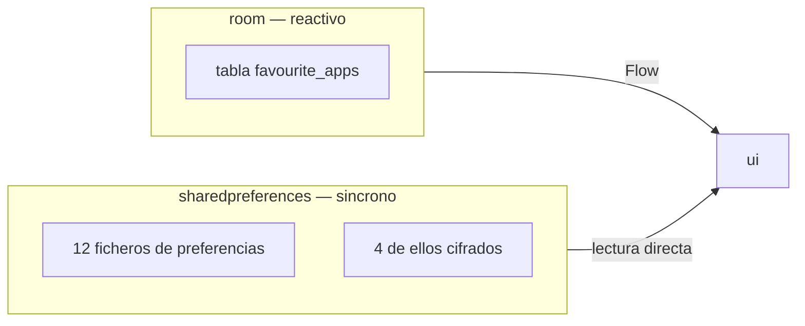

<div align="center">

# CAPA DE DATOS

<sub><a href="../README.md">indice</a> · <a href="../../en/developers/04-data-layer.md">english</a> · anterior: <a href="./03-entorno-y-compilacion.md">entorno y compilacion</a> · siguiente: <a href="./05-capa-de-dominio.md">capa de dominio</a></sub>

</div>

---

## DOS MECANISMOS DE PERSISTENCIA



| mecanismo | se usa para | por que |
|---|---|---|
| **room** | las aplicaciones favoritas | necesita consultas reactivas: la pantalla de inicio se redibuja sola al cambiar la lista |
| **sharedpreferences** | absolutamente todo lo demas | debe leerse de forma **sincrona**, antes de `setContentView` o dentro de un manejador tactil |

> **datastore queda descartado** a proposito: su api es asincrona y el tema debe aplicarse
> antes de que exista la primera vista, o la pantalla parpadea sin estilo.

---

## ROOM

### LA ENTIDAD

```kotlin
@Entity(tableName = "favourite_apps")
data class FavouriteApp(
    @PrimaryKey val packageName: String,
    val label: String,
    val sortOrder: Int = 0
)
```

### LA BASE DE DATOS

```kotlin
@Database(entities = [FavouriteApp::class], version = 1, exportSchema = false)
abstract class AppDatabase : RoomDatabase()
```

- singleton con doble comprobacion bajo `synchronized`
- fichero: `focusphone_database`
- `fallbackToDestructiveMigration(true)`: aceptable porque el usuario puede volver a elegir
  sus favoritos, y solo mientras el proyecto este en desarrollo temprano

> al cambiar el esquema: **sube la version y añade una migracion**, o asume la migracion
> destructiva actual de forma consciente.

### EL DAO

<table>
<tr><th align="left" width="34%">metodo</th><th align="left" width="66%">detalle</th></tr>
<tr><td><code>observeAll()</code></td><td><code>Flow</code> ordenado por <code>sortOrder</code>: la fuente reactiva de la pantalla de inicio</td></tr>
<tr><td><code>getAll()</code>, <code>count()</code>, <code>exists()</code></td><td>consultas puntuales <code>suspend</code></td></tr>
<tr><td><code>insert()</code>, <code>insertAll()</code></td><td>insercion con <code>OnConflictStrategy.REPLACE</code></td></tr>
<tr><td><code>delete()</code></td><td>borrado por paquete</td></tr>
<tr><td><code>deleteAndReorder()</code></td><td><strong>transaccion</strong>: borra y recompacta <code>sortOrder</code> sin huecos</td></tr>
<tr><td><code>applyOrder()</code></td><td><strong>transaccion</strong>: reescribe solo <code>sortOrder</code>, usando <code>FavouriteOrdering.merge</code>; <strong>nunca borra una fila</strong></td></tr>
<tr><td><code>insertIfNotExists()</code></td><td><strong>transaccion</strong>: inserta asignando el siguiente <code>sortOrder</code> libre</td></tr>
</table>

<details>
<summary><strong>por que <code>applyOrder</code> no puede perder favoritos</strong></summary>

<br>

reordenar se expresa como una **fusion**, no como un reemplazo: el orden solicitado va
primero, y cada favorito almacenado que la peticion no menciona conserva su posicion
relativa detras. asi, una lista construida a partir de una vista parcial (por ejemplo, solo
las filas visibles) no puede eliminar nada.

la regla vive en `domain/util/FavouriteOrdering.kt` y esta cubierta por pruebas unitarias.

</details>

---

## REPOSITORIOS

<details open>
<summary><strong><code>FavouriteAppRepositoryImpl</code></strong></summary>

<br>

combina room con las etiquetas personalizadas:

```kotlin
override fun observeFavourites(): Flow<List<FavouriteApp>> =
    combine(dao.observeAll(), customLabels.labelsFlow) { list, labels ->
        list.map { app ->
            val custom = labels[app.packageName]
            if (custom != null) app.copy(label = custom.normalizeAppName())
            else app.copy(label = app.label.normalizeAppName())
        }
    }
```

ademas ejecuta **una vez**, en `init`, la migracion del formato antiguo:

| paso de la migracion | detalle |
|---|---|
| origen | fichero `focusphone_favourites`, clave `apps`, filas `paquete\|etiqueta\|orden` separadas por saltos de linea |
| validacion | el nombre de paquete debe contener un punto y medir 255 caracteres o menos |
| filtrado | se excluye el propio paquete de focusphone |
| deduplicacion | `distinctBy { packageName }` |
| limite | se aplica `MAX_FAVOURITES` **al escribir**, no al leer |
| limpieza | se elimina la clave antigua tras insertar |

> el limite se aplica al escribir a proposito: truncar al leer ocultaba favoritos
> almacenados a todas las pantallas, y el siguiente reordenado, construido sobre la lista
> truncada, los borraba.

</details>

<details open>
<summary><strong><code>AppRepositoryImpl</code></strong></summary>

<br>

consulta las aplicaciones lanzables mediante `PackageManager`, que es una operacion cara
porque hay que cargar todas las etiquetas.

| aspecto | comportamiento |
|---|---|
| cache | breve, solo de las etiquetas **del sistema** |
| etiquetas personalizadas | se aplican **en cada lectura**, no se cachean: un renombrado se ve al instante |
| invalidacion | la cache se descarta en cuanto `PackageChangeMonitor` informa de una instalacion, desinstalacion o actualizacion |

</details>

<details open>
<summary><strong><code>NotificationRepository</code></strong></summary>

<br>

lista de notificaciones activas **solo en memoria ram**. al morir el proceso la lista se
vacia y se vuelve a poblar en la siguiente conexion de `FocusNotificationService`. el
contenido nunca se escribe en disco.

</details>

<details open>
<summary><strong><code>PackageChangeMonitor</code></strong></summary>

<br>

señal global de proceso: su `version` se incrementa en cada instalacion, desinstalacion,
actualizacion o activacion/desactivacion de un paquete. las caches comparan su version
guardada con la actual para saber si estan obsoletas, y las pantallas abiertas se recargan.

</details>

---

## LAS PREFERENCIAS

doce objetos, cada uno con su propio fichero de `SharedPreferences`. cuatro de ellos
cifrados.

<table>
<tr>
<th align="left" width="28%">objeto</th>
<th align="left" width="26%">fichero</th>
<th align="left" width="12%">cifrado</th>
<th align="left" width="34%">contenido</th>
</tr>
<tr><td><code>ThemePreferences</code></td><td><code>focusphone_theme</code></td><td>no</td><td>tema, colores personalizados, alineacion, barra de estado, bienvenida completada</td></tr>
<tr><td><code>FontPreferences</code></td><td><code>focusphone_prefs</code></td><td>no</td><td>tipografia, tipo y tamaño de reloj, tamaño de texto (8-24 pt, por defecto 14)</td></tr>
<tr><td><code>HomeLayoutPreferences</code></td><td><code>focusphone_home_layout</code></td><td>no</td><td>orden de componentes, visibilidad de reloj y widget, espaciado, reloj fijo arriba</td></tr>
<tr><td><code>WidgetPreferences</code></td><td><code>focusphone_widget</code></td><td>no</td><td>id del unico widget y su activacion</td></tr>
<tr><td><code>WallpaperPreferences</code></td><td><code>focusphone_wallpaper</code></td><td>no</td><td>uri por superficie, modo compartido, desenfoque e intensidad, legibilidad (por defecto 60)</td></tr>
<tr><td><code>GesturePreferences</code></td><td><code>focusphone_gestures</code></td><td>no</td><td>gesto de deslizar hacia abajo</td></tr>
<tr><td><code>NotificationPanelPreferences</code></td><td><code>focusphone_notification_panel</code></td><td>no</td><td>activacion del panel lateral</td></tr>
<tr><td><code>ConsciousPausePreferences</code></td><td><code>focusphone_conscious_pause</code></td><td>no</td><td>activacion y duracion (3-10 s)</td></tr>
<tr><td><code>TutorialPreferences</code></td><td><code>focusphone_tutorial</code></td><td>no</td><td>tutorial completado y paso actual</td></tr>
<tr><td><code>ProfilePreferences</code></td><td><code>focusphone_profile</code></td><td><strong>si</strong></td><td>perfil, fin del detox, hash de contraseña, apps bloqueadas, palabras clave, contador de intentos</td></tr>
<tr><td><code>CustomAppLabelsPreferences</code></td><td><code>focusphone_custom_labels</code></td><td><strong>si</strong></td><td>nombres personalizados por paquete</td></tr>
<tr><td><code>AppFolderPreferences</code></td><td>fichero propio</td><td><strong>si</strong></td><td>carpetas del cajon y su estado de expansion</td></tr>
<tr><td><code>AppSchedulePreferences</code></td><td><code>focusphone_schedule</code></td><td><strong>si</strong></td><td>reglas, contraseña, contadores de uso del dia</td></tr>
</table>

### PATRON COMUN

```kotlin
object XxxPreferences {
    private const val PREF_FILE = "focusphone_xxx"
    private const val KEY_ALGO  = "algo"

    private fun prefs(context: Context) =
        context.getSharedPreferences(PREF_FILE, Context.MODE_PRIVATE)

    fun getAlgo(context: Context): T = ...
    fun setAlgo(context: Context, value: T) = ...
}
```

son `object`, no clases, salvo los que necesitan estado observable
(`CustomAppLabelsPreferences`, `AppFolderPreferences`), que se instancian desde
`AppContainer` y exponen `StateFlow`.

---

## PREFERENCIAS CIFRADAS

las cuatro preferencias sensibles pasan por `EncryptedPrefs`, que a su vez usa
`SecureStorageHelper` (aes-256/gcm con clave del keystore de android).

`EncryptedPrefs.read()` devuelve un **resultado tipado**:

<table>
<tr><th align="left" width="20%">estado</th><th align="left" width="45%">significado</th><th align="left" width="35%">como debe reaccionar quien escribe</th></tr>
<tr><td><code>Absent</code></td><td>no hay nada guardado</td><td>puede escribir con normalidad</td></tr>
<tr><td><code>Present</code></td><td>valor leido correctamente</td><td>puede escribir con normalidad</td></tr>
<tr><td><code>Unavailable</code></td><td>la clave del keystore no se puede usar <strong>ahora mismo</strong></td><td><strong>debe negarse a escribir</strong>: escribir sustituiria los datos reales por el valor vacio de respaldo</td></tr>
<tr><td><code>Lost</code></td><td>el contenido no podra descifrarse <strong>nunca</strong></td><td>se trata como ausente, para que el usuario pueda reconstruir sus datos</td></tr>
</table>

<details>
<summary><strong>deteccion del formato heredado en texto plano</strong></summary>

<br>

`CustomAppLabelsPreferences` reconoce los valores antiguos en texto plano **por su forma**
(`SecureStorageHelper.looksEncrypted`), nunca por un fallo al descifrar.

el motivo: cuando la clave del keystore se pierde, un valor cifrado real **tambien** falla
al descifrarse; tratarlo como texto plano volveria a cifrar el texto cifrado y corromperia
la etiqueta para siempre. los valores ilegibles se dejan intactos en disco y se muestra la
etiqueta del sistema.

</details>

---

## EL ALMACENAMIENTO DEL FONDO DE PANTALLA

`ui/wallpaper/WallpaperStorage.kt` gestiona las imagenes:

| regla | motivo |
|---|---|
| la imagen se **copia** a `filesDir/wallpapers`, reducida y con la rotacion exif aplicada | el permiso del selector de fotos muere con el proceso, asi que una uri `content://` no se puede guardar |
| las preferencias guardan la uri `file://` de la copia | sobrevive a reinicios |
| asignar o quitar una imagen se hace **solo** por `WallpaperPreferences.assignWallpaper`, dentro de `WallpaperStorage.replace` / `update` | esos metodos borran las copias a las que ya no apunta ninguna preferencia |
| el modo compartido se cambia **solo** con `WallpaperPreferences.setSharedMode` | siembra la ranura compartida a partir de la imagen en pantalla y devuelve la suya a cada superficie al desactivarlo |

---

## REGLAS AL TOCAR ESTA CAPA

| regla | motivo |
|---|---|
| no conviertas una preferencia en asincrona | se leen antes de `setContentView` y dentro de manejadores tactiles |
| no leas preferencias cifradas en un bucle caliente sin cachear | descifrar aes en cada evento de accesibilidad provoca anr; el servicio cachea su estado |
| no trates `Unavailable` como lista vacia | se sobrescriben los datos reales del usuario |
| aplica los limites al **escribir**, no al leer | truncar al leer oculta datos y el siguiente guardado los borra |
| añade la clave nueva en su `*Preferences`, no en uno ajeno | cada fichero tiene un dominio claro |

---

<div align="center">

<sub><a href="./03-entorno-y-compilacion.md">← entorno y compilacion</a> · <a href="../README.md">indice</a> · <a href="./05-capa-de-dominio.md">capa de dominio →</a></sub>

</div>
