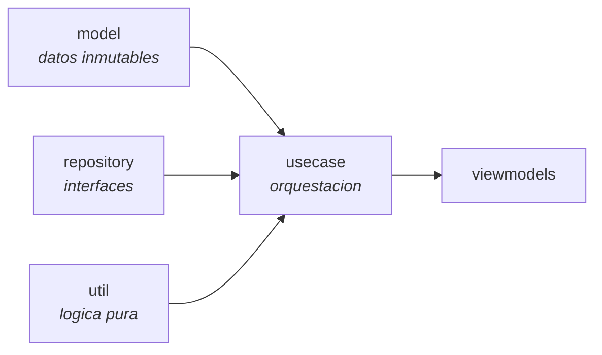

<div align="center">

# CAPA DE DOMINIO

<sub><a href="../README.md">indice</a> · <a href="../../en/developers/05-domain-layer.md">english</a> · anterior: <a href="./04-capa-de-datos.md">capa de datos</a> · siguiente: <a href="./06-capa-de-presentacion.md">capa de presentacion</a></sub>

</div>

---

## PRINCIPIO

el paquete `domain` contiene las **reglas de negocio**, y su parte critica esta escrita
como **funciones puras sin dependencias de android**. la razon es directa: las decisiones
mas delicadas de focusphone son *¿esta aplicacion bloqueada?* y *¿que orden tienen los
favoritos?*, y ambas deben poder probarse de forma exhaustiva en la jvm, sin emulador.



---

## MODELOS

<table>
<tr><th align="left" width="26%">modelo</th><th align="left" width="74%">contenido</th></tr>
<tr><td><code>AppInfo</code></td><td>aplicacion instalada. <code>icon</code> es nulable a proposito, para no cargarlo cuando no hace falta (la pantalla de inicio no muestra iconos)</td></tr>
<tr><td><code>AppShortcut</code></td><td>acceso directo obtenido por <code>LauncherApps</code>: dinamico, declarado en el manifiesto o anclado</td></tr>
<tr><td><code>AppFolder</code></td><td>carpeta del cajon. <code>packageNames</code> conserva el orden de insercion solo como detalle de persistencia: la ui siempre reordena por etiqueta</td></tr>
<tr><td><code>AppFont</code></td><td>enum de tipografias: <code>SYSTEM</code>, <code>POPPINS</code>, <code>COMFORTAA</code>, <code>JETBRAINS</code></td></tr>
<tr><td><code>ClockType</code></td><td>enum de relojes: <code>DIGITAL</code>, <code>STACKED</code>, <code>WORDS</code>, <code>ANALOG</code>, <code>HIDDEN</code>, cada uno con su etiqueta de vista previa</td></tr>
<tr><td><code>ToggleResult</code></td><td>resultado de alternar un favorito: <code>Added</code>, <code>Removed</code> o <code>LimitReached</code></td></tr>
<tr><td><code>AppScheduleRule</code></td><td>regla de horario de una aplicacion</td></tr>
<tr><td><code>ScheduleBlockReason</code></td><td>clase sellada con el motivo del bloqueo y los datos para explicarlo</td></tr>
</table>

### `AppScheduleRule` EN DETALLE

```kotlin
data class AppScheduleRule(
    val packageName: String,
    val windowEnabled: Boolean = false,
    val startMinute: Int = DEFAULT_START_MINUTE,   // 9 * 60
    val endMinute: Int = DEFAULT_END_MINUTE,       // 18 * 60
    val days: Set<Int> = ALL_DAYS,
    val dailyLimitMinutes: Int = 0
)
```

| convencion | detalle |
|---|---|
| unidad de tiempo | minutos desde la medianoche local, `0..1439`; las 9:30 son `570` |
| franja que cruza medianoche | `startMinute > endMinute`, por ejemplo `22:00 → 06:00` |
| franja de dia completo | `startMinute == endMinute` |
| dias | valores de `Calendar.DAY_OF_WEEK`, domingo = 1 … sabado = 7 |
| conjunto de dias vacio | se interpreta como *todos los dias* |
| `isActive` | `windowEnabled || dailyLimitMinutes > 0`; una regla inactiva se descarta al persistir |

---

## INTERFACES DE REPOSITORIO

| interfaz | contrato |
|---|---|
| `AppRepository` | lista de aplicaciones instaladas; la implementacion usa `PackageManager` y no persiste nada |
| `FavouriteAppRepository` | crud de favoritos; los cambios se emiten de forma reactiva mediante `Flow` |

la capa `domain` define estas interfaces y la capa `data` las implementa: la direccion de
la dependencia apunta siempre hacia el dominio.

---

## CASOS DE USO

<table>
<tr><th align="left" width="32%">caso de uso</th><th align="left" width="68%">responsabilidad</th></tr>
<tr>
<td><code>GetInstalledAppsUseCase</code></td>
<td>lista las aplicaciones instaladas marcando cuales son favoritas</td>
</tr>
<tr>
<td><code>GetFavouriteAppsUseCase</code></td>
<td>observa los favoritos. <strong>no</strong> aplica el limite de 10: el limite se impone donde se escribe, porque truncar al leer ocultaba favoritos y el siguiente reordenado los borraba</td>
</tr>
<tr>
<td><code>ToggleFavouriteAppUseCase</code></td>
<td>alterna un favorito. devuelve <code>ToggleResult.LimitReached</code> al intentar pasar de <code>MAX_FAVOURITES = 10</code></td>
</tr>
<tr>
<td><code>RemoveFavouriteAppUseCase</code></td>
<td>elimina un favorito. <strong>usa este, no el toggle</strong>, cuando la intencion es eliminar: un toggle vuelve a añadir la aplicacion si ya no era favorita, y eso permitia que dos limpiezas solapadas de aplicaciones desinstaladas las reinsertaran</td>
</tr>
<tr>
<td><code>UpdateAppsOrderUseCase</code></td>
<td>persiste un nuevo orden. <strong>solo cambia el orden</strong>: una lista que omite favoritos los deja en su sitio, detras de los reordenados</td>
</tr>
<tr>
<td><code>GetAppShortcutsUseCase</code></td>
<td>accesos directos via <code>LauncherApps</code>. devuelve lista vacia si el api es menor que 25, si focusphone no es el lanzador por defecto, si la aplicacion no declara ninguno, o si la llamada lanza <code>SecurityException</code></td>
</tr>
</table>

---

## UTILIDADES PURAS

esta es la parte mas importante del paquete: **sin android, sin `Context`, totalmente
testeable**.

<details open>
<summary><strong><code>AppScheduleEvaluator</code> — la decision de bloqueo por horario</strong></summary>

<br>

```kotlin
fun evaluate(
    rule: AppScheduleRule,
    minuteOfDay: Int,
    dayOfWeek: Int,
    usedMinutesToday: Int
): ScheduleBlockReason?
```

devuelve `null` cuando la aplicacion puede usarse, y el motivo cuando no.

el orden de comprobacion es: regla inactiva → sin bloqueo; fuera de la franja →
`OutsideWindow`; limite alcanzado → `DailyLimitReached`.

**reglas de la franja** (`isWithinWindow`):

| caso | comportamiento |
|---|---|
| `start == end` | la franja cubre el dia entero seleccionado |
| `start < end` | intervalo **semiabierto** `[start, end)`: una franja 09:00-18:00 bloquea exactamente a las 18:00 |
| `start > end` | la franja cruza la medianoche y **pertenece al dia en que empieza**: con 22:00 → 06:00 activo solo el viernes, las 02:00 del sabado siguen permitidas porque son la cola del viernes |
| `days` vacio | equivale a `ALL_DAYS` |

el mismo objeto contiene la **serializacion**, una linea por regla:

```
packageName|windowEnabled|startMinute|endMinute|dia,dia,…|dailyLimitMinutes
```

`parse()` devuelve `null` ante una entrada malformada, de modo que una linea corrupta se
puede descartar sin perder el resto del conjunto de reglas. los valores se acotan al
rango valido al parsear.

</details>

<details open>
<summary><strong><code>FavouriteOrdering</code> — reordenar sin perder nada</strong></summary>

<br>

```kotlin
fun merge(current: List<String>, requested: List<String>): List<String> {
    val known = current.toSet()
    val head = requested.filter { it in known }.distinct()
    val headSet = head.toSet()
    return head + current.filterNot { it in headSet }
}
```

- los paquetes desconocidos o repetidos de `requested` se ignoran
- todo paquete de `current` aparece **exactamente una vez** en el resultado
- por tanto, reordenar **no puede eliminar** un favorito

</details>

<details open>
<summary><strong><code>FuzzyMatcher</code> — la busqueda del cajon</strong></summary>

<br>

busqueda por subsecuencia con puntuacion:

| regla | valor |
|---|---|
| caracter coincidente | +1 |
| bonificacion por caracteres consecutivos | +3 |
| requisito de coincidencia | todos los caracteres de la consulta deben aparecer en orden |
| consulta vacia | siempre coincide |

ejemplos: `fb` encuentra *facebook*, `yt` encuentra *youtube*, `zzz` no encuentra
*facebook*. el coste es `O(|consulta| × |objetivo|)` en el peor caso, pero en la practica se
acerca a `O(|objetivo|)` porque el bucle interno avanza de forma monotona.

</details>

<details open>
<summary><strong><code>TextExtensions</code> — normalizacion</strong></summary>

<br>

dos funciones con proposito distinto:

| funcion | que hace | por que |
|---|---|---|
| `normalizeAppName()` | pasa el nombre a minusculas y **conserva los acentos** | en los idiomas soportados (es, fr, de) los acentos son ortografia, no decoracion: quitarlos convertia `teléfono` en `telefono` y `Übersetzer` en `ubersetzer` |
| `normalizeForSearch()` | minusculas **y** elimina los diacriticos | para que la consulta `telefono` encuentre *teléfono* |

</details>

<details open>
<summary><strong><code>AppFolderSerializer</code> — persistencia de carpetas</strong></summary>

<br>

una carpeta por linea:

```
id|nombre|paquete1,paquete2,…
```

`sanitizeName()` elimina los separadores del nombre **a la entrada**, de forma que un
nombre nunca puede romper el formato. el orden alfabetico se aplica al leer, porque las
carpetas no guardan orden manual.

</details>

---

## REGLAS AL TOCAR ESTA CAPA

| regla | motivo |
|---|---|
| la logica de decision va en `util`, no en la activity ni en el servicio | es la unica forma de cubrirla con pruebas de jvm |
| ningun `import android.*` en `model`, `usecase` ni `util` | mantiene la capa testeable sin emulador |
| toda regla nueva de bloqueo necesita pruebas de los casos limite | medianoche, cambio de dia, conjuntos vacios, entradas corruptas |
| los modelos son inmutables (`data class` con `val`) | evita estados intermedios inconsistentes en los flujos |
| el caso de uso orquesta, no calcula | el calculo vive en `util`, el acceso a datos en `data` |

---

<div align="center">

<sub><a href="./04-capa-de-datos.md">← capa de datos</a> · <a href="../README.md">indice</a> · <a href="./06-capa-de-presentacion.md">capa de presentacion →</a></sub>

</div>
