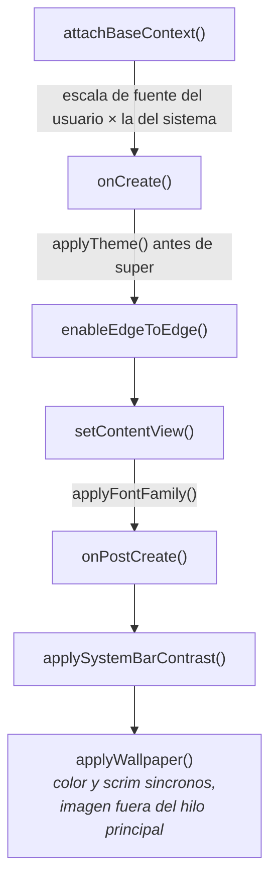

<div align="center">

# CAPA DE PRESENTACION

<sub><a href="../README.md">indice</a> · <a href="../../en/developers/06-presentation-layer.md">english</a> · anterior: <a href="./05-capa-de-dominio.md">capa de dominio</a> · siguiente: <a href="./07-sistema-de-temas.md">sistema de temas</a></sub>

</div>

---

## TECNOLOGIA

| aspecto | eleccion |
|---|---|
| sistema de vistas | **xml con view binding**; no se usa jetpack compose |
| patron | mvvm con `ViewModel` y `StateFlow` / `SharedFlow` |
| listas | `RecyclerView` con adaptadores propios |
| dialogos | `MaterialAlertDialogBuilder` con el tema de dialogo propio de la aplicacion |
| transiciones | fundido consistente definido en `res/anim/fp_fade_in.xml` y `fp_fade_out.xml` |

---

## `BaseActivity`, EL NUCLEO DE LA UI

**todas** las activities extienden `BaseActivity`. concentra el trabajo transversal para
que ninguna pantalla tenga que repetirlo.



<table>
<tr><th align="left" width="30%">responsabilidad</th><th align="left" width="70%">detalle</th></tr>
<tr>
<td>tema</td>
<td><code>applyTheme()</code> se llama <strong>antes</strong> de <code>super.onCreate</code>: resuelve el tema efectivo, memoriza los colores personalizados y limpia la cache de paleta</td>
</tr>
<tr>
<td>escala de tipografia</td>
<td><code>attachBaseContext()</code> multiplica la escala del sistema por la del usuario y la acota a <code>0.5f..2.0f</code></td>
</tr>
<tr>
<td>familia tipografica</td>
<td><code>applyFontFamily()</code> se ejecuta en cada <code>setContentView</code>; conserva la jerarquia: un peso por encima de 450 se considera enfatizado, de forma que <code>sans-serif-medium</code> no se aplana a regular</td>
</tr>
<tr>
<td>borde a borde</td>
<td>barras transparentes y aplicacion manual de insets en cada pantalla</td>
</tr>
<tr>
<td>fondo y scrim</td>
<td><code>applyWallpaper()</code> se puede llamar sobre una pantalla viva: asienta fondo, scrim y colores en el sitio</td>
</tr>
<tr>
<td>recoloreado</td>
<td><code>colorizeViewTree()</code> repinta solo los fondos dibujados con un color del tema y <strong>recuerda el rol de color de cada vista</strong>, por lo que es seguro ejecutarlo varias veces</td>
</tr>
<tr>
<td>transiciones</td>
<td><code>startActivity()</code> y <code>finish()</code> aplican el mismo fundido</td>
</tr>
<tr>
<td>dialogos</td>
<td><code>trackDialog</code>, <code>showExclusiveDialog</code>, <code>showStyledDialog</code>, <code>styleMaterialDialog</code> y <code>applyDialogSurface</code></td>
</tr>
<tr>
<td>bloqueos</td>
<td><code>showDetoxUnlockDialog</code>, mensajes de espera y de intentos restantes, y <code>enforceAppSchedule()</code></td>
</tr>
<tr>
<td>cambios del sistema</td>
<td><code>onResume()</code> detecta cambios de tema efectivo, escala o familia y llama a <code>recreate()</code></td>
</tr>
</table>

<details>
<summary><strong>dos trampas documentadas en el codigo</strong></summary>

<br>

| trampa | regla |
|---|---|
| insets de ventana | usa `updatePadding(top = …)`, **nunca** `setPadding(0, …, 0, 0)`: la segunda forma borra en silencio el padding declarado en el xml |
| colores | usa `FocusPalette.of(context)`, **nunca** `Theme.resolveAttribute(attr, tv, true).data`: devuelve un id de recurso cuando el atributo apunta a un `ColorStateList`, y desconoce el tema personalizado |

</details>

---

## PATRON DE VIEWMODEL

```kotlin
class HomeViewModel(
    getFavouriteApps: GetFavouriteAppsUseCase,
    private val removeFavouriteApp: RemoveFavouriteAppUseCase,
    private val updateAppsOrder: UpdateAppsOrderUseCase
) : ViewModel() {

    val favouriteApps: StateFlow<List<FavouriteApp>> = getFavouriteApps()
        .stateIn(
            scope        = viewModelScope,
            started      = SharingStarted.WhileSubscribed(5_000),
            initialValue = emptyList()
        )

    companion object {
        fun factory(app: FocusPhoneApp): ViewModelProvider.Factory = /* … */
    }
}
```

convenciones fijas:

| convencion | detalle |
|---|---|
| fabrica | cada viewmodel expone `companion object { fun factory(app: FocusPhoneApp): ViewModelProvider.Factory }` que toma sus dependencias de `AppContainer` |
| exposicion | `StateFlow` para estado, `SharedFlow` para eventos de un solo consumo |
| compartido | `SharingStarted.WhileSubscribed(5_000)` para sobrevivir a rotaciones sin dejar colectores vivos |
| errores | las operaciones de escritura se envuelven en `try/catch` y registran el fallo, sin propagarlo a la ui |

en la activity:

```kotlin
private val viewModel: HomeViewModel by viewModels { HomeViewModel.factory(focusPhoneApp) }

lifecycleScope.launch {
    repeatOnLifecycle(Lifecycle.State.STARTED) {
        viewModel.favouriteApps.collect { render(it) }
    }
}
```

---

## PANTALLAS

<table>
<tr><th align="left" width="26%">pantalla</th><th align="left" width="74%">responsabilidad</th></tr>
<tr><td><code>HomeActivity</code></td><td>la pantalla de inicio: reloj, calendario, favoritos, cajones, gestos, perfiles, reordenacion y tutorial. es la clase mas grande del proyecto</td></tr>
<tr><td><code>AppSelectActivity</code></td><td>seleccion de favoritos con busqueda y contador, aplicando el limite de 10</td></tr>
<tr><td><code>AllAppsActivity</code></td><td>cajon completo: busqueda, carpetas, arrastre y menu de opciones</td></tr>
<tr><td><code>SettingsActivity</code></td><td>menu de seis categorias; no contiene ningun control</td></tr>
<tr><td><code>SettingsSubActivity</code></td><td>base abstracta de las subpantallas: barra superior, boton de atras, insets y contenedor vertical</td></tr>
<tr><td><code>AppearanceSettingsActivity</code></td><td>tema, colores personalizados, tipografia, tamaño de texto, alineacion, barra de estado y fondo de pantalla</td></tr>
<tr><td><code>HomeSettingsActivity</code></td><td>tipo y tamaño de reloj, espaciado, widget y distribucion</td></tr>
<tr><td><code>FocusSettingsActivity</code></td><td>pausa consciente, horarios y palabras clave del modo trabajo</td></tr>
<tr><td><code>NotificationSettingsActivity</code></td><td>acceso a notificaciones, panel lateral y gesto hacia abajo</td></tr>
<tr><td><code>SystemSettingsActivity</code></td><td>permisos, accesibilidad, lanzador por defecto e idioma</td></tr>
<tr><td><code>AboutSettingsActivity</code></td><td>version, tutorial, reinicio de bienvenida y licencias</td></tr>
<tr><td><code>HomeLayoutActivity</code></td><td>reordenacion y visibilidad de los componentes, con vista previa <strong>real y funcional</strong></td></tr>
<tr><td><code>PermissionsActivity</code></td><td>estado de cada permiso</td></tr>
<tr><td><code>OnboardingActivity</code></td><td>bienvenida de 5 pasos con <code>ViewPager2</code> y verificacion en vivo del lanzador por defecto</td></tr>
<tr><td><code>ConsciousPauseActivity</code></td><td>cuenta atras respirada antes de abrir la aplicacion destino</td></tr>
<tr><td><code>DetoxBlockedActivity</code></td><td>bloqueo a pantalla completa con cuenta atras en vivo y desbloqueo por contraseña</td></tr>
<tr><td><code>AppScheduleActivity</code></td><td>lista de reglas, protegida por contraseña; no renderiza nada hasta desbloquear</td></tr>
<tr><td><code>AppScheduleEditActivity</code></td><td>editor de una regla; revalida <code>ScheduleAccessGate</code> en cada <code>onResume</code></td></tr>
<tr><td><code>ScheduleBlockedActivity</code></td><td>bloqueo por horario; <strong>sin boton de desbloqueo</strong> a proposito</td></tr>
<tr><td><code>WidgetPickerActivity</code></td><td>seleccion del unico widget, mediante la activity result api</td></tr>
</table>

---

## ADAPTADORES Y LISTAS

<details open>
<summary><strong><code>FavouriteAppsAdapter</code> — por que no es un <code>ListAdapter</code></strong></summary>

<br>

deliberadamente **no** extiende `ListAdapter`. el arrastre mueve filas en el sitio con
`notifyItemMoved`, mientras que la lista de un `ListAdapter` solo cambia por `submitList`.
las dos se desincronizaban durante un arrastre: las filas podian reasociarse a la
aplicacion equivocada, y el diff contra la siguiente emision de la base de datos repetia
movimientos que ya habian ocurrido en pantalla.

aqui, `items` es siempre exactamente lo que se muestra, y los diffs — como mucho unas
pocas filas — se calculan de forma sincrona contra esa lista.

</details>

<details open>
<summary><strong><code>AllAppsAdapter</code> y <code>AllAppsRow</code></strong></summary>

<br>

`AllAppsRow` es una clase sellada con dos variantes: cabecera de carpeta y aplicacion. la
lista mezcla ambas: primero las carpetas, alfabeticamente, cada una seguida de sus
aplicaciones mientras este expandida, y al final las aplicaciones sin carpeta.

el adaptador **no** gestiona la pulsacion larga de una aplicacion: la reclama el
`ItemTouchHelper` instalado por la activity. las carpetas si usan un listener normal,
porque no son arrastrables.

</details>

<details open>
<summary><strong><code>FolderDragCallback</code> — un solo canal para arrastre y pulsacion larga</strong></summary>

<br>

`ItemTouchHelper` siempre se apropia de la pulsacion larga de una fila arrastrable, asi que
el callback resuelve las dos cosas:

| resultado del gesto | interpretacion |
|---|---|
| se suelta sin superar el umbral tactil | pulsacion larga → abre el dialogo de opciones |
| se suelta tras desplazarse | arrastre → se calcula el destino desde el **centro de la fila arrastrada** |

calcular el destino desde el centro, y no desde `onMove`, permite que **toda la region** de
una carpeta expandida acepte el soltado, y que soltar sobre la lista general saque la
aplicacion de su carpeta.

la lista siempre esta ordenada, asi que un arrastre nunca reordena: solo elige destino.

</details>

---

## AYUDANTES DE AJUSTES

`SettingsUiHelper.kt` concentra las filas reutilizables:

| ayudante | produce |
|---|---|
| `settingsSection { }` | una seccion con cabecera opcional, las filas y los separadores |
| `addSectionHeader(res)` | solo la cabecera, por ejemplo *apariencia* |
| `addCategoryRow(...)` | fila navegable: icono, titulo, subtitulo y galon |
| `addSwitchRow(...)` | fila con interruptor; el listener se invoca **despues** de actualizar el estado interno |
| `addValueRow(...)` | fila con valor a la derecha; el valor puede ser nulo y entonces se oculta |
| `persistOnStop { }` | guarda el valor de un deslizador **una vez por arrastre**, no en cada pixel |

> los separadores solo se dibujan **entre dos filas estandar**. un deslizador, un selector o
> un panel en linea van pegados a su vecino, porque una linea sobre un deslizador se lee
> como el borde de un control que no tiene borde propio. por eso ninguna pantalla infla
> `settings_divider` a mano.

---

## AÑADIR UNA PANTALLA NUEVA

```kotlin
class MiActivity : BaseActivity() {
    private lateinit var binding: ActivityMiBinding

    override fun onCreate(savedInstanceState: Bundle?) {
        super.onCreate(savedInstanceState)
        binding = ActivityMiBinding.inflate(layoutInflater)
        setContentView(binding.root)
        setupInsets()
    }

    private fun setupInsets() {
        ViewCompat.setOnApplyWindowInsetsListener(binding.root) { _, insets ->
            val bars = insets.getInsets(WindowInsetsCompat.Type.systemBars())
            binding.toolbar.updatePadding(top = bars.top)
            insets
        }
    }
}
```

1. extiende `BaseActivity`
2. declarala en `AndroidManifest.xml`
3. usa `ActivityXxxBinding.inflate(layoutInflater)`
4. aplica los insets manualmente con `updatePadding`
5. observa los flujos con `repeatOnLifecycle(Lifecycle.State.STARTED)`

---

## AÑADIR UN AJUSTE NUEVO

1. añade las claves al `*Preferences` que corresponda
2. expon los cambios de repositorio o caso de uso que hagan falta
3. elige la subpantalla correcta de `ui/settings` y monta la fila con los ayudantes
4. si el ajuste afecta al tema o a la escala de fuente, asegurate de que
   `BaseActivity.onResume()` detecta el cambio y llama a `recreate()`
5. **crea una categoria nueva en `SettingsActivity` solo si el ajuste abre un dominio
   completamente nuevo**; si no, va dentro de una subpantalla existente

---

## CONVENCIONES DE ESTILO

| convencion | detalle |
|---|---|
| comentarios y kdoc | **en ingles**, siempre |
| texto de interfaz | en minusculas, tono minimalista y tranquilo |
| separadores de seccion | `// ── Nombre de la seccion ─────────────────` |
| nombres de paquete | `app.focusphone.{capa}.{funcionalidad}` |
| conversion a pixeles | metodo auxiliar `dp(value: Int)` en cada activity que lo necesite |

---

<div align="center">

<sub><a href="./05-capa-de-dominio.md">← capa de dominio</a> · <a href="../README.md">indice</a> · <a href="./07-sistema-de-temas.md">sistema de temas →</a></sub>

</div>
