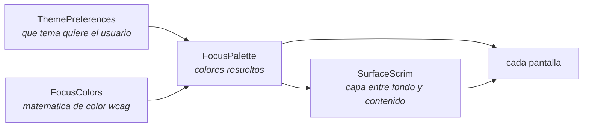

<div align="center">

# SISTEMA DE TEMAS

<sub><a href="../README.md">indice</a> · <a href="../../en/developers/07-theming-system.md">english</a> · anterior: <a href="./06-capa-de-presentacion.md">capa de presentacion</a> · siguiente: <a href="./08-seguridad.md">seguridad</a></sub>

</div>

---

## EL PROBLEMA QUE RESUELVE

focusphone permite combinar **un tema arbitrario** — incluido un par fondo/texto totalmente
libre elegido por el usuario — con **un fondo de pantalla arbitrario**. nada garantiza que
esa combinacion siga siendo legible.

ademas, el tema personalizado **no se aplica mediante un estilo**, sino en tiempo de
ejecucion, asi que resolver colores por atributo del tema no lo tiene en cuenta.

de ahi las tres piezas del paquete `ui/theme`:



---

## REGLA DE ORO

> **el color se obtiene siempre de `FocusPalette.of(context)`**, o de `BaseActivity.palette`
> / `effectivePalette`.
>
> **nunca** de `Theme.resolveAttribute(attr, tv, true).data`.

motivos:

1. `resolveAttribute(...).data` devuelve un **id de recurso**, no un color, cuando el
   atributo apunta a un `ColorStateList`
2. desconoce por completo el tema personalizado
3. no aplica ninguna comprobacion de contraste

---

## `FocusPalette`

una `data class` inmutable con el conjunto de colores ya resuelto:

| campo | uso |
|---|---|
| `background` | color opaco del fondo de toda la pantalla |
| `surface` | fondo ligeramente elevado para tarjetas, mosaicos y campos |
| `textPrimary` | texto e iconos principales |
| `textSecondary` | texto de apoyo, subtitulos e iconos inactivos |
| `divider` | separadores de una linea |
| `accent` | relleno de los estados seleccionados: dia actual, pastillas activas, interruptores |
| `onAccent` | color legible sobre `accent` |
| `isDark` | true cuando el fondo es oscuro, es decir, cuando el contenido claro va encima |

### CONSTRUCCION

```kotlin
fun of(context: Context): FocusPalette   // fuente unica de verdad
```

| ruta | cuando |
|---|---|
| `fromCustom(context)` | el tema activo es `THEME_CUSTOM`: los colores vienen de `ThemePreferences` |
| `fromTheme(context)` | cualquier tema integrado: los colores vienen de los atributos del estilo, con valores de respaldo si faltan |

ambas rutas terminan en `build(...)`, que **fuerza el contraste**:

```kotlin
val safePrimary   = FocusColors.ensureContrast(primary,   background, CONTRAST_BODY)
val safeSecondary = FocusColors.ensureContrast(secondary, background, CONTRAST_SUPPORT)
```

por eso un tema personalizado ilegible es imposible: el usuario elige, pero la paleta
corrige lo justo para alcanzar el minimo.

### METODOS UTILES

| metodo | para que |
|---|---|
| `primaryAt(fraction)` | atenua `textPrimary` hacia el fondo manteniendolo opaco y medible |
| `ripple()` | color translucido de pulsacion, derivado de `textPrimary` |
| `forScrim(scrimAlpha)` | variante de la paleta para texto sobre un scrim **parcialmente transparente** |

<details>
<summary><strong>por que existe <code>forScrim</code></strong></summary>

<br>

un scrim con opacidad menor del 100 % deja que el fondo de pantalla desplace la superficie
real respecto a `background`, y **todos** los colores de focusphone se eligieron contra
`background`.

ese desplazamiento siempre **reduce** la distancia entre superficie y texto: un tema claro
sobre una foto oscura oscurece la superficie, y un tema oscuro sobre una foto luminosa la
aclara. tirar de los colores de apoyo hacia `textPrimary` restaura la separacion en ambas
direcciones.

el tiron es proporcional a cuanto fondo sigue viendose, asi que un scrim casi opaco deja la
paleta intacta (`OPAQUE_ENOUGH = 0.95f`).

</details>

---

## `FocusColors`

la matematica de color compartida, siguiendo la definicion de contraste de **wcag 2.1**,
que es el mismo modelo que usa material 3 para sus paletas tonales.

<table>
<tr><th align="left" width="32%">funcion</th><th align="left" width="68%">que hace</th></tr>
<tr><td><code>withAlpha(color, alpha)</code></td><td>sustituye el canal alfa</td></tr>
<tr><td><code>blend(fg, bg, ratio)</code></td><td>compone <code>fg</code> sobre <code>bg</code> y devuelve un color <strong>opaco</strong>; preferible a <code>withAlpha</code> cuando hay que medir contraste, porque un color translucido no tiene luminancia propia medible</td></tr>
<tr><td><code>flatten(color, background)</code></td><td>aplana un color posiblemente translucido sobre un fondo opaco</td></tr>
<tr><td><code>luminance(color)</code></td><td>luminancia relativa wcag, de 0 a 1</td></tr>
<tr><td><code>isDark(color)</code></td><td>true cuando la luminancia es menor que 0.5</td></tr>
<tr><td><code>contrastRatio(a, b)</code></td><td>ratio de contraste wcag, de 1.0 a 21.0</td></tr>
<tr><td><code>bestOn(background)</code></td><td>devuelve blanco o negro, el que mejor se lea encima</td></tr>
<tr><td><code>ensureContrast(fg, bg, minRatio)</code></td><td>el metodo clave: ver mas abajo</td></tr>
<tr><td><code>compositeOver(top, bottom)</code></td><td>compone con alfa igual que lo hace el framework al dibujar vistas superpuestas</td></tr>
</table>

### UMBRALES

| constante | valor | para que |
|---|---|---|
| `CONTRAST_BODY` | 4.5 | minimo wcag para texto de cuerpo (14 sp regular) |
| `CONTRAST_LARGE` | 3.0 | minimo wcag para texto grande (18 sp o 14 sp en negrita) y formas significativas |
| `CONTRAST_SUPPORT` | 4.0 | objetivo comodo para el texto secundario de focusphone |

### `ensureContrast`

```kotlin
fun ensureContrast(foreground: Int, background: Int, minRatio: Double = CONTRAST_BODY): Int
```

1. si el color ya cumple el minimo, **se devuelve sin tocar**: un tema diseñado con cuidado
   nunca se altera
2. si no, se mezcla progresivamente hacia el extremo mas legible (blanco o negro) en pasos
   de 0.05, **conservando el tono todo lo posible**
3. solo si el objetivo es inalcanzable de otra forma, se devuelve el extremo puro

---

## `SurfaceScrim`

el scrim es la capa que se pinta **entre el fondo de pantalla y el contenido**. siempre se
pinta con el color `background` de la paleta activa, de forma que detras del texto queda una
version atenuada del tema elegido, no un lavado gris.

### TIPOS DE SUPERFICIE

cada superficie traduce la unica preferencia de *legibilidad* del usuario a su propio rango
de alfa, porque la ayuda que necesita cada pantalla depende de lo que muestre.

| superficie | suelo | rango | motivo |
|---|---|---|---|
| `HOME` | 0.00 | 0.55 | el fondo de pantalla es el objetivo de esta pantalla; con legibilidad 0 la foto se ve intacta |
| `PANEL` | 0.28 | 0.62 | los cajones laterales son densos: letras de dias a 12 sp sobre una foto cargada son ilegibles |
| `CONTENT` | 0.40 | 0.55 | ajustes, cajon, selectores y pantallas de bloqueo: texto pequeño, subtitulos, interruptores y deslizadores |

### FORMULA

```kotlin
var alpha = surface.floor + surface.range * (legibility / 100f)
if (blurEnabled) {
    alpha *= (1f - BLUR_RELIEF * (blurIntensity / 100f))   // BLUR_RELIEF = 0.35f
}
```

<details>
<summary><strong>por que el desenfoque descuenta scrim</strong></summary>

<br>

el desenfoque ya elimina el detalle de alta frecuencia que dificulta la lectura. sin este
descuento, los dos efectos se acumularian hasta convertir la pantalla en un panel opaco, y
el fondo elegido dejaria de verse.

</details>

<details>
<summary><strong>el caso sin fondo de pantalla no cuesta nada</strong></summary>

<br>

`SurfaceScrim.apply` pone la vista en `GONE` cuando el alfa es despreciable, de modo que en
el caso comun — sin fondo de pantalla — el scrim no consume ni una pasada de dibujado.

</details>

<details>
<summary><strong>vista previa en vivo</strong></summary>

<br>

existe una sobrecarga de `alphaFor(surface, legibility, blurEnabled, blurIntensity)` con
valores explicitos, para que la vista previa de ajustes pueda seguir un deslizador
**mientras se arrastra**, antes de que nada se guarde.

</details>

---

## LOS TEMAS EN RECURSOS

`res/values/themes.xml` define:

| estilo | papel |
|---|---|
| `Theme.FocusPhone` | raiz, sobre `Theme.Material3.Dark.NoActionBar` |
| `Base.Theme.FocusPhone` / `Base.Theme.FocusPhone.Dark` | bases comunes para temas claros y oscuros |
| `Theme.FocusPhone.OffWhite` · `.Slate` · `.WarmBeige` · `.Navy` | los cuatro temas integrados |
| estilos de dialogo y de widgets | apariencia de dialogos, interruptores y deslizadores |

<details>
<summary><strong>la redireccion de roles de material 3</strong></summary>

<br>

cada tema **redirige a sus propios colores** todos los roles de material 3 que no define
(`colorPrimaryInverse`, `colorOnTertiary`, `colorSurfaceContainerLow`, …). sin esa
redireccion, la linea base morada de m3 se colaba en la interfaz monocroma a traves de
componentes que la aplicacion no estiliza explicitamente.

</details>

<details>
<summary><strong>por que no existe <code>values-night/</code></strong></summary>

<br>

el claro/oscuro **no** se delega en el sistema de recursos. `THEME_AUTO` se resuelve a mano:

```kotlin
fun getEffectiveTheme(context: Context): String   // AUTO → SLATE (noche) | OFF_WHITE (dia)
```

`BaseActivity` guarda el tema **efectivo** resuelto, de modo que `onResume()` detecta que el
sistema ha cambiado de modo y llama a `recreate()`. asi el tema personalizado y el modo
automatico conviven en un unico mecanismo.

</details>

### PALETAS INTEGRADAS

| tema | fondo | fondo secundario | acento | texto principal | texto secundario | separador |
|---|---|---|---|---|---|---|
| off-white | `#FAFAFA` | `#F5F5F5` | `#E0E0E0` | `#333333` | `#757575` | `#E0E0E0` |
| slate | `#181818` | `#1E1E1E` | `#333333` | `#E0E0E0` | `#9E9E9E` | `#2C2C2C` |
| warm beige | `#FEFEFE` | `#F0EDE8` | `#D4C9B0` | `#4A4A4A` | `#8A8078` | `#D4C9B0` |
| navy | `#0A0E17` | `#1A1F2E` | `#2D3748` | `#E2E8F0` | `#94A3B8` | `#1E2A3A` |

el tema personalizado valida el hexadecimal con una expresion regular estricta
(`^#[0-9A-Fa-f]{6}$`) y cae a valores seguros (`#181818` / `#FAFAFA`) si el valor no es
valido.

---

## RECOLOREADO DEL ARBOL DE VISTAS

el tema personalizado no pasa por un estilo, asi que `BaseActivity.colorizeViewTree()`
repinta el arbol ya inflado. dos reglas hacen que sea seguro:

| regla | motivo |
|---|---|
| **solo repinta fondos dibujados con un color del tema** | antes rellenaba todos los contenedores con un color opaco que nunca se deshacia, y eso tapaba el fondo de pantalla |
| **recuerda el rol de color de cada vista** | sin eso, repintar dos veces convertia el texto secundario en principal |

existe ademas una lista de ids excluidos (`BACKGROUND_RECOLOR_EXCLUDED_IDS`) para las
superficies cuyo fondo lo define el layout con una intencion semantica propia.

---

## LISTA DE COMPROBACION AL TOCAR COLOR

<details open>
<summary><strong>antes de dar por terminado un cambio de color</strong></summary>

<br>

- [ ] el color se obtiene de `FocusPalette`, no de `resolveAttribute`
- [ ] se ha probado en los **cuatro** temas integrados
- [ ] se ha probado con el **tema personalizado**, incluida una combinacion deliberadamente poco legible
- [ ] se ha probado con **fondo de pantalla** activo, con y sin desenfoque, en legibilidad 0 y 100
- [ ] los textos secundarios siguen distinguiendose de los principales tras varios repintados
- [ ] `./gradlew :app:testDebugUnitTest` pasa, incluidos `FocusColorsTest`, `SurfaceScrimTest` y `MaterialAlertDialogThemeTest`

</details>

---

<div align="center">

<sub><a href="./06-capa-de-presentacion.md">← capa de presentacion</a> · <a href="../README.md">indice</a> · <a href="./08-seguridad.md">seguridad →</a></sub>

</div>
