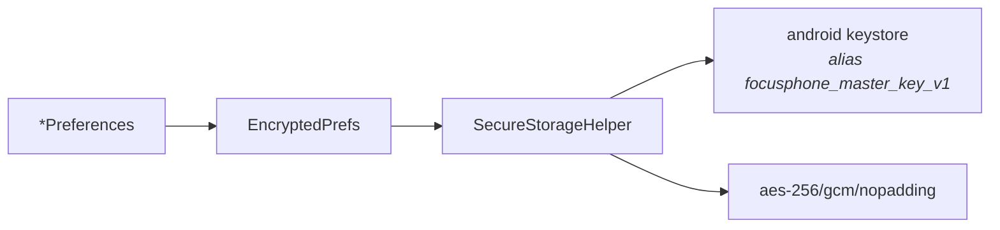

<div align="center">

# SEGURIDAD

<sub><a href="../README.md">indice</a> · <a href="../../en/developers/08-security.md">english</a> · anterior: <a href="./07-sistema-de-temas.md">sistema de temas</a> · siguiente: <a href="./09-servicios-del-sistema.md">servicios del sistema</a></sub>

</div>

---

## MODELO DE AMENAZA

focusphone no protege frente a un atacante remoto: **no tiene red**. lo que protege es:

<table>
<tr>
<th align="left" width="34%">amenaza</th>
<th align="left" width="66%">mitigacion</th>
</tr>
<tr>
<td>el propio usuario intentando saltarse sus limites en un impulso</td>
<td>contraseñas con hash, politica de intentos con espera, pantallas de bloqueo sin atajos de salida y reglas invisibles hasta desbloquear</td>
</tr>
<tr>
<td>otra aplicacion leyendo datos de focusphone</td>
<td>almacenamiento privado de la aplicacion y cifrado aes-256/gcm de los datos sensibles</td>
</tr>
<tr>
<td>extraccion de ficheros del dispositivo</td>
<td>los valores sensibles son ilegibles sin la clave del keystore, que nunca sale del dispositivo</td>
</tr>
<tr>
<td>fuga por copia de seguridad o transferencia de dispositivo</td>
<td><code>allowBackup=false</code> y <code>data_extraction_rules.xml</code> excluyendo todos los dominios</td>
</tr>
<tr>
<td>observacion visual de una contraseña</td>
<td><code>FLAG_SECURE</code> en la pantalla de bloqueo de detox y en los dialogos de contraseña</td>
</tr>
</table>

**fuera del alcance**: focusphone no es un administrador de dispositivos, no impide su
propia desinstalacion y no impide cambiar de lanzador. es un compromiso reforzado, no una
jaula.

---

## CIFRADO EN REPOSO



### `SecureStorageHelper`

| aspecto | valor |
|---|---|
| algoritmo | `AES/GCM/NoPadding` |
| longitud de clave | 256 bits |
| alias de la clave | `focusphone_master_key_v1` |
| almacen | `AndroidKeyStore`, respaldado por hardware o tee cuando el dispositivo lo permite |
| iv | 12 bytes aleatorios por operacion |
| etiqueta de autenticacion | 128 bits |
| formato del payload | `Base64( IV(12) ‖ ciphertext ‖ authTag(16) )` |
| api | **sincrona**, para poder usarse dentro de envoltorios de `SharedPreferences` leidos en el hilo principal |

la clave **nunca sale del keystore**: la aplicacion solo puede pedirle que cifre y descifre.

> **nunca se regenera la clave sobre un alias existente.** hacerlo dejaba ilegible todo lo
> cifrado con la clave anterior.

### `EncryptedPrefs` Y EL RESULTADO TIPADO

ningun fallo se traga en silencio. `read()` devuelve uno de cuatro estados:

<table>
<tr><th align="left" width="18%">estado</th><th align="left" width="42%">significado</th><th align="left" width="40%">reaccion obligatoria</th></tr>
<tr><td><code>Absent</code></td><td>no hay nada guardado</td><td>escribir con normalidad</td></tr>
<tr><td><code>Present</code></td><td>valor descifrado correctamente</td><td>escribir con normalidad</td></tr>
<tr><td><code>Unavailable</code></td><td>la clave del keystore no se puede usar <strong>en este momento</strong></td><td><strong>negarse a escribir</strong>: escribir sustituiria los datos reales por el valor vacio de respaldo</td></tr>
<tr><td><code>Lost</code></td><td>el contenido <strong>nunca</strong> podra descifrarse</td><td>tratar como ausente, para que el usuario pueda reconstruirlo</td></tr>
</table>

este es el patron que aplican `AppFolderPreferences`, `AppSchedulePreferences` y
`ProfilePreferences`: mientras el estado sea `Unavailable`, la interfaz muestra la lista
vacia **y toda escritura se rechaza**.

### DETECCION DEL FORMATO HEREDADO

`CustomAppLabelsPreferences` distingue los valores antiguos en texto plano **por su forma**,
con `SecureStorageHelper.looksEncrypted`, y jamas por un fallo al descifrar.

> si la clave se pierde, un valor cifrado real tambien falla al descifrarse. tratarlo como
> texto plano lo volveria a cifrar sobre si mismo y corromperia la etiqueta para siempre.
> los valores ilegibles se dejan intactos y se muestra la etiqueta del sistema.

### QUE ESTA CIFRADO

| fichero | contenido cifrado |
|---|---|
| `focusphone_profile` | perfil activo, fin del detox, hash de contraseña, apps bloqueadas, palabras clave, contador de intentos y fin de la espera |
| `focusphone_custom_labels` | nombres personalizados de aplicaciones |
| carpetas del cajon | definicion de carpetas y su pertenencia |
| `focusphone_schedule` | reglas de horario, hash de contraseña y contadores de uso diario |

---

## HASHING DE CONTRASEÑAS

`PasswordHasher` es el unico punto donde se procesan contraseñas, tanto de detox como de
horarios.

| parametro | valor |
|---|---|
| algoritmo | `PBKDF2WithHmacSHA256` |
| iteraciones | 100 000 |
| longitud de clave derivada | 256 bits |
| sal | 16 bytes (128 bits) de `SecureRandom`, distinta por contraseña |
| formato almacenado | `saltBase64:hashBase64` |

```kotlin
fun verify(stored: String, input: String): VerifyResult
```

| resultado | significado |
|---|---|
| `Match` | coincide y esta en el formato actual |
| `MatchNeedsUpgrade` | coincide con un hash **heredado** sha-256 sin sal: quien llama debe volver a guardarlo en el formato moderno |
| `Mismatch` | no coincide, o el payload almacenado es ilegible |

<details>
<summary><strong>detalles de implementacion que importan</strong></summary>

<br>

| detalle | motivo |
|---|---|
| comparacion en **tiempo constante** (`constantTimeEquals`) | no cortocircuita en el primer caracter distinto, para no filtrar informacion por temporizacion |
| formato heredado reconocido por forma | exactamente 64 caracteres hexadecimales |
| sal vacia o ilegible → `Mismatch` | un payload sin sal utilizable nunca puede coincidir |
| **pbkdf2 se ejecuta siempre fuera del hilo principal** | 100 000 iteraciones bloquearian la interfaz |

</details>

---

## POLITICA DE INTENTOS

`PasswordAttemptPolicy` es la **unica** politica de contraseña incorrecta de la aplicacion:
la comparten las sesiones de detox y los horarios.

| parametro | valor por defecto |
|---|---|
| intentos fallidos maximos | 5 |
| duracion de la espera | 15 minutos |

```kotlin
fun recordFailure(): Boolean      // true cuando este fallo inicia la espera
fun isLockedOut(): Boolean
fun lockoutRemainingMs(): Long
fun remainingAttempts(): Int
fun reset()                       // tras acierto o cambio de contraseña
```

### INVARIANTES

<table>
<tr><td width="4%">1</td><td>durante la espera se rechaza <strong>todo</strong> intento, <strong>incluida la contraseña correcta</strong>. sin eso, probar contraseñas no tendria coste.</td></tr>
<tr><td>2</td><td><strong>nunca se borra nada al fallar</strong>: ni la contraseña, ni las reglas, ni la sesion. borrar la configuracion al fallar convertiria el bloqueo en un atajo de un minuto.</td></tr>
<tr><td>3</td><td>una contraseña incorrecta <strong>no termina</strong> una sesion de detox.</td></tr>
<tr><td>4</td><td>el usuario nunca queda atrapado: una sesion de detox <strong>siempre</strong> termina cuando expira su temporizador.</td></tr>
<tr><td>5</td><td>el contador y el fin de la espera se persisten <strong>cifrados</strong>, asi que sobreviven a la muerte del proceso y no se pueden reiniciar editando un fichero en texto plano.</td></tr>
</table>

<details>
<summary><strong>el contador se reinicia al empezar la espera</strong></summary>

<br>

cuando el fallo numero 5 inicia la espera, el contador vuelve a 0 y se guarda la marca de
fin. asi, al terminar la espera, el siguiente presupuesto de intentos empieza limpio, sin
quedar bloqueado de forma permanente.

</details>

<details>
<summary><strong>la abstraccion <code>AttemptStore</code></strong></summary>

<br>

la politica no conoce el keystore: recibe una interfaz `AttemptStore` con cuatro metodos.
en produccion, `PasswordAttemptPolicy.encrypted(...)` la respalda con `EncryptedPrefs`; en
las pruebas se sustituye por una implementacion en memoria, junto con un reloj inyectable.

</details>

---

## LA PUERTA DE ACCESO A HORARIOS

`ScheduleAccessGate` es una sesion de desbloqueo de **5 minutos** que vive **solo en
memoria**:

| propiedad | detalle |
|---|---|
| duracion | 5 minutos desde la verificacion correcta |
| almacenamiento | memoria del proceso; desaparece al morir el proceso |
| motivo | permite ajustar varias aplicaciones sin reintroducir la contraseña en cada edicion |
| revalidacion | `AppScheduleEditActivity` la comprueba en **cada `onResume`**, de modo que una tarea antigua en recientes no sirve para editar reglas |

---

## PERMISOS Y SUPERFICIE DE ATAQUE

| permiso declarado | motivo |
|---|---|
| `QUERY_ALL_PACKAGES` | imprescindible para un lanzador: listar las aplicaciones instaladas. requiere formulario de declaracion en play store |
| `REQUEST_DELETE_PACKAGES` | necesario desde android 9 para lanzar intents de desinstalacion; la confirmacion siempre la hace el sistema |
| `EXPAND_STATUS_BAR` | gesto de desplegar la persiana de notificaciones |

| servicio exportado | proteccion |
|---|---|
| `FocusAccessibilityService` | `android.permission.BIND_ACCESSIBILITY_SERVICE`: solo el sistema puede enlazarlo |
| `FocusNotificationService` | `android.permission.BIND_NOTIFICATION_LISTENER_SERVICE`: idem |

**todas las demas activities estan declaradas con `android:exported="false"`**, salvo
`HomeActivity`, que debe estar exportada por su filtro de intent `HOME`.

---

## COPIAS DE SEGURIDAD

```xml
android:allowBackup="false"
android:dataExtractionRules="@xml/data_extraction_rules"
```

| mecanismo | estado | motivo |
|---|---|---|
| copia en la nube y `adb backup` | desactivados por `allowBackup="false"` | evita filtrar metadatos del usuario: favoritos, temas, etiquetas personalizadas y estado de perfil |
| transferencia dispositivo a dispositivo | excluida en `data_extraction_rules.xml` | desde android 12, `allowBackup` ya **no** cubre la transferencia |

aunque una copia escapase, los valores cifrados estan ligados a una clave del keystore que
nunca sale del dispositivo, asi que una copia restaurada no seria legible.

---

## PROTECCIONES DE INTERFAZ

| proteccion | donde |
|---|---|
| `FLAG_SECURE` | `DetoxBlockedActivity` y los dialogos de contraseña: impide capturas y grabacion de pantalla |
| renderizado diferido | `AppScheduleActivity` no dibuja la lista de reglas hasta que la contraseña es correcta |
| sin boton de desbloqueo | `ScheduleBlockedActivity` no ofrece salida: las reglas solo se cambian desde ajustes |
| validacion de entrada | los colores del tema personalizado se validan con `^#[0-9A-Fa-f]{6}$` antes de parsearse |
| validacion de paquetes | las claves de etiquetas personalizadas se validan contra la forma de un nombre de paquete antes de persistirse |

---

## REGLAS AL TOCAR SEGURIDAD

<details open>
<summary><strong>lo que nunca debe hacerse</strong></summary>

<br>

- **no** borres configuracion protegida como reaccion a intentos fallidos
- **no** trates `Unavailable` como lista vacia
- **no** ejecutes pbkdf2 en el hilo principal
- **no** regeneres la clave del keystore sobre un alias existente
- **no** detectes texto plano heredado por un fallo de descifrado
- **no** añadas un atajo de desbloqueo en una pantalla de bloqueo por horario
- **no** guardes una contraseña en claro, ni siquiera temporalmente

</details>

<details open>
<summary><strong>lo que debe hacerse</strong></summary>

<br>

- pasa toda contraseña nueva por `PasswordHasher`
- reutiliza `PasswordAttemptPolicy` en lugar de escribir otra politica de intentos
- guarda cualquier dato nuevo que revele habitos del usuario a traves de `EncryptedPrefs`
- pon `FLAG_SECURE` en toda pantalla nueva que muestre o pida una contraseña
- añade pruebas unitarias de los casos limite: payload malformado, sal vacia, espera activa, formato heredado

</details>

---

## REPORTAR UNA VULNERABILIDAD

no abras una issue publica: usa el [aviso privado de seguridad de github](https://github.com/rezzt-dev/focusphone-app/security/advisories/new)
(cuando este activado en el repositorio) o escribe a `contacto@rezzt.dev`. la version soportada, los plazos de respuesta, la politica de
divulgacion y el alcance dentro y fuera de la politica estan en [`security.md`](../../../security.md),
en la raiz del repositorio, que es donde github lo lee para activar la pestaña "security".

---

<div align="center">

<sub><a href="./07-sistema-de-temas.md">← sistema de temas</a> · <a href="../README.md">indice</a> · <a href="./09-servicios-del-sistema.md">servicios del sistema →</a></sub>

</div>
