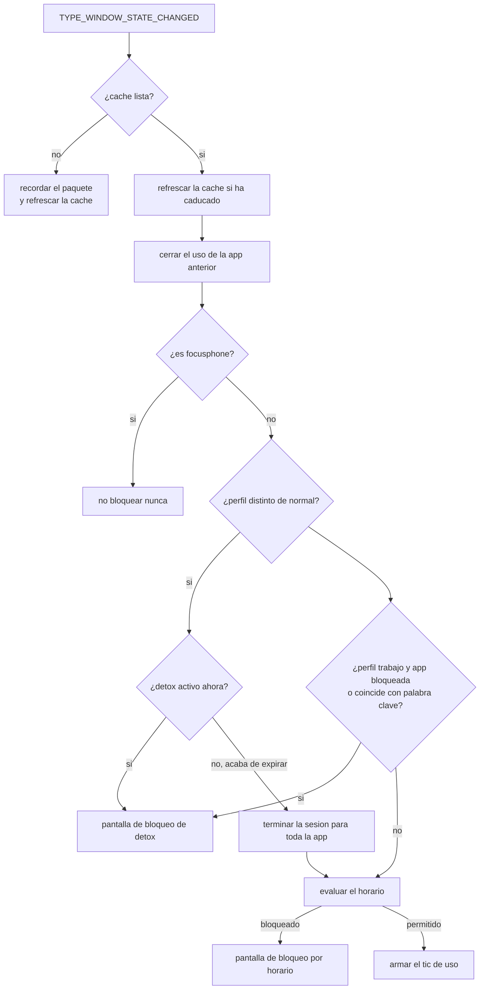
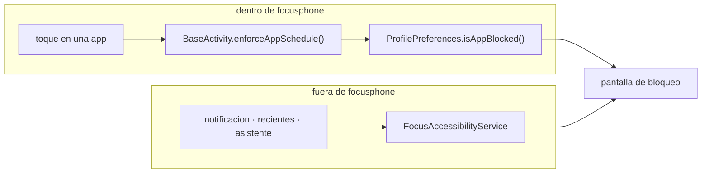

<div align="center">

# SERVICIOS DEL SISTEMA

<sub><a href="../README.md">indice</a> · <a href="../../en/developers/09-system-services.md">english</a> · anterior: <a href="./08-seguridad.md">seguridad</a> · siguiente: <a href="./10-pruebas-y-calidad.md">pruebas y calidad</a></sub>

</div>

---

## DOS SERVICIOS, AMBOS OPCIONALES

| servicio | permiso de enlace | habilita |
|---|---|---|
| `FocusAccessibilityService` | `BIND_ACCESSIBILITY_SERVICE` | bloqueo a nivel de sistema, limites diarios de uso y despliegue de la persiana |
| `FocusNotificationService` | `BIND_NOTIFICATION_LISTENER_SERVICE` | el panel lateral de notificaciones y las insignias |

ninguno esta activo por defecto: los activa el usuario desde los ajustes del sistema.

---

## `FocusAccessibilityService`

### PARA QUE EXISTE

focusphone bloquea sin ningun permiso especial las aplicaciones que se abren **desde
focusphone**. pero una aplicacion tambien se abre desde una notificacion, desde las apps
recientes o desde el asistente de voz, y eso pasa por encima del lanzador. este servicio
cierra esa via.

ademas es **el unico componente capaz de medir cuanto tiempo pasa una aplicacion en primer
plano**, asi que tambien le corresponde la contabilidad de los limites diarios.

### CONFIGURACION

```xml
<accessibility-service
    android:accessibilityEventTypes="typeWindowStateChanged"
    android:accessibilityFeedbackType="feedbackGeneric"
    android:notificationTimeout="0"
    android:canRetrieveWindowContent="true"
    android:settingsActivity="app.focusphone.ui.settings.SettingsActivity" />
```

solo escucha `TYPE_WINDOW_STATE_CHANGED`: le basta con saber **que paquete** pasa a primer
plano.

### FLUJO DE UN EVENTO



### LA CACHE Y POR QUE EXISTE

leer preferencias cifradas con aes-256/gcm **en cada evento de accesibilidad** provoca anr.
por eso el servicio mantiene en memoria:

| valor cacheado | contenido |
|---|---|
| `cachedBlockedApps` | paquetes bloqueados a mano |
| `cachedWorkKeywords` | palabras clave del perfil de trabajo |
| `cachedScheduleRules` | reglas de horario por paquete |
| `cachedDetoxEndTime` | marca de fin de la sesion de detox |
| `cachedProfile` | perfil activo |

| constante | valor | para que |
|---|---|---|
| `CACHE_TTL_MS` | 3 000 ms | vida de la cache de estado cifrado |
| `TICK_INTERVAL_MS` | 30 000 ms | intervalo maximo de revision del uso |
| `DISK_FLUSH_INTERVAL_MS` | 60 000 ms | volcado periodico de los contadores a disco |

<details>
<summary><strong>el detox no se cachea como booleano</strong></summary>

<br>

que una sesion de detox este activa depende del **reloj**, asi que se evalua en cada evento
a partir de las entradas cacheadas, con `ProfilePreferences.isDetoxActivePure(...)`.

cachear el booleano hacia que el bloqueo siguiera vigente hasta `CACHE_TTL_MS` despues de
que la sesion hubiera terminado.

cuando la sesion acaba de expirar, el servicio no se limita a dejar de bloquear: llama a
`expireDetoxIfNeeded` para cerrarla **en toda la aplicacion**, no solo en el servicio.

</details>

### CONTABILIDAD DE USO

<table>
<tr><th align="left" width="34%">mecanismo</th><th align="left" width="66%">detalle</th></tr>
<tr>
<td>cronometro de primer plano</td>
<td><code>foregroundPackage</code> y <code>foregroundSince</code>; al cambiar de aplicacion se cierra primero el tiempo de la anterior</td>
</tr>
<tr>
<td>solo apps con limite</td>
<td><code>flushForegroundUsage()</code> descarta cualquier paquete sin <code>hasDailyLimit</code>: <strong>no se escribe dato de uso de aplicaciones sin limite</strong></td>
</tr>
<tr>
<td>pausa con pantalla apagada</td>
<td>un receptor de <code>ACTION_SCREEN_OFF</code> / <code>ACTION_SCREEN_ON</code> detiene y reanuda el conteo: una aplicacion en primer plano con el movil bloqueado no se esta usando</td>
</tr>
<tr>
<td>revision periodica</td>
<td><code>scheduleUsageTickFor()</code> despierta <strong>exactamente</strong> cuando se agotaria el margen, o como muy tarde a los 30 s, de forma que la sesion se interrumpe a mitad de uso</td>
</tr>
<tr>
<td>escritura a disco</td>
<td>el delta en memoria se vuelca en una unica transaccion de e/s serializada por un <code>Mutex</code>; si el almacenamiento cifrado no esta disponible, el lote se reincorpora en memoria en vez de perderse</td>
</tr>
<tr>
<td>cambio de dia</td>
<td><code>ensureCurrentUsageDay()</code> reinicia los contadores en la medianoche local</td>
</tr>
</table>

<details>
<summary><strong>por que se cierra el uso tambien en <code>enforceSchedule</code></strong></summary>

<br>

hay aplicaciones que emiten eventos de ventana continuamente. sin ese cierre adicional,
cada evento reiniciaba el temporizador periodico y el tiempo usado nunca llegaba a
escribirse.

</details>

### API ESTATICA

| metodo | para que |
|---|---|
| `isEnabled(context)` | consulta si el usuario ha activado el servicio |
| `openAccessibilitySettings(context)` | abre directamente la pantalla de accesibilidad de android |
| `expandNotifications()` | despliega la persiana usando `GLOBAL_ACTION_NOTIFICATIONS`; devuelve `false` si el servicio no esta activo |

`HomeActivity` usa esa via oficial primero y solo recurre a la reflexion sobre
`StatusBarManager` cuando el servicio no esta activo. esa reflexion la bloquea la lista de
interfaces no sdk a partir de api 31, asi que en dispositivos modernos **el gesto necesita
el servicio**.

### CICLO DE VIDA

| callback | que hace |
|---|---|
| `onServiceConnected()` | fuerza un refresco de cache, arma el volcado periodico y registra el receptor de pantalla **una sola vez** (puede volver a dispararse tras una reconexion) |
| `onInterrupt()` | requerido por la plataforma |
| `onUnbind()` / `onDestroy()` | `release()`: vuelca el uso pendiente, cancela los temporizadores y desregistra el receptor |

---

## `FocusNotificationService`

extiende `NotificationListenerService` y alimenta `NotificationRepository`.

| callback | comportamiento |
|---|---|
| `onNotificationPosted` / `onNotificationRemoved` | refrescan la lista |
| `onListenerConnected` | refresca la lista al conectarse |
| `onListenerDisconnected` | **olvida todo**: sin un listener vivo la lista no puede mantenerse al dia, asi que el contenido de las notificaciones de otras aplicaciones no debe seguir en pantalla ni en memoria |
| `onDestroy` | idem |
| `onStartCommand` | atiende la accion de descartar una notificacion concreta |

### GARANTIA DE PRIVACIDAD

el contenido (titulo y texto) **vive solo en ram**. no se escribe en disco, no se indexa y
no sale del dispositivo. al morir el proceso, la lista se vacia y se repuebla en la
siguiente conexion.

los `PendingIntent` de cada notificacion se guardan en un mapa concurrente y se liberan al
descartarla o al desconectarse el listener.

---

## PUNTOS DE APLICACION DEL BLOQUEO

hay **dos** caminos por los que se aplica un bloqueo, y ambos deben mantenerse coherentes:



| camino | cubre | requiere el servicio |
|---|---|---|
| `BaseActivity.enforceAppSchedule()` | cualquier lanzamiento iniciado en focusphone | no |
| `FocusAccessibilityService` | cualquier lanzamiento del sistema | si |

> al añadir una nueva via de lanzamiento en la aplicacion, **llama a `enforceAppSchedule()`**,
> o esa via se convertira en un hueco por el que los bloqueos no se aplican.

---

## REGLAS AL TOCAR LOS SERVICIOS

| regla | motivo |
|---|---|
| no leas preferencias cifradas directamente en `onAccessibilityEvent` | descifrar en cada evento provoca anr; usa la cache |
| no caches decisiones que dependan del reloj | un booleano cacheado mantiene un bloqueo vivo hasta 3 s despues de expirar |
| no acumules uso de aplicaciones sin limite diario | se estaria registrando actividad que nadie pidio medir |
| registra los receptores una sola vez | `onServiceConnected` puede dispararse de nuevo tras una reconexion |
| vuelca siempre el uso pendiente en `onUnbind` y `onDestroy` | si no, se pierde el tiempo acumulado desde el ultimo volcado |
| nunca escribas en disco el contenido de una notificacion | rompe la garantia de privacidad del panel |

---

<div align="center">

<sub><a href="./08-seguridad.md">← seguridad</a> · <a href="../README.md">indice</a> · <a href="./10-pruebas-y-calidad.md">pruebas y calidad →</a></sub>

</div>
