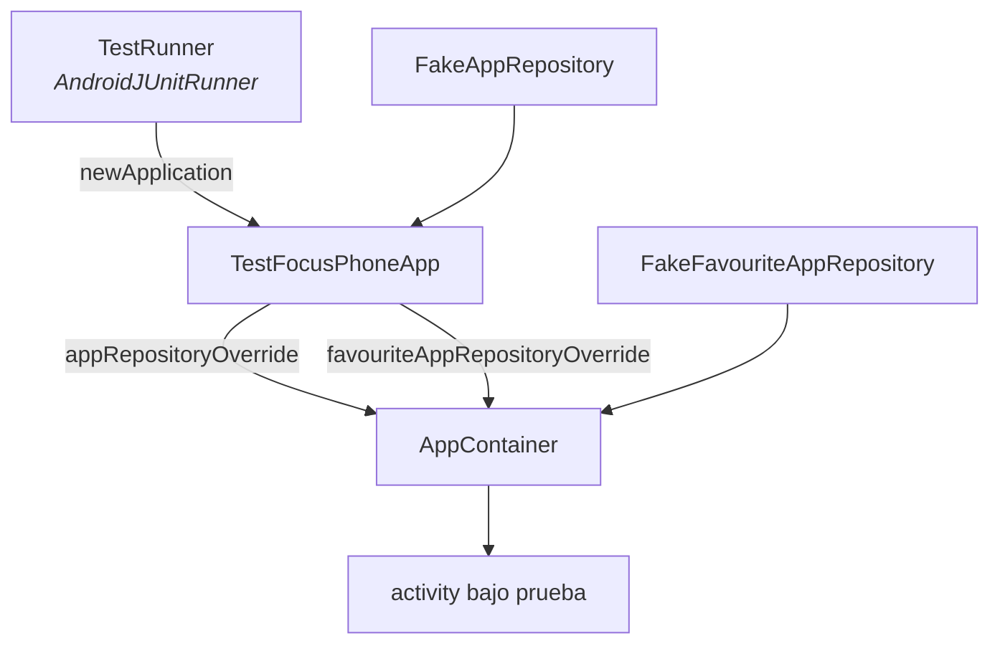

<div align="center">

# PRUEBAS Y CALIDAD

<sub><a href="../README.md">indice</a> · <a href="../../en/developers/10-testing-and-quality.md">english</a> · anterior: <a href="./09-servicios-del-sistema.md">servicios del sistema</a> · siguiente: <a href="./11-ci-y-publicacion.md">ci y publicacion</a></sub>

</div>

---

## LOS DOS NIVELES

<table>
<tr>
<th align="left" width="50%">pruebas unitarias (jvm)</th>
<th align="left" width="50%">pruebas instrumentadas</th>
</tr>
<tr>
<td valign="top">

`app/src/test/java/app/focusphone/`

- ejecutor: junit 4 sobre la jvm
- bibliotecas: mockk, robolectric, turbine, kotlinx-coroutines-test
- comando: `./gradlew :app:testDebugUnitTest`
- cubren: **logica pura y decisiones criticas**

</td>
<td valign="top">

`app/src/androidTest/java/app/focusphone/`

- ejecutor: `AndroidJUnit4` a traves de `TestRunner`
- bibliotecas: espresso, `ActivityScenario`
- comando: `./gradlew :app:connectedDebugAndroidTest`
- cubren: **flujos de usuario completos**

</td>
</tr>
</table>

> `unitTests.isIncludeAndroidResources = true`: las pruebas de robolectric inflan layouts
> reales y necesitan los recursos fusionados de la aplicacion. sin ellos, un estilo roto
> solo aparecia como un cierre inesperado en un dispositivo.

---

## INFRAESTRUCTURA DE PRUEBAS



| pieza | responsabilidad |
|---|---|
| `TestRunner` | runner propio que sustituye la clase `Application` por `TestFocusPhoneApp` |
| `TestFocusPhoneApp` | extiende `FocusPhoneApp`; expone **un unico** `AppContainer`, igual que produccion, y solo lo reconstruye cuando se intercambia un doble |
| `FakeAppRepository` | devuelve una lista fija de aplicaciones para las pruebas instrumentadas |
| `FakeFavouriteAppRepository` | doble en memoria para las pruebas unitarias |
| `AppContainer` | acepta los dos dobles por constructor |

<details>
<summary><strong>por que un unico contenedor en las pruebas</strong></summary>

<br>

los `StateFlow` de etiquetas y carpetas deben ser **los mismos** para todas las pantallas
bajo prueba, igual que en produccion. ademas, la `Application` sobrevive a las pruebas
individuales, y el `@Before` de una prueba puede instalar sus dobles despues de que una
prueba anterior ya haya construido el grafo: de ahi que el contenedor se invalide al
intercambiar un doble, en lugar de crearse uno nuevo en cada lectura.

</details>

---

## COBERTURA ACTUAL

### PRUEBAS UNITARIAS

<table>
<tr><th align="left" width="36%">suite</th><th align="left" width="64%">que cubre</th></tr>
<tr><td><code>AppScheduleEvaluatorTest</code></td><td>franjas, exclusividad del extremo final, cruce de medianoche, dia al que pertenece una franja envuelta, dias no seleccionados, conjunto vacio, limites diarios, precedencia de la franja sobre el limite, serializacion de ida y vuelta, lineas malformadas y valores fuera de rango</td></tr>
<tr><td><code>ProfilePreferencesTest</code></td><td>logica pura de bloqueo, expiracion del detox, migracion sha-256 → pbkdf2</td></tr>
<tr><td><code>ThemePreferencesTest</code></td><td>resolucion de tema, dia/noche automatico, respaldo ante hexadecimal invalido</td></tr>
<tr><td><code>PasswordHasherTest</code></td><td>payloads pbkdf2, actualizacion del formato heredado, entradas malformadas</td></tr>
<tr><td><code>PasswordAttemptPolicyTest</code></td><td>conteo de fallos, inicio y fin de la espera, reinicio del contador</td></tr>
<tr><td><code>AppFolderSerializerTest</code></td><td>ida y vuelta, saneado de nombres, lineas corruptas, orden alfabetico</td></tr>
<tr><td><code>FavouriteOrderingTest</code></td><td>la fusion nunca pierde ni duplica un favorito</td></tr>
<tr><td><code>FuzzyMatcherTest</code></td><td>puntuacion, bonificacion por consecutivos, ausencia de coincidencia</td></tr>
<tr><td><code>ToggleFavouriteAppUseCaseTest</code></td><td>alternar y limite de 10</td></tr>
<tr><td><code>RemoveFavouriteAppUseCaseTest</code></td><td>eliminacion idempotente</td></tr>
<tr><td><code>UpdateAppsOrderUseCaseTest</code></td><td>reordenacion sin perdida</td></tr>
<tr><td><code>FocusColorsTest</code></td><td>luminancia, ratio de contraste, <code>ensureContrast</code></td></tr>
<tr><td><code>SurfaceScrimTest</code></td><td>alfa por superficie, descuento por desenfoque, caso sin fondo</td></tr>
<tr><td><code>MaterialAlertDialogThemeTest</code></td><td>que los dialogos de material se inflan en <strong>todos</strong> los temas</td></tr>
<tr><td><code>AllAppsViewModelTest</code></td><td>construccion de filas del cajon</td></tr>
<tr><td><code>FocusAccessibilityServiceTest</code></td><td>logica del servicio aislada de la plataforma</td></tr>
<tr><td>preferencias varias</td><td><code>AppFolder</code>, <code>Font</code>, <code>Gesture</code>, <code>HomeLayout</code>, <code>Wallpaper</code>, <code>Widget</code></td></tr>
</table>

### PRUEBAS INSTRUMENTADAS

| suite | flujo |
|---|---|
| `OnboardingFlowTest` | los pasos de la bienvenida |
| `AppSelectFlowTest` | seleccion de favoritos y limite de 10 |
| `ProfileSwitchTest` | cambio entre perfiles normal y trabajo |
| `DetoxPasswordTest` | verificacion de contraseña y bloqueo tras intentos fallidos |
| `AppScheduleTest` | persistencia de reglas, contabilidad de uso y espera de la contraseña de horarios |
| `ProfilePreferencesStorageTest` | almacenamiento cifrado del perfil |
| `FavouriteAppDaoTest` | transacciones del dao |
| `ClockRendererTest` | renderizado de los tipos de reloj |
| `WallpaperStorageTest` | copia, sustitucion y limpieza de imagenes |
| `WidgetSlotTest` | la ranura del unico widget |

---

## ESTILO DE LAS PRUEBAS

los nombres son **frases en ingles** entre comillas invertidas, que describen el
comportamiento, no el metodo:

```kotlin
@Test fun `the window end is exclusive`() { … }
@Test fun `a wrapped window belongs to the day it starts on`() { … }
@Test fun `usage that reaches the limit blocks the app`() { … }
@Test fun `parse rejects malformed lines`() { … }
```

| convencion | detalle |
|---|---|
| una prueba, un comportamiento | nada de pruebas que verifican cinco cosas a la vez |
| casos limite explicitos | medianoche, conjuntos vacios, entradas corruptas, valores fuera de rango |
| relojes inyectables | `PasswordAttemptPolicy` recibe `clock: () -> Long`, de modo que la espera se prueba sin esperar |
| dobles por interfaz | `AttemptStore`, `AppRepository` y `FavouriteAppRepository` se sustituyen sin mockear el framework |

---

## QUE HAY QUE PROBAR SIEMPRE

<details open>
<summary><strong>obligatorio</strong></summary>

<br>

| cambio | prueba minima exigible |
|---|---|
| una regla de bloqueo nueva o modificada | pruebas unitarias de todos sus casos limite |
| una decision que dependa del reloj | pruebas con reloj inyectado, incluido el cruce de medianoche |
| un formato serializado | ida y vuelta, mas entradas corruptas |
| una operacion de contraseña | acierto, fallo, formato heredado y espera activa |
| un cambio de color o de contraste | `FocusColorsTest` y `SurfaceScrimTest` |
| un estilo de dialogo | `MaterialAlertDialogThemeTest` cubre todos los temas |
| un flujo de usuario nuevo | prueba instrumentada del recorrido completo |

</details>

<details>
<summary><strong>un ejemplo real de por que</strong></summary>

<br>

`MaterialAlertDialogThemeTest` existe porque `FocusPhone.DialogTitleTextStyle` heredaba de
un `TextAppearance` sin `layout_width`, y el titulo de `m3_alert_dialog` no se podia inflar:
la aplicacion se cerraba al abrir **cualquier** dialogo de material. ahora los estilos de
titulo y cuerpo heredan de `MaterialAlertDialog.Material3.*.Text`, y la prueba lo verifica
tema por tema.

</details>

---

## LINT

```kotlin
lint {
    checkReleaseBuilds = true
    abortOnError       = true
}
```

| regla del proyecto | detalle |
|---|---|
| lint se ejecuta tambien en release | cualquier error rompe la compilacion de publicacion |
| **no hay linea base** | a proposito: cada error se ha corregido en origen |
| advertencias | las que quedan estan registradas como hallazgos en la auditoria tecnica |
| errores nuevos | se corrigen en el codigo, no se silencian |

---

## COMANDOS

| comando | cuando |
|---|---|
| `./gradlew :app:testDebugUnitTest` | en cada cambio de logica |
| `./gradlew :app:lintDebug` | antes de cada commit |
| `./gradlew :app:connectedDebugAndroidTest` | al tocar un flujo de usuario, con un dispositivo conectado |
| `./gradlew :app:testDebugUnitTest :app:lintDebug :app:assembleRelease` | la verificacion completa, identica a la de ci |

los informes quedan en `app/build/reports/` y `app/build/test-results/`, y ci los publica
como artefactos en cada ejecucion.

---

<div align="center">

<sub><a href="./09-servicios-del-sistema.md">← servicios del sistema</a> · <a href="../README.md">indice</a> · <a href="./11-ci-y-publicacion.md">ci y publicacion →</a></sub>

</div>
