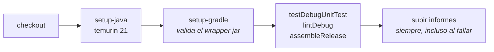
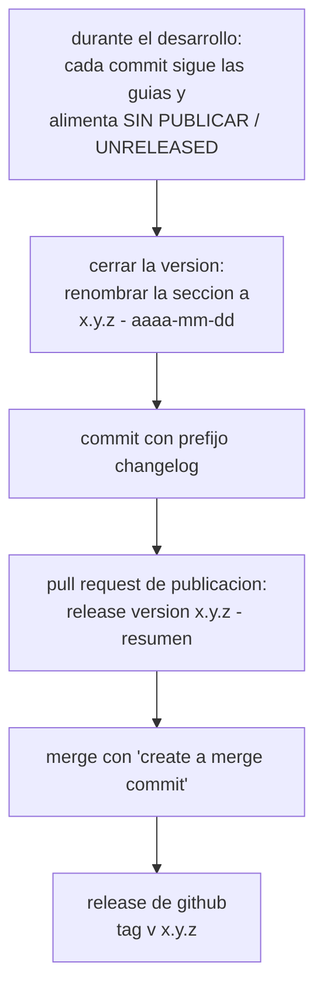

<div align="center">

# CI Y PUBLICACION

<sub><a href="../README.md">indice</a> · <a href="../../en/developers/11-ci-and-release.md">english</a> · anterior: <a href="./10-pruebas-y-calidad.md">pruebas y calidad</a> · siguiente: <a href="./12-contribuir.md">contribuir</a></sub>

</div>

---

## INTEGRACION CONTINUA

el workflow vive en `.github/workflows/android-ci.yml`.

| propiedad | valor |
|---|---|
| nombre | `android-ci` |
| disparadores | `push` a `main` y a `alfa-*`, y **toda** pull request |
| runner | `ubuntu-latest` |
| tiempo limite | 45 minutos |
| concurrencia | un grupo por workflow y referencia, con cancelacion de ejecuciones anteriores |
| permisos | `contents: read` |
| directorio de trabajo | `focusphone-project` |

### PASOS



```yaml
- name: Verify
  run: ./gradlew :app:testDebugUnitTest :app:lintDebug :app:assembleRelease --stacktrace
```

<details>
<summary><strong>por que esos tres objetivos y en ese orden</strong></summary>

<br>

| objetivo | aporta |
|---|---|
| `testDebugUnitTest` | falla rapido ante una regresion de logica |
| `lintDebug` | analisis estatico con `abortOnError` |
| `assembleRelease` | ejecuta **lint-vital** y **r8**: es la unica forma de detectar una regla de proguard rota o un error que solo aparece al minificar |

el apk de release se ensambla **sin firmar** en ci, porque las propiedades `RELEASE_*` solo
existen en la maquina de publicacion.

</details>

<details>
<summary><strong>jdk y wrapper</strong></summary>

<br>

- `actions/setup-java@v4` con temurin 21 satisface el criterio de toolchain del daemon
  definido en `gradle/gradle-daemon-jvm.properties`
- `gradle/actions/setup-gradle@v4` valida ademas `gradle/wrapper/gradle-wrapper.jar` contra
  las sumas de comprobacion oficiales, que es la razon de tener el jar versionado

</details>

### ARTEFACTOS

con `if: always()`, incluso cuando la verificacion falla, se suben:

```
focusphone-project/app/build/reports/
focusphone-project/app/build/test-results/
```

---

## POLITICA DE DEPENDENCIAS

un segundo workflow, `.github/workflows/dependency-policy.yml`, corre en cada pull request y
hace una sola cosa: **falla las pull requests abiertas por un bot de dependencias**.

| propiedad | valor |
|---|---|
| nombre | `dependency-policy` |
| disparadores | cada pull request |
| timeout | 5 minutos |
| permisos | `contents: read` |
| falla cuando | el autor es `dependabot[bot]` / `renovate[bot]`, o la rama de origen es `dependabot/*` / `renovate/*` |

en este repositorio no hay ninguna actualizacion automatica de `gradle/libs.versions.toml`:
`.github/dependabot.yml` declara sus ecosistemas con `open-pull-requests-limit: 0` y
`renovate.json` lleva `"enabled": false`, mientras que este workflow mantiene la politica en pie
aunque alguna de esas integraciones se reactive desde los ajustes del repositorio.

> el procedimiento manual para subir una biblioteca — verificacion, entrada de changelog y
> prefijo de commit — esta en <a href="./03-entorno-y-compilacion.md">entorno y compilacion</a>,
> seccion *actualizacion manual de dependencias*.

---

## VERSIONADO

| elemento | donde | regla |
|---|---|---|
| `versionName` | `app/build.gradle.kts` | se muestra al usuario en *acerca de* |
| `versionCode` | `app/build.gradle.kts` | **debe incrementarse en cada build publicado** |
| rama de publicacion | git | `alfa-X.Y.Z`, sincronizada con el `versionName` |
| etiqueta | git | `v<x.y.z>`, sin sufijos |
| cabecera del changelog | `changelog.md` | `## [x.y.z] - aaaa-mm-dd` |

---

## EL CHANGELOG COMO FUENTE DE VERDAD

`changelog.md` es **bilingue** y usa cinco categorias cerradas, siempre en este orden,
omitiendo las que no tengan entradas:

| castellano | ingles |
|---|---|
| añadido | added |
| cambiado | changed |
| corregido | fixed |
| eliminado | removed |
| seguridad | security |

reglas de estilo:

- todo el contenido **en minusculas y sin acentos**; los encabezados en mayusculas y sin acentos
- **una linea por entrada**, en imperativo
- nombres de ficheros, rutas, comandos e identificadores entre comillas invertidas
- fechas en formato `aaaa-mm-dd`
- las marcas `[online]` / `[offline]` se conservan tal cual en pull requests, merges y releases

> el contenido de las pull requests, los commits de merge y las releases **se extrae** de
> `changelog.md`. no se redacta en paralelo ni se inventa un formato propio por canal.

---

## FLUJO DE PUBLICACION



### 1 · CERRAR LA VERSION

renombra `## SIN PUBLICAR / UNRELEASED` a `## [x.y.z] - aaaa-mm-dd` en `changelog.md` y haz
un commit con el prefijo `changelog`.

### 2 · LA PULL REQUEST DE PUBLICACION

| elemento | formato |
|---|---|
| titulo | `release version <x.y.z> - <resumen corto en imperativo>` |
| resumen | recoge las 2-3 entradas mas relevantes de la version |
| descripcion | los bloques `### CASTELLANO` y `### ENGLISH` de esa version, pegados tal cual con sus encabezados `####` |

para una pull request de trabajo normal, el titulo usa el **mismo formato que un commit**:
`<prefijo> | <resumen corto en imperativo>`, y la descripcion incluye solo los items que
aporta esa pull request.

### 3 · EL MERGE

usa siempre **create a merge commit**. nunca squash ni rebase: el historial de commits
individuales, redactado segun las guias, debe conservarse completo junto al resumen de la
pull request.

github genera el commit de merge a partir del titulo y la descripcion de la pull request,
asi que si la pr cumple el formato, el commit de merge lo cumple sin trabajo adicional.

si el merge se hace a mano (`git merge --no-ff`), el mensaje se redacta siguiendo el mismo
titulo y el mismo cuerpo que llevaria la pull request equivalente.

### 4 · LA RELEASE DE GITHUB

las releases son **solo en ingles**, a diferencia de `changelog.md` y de las pull requests:
son la cara publica del proyecto para usuarios que no necesariamente leen castellano.

| elemento | formato |
|---|---|
| titulo | `v<x.y.z> — <resumen corto en ingles, minusculas, sin acentos>` |
| cuerpo | el bloque `### ENGLISH` de la version cerrada, con sus categorias `#### ADDED`, `#### CHANGED`, … |
| etiqueta | `v<x.y.z>` |

ejemplo de titulo: `v1.7 — 100% offline, reminders redesign & settings categories`

> la release debe poder generarse **copiando y pegando** el bloque `### ENGLISH`. no se
> reescribe en parrafos narrativos con negritas, ni se reordenan las categorias.
>
> las releases anteriores a esta guia usan un formato narrativo distinto: son historicas y
> no se reescriben.

---

## COMPILAR UN APK FIRMADO

```bash
cd focusphone-project
./gradlew :app:assembleRelease
```

con las cuatro propiedades `RELEASE_*` definidas en `gradle.properties` (fuera del control
de versiones) o pasadas como propiedades de proyecto:

| propiedad | contenido |
|---|---|
| `RELEASE_STORE_FILE` | ruta al almacen de claves |
| `RELEASE_STORE_PASSWORD` | contraseña del almacen |
| `RELEASE_KEY_ALIAS` | alias de la clave |
| `RELEASE_KEY_PASSWORD` | contraseña de la clave |

sin ellas, el build se ensambla **sin firmar**, lo que sigue siendo util para pruebas
locales y es lo que hace ci.

la salida queda en `app/release/`, que **no** esta bajo control de versiones.

---

## LISTA DE COMPROBACION DE PUBLICACION

<details open>
<summary><strong>antes de publicar una version</strong></summary>

<br>

- [ ] `changelog.md` tiene la seccion de la version cerrada, con fecha y en ambos idiomas
- [ ] `versionName` coincide con la version del changelog
- [ ] `versionCode` se ha incrementado
- [ ] `./gradlew :app:testDebugUnitTest` pasa
- [ ] `./gradlew :app:lintDebug` reporta 0 errores
- [ ] `./gradlew :app:assembleRelease` compila, con lint-vital y r8
- [ ] las pruebas instrumentadas pasan en un dispositivo real
- [ ] la pull request de publicacion sigue el formato de titulo y descripcion
- [ ] el merge se hace con *create a merge commit*
- [ ] la release lleva la etiqueta `v<x.y.z>` y el bloque `### ENGLISH` como cuerpo

</details>

---

<div align="center">

<sub><a href="./10-pruebas-y-calidad.md">← pruebas y calidad</a> · <a href="../README.md">indice</a> · <a href="./12-contribuir.md">contribuir →</a></sub>

</div>
