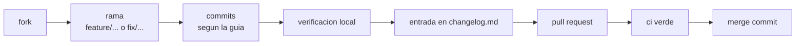

<div align="center">

# CONTRIBUIR

<sub><a href="../README.md">indice</a> · <a href="../../en/developers/12-contributing.md">english</a> · anterior: <a href="./11-ci-y-publicacion.md">ci y publicacion</a></sub>

</div>

---

## ANTES DE EMPEZAR

| paso | detalle |
|---|---|
| 1 | lee [arquitectura](./01-arquitectura.md) y [estructura del proyecto](./02-estructura-del-proyecto.md) |
| 2 | monta el entorno segun [entorno y compilacion](./03-entorno-y-compilacion.md) |
| 3 | comprueba que `./gradlew :app:testDebugUnitTest`, `./gradlew :app:lintDebug` y `./gradlew staticAnalysis` pasan **antes** de tocar nada |
| 4 | revisa la licencia: el proyecto se distribuye bajo una licencia de **uso no comercial** |

---

## FLUJO DE TRABAJO



```bash
git checkout -b feature/nombre-descriptivo
# … TRABAJO …
./gradlew :app:ktlintFormat                      # corrige el formato primero
./gradlew staticAnalysis                         # ktlint + detekt, debe quedar limpio
./gradlew :app:testDebugUnitTest :app:lintDebug
git commit
git push origin feature/nombre-descriptivo
```

---

## FORMATO DE LOS COMMITS

### TITULO

```
<prefijo> | <resumen corto en imperativo>
```

el separador es siempre **espacio, barra vertical, espacio**. el prefijo es una de estas
cinco palabras, en minusculas, y **nunca se combinan ni se inventan otras**:

<table>
<tr><th align="left" width="16%">prefijo</th><th align="left" width="84%">cuando usarlo</th></tr>
<tr><td><strong>update</strong></td><td>trabajo normal hacia adelante: se añade o mejora una funcionalidad, contenido o documento existente. es el prefijo por defecto</td></tr>
<tr><td><strong>fix</strong></td><td>se corrige un error o comportamiento incorrecto detectado durante el desarrollo, sin urgencia de publicacion inmediata</td></tr>
<tr><td><strong>hotfix</strong></td><td>se corrige algo urgente que afecta a una version ya publicada o a un bloqueo critico. solo cuando la correccion es realmente urgente</td></tr>
<tr><td><strong>changes</strong></td><td>cambios estructurales o no funcionales: reorganizar carpetas, renombrar ficheros, tocar configuracion, tooling o dependencias. no añade funcionalidad ni corrige un bug</td></tr>
<tr><td><strong>changelog</strong></td><td>el unico proposito del commit es editar <code>changelog.md</code>, por ejemplo al cerrar una version</td></tr>
</table>

ejemplos correctos:

```
update | añadir vista previa de mapeo de columnas al asistente de importación csv
fix | detección de duplicados fallando en filas con importes negativos
hotfix | fallo al iniciar cuando falta el archivo de perfil de importación
changes | reorganizar la documentación en la subcarpeta project-context
changelog | cerrar la sección de changelog para la versión mvp fase 0
```

### CUERPO

| regla | detalle |
|---|---|
| formato | siempre una **lista de markdown no numerada**; cada item empieza por `-` |
| nunca | listas numeradas ni parrafos sueltos |
| cada item | un bloque logico en imperativo, en **una sola linea continua**, sin saltos internos |
| espaciado | sin lineas en blanco entre items |
| markdown | ficheros, rutas, comandos e identificadores entre comillas invertidas |
| contenido | explica **el que y el por que**, no el detalle linea a linea |
| cierre | una linea en blanco y la linea de atribucion que corresponda al entorno |

### COMO SE PRESENTA EL RESULTADO

al redactar un titulo y una descripcion se usan **bloques de codigo separados**: uno para el
titulo y otro para el cuerpo, mas otro para el fragmento del changelog. **nunca** se juntan
titulo y cuerpo en el mismo bloque.

---

## PULL REQUESTS

<table>
<tr><th align="left" width="30%">tipo</th><th align="left" width="70%">titulo</th></tr>
<tr>
<td>trabajo normal</td>
<td><code>&lt;prefijo&gt; | &lt;resumen corto en imperativo&gt;</code> — el mismo formato que un commit; si agrupa varios commits, el resumen describe el conjunto</td>
</tr>
<tr>
<td>publicacion de version</td>
<td><code>release version &lt;x.y.z&gt; - &lt;resumen corto en imperativo&gt;</code></td>
</tr>
</table>

la **descripcion** es igual para los dos tipos: los bloques `### CASTELLANO` y `### ENGLISH`
de la seccion correspondiente de `changelog.md`, pegados tal cual con sus encabezados
`####` de categoria.

```
### CASTELLANO

#### <CATEGORIA>
- <cambio en una linea>

### ENGLISH

#### <CATEGORY>
- <same change, one line>
```

| regla | detalle |
|---|---|
| alcance | si la pr solo aporta parte de `SIN PUBLICAR / UNRELEASED`, incluye **solo sus items**, no la seccion entera |
| contexto extra | capturas de pantalla y explicaciones van **despues** de la lista, nunca en su lugar |
| merge | siempre **create a merge commit**; nunca squash ni rebase |

---

## ESTILO DE CODIGO

el formato es **obligatorio, no una convencion**: ktlint lee `.editorconfig` en la raiz del
repositorio y ci falla ante cualquier violacion. ejecuta `./gradlew :app:ktlintFormat` antes
de hacer commit — indentacion de 4 espacios, lf, utf-8, limite de 140 columnas, imports
ordenados y sin comas finales se aplican solos. lo que sigue es lo que un formateador no puede
decidir:

<table>
<tr><th align="left" width="34%">aspecto</th><th align="left" width="66%">convencion</th></tr>
<tr><td>idioma del codigo</td><td><strong>comentarios y kdoc en ingles</strong>, siempre</td></tr>
<tr><td>texto de interfaz</td><td>en minusculas, tono minimalista y tranquilo: <code>"no apps selected.\ntap the menu to add apps."</code></td></tr>
<tr><td>separadores de seccion</td><td><code>// ── Section Name ──────────────────────────</code></td></tr>
<tr><td>paquetes</td><td><code>app.focusphone.{capa}.{funcionalidad}</code></td></tr>
<tr><td>activities</td><td>todas extienden <code>BaseActivity</code></td></tr>
<tr><td>conversion a pixeles</td><td>metodo auxiliar <code>dp(value: Int)</code></td></tr>
<tr><td>view binding</td><td><code>ActivityXxxBinding.inflate(layoutInflater)</code></td></tr>
<tr><td>insets</td><td><code>ViewCompat.setOnApplyWindowInsetsListener</code> y <code>updatePadding</code>, nunca <code>setPadding</code> completo</td></tr>
<tr><td>dialogos</td><td><code>MaterialAlertDialogBuilder</code> con el tema de dialogo propio</td></tr>
<tr><td>flujos</td><td><code>lifecycleScope.launch { repeatOnLifecycle(STARTED) { … } }</code></td></tr>
</table>

---

## REGLAS INNEGOCIABLES

<details open>
<summary><strong>no hagas esto</strong></summary>

<br>

| prohibicion | motivo |
|---|---|
| introducir hilt o dagger | hay una incompatibilidad conocida con el procesamiento de anotaciones en agp 9.x; resuelvela primero |
| usar `Theme.resolveAttribute(attr, tv, true).data` para obtener un color | devuelve un id de recurso con `ColorStateList` y desconoce el tema personalizado |
| usar `setPadding(0, top, 0, 0)` para los insets | borra en silencio el padding declarado en el xml |
| convertir una preferencia en asincrona | se leen antes de `setContentView` y en manejadores tactiles |
| tratar `Unavailable` como lista vacia | sobrescribe los datos reales del usuario |
| borrar configuracion protegida tras intentos fallidos | convierte el bloqueo en un atajo trivial |
| ejecutar pbkdf2 en el hilo principal | bloquea la interfaz durante 100 000 iteraciones |
| añadir una linea base de lint | cada error se corrige en origen |
| añadir una dependencia con coordenadas literales | todas van en `gradle/libs.versions.toml` |
| añadir `values-night/` | el modo automatico se resuelve a mano en `ThemePreferences` |
| reintroducir `org.gradle.java.home` | fija una ruta de una maquina concreta y rompe ci |

</details>

<details open>
<summary><strong>si haces esto, hazlo asi</strong></summary>

<br>

| tarea | procedimiento |
|---|---|
| **añadir un ajuste** | 1) claves en el `*Preferences` correspondiente · 2) cambios de repositorio o caso de uso · 3) la fila en la subpantalla correcta con `SettingsUiHelper` · 4) si afecta a tema o escala, comprueba que `BaseActivity.onResume()` llama a `recreate()` · 5) categoria nueva en `SettingsActivity` **solo** si abre un dominio completamente nuevo |
| **añadir una pantalla** | 1) extiende `BaseActivity` · 2) declarala en `AndroidManifest.xml` · 3) view binding · 4) insets manuales · 5) flujos con `repeatOnLifecycle` |
| **añadir un caso de uso** | 1) definelo en `domain.usecase` · 2) inyecta los repositorios que necesite · 3) exponlo en `AppContainer` · 4) pasalo al viewmodel por su `factory()` |
| **añadir un singleton** | registralo en `AppContainer`, no en un `object` global |
| **modificar la base de datos** | sube la version de `AppDatabase` y añade una migracion, o asume conscientemente la migracion destructiva actual |
| **añadir una via de lanzamiento de apps** | llama a `BaseActivity.enforceAppSchedule()`, o esa via sera un hueco en los bloqueos |
| **añadir una cadena de texto** | añadela a `values/strings.xml` en minusculas y traducela a `values-es`, `values-fr`, `values-de` y `values-en-rGB` |

</details>

---

## LISTA DE COMPROBACION DE LA PULL REQUEST

<details open>
<summary><strong>antes de abrirla</strong></summary>

<br>

- [ ] `./gradlew :app:testDebugUnitTest` pasa
- [ ] `./gradlew staticAnalysis` reporta **0 hallazgos** (ktlint y detekt)
- [ ] `./gradlew :app:lintDebug` reporta **0 errores**
- [ ] `./gradlew :app:assembleRelease` compila
- [ ] hay pruebas nuevas para la logica nueva, con sus casos limite
- [ ] los cambios visuales se han probado en los **cuatro** temas, en el tema personalizado y con fondo de pantalla
- [ ] las cadenas nuevas estan traducidas a los cinco idiomas
- [ ] hay una entrada en `SIN PUBLICAR / UNRELEASED` de `changelog.md`, **en los dos idiomas** y en la categoria correcta
- [ ] el titulo y la descripcion siguen el formato de estas guias
- [ ] los comentarios y el kdoc estan en ingles

</details>

---

## REPORTAR ERRORES

en la pestaña **issues** del repositorio. un buen informe incluye:

| dato | por que |
|---|---|
| version de focusphone | *ajustes → acerca de → version* |
| modelo y version de android | muchos comportamientos dependen del fabricante |
| pasos exactos para reproducirlo | sin esto, la mayoria de los errores no se pueden investigar |
| estado del servicio de accesibilidad | cambia por completo el comportamiento de los bloqueos |
| tema activo y si hay fondo de pantalla | imprescindible para cualquier error visual |

---

## LICENCIA

el proyecto se distribuye bajo una **licencia de uso no comercial**. se permite el uso
personal, educativo y de evaluacion; el uso comercial requiere autorizacion previa por
escrito del autor. el texto completo esta en `license`.

al contribuir, aceptas que tu aportacion se distribuya bajo esos mismos terminos.

---

<div align="center">

<sub><a href="./11-ci-y-publicacion.md">← ci y publicacion</a> · <a href="../README.md">indice</a></sub>

</div>
