# QUE ES FOCUSPHONE

<a href="../README.md">indice</a> · <a href="../../en/users/01-what-is-focusphone.md">english</a> · siguiente: <a href="./02-instalacion-y-primeros-pasos.md">instalacion y primeros pasos</a>

---

## LA IDEA EN UNA FRASE

focusphone sustituye la pantalla de inicio de tu movil por una pantalla de texto:
un reloj, un calendario y la lista de las aplicaciones que de verdad usas. nada mas.

no hay iconos de colores, no hay cuadriculas, no hay carrusel de pantallas, no hay
sugerencias ni recomendaciones. si una aplicacion no esta en tu lista, no la vas a
ver por accidente.

---

## POR QUE EXISTE

la mayoria de lanzadores de android estan diseñados para que abras aplicaciones. los
iconos de colores, las insignias rojas y las pantallas llenas de cuadriculas funcionan
como recordatorios constantes: cada vez que desbloqueas el movil para mirar la hora,
ves veinte motivos para quedarte.

focusphone parte de la idea contraria: **la pantalla de inicio deberia ser un sitio
por el que se pasa, no un sitio en el que uno se queda**. por eso la interfaz es solo
texto, por eso los favoritos estan limitados a diez, y por eso existe la pausa
consciente antes de abrir una aplicacion.

<table>
<tr>
<th align="left" width="50%">un lanzador normal</th>
<th align="left" width="50%">focusphone</th>
</tr>
<tr>
<td valign="top">

- decenas de iconos a la vista
- insignias de colores que reclaman atencion
- varias pantallas con carrusel
- carpetas de iconos con animaciones
- sugerencias automaticas de apps
- abrir una app es un toque reflejo

</td>
<td valign="top">

- lista de texto con un maximo de diez apps
- sin iconos en la pantalla de inicio
- una sola pantalla, sin carrusel
- carpetas de texto solo en el cajon de apps
- nada se sugiere: tu decides que aparece
- opcionalmente, una respiracion antes de abrir

</td>
</tr>
</table>

---

## PARA QUIEN ES

<strong>encaja bien si…</strong>

 

- quieres reducir el tiempo de pantalla sin desinstalar nada
- te descubres abriendo aplicaciones sin haberlo decidido
- te gusta la estetica minimalista y el texto sobre los iconos
- necesitas separar el movil de trabajo del movil personal sin tener dos moviles
- quieres poder bloquear aplicaciones durante un rato y que ese bloqueo aguante de verdad
- te importa que una aplicacion no envie tus datos a ningun sitio

<strong>probablemente no encaja si…</strong>

 

- dependes de widgets grandes y multiples en la pantalla de inicio: focusphone admite **un** widget
- necesitas gestos avanzados configurables o multiples pantallas de escritorio
- quieres un control parental para el movil de otra persona: focusphone esta pensado para autoimponerse limites, no para imponerselos a terceros
- usas un lanzador con integracion profunda del fabricante que no quieres perder

---

## QUE HACE, EN BLOQUES

```mermaid
flowchart LR
    subgraph PANTALLA["pantalla de inicio"]
        A1["reloj<br>5 estilos"]
        A2["calendario<br>del mes"]
        A3["favoritos<br>hasta 10 apps"]
        A4["widget<br>opcional"]
    end

    subgraph ENFOQUE["herramientas de enfoque"]
        B1["perfiles<br>normal · trabajo · detox"]
        B2["horarios<br>por aplicacion"]
        B3["limite diario<br>de uso"]
        B4["pausa consciente<br>antes de abrir"]
    end

    subgraph ASPECTO["apariencia"]
        C1["4 temas<br>+ tema propio"]
        C2["4 tipografias"]
        C3["fondo de pantalla<br>con desenfoque"]
        C4["distribucion<br>reordenable"]
    end

    PANTALLA --> ENFOQUE --> ASPECTO
```

### PANTALLA DE INICIO

un reloj que puedes mostrar en cinco estilos distintos (digital, apilado, en
palabras, analogico u oculto), un calendario del mes en el menu lateral y la lista
de tus aplicaciones favoritas, con un maximo de diez. puedes reordenarlas
arrastrandolas y renombrarlas para que se llamen como tu quieras.

### HERRAMIENTAS DE ENFOQUE

- **perfiles**: *normal* no bloquea nada, *trabajo* bloquea las apps que marques y las
  que coincidan con tus palabras clave, y *detox* bloquea absolutamente todo durante un
  tiempo, protegido con contraseña.
- **horarios**: cada aplicacion puede tener una franja horaria permitida, con seleccion
  de dias, y un limite de minutos al dia. funcionan siempre, tambien en el perfil normal.
- **pausa consciente**: una cuenta atras de unos segundos antes de abrir cualquier
  aplicacion, con la pregunta de si de verdad quieres abrirla.

### APARIENCIA

cuatro temas integrados (off-white, slate, warm beige y navy), un modo automatico
que sigue el claro/oscuro del sistema, y un tema personalizado en el que eliges tu
propio color de fondo y de texto. cuatro tipografias, tamaño de texto ajustable,
alineacion a izquierda, centro o derecha, y fondo de pantalla propio con desenfoque
y control de legibilidad.

---

## QUE **NO** HACE

| no hace | por que |
|---|---|
| no se conecta a internet | la app es completamente offline: no hay cuentas, ni sincronizacion, ni servidores |
| no muestra publicidad | no hay ningun componente publicitario en el codigo |
| no recoge telemetria | no hay analitica, ni informes de uso, ni identificadores |
| no hace copia de seguridad en la nube | `allowBackup` esta desactivado y la transferencia entre dispositivos esta excluida |
| no lee el contenido de tus notificaciones fuera de la ram | el panel de notificaciones vive en memoria y se vacia al cerrar el proceso |
| no puede impedir que desinstales focusphone | los bloqueos son un compromiso contigo mismo, no una jaula |

---

## DATOS TECNICOS BASICOS

| propiedad | valor |
|---|---|
| nombre de paquete | `app.focusphone` |
| version documentada | 1.0.6 |
| android minimo | 7.0 (api 24) |
| android objetivo | 16 (api 36) |
| lenguaje | kotlin |
| idiomas de la interfaz | ingles, ingles britanico, español, frances, aleman |
| licencia | uso no comercial, ver `LICENSE` |

---

## SIGUIENTE PASO

si quieres instalarlo y dejarlo funcionando, continua en
**[instalacion y primeros pasos](./02-instalacion-y-primeros-pasos.md)**.

si lo que quieres es entender como esta construido por dentro, salta a la
**[documentacion para desarrolladores](../desarrolladores/01-arquitectura.md)**.

---

<a href="../README.md">← indice</a> · <a href="./02-instalacion-y-primeros-pasos.md">instalacion y primeros pasos →</a>

