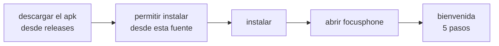

<div align="center">

# INSTALACION Y PRIMEROS PASOS

<sub><a href="../README.md">indice</a> · <a href="../../en/users/02-installation-and-first-steps.md">english</a> · anterior: <a href="./01-que-es-focusphone.md">que es focusphone</a> · siguiente: <a href="./03-pantalla-de-inicio-y-gestos.md">pantalla de inicio y gestos</a></sub>

</div>

---

## REQUISITOS

| requisito | valor |
|---|---|
| version de android | 7.0 (api 24) o superior |
| espacio | unos pocos megabytes; la app es muy ligera |
| conexion a internet | **no es necesaria** en ningun momento, ni para instalar el apk ni para usar la app |
| cuenta de usuario | ninguna: focusphone no tiene registro ni inicio de sesion |

---

## INSTALAR LA APLICACION

focusphone se distribuye como apk desde la pestaña de releases del repositorio.



<details open>
<summary><strong>paso a paso</strong></summary>

<br>

1. entra en la pestaña **releases** del repositorio y descarga el fichero `.apk` de la
   version mas reciente.
2. abre el fichero descargado. android te avisara de que la instalacion procede de una
   fuente desconocida.
3. concede el permiso **instalar aplicaciones desconocidas** a la aplicacion desde la que
   estas abriendo el apk (normalmente el navegador o el gestor de archivos). android te
   lleva a esa pantalla automaticamente.
4. vuelve atras y confirma la instalacion.
5. abre focusphone desde el cajon de aplicaciones de tu lanzador actual.

</details>

<details>
<summary><strong>comprobar que el apk es autentico</strong></summary>

<br>

cada release adjunta un fichero `SHA256SUMS`. en un ordenador, `sha256sum -c SHA256SUMS`
comprueba la descarga, y `apksigner verify --print-certs focusphone-*.apk` (build tools del sdk
de android) muestra el certificado de firma, cuyo sha-256 debe ser el publicado en
[`security.es.md`](../../../security.es.md#verificar-un-apk).

**si instalaste `v1.0.0-beta`**: esa compilacion se firmo con otra clave, asi que android no
deja instalar una version nueva encima ("aplicacion no instalada"). desinstalala primero —se
borran sus ajustes, porque focusphone no guarda copias de seguridad— e instala despues la
release actual.

</details>

<details>
<summary><strong>compilar el apk tu mismo</strong></summary>

<br>

si prefieres compilarlo desde el codigo fuente en lugar de descargar un apk:

```bash
git clone https://github.com/rezzt-dev/focusphone-app.git
cd focusphone-app/focusphone-project
./gradlew :app:assembleDebug
```

el apk queda en `app/build/outputs/apk/debug/`. los detalles completos del entorno de
compilacion estan en
[entorno y compilacion](../desarrolladores/03-entorno-y-compilacion.md).

</details>

---

## LA BIENVENIDA: 5 PASOS

la primera vez que abres focusphone aparece una bienvenida de cinco pantallas que
puedes recorrer deslizando en horizontal.

| paso | que hace |
|---|---|
| 1 · bienvenida | presenta la aplicacion y su proposito |
| 2 · filosofia | explica por que la interfaz es de solo texto y que ganas con ello |
| 3 · lanzador por defecto | te lleva a los ajustes de android para poner focusphone como pantalla de inicio, y **verifica en tiempo real** si lo has conseguido |
| 4 · elegir aplicaciones | abre el selector para que marques tus primeras aplicaciones favoritas |
| 5 · listo | cierra la bienvenida y te deja en la pantalla de inicio |

> la bienvenida se puede volver a lanzar en cualquier momento desde
> **ajustes → acerca de → reiniciar la bienvenida**.

---

## PONER FOCUSPHONE COMO LANZADOR POR DEFECTO

este es el unico paso realmente importante: mientras no sea tu lanzador por defecto,
focusphone es una aplicacion mas y el boton de inicio seguira llevandote a tu pantalla
de siempre.

<details open>
<summary><strong>si estas en la bienvenida</strong></summary>

<br>

pulsa el boton del paso 3. focusphone abre directamente la pantalla de android donde
se elige la aplicacion de inicio. selecciona **focusphone** y vuelve atras: el paso se
marca como verificado solo.

</details>

<details>
<summary><strong>si ya cerraste la bienvenida</strong></summary>

<br>

tienes dos caminos:

- **desde focusphone**: menu lateral → ajustes → sistema → *establecer como predeterminado*.
- **desde android**: ajustes del sistema → aplicaciones → aplicaciones predeterminadas →
  aplicacion de inicio → focusphone.

la ruta exacta cambia segun el fabricante; en algunos moviles la opcion se llama
*aplicacion de pantalla de inicio* o *launcher*.

</details>

<details>
<summary><strong>como volver a tu lanzador anterior</strong></summary>

<br>

focusphone no te retiene: repite el mismo procedimiento y elige tu lanzador anterior en
la lista. tus aplicaciones, carpetas y datos siguen intactos, porque focusphone nunca
toca las aplicaciones instaladas, solo decide cuales muestra.

</details>

---

## ELEGIR TUS PRIMERAS APLICACIONES

el limite es **10 aplicaciones favoritas**. no es un capricho: es el nucleo de la
propuesta. si todo cabe en la pantalla de inicio, la pantalla de inicio vuelve a ser
una cuadricula.

<details open>
<summary><strong>como elegirlas</strong></summary>

<br>

1. abre el menu deslizando **hacia la izquierda** en la pantalla de inicio.
2. pulsa **editar dashboard**.
3. usa el buscador para encontrar cada aplicacion y marcala.
4. el contador de la parte superior te indica cuantas llevas de las diez.
5. pulsa **listo**.

</details>

<details>
<summary><strong>consejo para elegir bien</strong></summary>

<br>

una regla que funciona: incluye solo las aplicaciones que abririas **con una intencion
concreta** (telefono, mensajes, camara, mapas, musica, notas) y deja fuera las que
abres por inercia. las que dejas fuera siguen instaladas y accesibles desde el cajon de
todas las aplicaciones: solo dejan de estar a un toque de distancia.

</details>

---

## PERMISOS QUE TE PEDIRA

focusphone funciona con muy pocos permisos, y **ninguno de los opcionales es obligatorio**.

| permiso | cuando lo pide | para que |
|---|---|---|
| ver aplicaciones instaladas | automatico al instalar | listar tus aplicaciones en el cajon y en el selector |
| desinstalar aplicaciones | solo al pulsar *desinstalar* | lanzar el dialogo de desinstalacion de android |
| servicio de accesibilidad | al iniciar una sesion de detox, o desde ajustes | bloquear de verdad las aplicaciones y contar el tiempo de uso |
| acceso a notificaciones | al activar el panel de notificaciones | mostrar tus notificaciones en el cajon lateral |

el detalle completo esta en
**[privacidad y permisos](./11-privacidad-y-permisos.md)**.

---

## COMPROBACION FINAL

<details open>
<summary><strong>lista de verificacion</strong></summary>

<br>

- [ ] focusphone esta instalado y abierto al menos una vez
- [ ] esta seleccionado como aplicacion de inicio: al pulsar el boton de inicio, aparece focusphone
- [ ] hay al menos una aplicacion en la lista de favoritos
- [ ] deslizando hacia la izquierda se abre el menu lateral
- [ ] tocando el reloj se abre la aplicacion de alarmas

si todo esto funciona, la instalacion esta completa.

</details>

---

<div align="center">

<sub><a href="./01-que-es-focusphone.md">← que es focusphone</a> · <a href="../README.md">indice</a> · <a href="./03-pantalla-de-inicio-y-gestos.md">pantalla de inicio y gestos →</a></sub>

</div>
