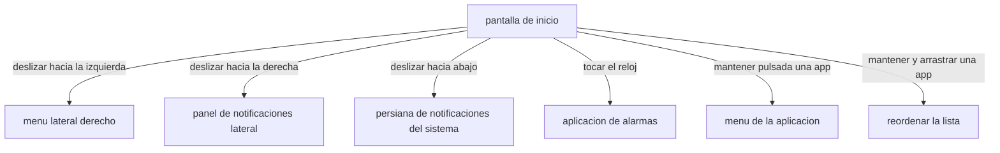

<div align="center">

# PANTALLA DE INICIO Y GESTOS

<sub><a href="../README.md">indice</a> · <a href="../../en/users/03-home-screen-and-gestures.md">english</a> · anterior: <a href="./02-instalacion-y-primeros-pasos.md">instalacion</a> · siguiente: <a href="./04-aplicaciones-y-carpetas.md">aplicaciones y carpetas</a></sub>

</div>

---

## ANATOMIA DE LA PANTALLA DE INICIO

la pantalla de inicio tiene tres componentes y dos cajones laterales. los tres
componentes se pueden ocultar y reordenar entre si.

```
┌──────────────────────────────────┐
│                                  │
│              09:41               │  ← reloj (5 estilos, se toca para la alarma)
│         lunes, 12 de mayo        │
│                                  │
│  ┌────────────────────────────┐  │
│  │        widget opcional     │  │  ← widget (uno solo, opcional)
│  └────────────────────────────┘  │
│                                  │
│              telefono            │
│              mensajes            │  ← favoritos (hasta 10, solo texto)
│              camara              │
│              notas               │
│                                  │
└──────────────────────────────────┘
   ↑ deslizar derecha    ↑ deslizar izquierda
   notificaciones        menu
```

<table>
<tr>
<th align="left">componente</th>
<th align="left">que es</th>
<th align="left">se puede ocultar</th>
</tr>
<tr>
<td>reloj</td>
<td>la hora y la fecha, en uno de cinco estilos</td>
<td>si</td>
</tr>
<tr>
<td>widget</td>
<td>un unico widget de otra aplicacion, si lo añades</td>
<td>si</td>
</tr>
<tr>
<td>favoritos</td>
<td>la lista de texto con tus aplicaciones elegidas</td>
<td>no, es el nucleo de la pantalla</td>
</tr>
</table>

> el orden de los tres componentes se cambia en
> **ajustes → pantalla de inicio → distribucion**, con una vista previa real y funcional.

---

## LOS CINCO ESTILOS DE RELOJ

| estilo | aspecto | comentario |
|---|---|---|
| digital | `09:41` | el clasico, una sola linea con la fecha debajo |
| apilado | `09` sobre `41` | horas y minutos en dos lineas, tipografia muy grande |
| en palabras | `nueve` / `cuarenta y uno` | la hora escrita, la opcion mas tranquila |
| analogico | esfera dibujada | un reloj de agujas minimalista |
| oculto | — | sin reloj; la pantalla se queda solo con los favoritos |

el reloj respeta el formato de 12 o 24 horas configurado en tu sistema, y el tamaño se
ajusta con un deslizador en **ajustes → pantalla de inicio → tamaño del reloj**.

> **tocar el reloj abre la aplicacion de alarmas del sistema.** es el atajo mas usado de
> focusphone: desbloquear, mirar la hora, poner una alarma y volver a guardar el movil.

---

## LOS GESTOS

todos los gestos se hacen sobre la pantalla de inicio, en cualquier punto libre.



<table>
<tr>
<th align="left" width="34%">gesto</th>
<th align="left" width="33%">resultado</th>
<th align="left" width="33%">condiciones</th>
</tr>
<tr>
<td><strong>deslizar hacia la izquierda</strong></td>
<td>abre el menu lateral: calendario, todas las apps, editar dashboard, ajustes y perfil</td>
<td>siempre disponible</td>
</tr>
<tr>
<td><strong>deslizar hacia la derecha</strong></td>
<td>abre el panel lateral de notificaciones de focusphone</td>
<td>requiere activar el panel en ajustes y conceder acceso a notificaciones</td>
</tr>
<tr>
<td><strong>deslizar hacia abajo</strong></td>
<td>despliega la persiana de notificaciones de android</td>
<td>requiere activar el gesto en ajustes; funciona mejor con el servicio de accesibilidad activo</td>
</tr>
<tr>
<td><strong>tocar el reloj</strong></td>
<td>abre la aplicacion de alarmas del sistema</td>
<td>siempre disponible, si el reloj esta visible</td>
</tr>
<tr>
<td><strong>mantener pulsada una app</strong></td>
<td>abre su menu: abrir, quitar de la lista, info de la app, desinstalar</td>
<td>siempre disponible</td>
</tr>
<tr>
<td><strong>mantener y arrastrar una app</strong></td>
<td>cambia el orden de la lista de favoritos</td>
<td>siempre disponible</td>
</tr>
</table>

<details>
<summary><strong>por que no se puede abrir un cajon estando el otro abierto</strong></summary>

<br>

si ya hay un cajon abierto, el gesto de deslizar no abre el contrario: primero hay que
cerrar el actual (tocando fuera o con el boton de atras). es deliberado, para evitar que
un gesto rapido acabe en el cajon equivocado.

</details>

---

## EL MENU LATERAL

se abre deslizando hacia la izquierda. contiene, de arriba abajo:

| elemento | que hace |
|---|---|
| calendario del mes | muestra el mes actual con el dia de hoy marcado; se actualiza solo al cambiar de dia |
| todas las apps | abre el cajon completo de aplicaciones, con buscador y carpetas |
| editar dashboard | abre el selector de favoritos |
| ajustes de focus | abre la pantalla de ajustes |
| perfil seleccionado | muestra el perfil activo y, al tocarlo, permite cambiarlo |

<details>
<summary><strong>el calendario</strong></summary>

<br>

es un calendario de solo lectura: muestra el mes en curso con los nombres de los dias
en el orden e idioma de tu sistema, y el dia de hoy resaltado. no se puede navegar a
otros meses ni crear eventos, a proposito: es una referencia rapida, no una agenda.

como el lanzador puede quedarse abierto durante dias, el calendario se reconstruye solo
cuando cambia el dia, sin que tengas que salir y volver a entrar.

</details>

---

## LA LISTA DE FAVORITOS

- muestra **solo texto**, sin iconos, con el nombre que tu elijas para cada aplicacion
- admite un maximo de **10 aplicaciones**
- se alinea a la izquierda, al centro o a la derecha (**ajustes → apariencia → alineacion**),
  algo util para usar el movil con una sola mano
- el espacio entre aplicaciones es ajustable (**ajustes → pantalla de inicio → espaciado**)
- si esta vacia, muestra el mensaje *sin apps seleccionadas. toca el menu para añadir apps.*

<details>
<summary><strong>reordenar la lista</strong></summary>

<br>

manten pulsada una aplicacion y, sin levantar el dedo, arrastrala a su nueva posicion. el
nuevo orden se guarda automaticamente. reordenar **nunca** elimina una aplicacion de la
lista: si el reordenado no incluye alguna de tus favoritas, esa aplicacion se conserva
detras de las demas.

</details>

<details>
<summary><strong>el menu de cada aplicacion</strong></summary>

<br>

manteniendo pulsada una aplicacion sin arrastrarla se abre su menu:

| opcion | que hace |
|---|---|
| abrir | la abre (pasando por la pausa consciente si la tienes activada) |
| quitar de la lista | la saca de los favoritos, sin desinstalarla |
| info de la app | abre la ficha de la aplicacion en los ajustes de android |
| desinstalar | lanza el dialogo de desinstalacion del sistema |

</details>

---

## EL INDICADOR DE PAGINA

en la parte inferior aparecen dos puntos muy discretos cuando arrastras lateralmente:
indican si estas en la pantalla de inicio o en el menu. desaparecen en cuanto sueltas.

---

<div align="center">

<sub><a href="./02-instalacion-y-primeros-pasos.md">← instalacion</a> · <a href="../README.md">indice</a> · <a href="./04-aplicaciones-y-carpetas.md">aplicaciones y carpetas →</a></sub>

</div>
