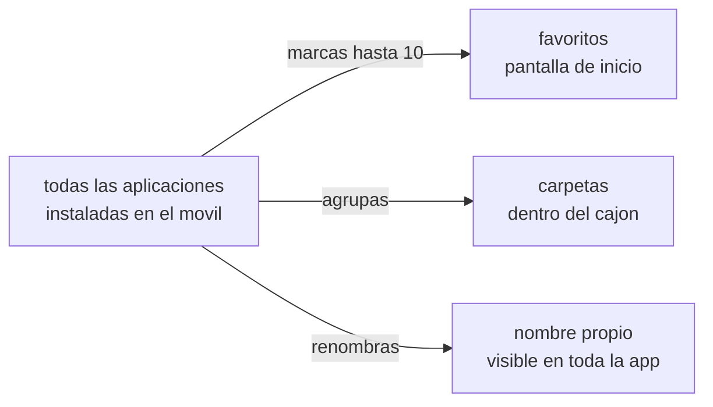

<div align="center">

# APLICACIONES Y CARPETAS

<sub><a href="../README.md">indice</a> · <a href="../../en/users/04-apps-and-folders.md">english</a> · anterior: <a href="./03-pantalla-de-inicio-y-gestos.md">pantalla de inicio y gestos</a> · siguiente: <a href="./05-perfiles-y-detox.md">perfiles y detox</a></sub>

</div>

---

## DOS LISTAS DISTINTAS

focusphone trabaja con dos listas que conviene no confundir:

<table>
<tr>
<th align="left" width="50%">favoritos (dashboard)</th>
<th align="left" width="50%">todas las aplicaciones (cajon)</th>
</tr>
<tr>
<td valign="top">

las aplicaciones que aparecen en la **pantalla de inicio**.

- maximo **10**
- las eliges tu, una a una
- se reordenan arrastrando
- se editan desde *editar dashboard*

</td>
<td valign="top">

**todas** las aplicaciones instaladas en el movil.

- sin limite
- se abre desde *todas las apps*
- tiene buscador y carpetas
- desde aqui se renombra, bloquea y desinstala

</td>
</tr>
</table>



---

## ELEGIR Y EDITAR LOS FAVORITOS

**menu lateral → editar dashboard**

| accion | como |
|---|---|
| añadir una aplicacion | buscala y marcala en la lista |
| quitar una aplicacion | desmarcala, o manten pulsada su fila en la pantalla de inicio y elige *quitar de la lista* |
| ver cuantas llevas | el contador superior muestra `x de 10 apps seleccionadas` |
| terminar | pulsa *listo* |

<details>
<summary><strong>que pasa al llegar a 10</strong></summary>

<br>

el selector te avisa con el mensaje *has alcanzado el limite de 10 apps* y no deja añadir
mas hasta que quites alguna. el limite es intencionado: es lo que mantiene la pantalla de
inicio como una lista y no como una cuadricula.

</details>

<details>
<summary><strong>que pasa si desinstalas una aplicacion favorita</strong></summary>

<br>

focusphone detecta las instalaciones, desinstalaciones y actualizaciones del sistema y
limpia la lista automaticamente. no vas a quedarte con una entrada muerta que no abre nada.

</details>

---

## EL CAJON DE TODAS LAS APLICACIONES

**menu lateral → todas las apps**

es la lista completa, ordenada alfabeticamente, con buscador en la parte superior.

### EL BUSCADOR

la busqueda es **difusa y sin acentos**: no hace falta escribir el nombre completo ni
respetar las tildes.

| escribes | encuentra |
|---|---|
| `fb` | facebook |
| `yt` | youtube |
| `telefono` | teléfono |
| `ubers` | übersetzer |

mientras buscas, las carpetas se ocultan y los resultados se muestran en una lista plana.

### EL MENU DE CADA APLICACION

manten pulsada cualquier fila del cajon:

| opcion | que hace |
|---|---|
| abrir | abre la aplicacion |
| accesos directos | si la aplicacion los ofrece, aparecen aqui (requiere ser el lanzador por defecto) |
| renombrar | le pones el nombre que tu quieras |
| mover a carpeta | la mete en una carpeta existente o crea una nueva |
| sacar de la carpeta | la devuelve a la lista general |
| bloquear / desbloquear | la marca como bloqueada para el perfil de trabajo |
| info de la app | abre su ficha en los ajustes de android |
| desinstalar | lanza el dialogo de desinstalacion del sistema |

---

## RENOMBRAR APLICACIONES

una de las funciones que mas cambia la sensacion de uso. el nombre que pongas se usa en
**toda** la aplicacion: pantalla de inicio, cajon, selector y pantallas de bloqueo.

<details open>
<summary><strong>como renombrar</strong></summary>

<br>

1. abre **todas las apps**
2. manten pulsada la aplicacion
3. elige **renombrar**
4. escribe el nombre nuevo y confirma

para volver al nombre original, borra el texto y confirma con el campo vacio.

</details>

<details>
<summary><strong>para que sirve en la practica</strong></summary>

<br>

quitar la marca comercial de los nombres reduce el reclamo visual. ejemplos habituales:

| nombre original | nombre util |
|---|---|
| whatsapp messenger | mensajes |
| youtube | videos |
| google chrome | navegador |
| gmail | correo |
| spotify | musica |

</details>

> los nombres personalizados se guardan **cifrados** en el dispositivo, porque revelan
> como organizas tu movil. mas detalle en [privacidad y permisos](./11-privacidad-y-permisos.md).

---

## CARPETAS

las carpetas viven **solo dentro del cajon de todas las aplicaciones**, nunca en la
pantalla de inicio. son de texto, se muestran siempre **antes** que las aplicaciones
sueltas y se ordenan alfabeticamente.

```
┌─────────────────────────────┐
│  buscar…                    │
├─────────────────────────────┤
│  › trabajo            (4)   │  ← carpeta cerrada
│  ⌄ ocio               (3)   │  ← carpeta abierta
│      musica                 │
│      podcasts               │
│      videos                 │
│  ─────────────────────────  │
│  ajustes                    │  ← aplicaciones sin carpeta
│  camara                     │
│  calculadora                │
└─────────────────────────────┘
```

### CREAR, LLENAR Y VACIAR

<table>
<tr>
<th align="left" width="30%">accion</th>
<th align="left" width="70%">como se hace</th>
</tr>
<tr>
<td>crear una carpeta</td>
<td>pulsa <strong>+ nueva carpeta</strong> en la parte superior del cajon y escribe el nombre</td>
</tr>
<tr>
<td>meter una aplicacion</td>
<td>arrastrala sobre la carpeta, o manten pulsada y elige <strong>mover a carpeta</strong></td>
</tr>
<tr>
<td>sacar una aplicacion</td>
<td>arrastrala fuera, sobre la lista general, o elige <strong>sacar de la carpeta</strong></td>
</tr>
<tr>
<td>abrir o cerrar</td>
<td>toca la cabecera de la carpeta</td>
</tr>
<tr>
<td>renombrar</td>
<td>manten pulsada la cabecera y elige <strong>renombrar carpeta</strong></td>
</tr>
<tr>
<td>borrar</td>
<td>manten pulsada la cabecera y elige <strong>eliminar</strong>; las aplicaciones vuelven a la lista general, nada se desinstala</td>
</tr>
</table>

<details>
<summary><strong>reglas de las carpetas</strong></summary>

<br>

- una aplicacion pertenece **como mucho a una carpeta**: al moverla a otra, sale de la anterior automaticamente
- los nombres de carpeta son **unicos**: si repites uno, aparece un aviso en linea y el dialogo no se cierra
- **no hay orden manual** de carpetas: siempre se ordenan alfabeticamente, ignorando mayusculas
- al arrastrar sobre una carpeta abierta, **toda su region** acepta el soltado, no solo la cabecera
- las carpetas se guardan cifradas en el dispositivo

</details>

<details>
<summary><strong>una aplicacion de una carpeta ha desaparecido</strong></summary>

<br>

si una aplicacion de una carpeta no aparece, casi siempre es porque esta temporalmente no
disponible: se esta actualizando, el movil acaba de arrancar o pertenece a un perfil de
trabajo de android que aun no esta listo. focusphone **no borra** la pertenencia a la
carpeta en ese caso: la oculta y la vuelve a mostrar cuando la aplicacion esta disponible
otra vez.

</details>

---

## ACCESOS DIRECTOS DE APLICACION

si focusphone es tu lanzador por defecto y el dispositivo tiene android 7.1 o superior,
el menu de cada aplicacion en el cajon muestra tambien sus accesos directos (por ejemplo
*nuevo mensaje* o *escanear codigo*). si la aplicacion no declara ninguno, o focusphone no
es el lanzador por defecto, simplemente no aparece esa seccion.

---

<div align="center">

<sub><a href="./03-pantalla-de-inicio-y-gestos.md">← pantalla de inicio y gestos</a> · <a href="../README.md">indice</a> · <a href="./05-perfiles-y-detox.md">perfiles y detox →</a></sub>

</div>
