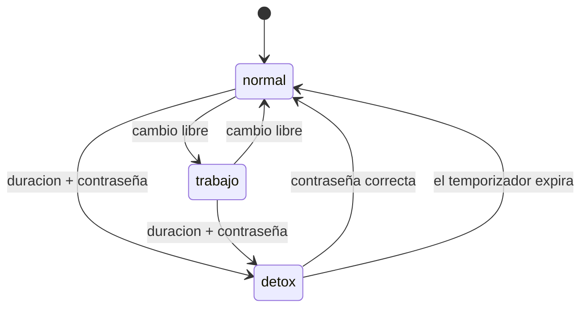
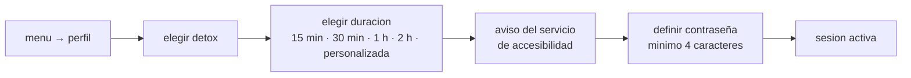

# PERFILES Y DETOX

<a href="../README.md">indice</a> · <a href="../../en/users/05-profiles-and-detox.md">english</a> · anterior: <a href="./04-aplicaciones-y-carpetas.md">aplicaciones y carpetas</a> · siguiente: <a href="./06-horarios-de-aplicaciones.md">horarios de aplicaciones</a>

---

## LOS TRES PERFILES

un perfil es un modo de uso del movil. en cada momento hay exactamente uno activo, y se
cambia desde el menu lateral, tocando la fila **perfil seleccionado**.

<table>
<tr>
<th align="left" width="20%">perfil</th>
<th align="left" width="45%">que bloquea</th>
<th align="left" width="35%">como se sale</th>
</tr>
<tr>
<td><strong>normal</strong></td>
<td>nada</td>
<td>es el estado por defecto</td>
</tr>
<tr>
<td><strong>trabajo</strong></td>
<td>las aplicaciones que hayas marcado como bloqueadas, mas las que coincidan con tus palabras clave</td>
<td>libremente, en cualquier momento</td>
</tr>
<tr>
<td><strong>detox</strong></td>
<td><strong>todo</strong>, excepto focusphone</td>
<td>con contraseña, o esperando a que termine el temporizador</td>
</tr>
</table>

---

## PERFIL DE TRABAJO

pensado para la jornada laboral: quieres el telefono, el correo y el calendario, pero no
las redes sociales ni el video.

### QUE BLOQUEA

1. **las aplicaciones que marcas a mano**: en el cajon de todas las apps, manten pulsada
   una aplicacion y elige *bloquear*.
2. **las que coinciden con tus palabras clave**: si el nombre de la aplicacion contiene
   alguna de las palabras de tu lista, queda bloqueada sin necesidad de marcarla.

### LAS PALABRAS CLAVE

**ajustes → enfoque → palabras clave del modo trabajo**

la lista viene rellenada con un conjunto razonable de partida y es **completamente
editable**: puedes añadir, cambiar o borrar las que quieras, o dejarla vacia para que solo
cuenten las aplicaciones marcadas a mano.

<strong>como usar bien las palabras clave</strong>

 

son coincidencias por texto contra el nombre de la aplicacion, asi que conviene ser
especifico:

| palabra | bloquea | riesgo |
|---|---|---|
| `tok` | tiktok | bajo |
| `gram` | instagram, telegram | puede bloquear mas de lo previsto |
| `game` | cualquier app con "game" en el nombre | alto si tienes muchas |

si una palabra bloquea algo que no querias, quitala de la lista y bloquea esa aplicacion a
mano en su lugar.

> el perfil de trabajo **no tiene contraseña**: se sale de el cuando quieras. es una ayuda
> contra el automatismo, no una barrera.

---

## PERFIL DETOX

es el modo estricto. mientras esta activo, **ninguna aplicacion se abre** salvo
focusphone. al intentar abrir cualquier cosa aparece una pantalla completa con el tiempo
restante.

### INICIAR UNA SESION DE DETOX

1. abre el menu lateral y toca la fila del perfil.
2. elige **detox**.
3. elige la duracion: 15 minutos, 30 minutos, 1 hora, 2 horas o una duracion personalizada
   en horas y minutos.
4. si el servicio de accesibilidad no esta activo, focusphone te ofrece activarlo. puedes
   continuar sin el, pero el bloqueo sera mas debil (ver mas abajo).
5. define una contraseña de al menos 4 caracteres. **esa contraseña es lo unico que
   termina la sesion antes de tiempo.**

### DURANTE LA SESION

- la pantalla de bloqueo muestra la cuenta atras en vivo
- no se pueden hacer capturas de pantalla ni grabar la pantalla de bloqueo ni los dialogos
  de contraseña
- focusphone sigue funcionando: puedes mirar la hora, el calendario y los ajustes

### TERMINAR LA SESION

| forma | detalle |
|---|---|
| esperar | cuando el temporizador llega a cero, el perfil vuelve a *normal* solo, incluso si el movil se ha reiniciado |
| contraseña | introduce la contraseña correcta en la pantalla de bloqueo |

---

## LA CONTRASEÑA Y LOS INTENTOS FALLIDOS

<table>
<tr>
<th align="left" width="40%">regla</th>
<th align="left" width="60%">detalle</th>
</tr>
<tr>
<td>longitud minima</td>
<td>4 caracteres</td>
</tr>
<tr>
<td>almacenamiento</td>
<td>nunca se guarda la contraseña: se guarda un resumen criptografico con sal aleatoria</td>
</tr>
<tr>
<td>intentos permitidos</td>
<td>5 intentos fallidos consecutivos</td>
</tr>
<tr>
<td>bloqueo temporal</td>
<td>tras el quinto fallo, <strong>15 minutos</strong> en los que se rechaza cualquier intento, incluso el correcto</td>
</tr>
<tr>
<td>que <strong>no</strong> pasa al fallar</td>
<td>no se borra la contraseña, no se cancela la sesion y no se pierde ninguna configuracion</td>
</tr>
<tr>
<td>persistencia</td>
<td>el contador sobrevive a reinicios: cerrar la app no reinicia los intentos</td>
</tr>
</table>

<strong>¿y si olvido la contraseña?</strong>

 

no hay recuperacion, y es intencionado: si hubiese una forma de saltarse la contraseña, el
bloqueo no serviria de nada. **pero nunca te quedas atrapado**: toda sesion de detox tiene
un temporizador y termina sola cuando expira. si olvidas la contraseña, solo tienes que
esperar a que la sesion acabe.

<strong>por que se rechaza tambien la contraseña correcta durante el bloqueo</strong>

 

porque si no, bastaria con probar contraseñas sin coste. el periodo de espera convierte la
fuerza bruta en algo inviable, y no perjudica al uso legitimo: quien conoce su contraseña
acierta al primer intento.

---

## BLOQUEO REAL: EL SERVICIO DE ACCESIBILIDAD

focusphone bloquea las aplicaciones que se abren **desde focusphone** sin ningun permiso
especial. pero una aplicacion tambien se puede abrir desde una notificacion, desde las
apps recientes o desde el asistente de voz, y eso pasa por encima del lanzador.

el **servicio de accesibilidad** de focusphone cierra esa via: vigila que aplicacion pasa a
primer plano y, si esta bloqueada, muestra la pantalla de bloqueo encima al instante.

<table>
<tr>
<th align="left" width="50%">sin el servicio</th>
<th align="left" width="50%">con el servicio</th>
</tr>
<tr>
<td valign="top">

- se bloquean las apps abiertas desde focusphone
- **no** se bloquean las abiertas desde notificaciones, recientes o el asistente
- los horarios por franja horaria funcionan
- **los limites diarios de uso no funcionan**

</td>
<td valign="top">

- se bloquea la aplicacion se abra desde donde se abra
- los horarios funcionan por completo
- los limites diarios de uso funcionan: es el unico componente que puede medir el tiempo en primer plano
- el consumo adicional de bateria es minimo

</td>
</tr>
</table>

### COMO ACTIVARLO

**ajustes → sistema → bloqueo del sistema**, o acepta el aviso al iniciar una sesion de
detox. focusphone abre directamente la pantalla de accesibilidad de android; busca
*focusphone* en la lista y activalo.

> android muestra un aviso generico al activar cualquier servicio de accesibilidad, porque
> son servicios potentes. focusphone solo lo usa para saber **que aplicacion esta en primer
> plano** y para desplegar la persiana de notificaciones: no lee el contenido de las
> pantallas, no escribe nada y no envia nada a ningun sitio.

---

## QUE SE PUEDE Y QUE NO SE PUEDE BLOQUEAR

| situacion | resultado |
|---|---|
| abrir una app bloqueada desde focusphone | bloqueada siempre |
| abrir una app bloqueada desde una notificacion | bloqueada solo con el servicio de accesibilidad |
| abrir una app bloqueada desde apps recientes | bloqueada solo con el servicio de accesibilidad |
| desinstalar focusphone durante un detox | android lo permite: focusphone no es un administrador de dispositivos |
| reiniciar el movil durante un detox | la sesion continua; el estado se comprueba en cada arranque |
| cambiar la hora del sistema | la sesion sigue vinculada a su hora de fin |

---

<a href="./04-aplicaciones-y-carpetas.md">← aplicaciones y carpetas</a> · <a href="../README.md">indice</a> · <a href="./06-horarios-de-aplicaciones.md">horarios de aplicaciones →</a>

