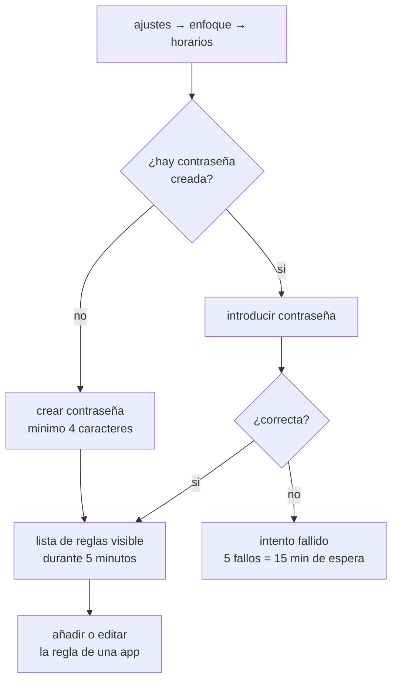

# HORARIOS DE APLICACIONES

<a href="../README.md">indice</a> · <a href="../../en/users/06-app-schedules.md">english</a> · anterior: <a href="./05-perfiles-y-detox.md">perfiles y detox</a> · siguiente: <a href="./07-pausa-consciente.md">pausa consciente</a>

---

## QUE SON

un horario es una regla permanente asociada a **una aplicacion concreta**. combina dos
restricciones independientes que se pueden usar juntas o por separado:

<table>
<tr>
<th align="left" width="50%">franja horaria permitida</th>
<th align="left" width="50%">limite diario de uso</th>
</tr>
<tr>
<td valign="top">

la aplicacion solo se abre **entre dos horas** y **en los dias de la semana** que elijas.

ejemplo: correo solo de 09:00 a 18:00, de lunes a viernes.

</td>
<td valign="top">

la aplicacion solo se puede usar **un numero de minutos al dia**. el contador se reinicia
a medianoche.

ejemplo: video, 30 minutos al dia.

</td>
</tr>
</table>

> los horarios son **independientes de los perfiles**: se aplican tambien en el perfil
> normal. son la herramienta para limites de largo plazo, mientras que el detox es para
> sesiones puntuales.

---

## ACCEDER A LOS HORARIOS

**ajustes → enfoque → horarios de aplicaciones**

la pantalla esta protegida con contraseña, y **no muestra absolutamente nada** hasta que
la introduces correctamente: ni siquiera se ve que aplicaciones tienen reglas.

### LA CONTRASEÑA DE HORARIOS

- es **distinta** de la contraseña de detox
- se crea la primera vez que entras en la pantalla
- minimo 4 caracteres
- tras introducirla, tienes **5 minutos** para ajustar varias aplicaciones sin que te la
  vuelva a pedir; ese permiso vive solo en memoria y desaparece al cerrarse la app
- tras **5 intentos fallidos**, la pantalla queda bloqueada **15 minutos**
- fallar **nunca** borra las reglas ni la contraseña

---

## CREAR UNA REGLA

1. entra en la pantalla de horarios e introduce la contraseña
2. pulsa para añadir una aplicacion y eligela de la lista
3. configura la franja, los dias y el limite diario
4. guarda

<strong>configurar la franja horaria</strong>

 

| campo | detalle |
|---|---|
| activar franja | interruptor que enciende esta restriccion |
| hora de inicio | hora a partir de la cual se permite usar la aplicacion |
| hora de fin | hora a partir de la cual se vuelve a bloquear |
| dias | pastillas de la semana; se muestran en el idioma y el orden de tu sistema |

reglas importantes:

- la franja es **cerrada por abajo y abierta por arriba**: una franja de 09:00 a 18:00
  bloquea exactamente a las 18:00
- una franja que **cruza la medianoche** es valida: 22:00 → 06:00 funciona, y esa franja
  pertenece al dia en que **empieza**. con 22:00 → 06:00 activado solo el viernes, las
  02:00 del sabado siguen permitidas porque son la cola del viernes
- si la hora de inicio y la de fin son **iguales**, la franja cubre el dia entero
  seleccionado
- si no seleccionas ningun dia, se entiende **todos los dias**

<strong>configurar el limite diario</strong>

 

| campo | detalle |
|---|---|
| minutos al dia | numero de minutos permitidos por jornada |
| reinicio | automatico a la medianoche local |

para aplicar cualquier regla al abrir una aplicacion desde recientes, accesos frecuentes,
notificaciones u otros lugares fuera de focusphone, **activa el servicio de accesibilidad**.
sin el, la franja horaria solo se comprueba al abrir desde focusphone. el limite diario
tambien necesita ese servicio para medir cuanto tiempo pasa la aplicacion en primer plano.

el tiempo se acumula mientras la aplicacion esta en primer plano y **se pausa con la
pantalla apagada**. la regla se revisa cada 30 segundos, o justo en el momento en que el
tiempo se agotaria, de forma que una sesion se interrumpe en cuanto se pasa del limite, no
al abrir la aplicacion la proxima vez.

---

## QUE VES AL ESTAR BLOQUEADA

aparece una pantalla completa que explica el motivo:

| motivo | mensaje |
|---|---|
| fuera de la franja | indica la franja permitida, por ejemplo *disponible de 09:00 a 18:00* |
| limite agotado | indica los minutos usados y el limite, por ejemplo *30 de 30 minutos usados hoy* |

**esta pantalla no tiene boton de desbloqueo**, a diferencia de la de detox. es
deliberado: un horario es una configuracion estable, y la unica forma de cambiarlo es la
pantalla de ajustes protegida con contraseña. poner ahi un atajo de desbloqueo seria
ofrecer la salida justo en el momento en que uno quiere saltarsela.

---

## EJEMPLOS PRACTICOS

<strong>redes sociales solo por la tarde, entre semana</strong>

 

| campo | valor |
|---|---|
| franja | activada, 18:00 → 21:00 |
| dias | lunes, martes, miercoles, jueves, viernes |
| limite diario | desactivado |

resultado: entre semana solo se abre de 18:00 a 21:00; el fin de semana no se abre en
absoluto, porque sabado y domingo no estan seleccionados.

<strong>video, media hora al dia, cualquier momento</strong>

 

| campo | valor |
|---|---|
| franja | desactivada |
| limite diario | 30 minutos |

resultado: puedes abrirla a cualquier hora, pero cuando se agotan los 30 minutos se
bloquea hasta la medianoche. requiere el servicio de accesibilidad.

<strong>nada de movil de madrugada</strong>

 

| campo | valor |
|---|---|
| franja | activada, 07:00 → 23:30 |
| dias | todos |
| limite diario | desactivado |

resultado: de 23:30 a 07:00 esa aplicacion no se abre ningun dia.

<strong>correo del trabajo solo en horario laboral, con tope</strong>

 

| campo | valor |
|---|---|
| franja | activada, 09:00 → 18:00 |
| dias | lunes a viernes |
| limite diario | 60 minutos |

resultado: ambas restricciones se aplican a la vez. fuera de la franja se bloquea por
horario; dentro de ella, se bloquea al llegar a la hora acumulada.

---

## HORARIOS FRENTE A DETOX

| | horarios | detox |
|---|---|---|
| alcance | una aplicacion cada vez | todas las aplicaciones |
| duracion | permanente, hasta que lo cambies | una sesion con temporizador |
| activacion | automatica, siempre | manual, cuando lo inicias |
| contraseña | la de horarios | la de la sesion de detox |
| salida anticipada | no existe: solo desde ajustes | contraseña de la sesion |
| perfil necesario | cualquiera, incluido normal | el perfil detox |

---

<a href="./05-perfiles-y-detox.md">← perfiles y detox</a> · <a href="../README.md">indice</a> · <a href="./07-pausa-consciente.md">pausa consciente →</a>

