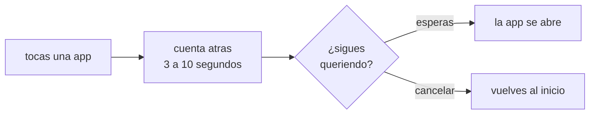

# PAUSA CONSCIENTE

<a href="../README.md">indice</a> · <a href="../../en/users/07-conscious-pause.md">english</a> · anterior: <a href="./06-horarios-de-aplicaciones.md">horarios de aplicaciones</a> · siguiente: <a href="./08-personalizacion.md">personalizacion</a>

---

## QUE ES

la pausa consciente es una cuenta atras de unos segundos que aparece **entre** el momento
en que tocas una aplicacion y el momento en que se abre. durante esa cuenta atras ves un
circulo que respira, una indicacion de *inspira* / *manten* / *espira*, y la pregunta:

> ¿seguro que quieres abrir *x*?

cuando la cuenta atras termina, la aplicacion se abre sola. si en algun momento decides
que no, pulsas **cancelar** y vuelves a la pantalla de inicio.

---

## POR QUE FUNCIONA

abrir una aplicacion suele ser un gesto reflejo: la mano llega antes que la decision.
la pausa no impide nada, solo **introduce una decision donde antes habia un automatismo**.
en la practica, una parte de esas aperturas se cancelan sin esfuerzo, simplemente porque
aparece el momento de darse cuenta.

---

## ACTIVARLA Y CONFIGURARLA

**ajustes → enfoque → pausa consciente**

| opcion | detalle |
|---|---|
| activar pausa consciente | interruptor principal; viene desactivada |
| duracion | de **3 a 10 segundos**, con un deslizador |

<strong>que duracion elegir</strong>

 

| duracion | sensacion | recomendada para |
|---|---|---|
| 3 segundos | apenas se nota | primer contacto, o si te resulta molesto |
| 5 segundos | suficiente para darse cuenta | la mayoria de los casos |
| 7 a 10 segundos | claramente incomoda en aperturas reflejas | cuando quieres reducir de verdad el numero de aperturas |

---

## COMO SE COMPORTA

<table>
<tr>
<th align="left" width="45%">situacion</th>
<th align="left" width="55%">resultado</th>
</tr>
<tr>
<td>abres una app desde la pantalla de inicio</td>
<td>aparece la pausa</td>
</tr>
<tr>
<td>abres una app desde el cajon de todas las apps</td>
<td>aparece la pausa</td>
</tr>
<tr>
<td>sales de la pantalla de pausa (por ejemplo, pulsando inicio)</td>
<td>la cuenta atras <strong>se detiene</strong>, no continua en segundo plano</td>
</tr>
<tr>
<td>vuelves a la pantalla de pausa</td>
<td>la cuenta atras se reanuda</td>
</tr>
<tr>
<td>la app esta bloqueada por perfil u horario</td>
<td>no hay pausa: se muestra directamente la pantalla de bloqueo</td>
</tr>
<tr>
<td>abres una app desde una notificacion</td>
<td>no hay pausa: la apertura no pasa por focusphone</td>
</tr>
</table>

<strong>por que la cuenta atras se detiene al salir</strong>

 

por una limitacion real de android: desde android 10, una aplicacion que no esta en primer
plano **no puede abrir otra aplicacion**. si la cuenta atras siguiera corriendo en segundo
plano, al terminar no pasaria nada y el toque se perderia. deteniendola, el comportamiento
es siempre predecible.

---

## COMBINARLA CON EL RESTO

la pausa consciente es la capa mas suave de las tres herramientas de enfoque, y se puede
combinar con todas:

| herramienta | intensidad | cuando actua |
|---|---|---|
| pausa consciente | baja: solo introduce un retraso | cada vez que abres una aplicacion desde focusphone |
| perfil de trabajo | media: bloquea, pero se sale libremente | mientras el perfil esta activo |
| horarios | alta: bloquea segun reloj y uso, con contraseña | siempre, segun la regla de cada aplicacion |
| detox | maxima: bloquea todo, con contraseña y temporizador | mientras dura la sesion |

una progresion que suele funcionar: empezar solo con la pausa consciente durante unos
dias, añadir despues el perfil de trabajo, y reservar los horarios y el detox para las
aplicaciones concretas que se resisten.

---

<a href="./06-horarios-de-aplicaciones.md">← horarios de aplicaciones</a> · <a href="../README.md">indice</a> · <a href="./08-personalizacion.md">personalizacion →</a>

