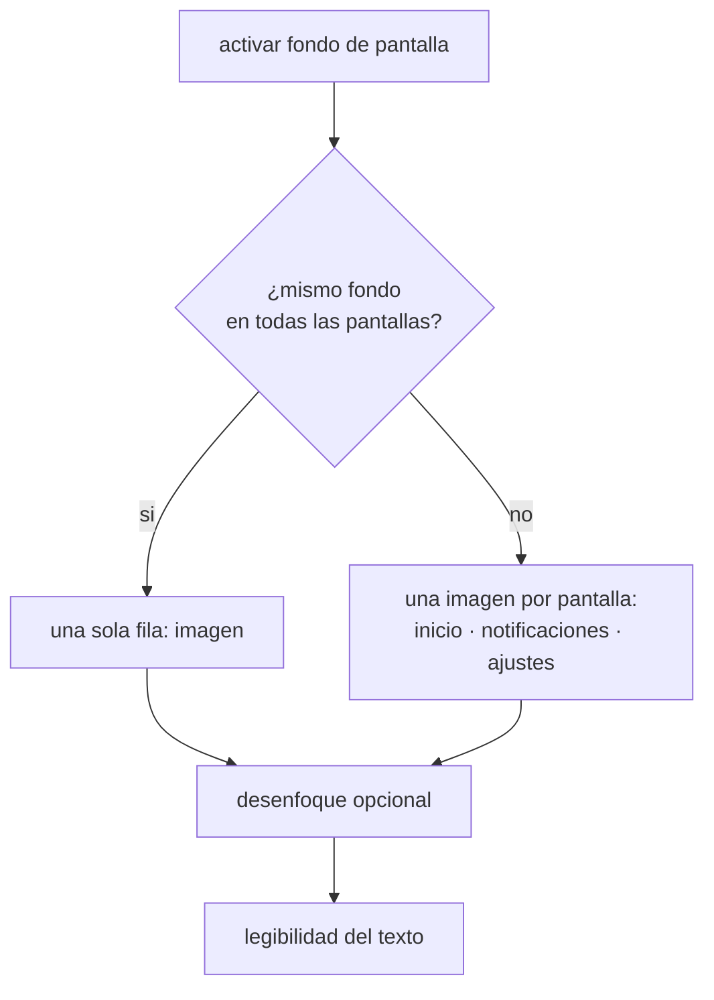

# PERSONALIZACION

<a href="../README.md">indice</a> · <a href="../../en/users/08-customization.md">english</a> · anterior: <a href="./07-pausa-consciente.md">pausa consciente</a> · siguiente: <a href="./09-notificaciones-y-widgets.md">notificaciones y widgets</a>

---

## LOS TEMAS

**ajustes → apariencia → tema**

focusphone incluye cuatro paletas monocromas, un modo automatico y un tema totalmente
personalizable.

<table>
<tr>
<th align="left">tema</th>
<th align="left">tipo</th>
<th align="left">fondo</th>
<th align="left">texto</th>
<th align="left">caracter</th>
</tr>
<tr><td><strong>off-white</strong></td><td>claro</td><td><code>#FAFAFA</code></td><td><code>#333333</code></td><td>papel, neutro y muy legible con luz</td></tr>
<tr><td><strong>slate</strong></td><td>oscuro</td><td><code>#181818</code></td><td><code>#E0E0E0</code></td><td>gris oscuro, el tema por defecto</td></tr>
<tr><td><strong>warm beige</strong></td><td>claro</td><td><code>#FEFEFE</code></td><td><code>#4A4A4A</code></td><td>calido, con acentos arena</td></tr>
<tr><td><strong>navy</strong></td><td>oscuro</td><td><code>#0A0E17</code></td><td><code>#E2E8F0</code></td><td>azul muy profundo, casi negro</td></tr>
<tr><td><strong>auto</strong></td><td>ambos</td><td>—</td><td>—</td><td>usa slate cuando el sistema esta en modo oscuro y off-white cuando esta en claro</td></tr>
<tr><td><strong>personalizado</strong></td><td>el que elijas</td><td>tu color</td><td>tu color</td><td>eliges el color de fondo y el de texto</td></tr>
</table>

<strong>el tema automatico</strong>

 

con **auto**, focusphone sigue el ajuste de claro/oscuro de android. el cambio se detecta
solo, sin necesidad de reabrir la aplicacion: si tu movil cambia a modo oscuro al
anochecer, focusphone pasa a slate en ese momento.

<strong>el tema personalizado</strong>

 

al elegir **personalizado** aparece un panel con dos colores en formato hexadecimal:

| campo | ejemplo | que es |
|---|---|---|
| color de fondo | `#181818` | el fondo de todas las pantallas |
| color de texto | `#E0E0E0` | el color del texto principal |

el formato aceptado es `#RRGGBB` con seis digitos hexadecimales. si escribes algo que no
es valido, focusphone avisa y mantiene los colores seguros por defecto.

**y si eliges una combinacion poco legible**, por ejemplo gris sobre gris, focusphone no
te deja con una pantalla ilegible: ajusta automaticamente el texto hasta alcanzar un
contraste minimo, siguiendo el mismo criterio que usan las pautas de accesibilidad web.

---

## TIPOGRAFIA Y TEXTO

**ajustes → apariencia**

### TIPOGRAFIA

| opcion | caracter |
|---|---|
| sistema | la tipografia por defecto de tu android |
| poppins | geometrica, redonda y muy limpia |
| comfortaa | redondeada y suave, la mas informal |
| jetbrains mono | monoespaciada, aspecto tecnico |

el selector muestra una muestra en vivo de cada tipografia antes de aplicarla.

### TAMAÑO DE TEXTO

**ajustes → apariencia** tiene dos deslizadores, los dos entre **8 y 24 puntos**:

| deslizador | afecta a | por defecto |
|---|---|---|
| tamaño de texto de la app | ajustes, todas las apps, dialogos y el resto de pantallas | 14 |
| tamaño de texto de la home | la pantalla de inicio, incluidos su menu lateral y su panel de notificaciones | sigue al de la app hasta que lo muevas |

los dos mantienen la jerarquia: los titulos siguen siendo mas grandes que el cuerpo, y las
negritas siguen siendo negritas. si usabas una version anterior, la pantalla de inicio
conserva su aspecto hasta que elijas un tamaño para la home.

### ALINEACION

| opcion | para que |
|---|---|
| izquierda | comodo para diestros usando el movil con una mano |
| centro | el aspecto mas equilibrado, es el valor por defecto |
| derecha | comodo para zurdos, o para moviles muy grandes |

afecta a la lista de favoritos de la pantalla de inicio.

### BARRA DE ESTADO

se puede **ocultar la barra de estado** del sistema para una pantalla de inicio
completamente limpia, sin hora del sistema ni iconos de bateria y cobertura.

---

## EL RELOJ

**ajustes → pantalla de inicio**

| ajuste | detalle |
|---|---|
| tipo de reloj | digital, apilado, en palabras, analogico u oculto |
| tamaño del reloj | deslizador de porcentaje |

el formato de 12 o 24 horas **no se configura en focusphone**: se toma del ajuste del
sistema, para que no haya dos sitios donde cambiarlo.

---

## FONDO DE PANTALLA

**ajustes → apariencia → fondo de pantalla**

focusphone puede usar una imagen propia como fondo, independiente del fondo de pantalla de
android.

<table>
<tr>
<th align="left" width="35%">ajuste</th>
<th align="left" width="65%">detalle</th>
</tr>
<tr>
<td>activar fondo de pantalla</td>
<td>interruptor principal; con el apagado, todo lo demas desaparece de la pantalla</td>
</tr>
<tr>
<td>mismo fondo en todas las pantallas</td>
<td>con el activo, una sola imagen sirve para inicio, notificaciones y ajustes</td>
</tr>
<tr>
<td>imagen</td>
<td>abre el selector de imagenes de android; la vista previa se toca para cambiarla</td>
</tr>
<tr>
<td>desenfoque</td>
<td>difumina la imagen para que el texto destaque</td>
</tr>
<tr>
<td>intensidad del desenfoque</td>
<td>deslizador; solo aparece con el desenfoque activo</td>
</tr>
<tr>
<td>legibilidad del texto</td>
<td>deslizador de 0 a 100 que oscurece o aclara una capa entre la imagen y el texto</td>
</tr>
</table>

<strong>la vista previa</strong>

 

la seccion incluye una vista previa con un reloj de muestra que refleja **en vivo** el
desenfoque y la legibilidad mientras mueves los deslizadores, asi que no hace falta salir
de ajustes para ver el resultado. tocar la vista previa abre directamente el selector de
imagenes.

<strong>que pasa con la imagen que eliges</strong>

 

focusphone **copia** la imagen a su almacenamiento privado, reducida de tamaño y con la
rotacion corregida. no guarda una referencia a la galeria, porque ese tipo de referencia
caduca al cerrarse el proceso y el fondo desapareceria al reiniciar el movil.

la copia se borra automaticamente cuando ninguna pantalla la usa ya.

<strong>por que existe el ajuste de legibilidad</strong>

 

una foto clara con texto claro encima es ilegible. en lugar de fijar una opacidad
arbitraria, focusphone pinta una capa en el color de fondo de **tu tema** entre la imagen
y el contenido, y te deja controlar su intensidad. cada superficie (pantalla de inicio,
cajon de notificaciones, menu, ajustes) recibe la cantidad que necesita segun lo que
muestra.

---

## DISTRIBUCION DE LA PANTALLA DE INICIO

la disposicion se edita directamente en la pantalla de inicio, en el **modo edicion**:
manten pulsado un hueco, un widget o el reloj, o usa **ajustes → pantalla de inicio →
editar pantalla de inicio**. ahi mueves y cambias el tamaño del reloj, de los favoritos y de
todos los widgets que quieras, y cambias el tamaño de la cuadricula. el procedimiento
completo esta en
[pantalla de inicio y gestos → modo edicion](./03-pantalla-de-inicio-y-gestos.md#modo-edicion).

la lista de favoritos no se puede quitar: es el nucleo de la pantalla.

### ESPACIADO ENTRE APLICACIONES

**ajustes → pantalla de inicio → espaciado** ajusta la separacion vertical entre las filas
de favoritos, en pixeles independientes de densidad. mas espacio da un aspecto mas aireado;
menos espacio permite ver las diez aplicaciones sin desplazar.

---

## IDIOMA

**ajustes → sistema → idioma**

| opcion |
|---|
| seguir el idioma del sistema |
| ingles |
| ingles britanico |
| español |
| frances |
| aleman |

el idioma se puede cambiar solo para focusphone, sin tocar el idioma del resto del movil.
los nombres de los dias de la semana y el orden de la semana en el calendario y en los
horarios se toman del idioma activo.

---

<a href="./07-pausa-consciente.md">← pausa consciente</a> · <a href="../README.md">indice</a> · <a href="./09-notificaciones-y-widgets.md">notificaciones y widgets →</a>

