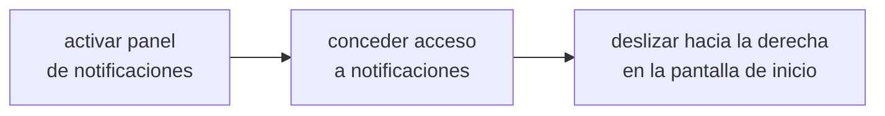

# NOTIFICACIONES Y WIDGETS

<a href="../README.md">indice</a> · <a href="../../en/users/09-notifications-and-widgets.md">english</a> · anterior: <a href="./08-personalizacion.md">personalizacion</a> · siguiente: <a href="./10-referencia-de-ajustes.md">referencia de ajustes</a>

---

## EL PANEL LATERAL DE NOTIFICACIONES

focusphone puede mostrar tus notificaciones en un cajon propio, que se abre **deslizando
hacia la derecha** en la pantalla de inicio. es una alternativa mas tranquila a la persiana
del sistema: solo texto, con el estilo del tema que estes usando.

### ACTIVARLO

**ajustes → notificaciones**

1. activa **panel de notificaciones**
2. concede el permiso de **acceso a notificaciones**: focusphone abre directamente la
   pantalla de android donde se concede
3. desliza hacia la derecha en la pantalla de inicio

### COMO SE USA

| accion | resultado |
|---|---|
| tocar una notificacion | abre la aplicacion correspondiente |
| deslizar una notificacion hacia la derecha | la descarta |
| boton de limpiar | descarta todas a la vez |

### PRIVACIDAD

<table>
<tr>
<td>

el contenido de las notificaciones (titulo y texto) **vive unicamente en la memoria ram**.
no se escribe nunca en disco, no se guarda en ninguna base de datos y no sale del
dispositivo. cuando el proceso de focusphone termina, la lista se vacia y se vuelve a
poblar la proxima vez que el servicio se conecta.

</td>
</tr>
</table>

---

## EL GESTO HACIA ABAJO

**ajustes → notificaciones → gesto hacia abajo**

con este ajuste activo, deslizar hacia abajo en la pantalla de inicio despliega la
**persiana de notificaciones de android**, la de siempre, sin necesidad de llegar al borde
superior de la pantalla.

<strong>funciona mejor con el servicio de accesibilidad</strong>

 

focusphone usa la accion oficial de accesibilidad para desplegar la persiana. si el
servicio de accesibilidad de focusphone esta activo, el gesto funciona siempre y de forma
fiable.

sin el servicio, focusphone intenta una via alternativa mas antigua que android bloquea a
partir de la version 12, asi que en moviles modernos el gesto puede no responder. si te
pasa, activa el servicio de accesibilidad en **ajustes → sistema → bloqueo del sistema**.

---

## INSIGNIAS DE NOTIFICACION

la seccion de notificaciones tambien controla si las aplicaciones de la pantalla de inicio
muestran un indicador cuando tienen notificaciones pendientes. es un indicador discreto y
de texto, coherente con el resto de la interfaz: no hay circulos rojos.

---

## WIDGETS

la pantalla de inicio admite **los widgets que quieras**, cada uno en su propio bloque de la
cuadricula (consulta el [modo edicion](./03-pantalla-de-inicio-y-gestos.md#modo-edicion)).
pueden ser los propios de focusphone o los de tus otras aplicaciones.

### LOS 20 WIDGETS DE FOCUSPHONE

siguen tu tema activo (incluido el personalizado) y se redibujan al cambiar de tema, de
colores, de modo dia/noche o de idioma. sus iconos son de [lucide](https://lucide.dev). son
widgets reales de android, asi que **tambien funcionan en cualquier otro launcher**, y abrir
una app desde ellos siempre pasa por el bloqueo de perfil, el horario y la pausa consciente
de focusphone.

| grupo | widget | que muestra |
|---|---|---|
| hora | reloj | la hora en grande, la fecha y la proxima alarma |
| hora | reloj analogico | una esfera analogica |
| hora | reloj mundial | hasta tres ciudades una junto a otra, cada una con su diferencia con la hora local (se eligen al añadirlo) |
| hora | hoy | dia de la semana, dia del mes y mes en un mosaico cuadrado |
| hora | mes | la cuadricula del mes |
| hora | semana | la semana actual en una tira |
| musica | barra de musica · reproductor · mosaico de musica | lo que suena, con reproducir/pausar, anterior y siguiente; el mosaico usa la caratula |
| navegacion | busqueda | un campo de busqueda que abre todas las apps con el teclado ya levantado |
| navegacion | spotlight | busqueda mas tus favoritas |
| navegacion | favoritas | tantas favoritas como quepan en su altura, en el orden de la pantalla de inicio |
| sistema | bateria | el nivel de bateria en un anillo, con icono de carga |
| sistema | almacenamiento | el almacenamiento libre y usado |
| sistema | sistema | bateria, almacenamiento y memoria juntos |
| sistema | ajustes rapidos | un interruptor real de linterna, mas atajos a los paneles de internet, bluetooth y volumen de android y a los ajustes |
| sistema | proxima alarma | la hora de tu proxima alarma |
| enfoque | perfil de enfoque | el perfil activo y, durante un detox, cuando termina |
| enfoque | intencion | una frase que escribes para el dia, guardada cifrada |
| enfoque | progreso | cuanto ha pasado del dia, la semana, el mes y el año |

> los tres widgets de musica necesitan el **acceso a notificaciones**, porque android solo
> muestra lo que suena a los oyentes de notificaciones. sin el, muestran un estado "sin
> acceso".

### AÑADIR UN WIDGET

desde el modo edicion (**widgets** en la barra inferior) o desde **ajustes → pantalla de
inicio → añadir widget**, que tambien indica cuantos widgets hay en inicio. el selector:

- agrupa los widgets por aplicacion, con su icono, y muestra **primero los de focusphone**;
- tiene una busqueda difusa;
- muestra vistas previas fieles (en android 12+, la vista previa del propio widget dibujada
  en vivo);
- indica el tamaño de cada widget en celdas de **tu** cuadricula, y marca como *en uso* los
  que ya estan en inicio.

si un widget necesita su propia configuracion, se abre su pantalla de configuracion antes de
colocarlo. si la cuadricula no tiene sitio, el selector te avisa en vez de sustituir otro
widget.

### CAMBIARLO O QUITARLO

en el modo edicion, toca el widget: su barra flotante ofrece **ajustes del widget** (si el
widget se puede reconfigurar) y **quitar**. para moverlo o cambiar su tamaño, arrastralo o
tira de sus asas.

<strong>"widget no disponible"</strong>

 

mientras se actualiza la aplicacion que ofrece un widget, android retira un momento su
proveedor. focusphone muestra en su lugar *widget no disponible mientras su app se
actualiza* en vez de borrarlo, y el widget vuelve solo cuando termina la actualizacion.

<strong>widgets de otras aplicaciones</strong>

 

los widgets que menos alteran el aspecto son los de texto o de un solo dato (el tiempo en su
forma compacta, el proximo evento del calendario, una nota rapida). los widgets grandes con
imagenes, carruseles o noticias funcionan, pero devuelven el ruido visual a la pantalla.
cada fabricante añade un margen distinto a los widgets: focusphone quita ese margen por
defecto y, cuando un widget no cabe en su bloque, lo encoge en vez de recortarlo.

---

## RESUMEN DE PERMISOS DE ESTA SECCION

| funcion | permiso necesario | obligatorio |
|---|---|---|
| panel lateral de notificaciones | acceso a notificaciones | solo para esta funcion |
| gesto hacia abajo | servicio de accesibilidad (recomendado) | no, pero sin el puede no funcionar en android 12+ |
| insignias de notificacion | acceso a notificaciones | solo para esta funcion |
| widgets de musica de focusphone | acceso a notificaciones | solo para esos tres widgets |
| cualquier otro widget | ninguno | — |

---

<a href="./08-personalizacion.md">← personalizacion</a> · <a href="../README.md">indice</a> · <a href="./10-referencia-de-ajustes.md">referencia de ajustes →</a>

